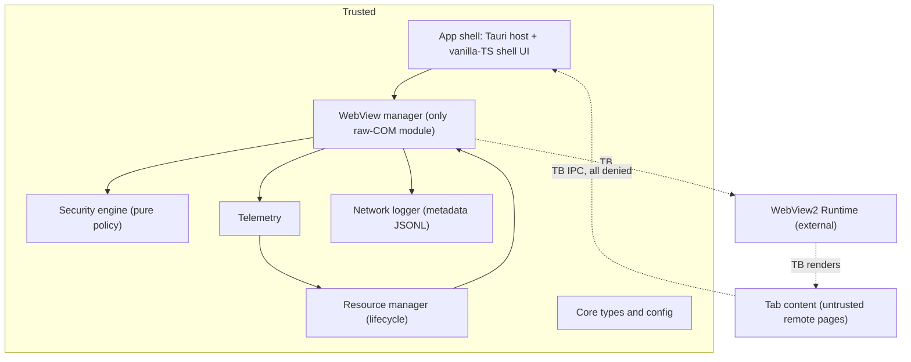

# Ferrum Architecture (summary)

> This is a human-facing summary. The canonical source is the wiki under [`wiki/architecture/`](wiki/architecture/), and **the wiki wins on any conflict** (wiki SCHEMA §3.4). Status: **planning (phase-p0-planning)**. Nothing is implemented, and no measurements exist.

Ferrum is a Rust + Tauri 2 + Microsoft WebView2 web-application container for Windows 11. It is also a research instrument for comparing adaptive WebView lifecycle management against Chrome, Edge and a minimal Tauri baseline.

## At a glance

## Key points

1. **One window: a trusted shell WebView plus one untrusted child WebView per tab** (Tauri multi-webview, `unstable` feature; adr-0007, risk-r02). No shell UI may overlap the tab area (child WebViews draw on top).
2. **Remote content gets zero native capability.** The IPC channel exists in every WebView, so protection is Tauri ACL authorization: no `remote` capability, a shell capability targeted by webview label, an app ACL manifest, and tabs blocked from the app's own origin. See [trust boundaries](wiki/architecture/ov-arch-trust-boundaries.md).
3. **Layer choice for WebView2 features.** Tauri API first, then wry, then raw COM via `with_webview`. TrySuspend, iframe navigation, external schemes, crash events, process info and the network log need raw COM. All `unsafe` is confined to `webview-manager::webview2`, `telemetry::win` and `bench::win`, with documented invariants. See [WebView2 integration](wiki/architecture/ov-arch-webview2-integration.md).
4. **Isolation target: per-site WebView2 profiles in one shared browser process** (adr-0010). Tauri 2.12.1 cannot set a profile name (risk-r01), so tab creation sits behind a swappable `TabHost` trait. The owner chooses the backend after a P1 spike. What stays shared is tracked in the [isolation model](wiki/architecture/ov-arch-isolation-model.md).
5. **Lifecycle.** States ACTIVE, BACKGROUND, IDLE (sleep via TrySuspend or memory-low), DISCARD_CANDIDATE (two-phase, guard re-check), DISCARDED and RESTORING. Policies `none`, `fixed-idle`, `memory-pressure` and `adaptive` are **runtime flags on one binary**. See the [state machine](wiki/architecture/ov-arch-lifecycle-state-machine.md) and [configuration](wiki/architecture/ov-arch-configuration.md).
6. **Measurement of record is external.** The harness launches every product suspended in a Job Object with a fresh profile and sums private commit over the exact process set. Whether WebView2 processes are descendants of the host and so join the job is UNVERIFIED[phase-p6-benchmark-harness] (risk-r05); if not, Ferrum and the baseline are attributed by the union of job members and `GetProcessExtendedInfos` PIDs (see [comp-benchmark-harness](wiki/architecture/components/comp-benchmark-harness.md)). In-app telemetry supplies Ferrum-only events and cross-checks.

## Architecture pages

| Page | Content |
|---|---|
| [System overview](wiki/architecture/ov-arch-system-overview.md) | C4 context + container diagrams, component catalogue, window/process model |
| [Trust boundaries and threat model](wiki/architecture/ov-arch-trust-boundaries.md) | Assets, adversaries, TB1–TB6, IPC denial rules, STRIDE, planned tests |
| [Data flows](wiki/architecture/ov-arch-data-flows.md) | Navigation, IPC, telemetry sampling, network-log capture, lifecycle; approvals are not runtime |
| [WebView2 integration](wiki/architecture/ov-arch-webview2-integration.md) | Tauri vs wry vs raw COM per capability; TabHost backends; unsafe policy and COM invariants |
| [Isolation model](wiki/architecture/ov-arch-isolation-model.md) | Isolation modes, site→profile mapping, shared-resource matrix |
| [Lifecycle state machine](wiki/architecture/ov-arch-lifecycle-state-machine.md) | States, transitions, safety guards, policies, objective J |
| [Repository layout](wiki/architecture/ov-arch-repo-layout.md) | Master prompt §12 adapted to repo root, .gitignore plan |
| [Crate graph](wiki/architecture/ov-arch-crate-graph.md) | Workspace members, dependency rules, version pins |
| [Configuration](wiki/architecture/ov-arch-configuration.md) | Layers, TOML schema sketch, cfg-* mapping |

Component pages: [`wiki/architecture/components/`](wiki/architecture/components/). The trusted components are app-shell, webview-manager, security-engine, resource-manager, telemetry, network-logger, core, benchmark-harness, baseline-app, research-analysis and interactive-plan. The untrusted component is tab-content. The external components are webview2-runtime, windows-os and competitor-browsers.

## Open architecture questions (for the owner)

The canonical list is [`wiki/overview/ov-open-questions.md`](wiki/overview/ov-open-questions.md), which alone states what each question blocks. The questions that bear on architecture are:

1. **Isolation backend (Q-107, risk-r01).** Wait for Tauri PR #16054, patch tauri-runtime-wry, use our own raw-COM tab controllers, or accept per-site UDFs or a shared profile. The proposal is to decide after spike p1.6, in a new ADR, before P3. Profile granularity is Q-111.
2. **Raw COM boundary (Q-110, adr-0019).** The architecture also proposes two non-WebView2 `unsafe` modules, `telemetry::win` and `bench::win`, for Win32 process and Job Object calls. That is an extension to adr-0019 and needs owner confirmation (Q-211).
3. **Cross-site navigation in `per-site-profile` mode (Q-209).** Re-host the tab in the new profile (loses in-tab history), keep the original profile (breaks isolation), or block the navigation.
4. **Network-log capture route (information; part of Q-114).** `WebResourceResponseReceived` per accepted adr-0008 (config default), with in-process CDP `Network.*` as the alternative if a P5 spike finds fields missing; a switch needs a superseding decision. Location, retention and URL redaction are Q-114.
5. **Additions to master prompt §12 (Q-106).** The new crate `crates/network-logger/` is now in the P1 scaffold task p1.4, subject to Q-106. Also `spikes/`, `tools/` and `plan/snapshots/`. The new folders are `apps/baseline-tauri/`, `benchmarks/runners/{orchestrator,playwright,energy-sampler}/` and `tests/security-fixtures/`.
6. **New registry component ids** (now in SCHEMA §8; approved with `schema`) `comp-tab-content`, `comp-windows-os` and `comp-competitor-browsers`, added as graph modelling nodes.
7. **Baseline variant (Q-213).** Whether to add a "shell + one child" Tauri baseline to separate the cost of the shell WebView.
8. **`bench-nosecurity` ablation build (Q-212).** It is the only Cargo-feature build variant, used for exp-security-overhead. Everything else is runtime config on one binary.
