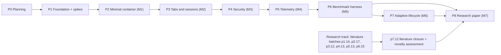
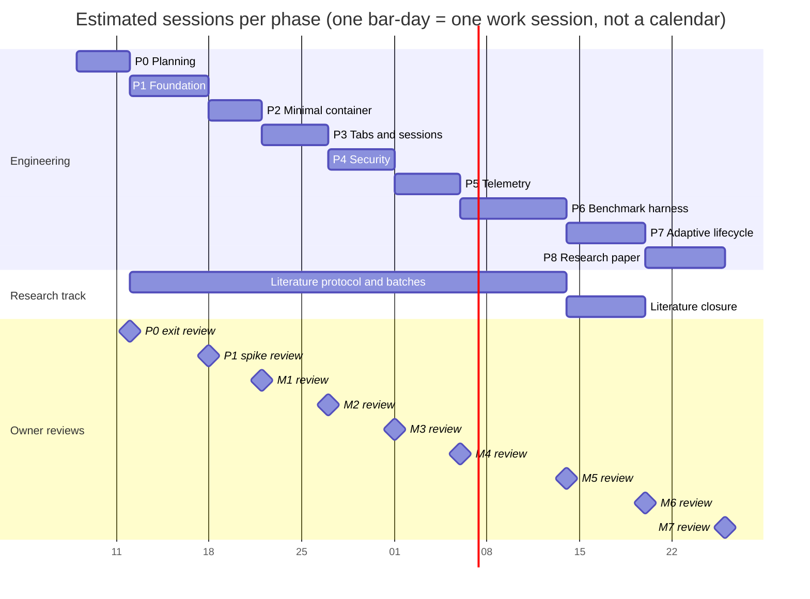

# Ferrum project plan

This file summarises the phase plan for people reading the repository on GitHub. The canonical plan is the set of phase pages in [`wiki/phases/`](wiki/phases/). If this file and a phase page disagree, the phase page wins (see [wiki/SCHEMA.md](wiki/SCHEMA.md) section 3.4), and the disagreement is a lint finding.

**Current state:** phase P0 (planning). No Ferrum application code exists yet, and there are no measurements. The live state and the exact next action are in [STATUS.md](STATUS.md).

## How the plan is gated

- Work happens one phase at a time. A phase starts only when its **entry gate** passes ([SCHEMA section 9.7](wiki/SCHEMA.md)):
  - Every phase it depends on is done, and the owner approved that phase's exit review (`<phase-id>#exit`).
  - The owner's approval is recorded and **not stale** in `plan/approvals.json` for the phase's dependency set: the phase page, its ADRs, its components, its experiments and the schema.
  - No open question blocks any of them.
- A phase ends only when its **exit gate** passes:
  - Every automated test in its `test_gate` ran on the exit commit and passed, with the output saved under `wiki/raw/evidence/<phase-id>/`.
  - The owner completed the manual checks.
  - Wiki lint is clean.
  - The owner approved the milestone review (adr-0014).
- Approvals are given by the owner in Claude Code. Claude saves the owner's words in `wiki/raw/owner/` and records the decision in `plan/approvals.json` (adr-0023). The plan portal (`interactive_plan/`) is read-only.
- Editing an approved page after approval makes that approval stale. The page has to be approved again before any work that depends on it.

## Phase overview

| Order | Phase | Milestone | Depends on | Est. sessions | Focus | Key risks | Exit approval key |
|---|---|---|---|---|---|---|---|
| 0 | [P0 Planning](wiki/phases/phase-p0-planning.md) | none | none | 4 | LLM wiki, interactive plan app, owner approval | Next.js stack checks | `phase-p0-planning#exit` |
| 1 | [P1 Foundation](wiki/phases/phase-p1-foundation.md) | none | P0 | 6 | Toolchain, workspace, CI, licences, doc stubs, **four de-risking spikes before the M1 design**, literature protocol | r01, r02, r03, r04, r06 | `phase-p1-foundation#exit` |
| 2 | [P2 Minimal container](wiki/phases/phase-p2-minimal-container.md) | M1 | P1 | 4 | Shell + one content WebView, navigation, redirects, cookies, IPC lockdown | r01, r02, r06 | `phase-p2-minimal-container#exit` |
| 3 | [P3 Tabs and sessions](wiki/phases/phase-p3-tabs-sessions.md) | M2 | P2 | 5 | Tabs, shortcuts, session restore, per-site profiles, downloads, settings UI, sidebar | r01, r02 | `phase-p3-tabs-sessions#exit` |
| 4 | [P4 Security](wiki/phases/phase-p4-security.md) | M3 | P3 | 5 | Threat model, policy engine, permissions, isolation modes and tests, benchmark-only ablation flag, all master prompt section 11 tests | r01, r03 | `phase-p4-security#exit` |
| 5 | [P5 Telemetry](wiki/phases/phase-p5-telemetry.md) | M4 | P4 | 5 | Validated process metrics, timing chain, metadata-only network log | r03, r05 | `phase-p5-telemetry#exit` |
| 6 | [P6 Benchmark harness](wiki/phases/phase-p6-benchmark-harness.md) | M5 | P5 | 8 | Baseline app, workloads, fair orchestrator, analysis pipeline, A/A, preregistration, campaign C1 | r04, r05, r06 | `phase-p6-benchmark-harness#exit` |
| 7 | [P7 Adaptive lifecycle](wiki/phases/phase-p7-lifecycle.md) | M6 | P6 | 6 | State machine, safety, four policies, campaign C2, **literature review closure** | r03, r05 | `phase-p7-lifecycle#exit` |
| 8 | [P8 Research paper](wiki/phases/phase-p8-research-paper.md) | M7 | P6, P7 | 6 | Analysis, figures, manuscript, citation check, reproducibility package | r04, r05 | `phase-p8-research-paper#exit` |

Total estimate: 49 sessions. Estimates are for planning only and are not measurements. They will be revised at each owner review.

## Dependency graph

The engineering chain is deliberately linear. The owner reviews after every milestone (Q11, adr-0014), and each phase builds on the one before:

- the policy-decision field in P5's network log comes from P4;
- the harness in P6 uses P5's sampler;
- P7's comparison needs the harness.

The research track runs alongside the chain: each phase from P1 to P6 has one small literature task, and the review closes in P7 before P8 frames any novelty.

## Timeline in sessions

Bar lengths are session estimates. The dates on the axis are only there because the diagram needs them; they are not deadlines. Owner reviews take as long as the owner needs.

## De-risking spikes in P1

The spikes run before the M1 design is frozen.

| Spike | Task | Risk | Question |
|---|---|---|---|
| S1 | p1.5 | risk-r02 | Is Tauri multi-webview (`unstable`) usable for a shell plus tabs on Windows? |
| S2 | p1.6 | risk-r01 | Can each site get its own WebView2 profile in one shared browser process? |
| S3 | p1.7 | risk-r03 | Can Ferrum reach TrySuspend, MemoryUsageTargetLevel, ProcessFailed and the network-response event through `with_webview`? |
| S4 | p1.8 | risk-r06 | Can one Playwright-over-CDP harness drive Ferrum, Chrome and Edge? |

p1.9 turns the spike results into owner-approved ADRs. P2 and P3 are revised to match and approved again before P2 starts.

## Phase-label crosswalk

The master prompt and the research notes number phases differently from this plan.

| This plan | Master prompt section 5 / 16 | Research-note labels that mean this phase |
|---|---|---|
| phase-p0-planning | (owner override of section 18) | nextjs-stack "P1 (plan-app build phase)" |
| phase-p1-foundation | section 18 environment checks | tauri-webview2 "P1" spikes; "P5" CDP-target question (answered by spike S4) |
| phase-p2-minimal-container | Phase 1, Milestone 1 | tauri-webview2 "P2" (OAuth observation) |
| phase-p3-tabs-sessions | Phase 2, Milestone 2 | none |
| phase-p4-security | Phase 3, Milestone 3 | tauri-webview2 "P3" security tests |
| phase-p5-telemetry | Milestone 4 | tauri-webview2 "P4" renderer-to-WebView mapping |
| phase-p6-benchmark-harness | Milestone 5 | measurement "P-harness (M5)", "P-bench" |
| phase-p7-lifecycle | Phase 4, section 6, Milestone 6 | tauri-webview2 "P4/P6" effect of hiding a WebView |
| phase-p8-research-paper | section 13, Milestone 7 | related-work "P8" literature review (closure moved to p7.12) |

## Resuming after an interruption

Every session starts with the RESUME procedure in [wiki/SCHEMA.md](wiki/SCHEMA.md) section 9.6:

1. Read CLAUDE.md, the schema and STATUS.md.
2. Read the last five log entries and the latest handoff.
3. Read the index.
4. Reconcile with git.
5. Re-run the entry gate.

Each task below is one commit boundary. `STATUS.md` names the current task and the exact next action.

## Milestone checklist

These boxes are a convenience view for GitHub readers. The authoritative record of progress is `STATUS.md` plus the `code` and `gate` entries in [wiki/log.md](wiki/log.md). Tick a box only after its log entry exists. Task definitions and their `verify` steps are on the phase pages.

### [phase-p0-planning](wiki/phases/phase-p0-planning.md)

- [ ] **p0.1** Capture raw sources: master prompt (verbatim) and scoping decisions (owner answers Q1-Q14, directives, observed environment)
- [x] **p0.2** Write verified research notes (llm-wiki, tauri-webview2 capabilities, measurement methodology, Next.js stack, related-work seed)
- [x] **p0.3** Write schema layer: wiki/SCHEMA.md, CLAUDE.md bootstrap, STATUS.md live state
- [x] **p0.4** Write overview, architecture and component pages (registry components, trust levels, connects edges)
- [x] **p0.5** Write ADR pages adr-0001..adr-0019 (every registered ADR) and the risk register (risk-r01..r06 plus newly found risks)
- [ ] **p0.6** Write research-track pages: research questions, hypotheses, experiment families, metrics, workloads
- [x] **p0.7** Write phase pages P0..P8, quality pages, operations pages, root summaries, index.md and log.md
- [ ] **p0.8** Manual LINT pass over the whole wiki (all SCHEMA section 9.3 codes that can be checked by hand or by grep) and creation of wiki/raw/MANIFEST.sha256 (SCHEMA section 3.1 format)
- [ ] **p0.9** Owner installs Node LTS via winget; Claude records exact node and npm versions
- [ ] **p0.10** Scaffold interactive_plan/ with create-next-app 16.4.0 using the flag set from research-nextjs-stack section 3.1; pin exact versions (TypeScript 5.9.3, ESLint 9.39.x); set turbopack.root; add engines field
- [ ] **p0.11** Wiki loader: pure TS module that reads ../wiki at runtime with fs, splits frontmatter, validates with zod per SCHEMA types
- [ ] **p0.12** Hash module: content_hash and scope_hash in TypeScript identical to the Python reference (SCHEMA section 10.2)
- [ ] **p0.13** Wiki lint + gate report (IP-5) and views: dashboard (phase progress + gate states), phase DAG, architecture graph with trust boundaries, page detail with markdown + mermaid rendering, ADR list, risk matrix, research traceability graph
- [ ] **p0.14** Approvals API (route handler, nodejs runtime, zod-validated body, loopback-only, atomic temp-file + rename write to plan/approvals.json, data dir overridable for tests)
- [ ] **p0.15** Approval UI: approve / request changes / reject with comment on every approvable page; staleness badges; '#exit' review for phases
- [ ] **p0.16** Run full plan-app test gate and save outputs as evidence
- [ ] **p0.17** Owner walkthrough: owner reviews pages in the app, answers open questions, approves or requests changes; Claude revises until the P1 dependency set is APPROVED
- [ ] **p0.18** Exit: set status gate-review, owner approves phase-p0-planning#exit, first local commit if authorised (Claude never pushes)
- [ ] **Owner exit approval** `phase-p0-planning#exit`

Tasks p0.9 to p0.16 are carried out as steps IP-0 to IP-10 of [ip-build-plan](wiki/interactive-plan/ip-build-plan.md). The mapping table, the resume rule and the evidence file names are on the [P0 phase page](wiki/phases/phase-p0-planning.md#plan-app-task-to-build-step-mapping). STATUS.md and commit tags always use the p0.N id.

### [phase-p1-foundation](wiki/phases/phase-p1-foundation.md)

- [ ] **p1.1** Owner installs the toolchain with the exact winget commands in the body; Claude verifies and records versions and installs cargo-deny with 'cargo install cargo-deny --locked'
- [ ] **p1.2** Record the benchmark machine inventory and current browser/WebView2 versions; owner answers CPU/RAM and meter questions
- [ ] **p1.3** Git hygiene: .gitignore (target/, spikes/*/target/, node_modules/, .next/, benchmarks/results/, profiles, *.etl; plan/snapshots/ stays tracked), .gitattributes, LICENSE-MIT and LICENSE-APACHE from their official texts, README license section
- [ ] **p1.4** Cargo workspace scaffold per adr-0018: root Cargo.toml (resolver 2, exclude = ["spikes/*"]), crates/core, crates/webview-manager, crates/security, crates/resource-manager, crates/telemetry, crates/network-logger (if Q-106 approves it) as library stubs; rust-toolchain.toml pinned to the observed stable version; section 12 directories with README placeholders
- [ ] **p1.5** Spike S1 (risk-r02, risk-r05): multi-webview stability. Tauri 2.12.1 with the unstable feature, vanilla TS + Vite shell (adr-0006), three child webviews created from an async command, tab switching via hide/show, auto-resize; plus the process-attribution check (launch suspended in a Job Object)
- [ ] **p1.6** Spike S2 (risk-r01): WebView2 profile chosen at controller creation. Evaluate routes (a) released Tauri with PR 16054, (b) patched tauri-runtime-wry, (c) own controllers via raw COM in child HWNDs, (d) per-site data directory
- [ ] **p1.7** Spike S3 (risk-r03): raw COM through with_webview. Obtain controller, cast ICoreWebView2_3 (hide, TrySuspend, IsSuspended, show/Resume), ICoreWebView2_19 (MemoryUsageTargetLevel Low/Normal, never mixed with suspend), ProcessFailed and WebResourceResponseReceived handlers, GetProcessInfos
- [ ] **p1.8** Spike S4 (risk-r06): Node/TS Playwright 1.64 connectOverCDP to the S1 spike launched non-elevated with WEBVIEW2_ADDITIONAL_BROWSER_ARGUMENTS=--remote-debugging-port=9222; same script against Chrome for Testing and Edge with a fresh user-data-dir and the same flag
- [ ] **p1.9** Spike synthesis and M1 design freeze: update risk pages, component pages and architecture; propose new ADRs (next free numbers) for the profile route, back/forward mechanism and CDP benchmark path; owner decides
- [ ] **p1.10** Extend lint: git-backed rules (RAW-IMMUTABLE from git history plus wiki/raw/MANIFEST.sha256, STALE-UPDATED) in the existing TS npm run lint:wiki from P0 (IP-5); no second linter
- [ ] **p1.11** CI: .github/workflows/ci.yml on windows-latest (Rust fmt/clippy/test/deny, plan app lint/typecheck/unit/build, wiki lint) and scripts/ci-local.ps1 running identical steps
- [ ] **p1.12** Dependency auditing: deny.toml with a licence allowlist compatible with MIT OR Apache-2.0, advisories check; Cargo.lock and package-lock.json committed
- [ ] **p1.13** Doc stubs: SECURITY.md (reporting, threat-model outline, debug-port and OAuth notes), BENCHMARKING.md (fairness rules outline), REPRODUCIBILITY.md (environment capture, version pinning), docs/README.md; update AI_USAGE.md
- [ ] **p1.14** Research track start: literature review protocol (questions, databases, search strings, inclusion/exclusion, verification rule) and first reading batch covering the seed list's gaps
- [ ] **p1.15** Enforcement of the CODE rule (SCHEMA section 9.8): pre-commit hook that runs the quick lint subset and warns when crates/ or apps/ change without a component page change
- [ ] **p1.16** Exit gate: run every automated item on one commit, save evidence, lint clean, set gate-review, owner review (adr-0014)
- [ ] **p1.17** Tauri CLI and frontend pins: use the npm package @tauri-apps/cli at the Tauri version pinned for the spikes (2.12.1 at research time, matching the adr-0006 Vite toolchain); record exact vite and typescript pins for the shell; spikes are created by hand (Cargo.toml plus the src-tauri layout documented in each spike README), not with create-tauri-app@latest
- [ ] **Owner exit approval** `phase-p1-foundation#exit`

### [phase-p2-minimal-container](wiki/phases/phase-p2-minimal-container.md) (Milestone M1)

- [ ] **p2.1** Local fixture server (tests/fixtures/) serving deterministic pages: redirect chains (301, 302, 303, 307, 308, loop), target=_blank links, mailto and custom-scheme links, cookie setter, slow page, 404/500 pages
- [ ] **p2.2** Create apps/desktop with the Tauri version and hosting route fixed in p1.9; shell UI in vanilla TS + Vite (adr-0006); workspace member
- [ ] **p2.3** Capability lockdown: no capability with a remote section; shell capability targeted by webview label 'shell'; app ACL manifest generated at build time
- [ ] **p2.4** core crate: configuration model (start URL, navigation posture, data directory) with serde, validation and defaults
- [ ] **p2.5** core crate: address-bar input normalisation as a pure function (scheme-less input, http upgrade/warn, non-web schemes need confirmation, whitespace, IDN, IPv6, javascript:, data:, file:, malformed)
- [ ] **p2.6** webview-manager: create the content WebView, navigate, track current URL and load state through Tauri hooks (on_navigation, on_page_load)
- [ ] **p2.7** Back, forward, refresh using the mechanism chosen in p1.9; buttons disabled when not possible
- [ ] **p2.8** Loading and error states: spinner while loading; navigation failure and HTTP error pages rendered by the shell, never by loading a local origin into the content WebView
- [ ] **p2.9** Redirects and internal navigation: final URL shown after redirect chains; redirect loop shows an error
- [ ] **p2.10** External links and schemes: target=_blank and window.open handled via on_new_window (M1 behaviour: same view or system browser per config); mailto and other non-web schemes require shell confirmation before the OS handler is called
- [ ] **p2.11** Cookies and persistent session in a fixed user data folder under the user's local app data
- [ ] **p2.12** DevTools only in debug builds
- [ ] **p2.13** Google OAuth policy: detect navigation to the Google OAuth authorization endpoint and offer 'open in system browser'; no user-agent spoofing or other circumvention
- [ ] **p2.14** Structured logging with tracing (JSON lines to the app log folder); explicit error types; no panics on navigation errors
- [ ] **p2.15** Smoke suite: Playwright over CDP (if spike S4 passed) driving shell and content WebView, otherwise Rust integration tests plus the manual checklist
- [ ] **p2.16** Docs: README build/run instructions, component pages updated with last_verified_commit, SECURITY.md M1 section, known limitations
- [ ] **p2.17** Research track: literature batch 2 (WebView2 and Chromium process model, page lifecycle, embedded-webview resource studies)
- [ ] **p2.18** Exit gate and owner M1 review (adr-0014)
- [ ] **Owner exit approval** `phase-p2-minimal-container#exit`

### [phase-p3-tabs-sessions](wiki/phases/phase-p3-tabs-sessions.md) (Milestone M2)

- [ ] **p3.1** core crate: tab model as pure Rust (ids, order, active tab, create/close/switch/move, closed-tab stack)
- [ ] **p3.2** webview-manager: one child WebView per tab, created only from async contexts (Windows deadlock note), hidden/shown on switch, laid out on resize, fully closed and handlers released on tab close
- [ ] **p3.3** Shell tab strip UI and keyboard shortcuts (new tab, close tab, next/previous tab, focus address bar, back/forward, reload) that work when focus is inside tab content without giving remote pages IPC access
- [ ] **p3.4** Persistent settings and configurable startup websites: versioned settings file in the app config folder, atomic write, schema migration from version 1
- [ ] **p3.5** Session restoration: tab list (URL, order, active, profile, history position) persisted periodically and on exit with atomic write; restored on start
- [ ] **p3.6** Per-site settings including profile assignment via the p1.9 route; site key definition (origin or registrable domain) decided and documented
- [ ] **p3.7** Navigation history: per-tab back/forward state in the shell; local global history list, clearable, never stored in the repo
- [ ] **p3.8** Basic downloads via on_download: default Downloads folder or prompt, progress, completion and failure states in the shell
- [ ] **p3.9** Shell responsiveness under a CPU-heavy tab
- [ ] **p3.10** Deadlock regression guard: tab creation is never reachable from a synchronous command or event handler
- [ ] **p3.14** Settings interface in the trusted shell WebView (master prompt section 4): startup sites, per-site settings including profile assignment, download folder; reads and edits configuration only through host commands that validate input and write via the p3.4 atomic settings store
- [ ] **p3.15** Sidebar in the trusted shell (master prompt section 4): collapsible panel listing open tabs and history, laid out beside the tab content area so it never overlaps child WebView bounds (z-order constraint, issue 15682)
- [ ] **p3.11** Integration test suite consolidating p3.2 to p3.9, p3.14 and p3.15
- [ ] **p3.12** Research track: literature batch 3 (tab-usage studies, Chrome and Edge lifecycle policies, mobile lifecycle analogues)
- [ ] **p3.13** Docs and exit gate: component pages updated, README features, known limitations (e.g. z-order constraints), owner M2 review
- [ ] **Owner exit approval** `phase-p3-tabs-sessions#exit`

### [phase-p4-security](wiki/phases/phase-p4-security.md) (Milestone M3)

- [ ] **p4.1** Threat model: assets, adversaries (malicious site, malicious iframe, compromised dependency, local process using a debug port), trust boundaries from the architecture pages, in-scope and out-of-scope threats; SECURITY.md completed
- [ ] **p4.2** Policy engine (pure Rust, security crate): origin-aware evaluation, domain allowlist and blocklist with subdomain matching (an allowlist entry more specific than a matching block rule wins; equal specificity = block; optional allowlist-only mode, adr-0015 rule 2), HTTPS allowed, HTTP upgrade or warn, non-web schemes need confirmation, unparseable URL denied (fail closed), decision record with reason
- [ ] **p4.3** Interception at all layers: Tauri on_navigation plus raw COM NavigationStarting (to close the fail-open path), FrameNavigationStarting for iframes, NewWindowRequested, every redirect hop re-evaluated
- [ ] **p4.4** External protocol handling via LaunchingExternalUriScheme: shell confirmation, per-scheme allowlist, no silent launch
- [ ] **p4.5** Permission controls: PermissionRequested handled by policy; sensitive kinds (camera, microphone, geolocation, notifications, clipboard read) denied by default; per-site grants in settings; decisions not persisted by the WebView2 profile (SavesInProfile false via raw COM)
- [ ] **p4.6** Secure downloads: destination restricted to the configured folder, no auto-open, warning for executable types, filename sanitisation
- [ ] **p4.7** Session storage configuration and isolation documentation: per-site profiles, optional InPrivate tabs, per-profile data clearing; list of shared resources (browser process, GPU process, binaries, other) established by tests and process inspection, not assumed
- [ ] **p4.8** Restricted native capability exposure: remote content cannot reach app commands, core plugin commands, event emit/listen or the exempt internal fetch-channel command; tabs cannot navigate to the app's own local origin; invoke key not relied upon
- [ ] **p4.9** Security audit log: every denied action as a JSONL record (time, tab, origin, action, rule, decision); rotation; no page content
- [ ] **p4.10** Renderer and browser process failure recovery via ProcessFailed and browser-exit events: crashed tab state, reload, no shell crash
- [ ] **p4.11** Consolidated security suite mapping master prompt section 11 items 1 to 10 to test ids, kept separate from performance tests
- [ ] **p4.15** Isolation modes selectable by configuration: shared-profile (every tab in the default profile), profile-per-site (adr-0010, route from p1.9) and udf-per-site (one user data folder per site via Tauri data_directory, so one WebView2 environment and browser process group per site); feasibility of per-site user data folders investigated (master prompt section 5 Phase 3) and the resources each mode shares or separates documented from observation
- [ ] **p4.16** Benchmark-only security ablation flag cfg-ferrum-nosecurity-bench: a compile-time Cargo feature under which every policy decision returns allow; never enabled in release builds, local fixtures only
- [ ] **p4.17** Settings UI for security: blocklist editing and per-site permission grants (view, grant, revoke) in the trusted shell settings interface from p3.14, writing config only through host commands
- [ ] **p4.12** Overhead experiment design: microbenchmark harness for policy evaluation latency and permission-check overhead; designs for exp-security-overhead and exp-isolation-overhead finalised for P6 campaigns
- [ ] **p4.13** Research track: literature batch 4 (site isolation, embedded-browser security, WebView security studies)
- [ ] **p4.14** Exit gate and owner M3 review including the threat model
- [ ] **Owner exit approval** `phase-p4-security#exit`

### [phase-p5-telemetry](wiki/phases/phase-p5-telemetry.md) (Milestone M4)

- [ ] **p5.1** Export schema v1 (JSONL + CSV) and run metadata record; schema files committed; writer with atomic file rotation
- [ ] **p5.2** Process-set attribution for Ferrum: own process plus WebView2 processes from GetProcessInfos / GetProcessExtendedInfos on Ferrum's environment; never by executable name (risk-r05)
- [ ] **p5.3** Process metrics sampler with direct windows crate calls: PrivateUsage (headline), WorkingSetSize and PrivateWorkingSetSize (secondary), page faults, CPU via GetProcessTimes and QueryProcessCycleTime; summed series over the attributed set; configurable interval
- [ ] **p5.4** Sampler validation against ground truth: helper program commits and touches a known number of MiB; helper burns CPU on one thread for a known duration; results compared with expected values and with psutil as an independent reader
- [ ] **p5.5** Sampler overhead characterisation: CPU time and private commit of the sampler itself at each supported interval
- [ ] **p5.6** Startup timing chain: process creation time, window visible, shell first paint, tab first contentful paint, largest contentful paint; collected from the host through DevTools Protocol calls on the WebView (no IPC from page script)
- [ ] **p5.7** Navigation timing records: navigation start, response, DOMContentLoaded, load, completion; same-origin and cross-origin labels; redirect count
- [ ] **p5.8** Lifecycle transition record type (from-state, to-state, trigger, timestamp, tab) for P7; recorded for hide/show today
- [ ] **p5.9** Network logger (adr-0008): raw COM WebResourceResponseReceived per tab (or DevTools Network events if spike S3 showed problems) to metadata-only JSONL, one folder per app session, rotation, policy-decision field from P4
- [ ] **p5.10** Network logger overhead pilot and coverage check (iframes, redirects, service-worker fetches documented as covered or not covered)
- [ ] **p5.11** Settings and shell UI: enable or disable telemetry and network log, open log folder, retention limit
- [ ] **p5.12** Spike-follow-up: confirm how multiple tab WebViews appear as DevTools targets and how renderer processes map to WebViews (inputs for P6 and P7)
- [ ] **p5.13** Research track: literature batch 5 (measurement methodology, browser benchmarking practice); metric pages move to status defined
- [ ] **p5.14** Exit gate and owner M4 review
- [ ] **Owner exit approval** `phase-p5-telemetry#exit`

### [phase-p6-benchmark-harness](wiki/phases/phase-p6-benchmark-harness.md) (Milestone M5)

- [ ] **p6.1** Baseline app (comp-baseline-app): single WebView, Tauri defaults, no Ferrum features, same Tauri and WebView2 runtime as Ferrum
- [ ] **p6.2** Workload fixtures 1 to 10 (static, JS-heavy SPA, large DOM, continuous scrolling, frequent navigation, video playback, canvas/WebGL, multiple active sessions, many background sessions, repeated destroy/restore) served locally with deterministic content and parameters on wl-* pages
- [ ] **p6.3** Supplementary public-site workloads: short list without login or Google auth, visited with recorded date and response metadata, clearly labelled supplementary
- [ ] **p6.4** Configuration system: versioned files in benchmarks/configurations/ for each cfg-*, recording viewport, cache policy, network conditions, extensions, background throttling, sleeping tabs and Startup Boost (Edge), Memory Saver and Energy Saver (Chrome), CDP flag, profile path, window state; 'as-shipped' and 'matched' variants if the owner chose both
- [ ] **p6.5** Rust orchestrator: trial plan generated from config plus seed (block randomisation or counterbalancing), suspended launch inside a Job Object, fresh profile folder, resume, sampling via the telemetry crate, timeouts, every trial recorded including failures
- [ ] **p6.6** Node/TS Playwright scripts per workload invoked by the orchestrator; all products driven through connectOverCDP for parity (risk-r06); outputs JSON per trial
- [ ] **p6.7** Environment capture per run (OS build, product versions, WebView2 runtime and channel, power plan, display, background process snapshot) and version pinning (Chrome for Testing download with checksum; WebView2 Fixed Version if chosen; Edge update blocking method)
- [ ] **p6.8** Frame timing: PresentMon as a separate elevated process keyed to the target process; LoAF collection in workload scripts
- [ ] **p6.9** Energy: if approved, separate elevated sampler reading AMD package energy through PawnIO or LibreHardwareMonitor, integrated over the trial window and labelled modeled CPU-package energy; wall-power meter path if available; otherwise exp-energy and its metrics marked unsupported
- [ ] **p6.10** Python analysis pipeline (comp-research-analysis): ingest run manifests and raw files, descriptive statistics (mean, median, SD, p95), bootstrap CIs (BCa with percentile fallback), Hedges' g, Cliff's delta, Holm or Benjamini-Hochberg, plots; pinned Python dependencies
- [ ] **p6.11** Harness validation: A/A run (same configuration as two arms) to estimate the noise floor; pilot runs per experiment family; sample-size decision per experiment recorded on its page
- [ ] **p6.12** Preregistration: hypotheses for C1 experiments moved to preregistered with practical thresholds and analysis plans; owner approves before any comparative run
- [ ] **p6.13** Campaign C1: run exp-baseline-footprint, exp-startup, exp-navigation, exp-rendering, exp-reliability, exp-security-overhead, exp-isolation-overhead (and exp-energy if supported) for cfg-chrome, cfg-edge, cfg-tauri-baseline, cfg-ferrum-nolifecycle
- [ ] **p6.14** BENCHMARKING.md and REPRODUCIBILITY.md: how to reproduce a campaign from a clean machine
- [ ] **p6.15** Research track: literature batch 6 (benchmarking methodology, statistics for performance evaluation)
- [ ] **p6.16** Exit gate and owner M5 review
- [ ] **Owner exit approval** `phase-p6-benchmark-harness#exit`

### [phase-p7-lifecycle](wiki/phases/phase-p7-lifecycle.md) (Milestone M6)

- [ ] **p7.1** State machine as pure Rust in the resource-manager crate: explicit transition table, guards, events; stateDiagram-v2 on the component page with the exact state names
- [ ] **p7.2** Signal providers: last interaction, memory-pressure signal from a Windows API chosen and documented, per-tab activity (with the attribution limits from P5), restoration cost estimate, media playback, active downloads, user exclusions, unsaved-form risk
- [ ] **p7.3** Mechanisms: hide, TrySuspend/Resume while hidden, MemoryUsageTargetLevel (never mixed with suspend), discard by closing the WebView while keeping URL, history position and scroll state, restore
- [ ] **p7.4** Safety mechanism: block discard (or require an explicit safety step) while media plays, a download is active, a form is dirty, a beforeunload handler is registered, or the site is excluded
- [ ] **p7.5** Deterministic policies behind runtime flags so one binary runs every strategy: none, fixed idle-time, memory-pressure
- [ ] **p7.6** Adaptive cost-aware policy prototype: J = alpha M + beta E + gamma L with documented measurement and normalisation of M, E, L; beta set to zero and documented if energy is unsupported; weights chosen on a calibration workload set disjoint from the evaluation set
- [ ] **p7.7** Lifecycle telemetry: every transition and refusal recorded with the P5 transition schema; restoration latency (L) measured from restore start to the restored page's FCP
- [ ] **p7.8** Soak test: long-running session with the background-sessions workload under each policy, checking memory growth, crashes and restore success
- [ ] **p7.9** Harness configurations: cfg-ferrum-adaptive plus cfg-ferrum-fixed-idle and cfg-ferrum-mempressure as documented cfg-* additions
- [ ] **p7.10** Preregistration for exp-lifecycle-policies: hypotheses preregistered with practical thresholds, owner-approved before C2
- [ ] **p7.11** Campaign C2: exp-lifecycle-policies comparing the four strategies on identical workloads, with Chrome and Edge as as-shipped references
- [ ] **p7.12** Literature review closure and novelty assessment against prior art (Chrome freezing, Edge sleeping tabs, Android standby buckets and lmkd, cost-aware caching such as GreedyDual-Size, and anything found in batches 1 to 6); owner approves the assessment
- [ ] **p7.13** Exit gate and owner M6 review
- [ ] **p7.14** Campaign C2b (conditional on Q-208 option a): rerun exp-baseline-footprint, exp-navigation, exp-rendering, exp-energy (if its metrics are supported) and exp-reliability with cfg-ferrum-adaptive included, under the frozen C1 protocol, in new randomised blocks never pooled with C1
- [ ] **Owner exit approval** `phase-p7-lifecycle#exit`

### [phase-p8-research-paper](wiki/phases/phase-p8-research-paper.md) (Milestone M7)

- [ ] **p8.1** Set up the manuscript project in research/paper/ with the template from adr-0017 (or its replacement); owner installs the LaTeX toolchain via winget; build script
- [ ] **p8.2** Analyse C1 and C2 with the P6 pipeline: descriptive statistics, bootstrap CIs, effect sizes, multiple-comparison correction; experiments to status analyzed; hypotheses to supported, not-supported or inconclusive
- [ ] **p8.3** Figures and tables generated by scripts; numbers in the manuscript come from generated macro or table files, never typed by hand; provenance manifest maps each figure to script, inputs and run ids
- [ ] **p8.4** Traceability matrix generated from the wiki (rq, hyp, exp, raw, analysis, figure, conclusion) and shown in the plan app
- [ ] **p8.5** Write methodology, system architecture, adaptive resource management, background sections (no results)
- [ ] **p8.6** Write Results only after p8.2 is complete; Security and usability trade-offs; Threats to validity (including energy measurement limits, process attribution, CDP fidelity, single machine)
- [ ] **p8.7** Related Work from the closed literature review (p7.12); introduction and abstract written last; novelty claims limited to what the approved assessment supports
- [ ] **p8.8** Citation verification: every bibliography entry has a fetched source or a Crossref DOI record in a research note; script resolves every DOI
- [ ] **p8.9** Negative results and failed experiments documented from log.md and run manifests; no cherry-picking
- [ ] **p8.10** Reproducibility package: REPRODUCIBILITY.md final, scripts, environment records, data availability (raw data or archive with checksums), licence for data
- [ ] **p8.11** AI_USAGE.md final, aligned with the chosen venue's AI policy; human authors' responsibility statement
- [ ] **p8.12** Exit gate: integrity checklist (no fabricated facts, versions, measurements, citations, novelty), owner M7 review
- [ ] **Owner exit approval** `phase-p8-research-paper#exit`
