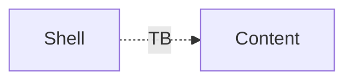

# Fixture project overview

The fixture project has a trusted shell and untrusted content. See
[the decision](../decisions/adr-0901-fixture-decision.md#decision) and the
[shell component](../architecture/components/comp-fixture-shell.md).

## Structure of `the` *fixture*

| Part | Trust |
|---|---|
| Shell | trusted |
| Content | untrusted |
