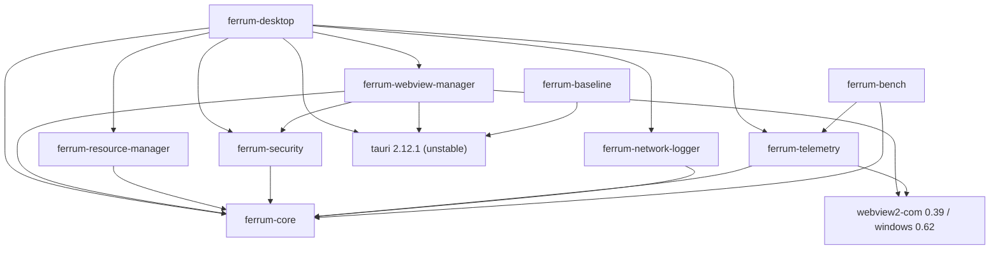

# Cargo workspace and crate dependency graph

## 1. Workspace members (planned)

| Crate | Path | Component | Kind |
|---|---|---|---|
| `ferrum-core` | `crates/core` | comp-core | lib |
| `ferrum-security` | `crates/security` | comp-security-engine | lib |
| `ferrum-telemetry` | `crates/telemetry` | comp-telemetry | lib |
| `ferrum-network-logger` | `crates/network-logger` | comp-network-logger | lib |
| `ferrum-resource-manager` | `crates/resource-manager` | comp-resource-manager | lib |
| `ferrum-webview-manager` | `crates/webview-manager` | comp-webview-manager | lib |
| `ferrum-desktop` | `apps/desktop/src-tauri` | comp-app-shell | bin (Tauri app) |
| `ferrum-baseline` | `apps/baseline-tauri/src-tauri` | comp-baseline-app | bin (Tauri app) |
| `ferrum-bench` | `benchmarks/runners/orchestrator` | comp-benchmark-harness | bin + lib |

The Python (`analysis/`) and Node (shell UI, Playwright, plan app) projects are **not** Cargo members.

## 2. Dependency graph (internal crates)

Edges point from a dependent crate to its dependency. Non-Rust components are omitted.

Design rules:

1. **`ferrum-core` depends on no Ferrum crate and not on Tauri.** It holds ids (`TabId`, `SiteKey`, `ProfileName`), config schema structs, event and record types (`NavTiming`, `NetRecord`, `LifecycleTransition`, `ProcessSample`), traits (`LifecycleActuator`, `Clock`) and error types.
2. **Only `ferrum-webview-manager` and `ferrum-desktop` depend on `tauri`.** Security, resource-manager, network-logger and telemetry can therefore be unit-tested without a WebView.
3. **Dependency inversion for lifecycle.** `ferrum-resource-manager` does **not** depend on `ferrum-webview-manager`. It calls the `LifecycleActuator` trait from core, and webview-manager implements it. `ferrum-desktop` wires the two together, which keeps the policy engine pure and replayable.
4. **The resource manager reads telemetry through values, not a crate edge.** `ferrum-desktop` forwards `ProcessSample` values (core types) from telemetry to the resource manager over a channel. The graph above has no `resource-manager → telemetry` edge; the component-level "samples" edge is a runtime data flow.
5. **`ferrum-telemetry` uses `windows` 0.62** for process counters, in its `win` module. Its `webview2-com` link is limited to PID-set types if needed. The PID set is produced by webview-manager's COM module.
6. **`ferrum-bench` reuses `ferrum-telemetry::win`** for process sampling, so Ferrum's in-app numbers and the harness's numbers use the same counter code. It must never depend on `ferrum-desktop` or `ferrum-webview-manager`: the harness observes products from outside.
7. **`ferrum-baseline` depends only on `tauri`** (no Ferrum crates, no `unstable` unless the baseline design requires it). Feature unification risk: Cargo unifies features across the packages built in one invocation, so the baseline is always built alone (`cargo build -p ferrum-baseline --release`). That this keeps `unstable` out is UNVERIFIED[phase-p6-benchmark-harness]; check with `cargo tree -e features -p ferrum-baseline`.

## 3. `[workspace.dependencies]` pins (research-backed)

| Dependency | Version | Source |
|---|---|---|
| `tauri` | `2.12.1` (+ `unstable` only in ferrum-desktop / webview-manager) | Tauri note §1 |
| `tauri-build` | `2.7.1` | Tauri note §1 |
| `webview2-com` | `0.39` | Tauri note §1 (must match Tauri) |
| `windows` | `0.62` | Tauri note §1 (must match Tauri) |
| `tokio` | `1.53` | Tauri note §1 |
| `serde` | `1.0.229` | Tauri note §1 |
| `tracing` | `0.1.44` | Tauri note §1 |

Crates added in P2, pinned exactly and clean under `cargo deny` ([source readings](../raw/research/p2-source-readings.md) S3): `toml` 1.1.8, `url`
2.5.8, `sha2` 0.11.0, `tracing` 0.1.44, `tracing-subscriber` 0.3.23, `serde_json` 1.0.154 (declared `"1"`), and for
the test server `axum` 0.8.9, `axum-server` 0.8.0, `rcgen` 0.14.10, `tokio` 1.53.2. Not added in P2: `thiserror`
(Ferrum's errors are hand-written enums) and a public-suffix-list crate (per-site profiles, P3); their versions are
UNVERIFIED[phase-p3-tabs-sessions]. `sysinfo` is **not** used for headline memory metrics: its `memory()` returns the double-counting working set ([measurement note](../raw/research/measurement-methodology.md)).

## 4. Profiles and reproducibility

- One `[profile.release]` for the whole workspace, so Ferrum and the baseline get identical optimisation settings. That fairness requirement is recorded in run metadata.
- Build commands and the toolchain version are recorded per benchmark run (master prompt §10).
