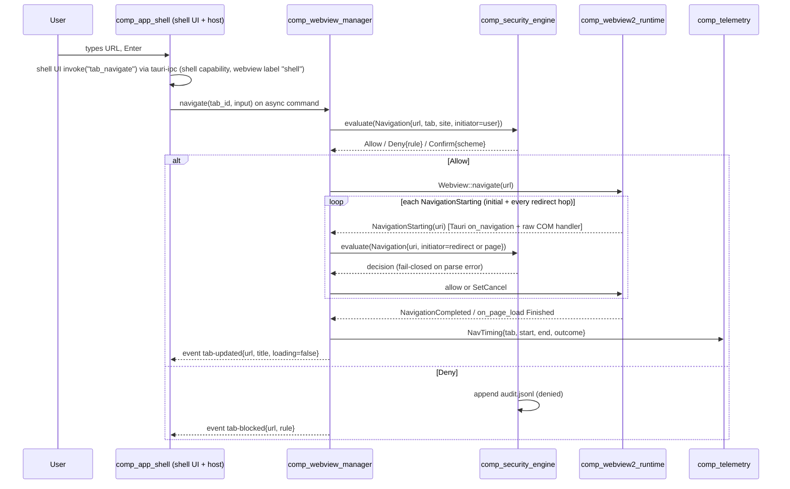
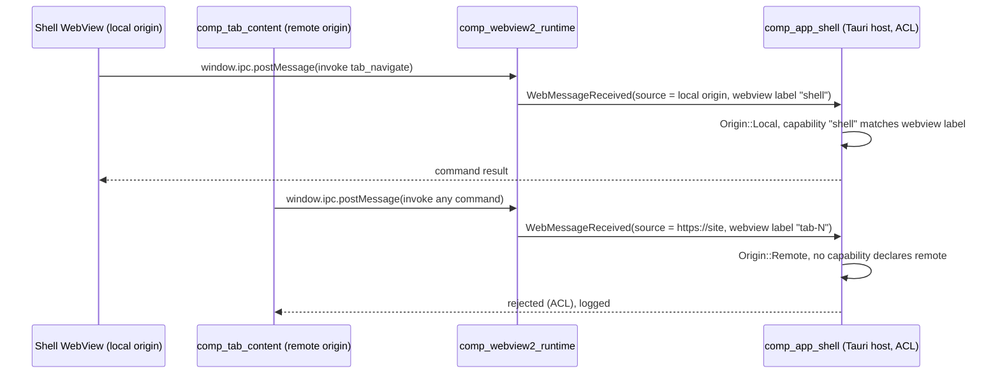
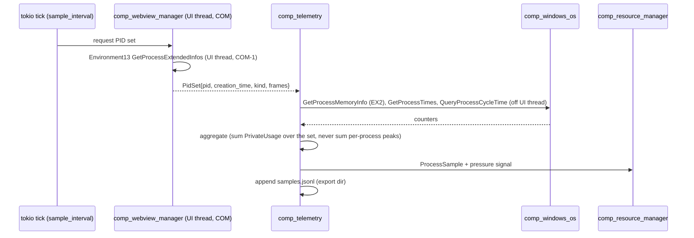
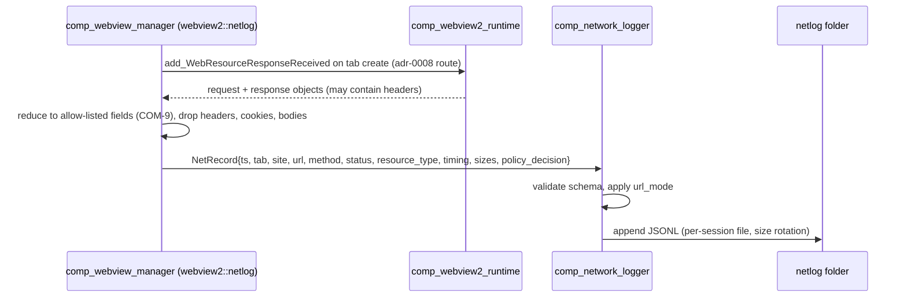
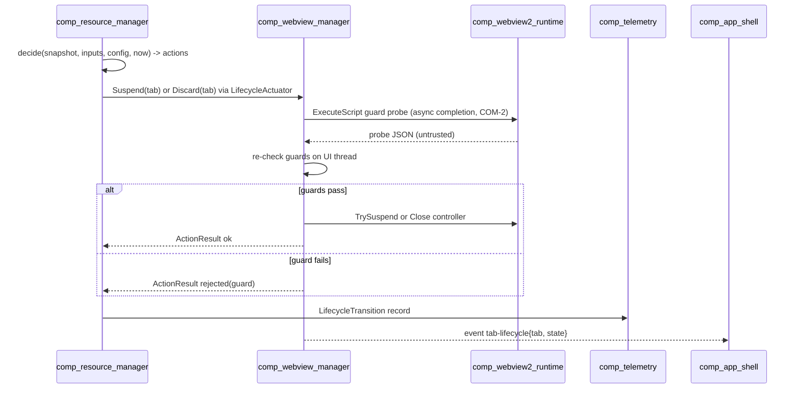
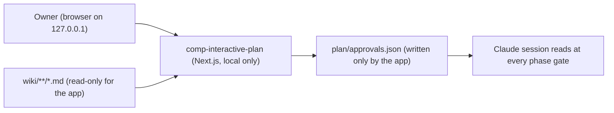

# Runtime data flows

Six flows. Flows 1–5 happen at runtime inside Ferrum. Flow 6, approvals, is **not runtime** and exists only to make that explicit.

## 1. Navigation (user-typed URL, including redirects)

Page-initiated navigations (links, `location=`, form posts, `window.open`) enter at the NavigationStarting / NewWindowRequested step. Iframe navigations come in through raw-COM `FrameNavigationStarting` ([integration §2](ov-arch-webview2-integration.md)).

## 2. IPC commands: the shell is allowed, remote content is denied

The facts behind this flow are VERIFIED in the [Tauri note §3](../raw/research/tauri-webview2-capabilities.md). That the rejection holds end to end was verified in P4: from a website, 16 ways into the app were refused, the exempt channel-fetch command returned nothing, and tab views have no bridge at all ([check-p4.8](../raw/evidence/phase-p4-security/check-p4.8.20261013-2009.txt), [self-test record](../raw/evidence/phase-p4-security/p4.8-ipc-selftest.20261013-2009.json)); the gate's rerun of the security suite passed ([security suite](../raw/evidence/phase-p4-security/security-suite.20261017-2315.txt)) ([trust boundaries §4](ov-arch-trust-boundaries.md)).

**Proposed shell command surface** (names are PROPOSALs, finalised in phase-p2-minimal-container / phase-p3-tabs-sessions): `tab_create`, `tab_close`, `tab_activate`, `tab_navigate`, `tab_back`, `tab_forward`, `tab_reload`, `tab_stop`, `settings_get`, `settings_set`, `session_list`, `download_list`, `external_open_confirm`, `netlog_open_folder`. Events (Rust → shell): `tab-updated`, `tab-blocked`, `tab-lifecycle`, `download-updated`, `permission-request`, `external-scheme-request`.

## 3. Telemetry sampling (in-app)

Metric definitions follow the [measurement note §1–3](../raw/research/measurement-methodology.md): private commit is the headline, and working set is secondary with a caveat. **In-app samples are not the measurement of record for the cross-browser comparison.** The harness measures every product externally, with a Job Object plus counters ([comp-benchmark-harness](components/comp-benchmark-harness.md)). In-app samples drive policies and serve as cross-checks.

**Startup marks.** Process creation time (`GetProcessTimes`), then `window-visible` (shell reports first paint of its own UI), then first tab NavigationCompleted, then FCP/LCP read from the page. FCP/LCP are read without page→host IPC (p5.6, [check-p5.6](../raw/evidence/phase-p5-telemetry/check-p5.6.txt)): the host calls `Page.createIsolatedWorld` and `Runtime.evaluate` in that isolated world through `CallDevToolsProtocolMethod`, so page script can neither send nor change the values.

## 4. Network-log capture (adr-0008: metadata only, JSONL)

- **Implementation route (accepted adr-0008; config default `route = "web-resource-response"`):** `ICoreWebView2_2::WebResourceResponseReceived`. It fires for every response, including redirects and subresources. It is non-blocking with no ordering guarantee (VERIFIED). It gives address, method and status; resource type and size are derived from the request's `Sec-Fetch-Dest` and the response's `Content-Length`, and it gives no timing (p5.9, [check-p5.9](../raw/evidence/phase-p5-telemetry/check-p5.9.txt)).
- **Alternative:** in-process DevTools Protocol over COM (`CallDevToolsProtocolMethod("Network.enable")` + `GetDevToolsProtocolEventReceiver`). It needs **no** remote debugging port. That the method and receiver exist is VERIFIED (Tauri note §6); which event fields it provides was not checked: the route stayed `WebResourceResponseReceived`, which gave the fields the record needs (p5.9), so no switch was needed. Switching the route, or using both for cross-validation, would require a superseding decision.
- The overhead of the chosen route is measured, not assumed: UNVERIFIED[phase-p6-benchmark-harness] (re-targeted in P5: the p5.10 on/off pilot was rough and inconclusive, run-to-run spread larger than any difference, [netlog-cost-p5.10.json](../raw/evidence/phase-p5-telemetry/netlog-cost-p5.10.json); adr-0008 puts the deciding A/B check before the first comparative campaign). The logger is a runtime toggle so exp-security-overhead / exp-baseline-footprint can run with it off and on.
- **Privacy:** fields are allow-listed (adr-0008, scoping Q5). Log folders are gitignored and never committed (master prompt §12).

## 5. Lifecycle transitions

See [lifecycle state machine](ov-arch-lifecycle-state-machine.md) for states, guards and policies.

## 6. Approval flow: NOT a runtime flow

The plan app is planning tooling (adr-0016, superseded by adr-0023). It has **no connection to Ferrum's runtime**, is never shipped, and is never started by the product. From portal v2 (task p0.17) it is read-only: it reads plain-language JSON (adr-0024) and never writes `plan/approvals.json`; Claude records approvals the owner gives in Claude Code (wiki SCHEMA §10.1).

## 7. SmartScreen reputation checks: data that leaves the PC

Every Ferrum browser engine keeps Microsoft Defender SmartScreen on (p4.18, owner answer Q-225). The WebView2 runtime,
not Ferrum, sends these checks to Microsoft's SmartScreen service over HTTPS
([research note](../raw/research/smartscreen-webview2.md), sections 2 and 3):

| When | What is sent |
|---|---|
| A site on the local list of very popular sites | nothing |
| Any other site | the address, information about the site, a device identifier, general location |
| A download completes | the file's hash, name and download address, a device identifier |

Whether the address is sent with its query part is not stated by Microsoft (note, 2.7). Ferrum has no control over
this flow other than leaving SmartScreen on; the Windows setting "SmartScreen for Microsoft Edge" switches it off for
every WebView2 app. SECURITY.md carries the notice Microsoft asks apps to give their users.
