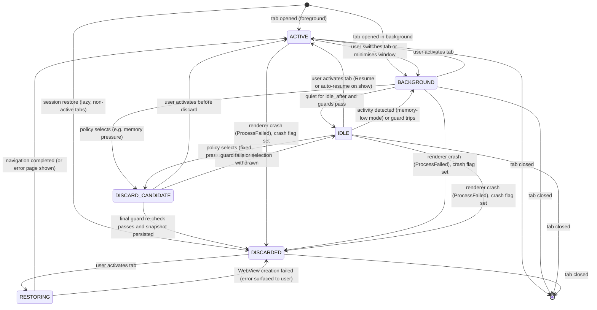

# Lifecycle state machine (design sketch)

Master prompt §5 Phase 4 asks for a configurable state machine over these states: **ACTIVE, BACKGROUND, IDLE, DISCARD_CANDIDATE, DISCARDED, RESTORING**. Its inputs are last interaction, memory pressure, site activity, restoration cost, media playback, active downloads, user exclusions and unsaved-form risk. *"Never discard a session during a potentially destructive operation without an explicit safety mechanism."* Owner component: [comp-resource-manager](components/comp-resource-manager.md). Implemented in phase-p7-lifecycle. Evaluated by exp-lifecycle-policies.

## 1. States and the WebView2 mechanism behind each

The related-work seed (Edge 105 blog, [related-work note B2](../raw/research/related-work-seed.md)) distinguishes **sleep** (resume without reload) from **discard** (full reload). The state machine keeps the two separate.

| State | Meaning | WebView present? | Mechanism |
|---|---|---|---|
| ACTIVE | The visible, selected tab | yes | `IsVisible = true` |
| BACKGROUND | Not selected, or window minimised | yes | `hide()` → `IsVisible = false` (VERIFIED mapping, Tauri note §2) |
| IDLE | Background and quiet past `idle_after`. Resources reclaimed **without** losing page state ("sleep") | yes | `reclaim_mode = suspend` → `TrySuspend` (requires hidden; best effort; VERIFIED). Or `reclaim_mode = memory-low` → `MemoryUsageTargetLevel = Low` (scripts keep running). Or `none`. **Never mix the two** (COM-6) |
| DISCARD_CANDIDATE | Selected by the active policy for discard; guards being (re)checked; snapshot being written | yes | Snapshot persisted to the session store |
| DISCARDED | WebView closed; only the snapshot remains (URL, title, profile, favicon, Ferrum-side history) | **no** | `Close()` controller, remove handlers (COM-4) |
| RESTORING | Re-creating the WebView from the snapshot | being created | `create_tab` + navigate to snapshot URL |

## 2. Transitions

Rules:

1. **ACTIVE is never discarded or suspended by policy.** Only BACKGROUND and IDLE tabs are eligible.
2. **DISCARD_CANDIDATE is a two-phase commit.** Guards are evaluated on entry and **re-evaluated immediately before `Close()`**, on the UI thread, in the same task that closes the WebView. If anything changed (a download started, media began), the tab returns to IDLE.
3. **Fail-safe.** If any guard cannot be evaluated (probe timeout, COM failure, unknown), the tab is **not** discarded.
4. **Crash path.** On `ProcessFailed` (raw COM, VERIFIED event exists), affected tabs go to DISCARDED with `crashed = true`. The shell offers reload. A renderer may host several tabs, so one crash can move several tabs at once (VERIFIED shared renderers, measurement note §2.2). Tests cover master prompt §11 "recovery after renderer crashes".
5. **Session restore.** Restore is lazy. Non-active tabs start in DISCARDED, so the session store and the discard snapshot use **one format**.
6. **Every transition** emits a `LifecycleTransition{tab, from, to, reason, policy, guard_results, t_mono}` record to telemetry. This is the evidence trail that exp-lifecycle-policies needs.

## 3. Safety guards (never discard / never suspend while …)

The exemption list draws on Chrome's freeze exemptions ([related-work note A3](../raw/research/related-work-seed.md)) and master prompt §5.

| Guard | Blocks | Signal source | Confidence |
|---|---|---|---|
| G1 User exclusion (site in `lifecycle.exclusions`) or pinned tab | suspend + discard | config | design |
| G2 Active download in this tab | suspend + discard | `on_download` Requested/Finished (VERIFIED events) | high |
| G3 Media playing / audible | suspend + discard | WebView2 audio state or probe: UNVERIFIED[phase-p7-lifecycle] | open |
| G4 Unsaved-form risk (dirty inputs, `beforeunload` handler registered) | discard | Host-initiated `ExecuteScript` probe returning JSON: UNVERIFIED[phase-p7-lifecycle]. Probe results are **untrusted**. A lying page can only stop its *own* discard, so the integrity impact is low | open |
| G5 Camera / microphone / screen capture / WebRTC in use | suspend + discard | Permission state + probe (Chrome exemption list) | open |
| G6 DevTools open on the tab | suspend + discard | Ferrum-tracked | high |
| G7 Recently interacted (`min_interaction_age`) | discard | shell interaction signals | high |
| G8 Pending permission prompt / modal dialog | suspend + discard | Ferrum-tracked | high |
| G9 Navigation in progress (between NavigationStarting and NavigationCompleted) | discard | WebView2 events | high |
| G10 Web Locks / IndexedDB activity (Chrome exemption) | — | listed for completeness; detectability unknown → **not used** until verified | open |

## 4. Policies (feature-flagged at runtime; master prompt §6)

| `lifecycle.policy` | Master prompt §6 strategy | Selection rule (sketch) |
|---|---|---|
| `none` | 1. No application-level lifecycle management | Never leaves ACTIVE/BACKGROUND (hide only). This is cfg-ferrum-nolifecycle |
| `fixed-idle` | 2. Fixed idle-time discard | IDLE after `idle_after`; DISCARD_CANDIDATE after `discard_after` of inactivity |
| `memory-pressure` | 3. Memory-pressure-based discard | When the pressure signal is high, rank eligible tabs by least-recently-used and discard until it clears. The Windows pressure signal is UNVERIFIED[phase-p7-lifecycle] |
| `adaptive` | 4. Adaptive cost-aware | Score each eligible tab by an estimate of `J = αM + βE + γL` saved vs incurred (below). Discard the best-scoring tabs subject to a budget. This is cfg-ferrum-adaptive |

**Objective sketch.** `M` = normalised memory, `E` = normalised energy, `L` = normalised restoration latency (master prompt §6). Limits that are known in advance:

- **M per tab is ill-defined** under shared renderers. The policy uses an *estimate* (renderer private commit attributed via associated frames, divided by the number of frames). It is labelled as an estimate (measurement note §2.2).
- **E per tab is not directly measurable** (energy counters are package-level, risk-r04). The policy uses a CPU-time proxy of the associated renderers. The proxy's validity is a research question, not an assumption.
- **L** = the tab's last measured restore latency, or a prior.
- Weights α, β, γ are experiment parameters recorded in run metadata. **No novelty is claimed.** Prior art: Edge sleeping tabs, Chrome freezing, GreedyDual-Size ([related-work note](../raw/research/related-work-seed.md)).

**Determinism.** `resource-manager` exposes a pure function `decide(state_snapshot, inputs, config, now) -> Vec<Action>`. It has an injected clock, no randomness and no I/O. Policies can then be unit-tested and replayed from recorded inputs. The tokio tick task only gathers inputs and applies actions.

## 5. Open items

- Whether WebView2 delivers Page Lifecycle `freeze`/`resume` to pages on `TrySuspend`: UNVERIFIED[phase-p7-lifecycle] (related-work note A2).
- Discarding loses in-page back/forward history (a usability cost to measure). Whether it can be restored: UNVERIFIED[phase-p7-lifecycle].
- Whether closing one tab frees memory when its renderer is shared: UNVERIFIED[phase-p7-lifecycle]. This directly affects the expected benefit of discard.
