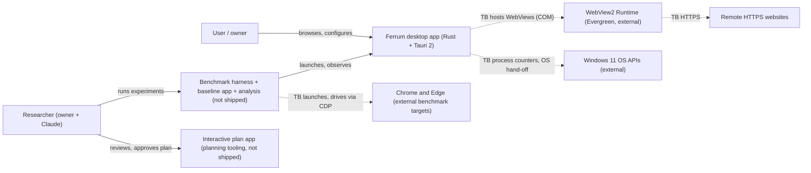
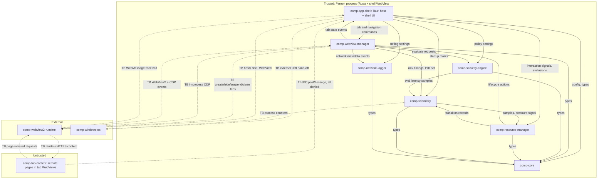
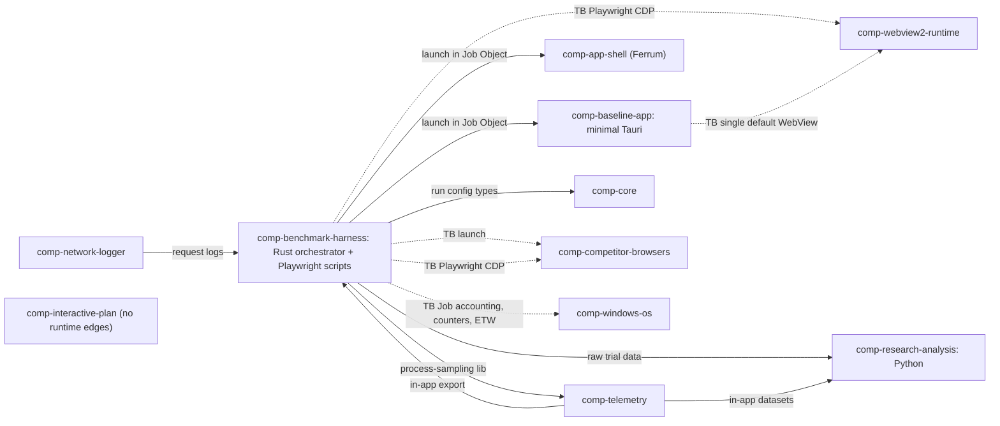

# Architecture: system overview

This is the entry page of the Ferrum architecture. It gives the two top-level views: **context**, which shows what Ferrum talks to, and **containers / components**, which shows how Ferrum is split internally. Every other architecture page refines one aspect of it:

| Aspect | Page |
|---|---|
| Trust boundaries and preliminary threat model | [ov-arch-trust-boundaries](ov-arch-trust-boundaries.md) |
| Runtime data flows (navigation, IPC, telemetry, network log, lifecycle; approvals are *not* runtime) | [ov-arch-data-flows](ov-arch-data-flows.md) |
| Which WebView2 features go through Tauri, wry or raw COM, and the unsafe-code policy | [ov-arch-webview2-integration](ov-arch-webview2-integration.md) |
| Site isolation via WebView2 profiles, and what stays shared | [ov-arch-isolation-model](ov-arch-isolation-model.md) |
| Lifecycle state machine (ACTIVE … RESTORING) | [ov-arch-lifecycle-state-machine](ov-arch-lifecycle-state-machine.md) |
| Repository layout and gitignore | [ov-arch-repo-layout](ov-arch-repo-layout.md) |
| Cargo workspace and crate dependency graph | [ov-arch-crate-graph](ov-arch-crate-graph.md) |
| Configuration model and lifecycle policy flags | [ov-arch-configuration](ov-arch-configuration.md) |

Component pages live in [components/](components/). Each one has machine-readable `connects` edges, and those edges drive the plan app's interactive architecture graph. **No part of this architecture is implemented yet** (phase-p0-planning). Nothing here is a measurement.

## 1. Goals that shape the architecture

Goals come from [master prompt §2, §4](../raw/00-master-prompt.md) and [scoping decisions](../raw/01-scoping-decisions.md).

1. **A usable app and a research instrument, equally (adr-0004).** The same binary is both the product under test and a benchmark configuration. Lifecycle policies are therefore **runtime configuration**, not separate builds (see [configuration](ov-arch-configuration.md)), so configurations D and E of master prompt §8 run byte-identical binaries.
2. **Remote web content never gets native capability.** The trusted shell UI and the untrusted tab content run in separate WebViews (adr-0007). Remote origins get zero Tauri commands (see [trust boundaries](ov-arch-trust-boundaries.md)).
3. **Observability without self-flattery.** The numbers used for the comparison with Chrome and Edge come from an *external* harness that observes the whole process tree (adr-0012). Ferrum's in-app telemetry covers events that only Ferrum can see, such as lifecycle transitions and policy decisions. It also serves as a cross-check. It is never the headline measurement ([measurement note §2](../raw/research/measurement-methodology.md)).
4. **Raw COM and `unsafe` are confined** to a small number of audited modules (see [WebView2 integration](ov-arch-webview2-integration.md)).

## 2. Context view (C4 level 1)

Actors and external systems. Nodes that are not wiki pages (people, websites) use an `actor_`/`ext_` prefix. Lint checks this diagram's edges against `connects` only for component nodes.

## 3. Container / component view (C4 level 2): shipped product

Every edge below is a `connects` entry on the source component's page. Dashed edges labelled `TB` cross a trust boundary.

## 4. Component view: research and planning tooling (not shipped)

`comp-interactive-plan` has **no runtime edges**. It reads `wiki/` and writes `plan/approvals.json`. See the "approval flow" section of [data flows](ov-arch-data-flows.md).

## 5. Component catalogue

| Id | Trust | Phase introduced | Path | One-line role |
|---|---|---|---|---|
| [comp-app-shell](components/comp-app-shell.md) | trusted | phase-p2-minimal-container | `apps/desktop/` | Tauri host binary + vanilla-TS shell UI (tabs, address bar, settings) |
| [comp-webview-manager](components/comp-webview-manager.md) | trusted | phase-p2-minimal-container | `crates/webview-manager/` | Creates/destroys tab WebViews; the **only** raw-COM module for WebViews |
| [comp-security-engine](components/comp-security-engine.md) | trusted | phase-p2-minimal-container | `crates/security/` | Pure policy evaluation + security audit log |
| [comp-resource-manager](components/comp-resource-manager.md) | trusted | phase-p7-lifecycle | `crates/resource-manager/` | Lifecycle state machine + policies |
| [comp-telemetry](components/comp-telemetry.md) | trusted | phase-p5-telemetry | `crates/telemetry/` | Process sampling (Windows APIs), events, exports |
| [comp-network-logger](components/comp-network-logger.md) | trusted | phase-p5-telemetry | `crates/network-logger/` | Metadata-only JSONL network log |
| [comp-core](components/comp-core.md) | trusted | phase-p1-foundation | `crates/core/` | Shared types, ids, config schema, errors |
| [comp-benchmark-harness](components/comp-benchmark-harness.md) | trusted | phase-p6-benchmark-harness | `benchmarks/` | Rust orchestrator + Node/TS Playwright runners |
| [comp-baseline-app](components/comp-baseline-app.md) | trusted | phase-p6-benchmark-harness | `apps/baseline-tauri/` | Minimal Tauri + WebView2 baseline (config C) |
| [comp-research-analysis](components/comp-research-analysis.md) | trusted | phase-p6-benchmark-harness | `analysis/` | Python statistics and figures |
| [comp-interactive-plan](components/comp-interactive-plan.md) | trusted | phase-p0-planning | `interactive_plan/` | Next.js plan viewer + approvals |
| [comp-tab-content](components/comp-tab-content.md) | untrusted | phase-p2-minimal-container | n/a | Remote web content rendered in tab WebViews |
| [comp-webview2-runtime](components/comp-webview2-runtime.md) | external | phase-p1-foundation | n/a | Microsoft Edge WebView2 Runtime |
| [comp-windows-os](components/comp-windows-os.md) | external | phase-p1-foundation | n/a | Windows 11 APIs (process counters, Job Objects, ETW, shell) |
| [comp-competitor-browsers](components/comp-competitor-browsers.md) | external | phase-p6-benchmark-harness | n/a | Google Chrome and Microsoft Edge (configs A, B) |

The last three ids, plus `comp-tab-content`, were added by the architecture area. They exist so that the trust boundaries and OS / benchmark-target edges have explicit endpoints in the graph.

## 6. Window and process model (summary)

- **One top-level window.** It holds one **shell WebView** (trusted, local bundled UI) and one **child WebView per tab** (untrusted remote content), created through Tauri's `Window::add_child`, which needs the `unstable` cargo feature (adr-0007, risk-r02; [Tauri note §2](../raw/research/tauri-webview2-capabilities.md)).
- **Layout.** Shell chrome (tab strip, address bar, sidebar) occupies fixed bands, and the active tab WebView fills the remaining rectangle. Child WebViews draw above the shell (Tauri issue #15682 in the Tauri note). So **no shell element (menu, dropdown, dialog) may overlap the tab rectangle**. Overlays are shown by hiding the active tab WebView, or by rendering inside the shell bands.
- **Only the active tab is visible.** Background tabs are hidden (`Webview::hide`, which maps to `ICoreWebView2Controller::put_IsVisible(false)`, VERIFIED in the Tauri note §2). The CPU and memory effect of hiding is UNVERIFIED[phase-p6-benchmark-harness].
- **Threads.** The Tauri main thread is the WebView2 UI thread, and all COM calls run there through `with_webview`. Async work (sampling, file writes, policy ticks) runs on a tokio runtime. The two communicate through channels, and the UI thread is never blocked (see [WebView2 integration §4](ov-arch-webview2-integration.md)). Tab WebViews must be created from async commands or non-UI threads, because creating them from synchronous handlers deadlocks on Windows (VERIFIED doc comment, Tauri note §2).
- **WebView2 processes.** All WebViews on one user data folder (UDF) share a browser process, a GPU process and helper processes. Renderers may be shared across WebViews (VERIFIED, [measurement note §2.2](../raw/research/measurement-methodology.md)). Per-tab memory is therefore not well defined. See [isolation model](ov-arch-isolation-model.md).
- **Overall stability.** Spike S1 found Tauri's unstable multi-webview usable for a shell plus N tabs on this machine ([S1 report](../raw/evidence/phase-p1-foundation/spike-s1-multiwebview.md)), with two rules (create views from async code; the shell never overlaps tabs) and one known issue (keyboard focus after Alt+Tab, issue 13466, to fix later). Tabs will be controllers Ferrum creates itself (adr-0029). The Tauri note lists 23 open issues against the `unstable` flag. Spikes in phase-p1-foundation must cover focus, resize, z-order and creation deadlock.

## 7. Key architectural decisions referenced

adr-0006 (shell UI = vanilla TS + Vite), adr-0007 (child WebViews in one window), adr-0008 (metadata-only JSONL network log), adr-0010 (profiles in a shared browser process), adr-0012 (Rust orchestrator + Playwright), adr-0013 (Python statistics), adr-0015 (open browsing + blocklist), adr-0018 (repo root is the project root). The ADR pages live in `wiki/decisions/`.

Several architecture choices on these pages are **new proposals that need owner decisions**. They are flagged inline as "PROPOSAL" and collected in the root [ARCHITECTURE.md](../../ARCHITECTURE.md) "Open architecture questions" list.
