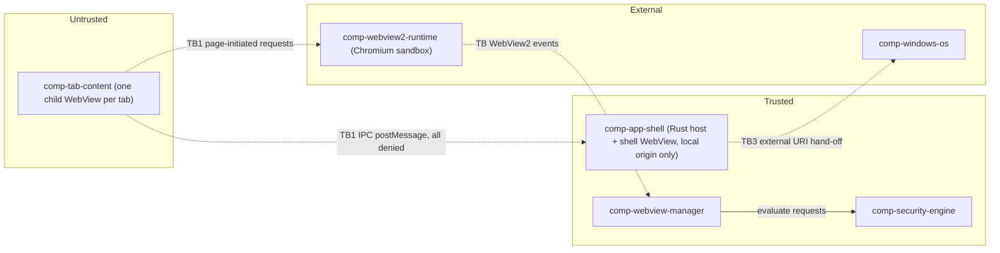

# Trust boundaries and preliminary threat model

> **Status:** preliminary design (P0). **No security property listed here is enforced yet.** Each one is a *planned* control with a planned test. Under master prompt §5 Phase 3 and §11, the threat model is finalised and its properties are proven in phase-p4-security (Milestone M3). A property is called "enforced" only after a passing test whose evidence is saved under `wiki/raw/evidence/phase-p4-security/`.

## 1. Assets

| Asset | Why it matters |
|---|---|
| A1 Native capabilities of the Ferrum process (file system, process spawn, settings, network log, Tauri commands) | Remote code reaching them = full compromise of the user account |
| A2 Per-site session state (cookies, storage, cache, permissions) | Cross-site leakage, session theft |
| A3 Shell UI integrity (address bar shows the true URL; security prompts are genuine) | Spoofed UI enables phishing |
| A4 Network log files and session files (browsing history, URLs) | Sensitive browsing information (master prompt §12: never commit it) |
| A5 Benchmark integrity (raw data, run metadata) | Research validity |
| A6 Owner approvals (`plan/approvals.json`) | Integrity of the phase-gating process |

## 2. Adversaries

| Id | Adversary | In scope? |
|---|---|---|
| ADV1 | Malicious or compromised **website** (incl. third-party scripts, ads, malicious redirects, iframes) loaded in a tab | **Yes, primary** |
| ADV2 | Network attacker (MITM) | Yes. Ferrum relies on WebView2 TLS validation and never bypasses certificate errors (master prompt §5) |
| ADV3 | Other local, unprivileged processes on the same user account | Partly. Relevant to the debug port in benchmark runs (TB4) and to the plan app's local server (TB6). Otherwise out of scope |
| ADV4 | Supply chain (crates, npm packages for the shell UI and the plan app) | Partly: `cargo audit`/`cargo deny` and lockfiles (phase-p1-foundation). Tauri's isolation pattern is optional shell hardening (Tauri note §3) |
| ADV5 | Local administrator / malware running elevated | **Out of scope** |

## 3. Trust boundaries

| Id | Boundary | Crossing mechanism | Planned control |
|---|---|---|---|
| **TB1** | Remote content (tab) to Ferrum host | Tauri IPC (`window.ipc.postMessage`, which becomes `WebMessageReceived`) is injected into **every** WebView, including tabs (VERIFIED, Tauri note §3) | Authorization in Rust: **zero `remote` capabilities**; shell capability targeted by **webview label**; app ACL manifest. See §4 |
| **TB2** | Tab to tab (site A's state vs site B's) | Shared WebView2 profile / UDF | Per-site WebView2 profiles (adr-0010), subject to risk-r01. See [isolation model](ov-arch-isolation-model.md) |
| **TB3** | Ferrum to OS | Downloads, external URI schemes, open-in-system-browser | Security engine decision + user confirmation in shell |
| **TB4** | Benchmark debug port to all WebViews | `--remote-debugging-port` via `WEBVIEW2_ADDITIONAL_BROWSER_ARGUMENTS` | Benchmark runs only. The port is **expected to expose the shell WebView too**, because browser args are environment-wide and all WebViews on a UDF share environment options (VERIFIED, Tauri note §6/§7). Actual CDP target exposure is UNVERIFIED[phase-p5-telemetry] (Tauri note §7: UNCERTAIN). The control assumes the worst case: never set in normal use; documented in SECURITY.md |
| **TB5** | Elevated energy sampler to harness | Separate elevated process (admin needed for energy counters, risk-r04) | Separate binary; read-only output file; Ferrum itself is never run elevated (Tauri note §7) |
| **TB6** | Plan app local server to repo files | Next.js route handler writes `plan/approvals.json` | Bind to `127.0.0.1`, zod-validated body, atomic write ([Next.js note §3.4](../raw/research/nextjs-stack.md)). Not shipped |

## 4. TB1 in detail: zero IPC for remote content

Facts, all VERIFIED from the tauri-2.12.1 source per [Tauri note §3](../raw/research/tauri-webview2-capabilities.md):

- The IPC channel exists in tab WebViews, so protection is **authorization**, not absence of the channel.
- Tauri classifies the message origin as `Origin::Local` or `Origin::Remote{url}` from the `Source` that WebView2 reports. For remote origins, the ACL is always checked. A command is allowed only if a capability matches the execution context (Local vs Remote URL pattern) **and** the webview label or window label matches.
- A capability without a `remote` section is Local-only.

**Design rules (each one is a planned P4 test):**

| Rule | Statement | Test (phase-p4-security, master prompt §11 "Unauthorized native command invocation") |
|---|---|---|
| R1 | No capability file in `apps/desktop/src-tauri/capabilities/` declares `remote`. Enforced by a CI grep / unit test over the capability JSON | Static check in CI from phase-p2-minimal-container |
| R2 | The shell capability targets `"webviews": ["shell"]`, not the window label. A window-label match would also cover the child tab WebViews in that window (VERIFIED matching logic) | Invoke each app command from a fixture page in a tab → expect rejection |
| R3 | Ship an app ACL manifest (tauri-build app manifest) so local custom commands are also ACL-checked | Same fixture: core plugin commands, app commands, event emit/listen all rejected |
| R4 | A tab may never navigate to the app's own origin (`tauri://localhost` / `http(s)://tauri.localhost`), because a tab there would become `Origin::Local`. Blocked in navigation handling. Whether WebView2 even permits that navigation is UNVERIFIED[phase-p4-security] (same phase as adr-0007 rule 4 and risk-r19; the handler itself is built in phase-p3-tabs-sessions and may be smoke-tested there) | Fixture tries `location = "http://tauri.localhost/"`, link, redirect, `window.open` → all blocked and audit-logged |
| R5 | The internal `FETCH_CHANNEL_DATA_COMMAND` is exempt from the ACL check (VERIFIED, `// TODO: Remove ... in v3`). What it can leak to a remote caller is UNVERIFIED[phase-p4-security] | Dedicated negative test calling it from a tab |
| R6 | The `__TAURI_INVOKE_KEY__` is injected into page context and is **not** a security boundary | Documented. No control relies on it |
| R7 | Whether WebView2's `Source` can be spoofed by page script is UNVERIFIED[phase-p4-security]. The design assumes it is browser-reported | Fixture with iframes / `postMessage` tricks |
| R8 | The shell WebView may only ever show the local origin. Its navigation handler denies every non-local URL. The shell has a strict CSP and no remote scripts | Unit test of the shell navigation handler; manual check of CSP |
| R9 | The shell stores **no state in web storage** (settings live in Rust-side files). Clearing browsing data, which is profile-wide (VERIFIED, Tauri note §6), therefore cannot corrupt shell state, and tab content sharing a profile with the shell (fallback isolation mode) can read nothing useful | Code review + test |

## 5. Navigation and request controls (security engine)

The order of evaluation and the default posture follow adr-0015 (open browsing + blocklist; [scoping Q12](../raw/01-scoping-decisions.md)):

1. **Parse.** URLs that fail to parse are **denied** (fail-closed). Tauri's `on_navigation` *allows* URLs that fail `url::Url` parsing before Ferrum's callback ever runs (VERIFIED, Tauri note §4 `lib.rs:4821-4826`). Ferrum therefore also registers a raw-COM `NavigationStarting` handler that sees the raw URI string. Whether both handlers can coexist is UNVERIFIED[phase-p4-security]. Fallback: raw-COM only.
2. **Scheme.** `https` is allowed. `http` is upgraded or warned (configurable). `ferrum`-internal and `tauri` origins are denied for tabs (R4). `javascript:`, `file:` and `data:` top-level navigations are denied (PROPOSAL). Other schemes (`mailto:`, `ms-*` and similar) need **user confirmation** in the shell, and are then handed to the OS (TB3) through `LaunchingExternalUriScheme` (raw COM only, VERIFIED binding exists, Tauri note §6).
3. **Blocklist.** Domain-suffix match against the configured blocklist. Applies to top-level navigations, including **every redirect hop**, because NavigationStarting fires for redirects (VERIFIED). It applies to iframes through raw-COM `FrameNavigationStarting`, since Tauri has no iframe hook (VERIFIED).
4. **Per-site settings.** Permissions, downloads and the profile assignment.
5. **New windows.** `on_new_window` returns Deny, or routes the popup to a new tab after re-evaluating it. Built in P3 (p3.2): the pop-up's address opens in a new tab with its own view, so the new page has **no
`window.opener` link** to the page that opened it; sign-in pop-ups that report back through `window.opener` therefore
cannot work as built. Keeping the link (WebView2 can hand the request a view of the app's choosing) and testing real
OAuth pop-ups are P4 work: UNVERIFIED[phase-p4-security].
6. **Google OAuth.** Google forbids OAuth from embedded user agents (VERIFIED, Tauri note §8). Ferrum detects `accounts.google.com` OAuth flows and offers "open in system browser". **It never spoofs the user agent or uses any other workaround** (master prompt §5).
7. **Permissions.** Default **deny** for camera, microphone, geolocation, notifications, clipboard-read, sensors, MIDI, file-system access and window management, with per-site overrides (PROPOSAL; kinds VERIFIED in Tauri note §4). Ferrum, not the profile, stays authoritative: `SavesInProfile(FALSE)` needs raw COM (VERIFIED).
8. **Downloads.** Every download fires `on_download`. The engine decides allow/deny and the destination, and the shell shows it. The filename is sanitised. Whether WebView2 applies Mark-of-the-Web to the file is UNVERIFIED[phase-p4-security].
9. **Certificates.** Ferrum never handles `ServerCertificateErrorDetected` by bypassing. The default WebView2 behaviour is expected to block the page, and Ferrum leaves it in place (master prompt §5). That default is UNVERIFIED[phase-p4-security] (no research note covers it; tested by SEC-13 in [qual-security-testing-plan](../quality/qual-security-testing-plan.md)).
10. **Audit.** Every **denied** action is appended to `audit.jsonl` (timestamp, tab id, origin, action kind, rule id, decision). There are no page contents.

## 6. Preliminary STRIDE table

| Threat | Boundary | Planned mitigation | Planned test (master prompt §11 item) |
|---|---|---|---|
| Elevation of privilege: remote page calls native command | TB1 | R1–R7 | Unauthorized native command invocation |
| Spoofing: tab navigates to the app origin to become "local" | TB1 | R4 | Unauthorized native command invocation; redirect-based bypass |
| Tampering: redirect chain reaches a blocked domain | TB1 | Evaluate every NavigationStarting (incl. redirects) | Redirect-based policy bypass |
| Spoofing: malformed URL slips past the filter | TB1 | Fail-closed parse (§5.1) | Malformed URL handling |
| Information disclosure: site A reads site B's cookies | TB2 | Per-site profiles (or documented fallback) | Session data isolation |
| Information disclosure: cross-origin access attempts | TB2 | Chromium same-origin policy + site isolation, not weakened by Ferrum (site isolation in WebView2 UNVERIFIED[phase-p4-security], adr-0010) | Cross-origin access attempts |
| Elevation of privilege: drive-by download executes | TB3 | Download policy, no auto-open | Download handling |
| Elevation of privilege: external protocol launches an app silently | TB3 | Confirmation dialog | External protocol handling |
| Elevation of privilege: permission granted silently | TB1/TB2 | Default deny + `SavesInProfile(FALSE)` | Permission denial |
| Denial of service: renderer crash takes down the app | TB1 | `ProcessFailed` handling → tab error state / reload (raw COM, VERIFIED event exists) | Recovery after renderer crashes |
| Information disclosure: network log leaks secrets | A4 | Metadata-only allow-list of fields, no headers/bodies/cookies (adr-0008); logs gitignored | Unit test: record schema has no header/body fields |
| Information disclosure: debug port may expose the shell (worst case assumed) | TB4 | Benchmark runs only; never in default config | Config test: release default has no debug args |

## 7. Non-goals and explicit limitations

- Ferrum does **not** claim process isolation or security isolation beyond what WebView2/Chromium provides, and it never weakens the Chromium sandbox (master prompt §5, §11).
- Ferrum does not defend against an elevated local attacker (ADV5).
- Per-site profiles separate **storage**. They share the browser process (adr-0010). What else stays shared is listed in [isolation model §3](ov-arch-isolation-model.md).
- The Tauri isolation pattern is **not documented** to protect against remote content (Tauri note §3, UNCERTAIN), and Ferrum does not rely on it for that. It is optional supply-chain hardening for the shell UI only.

## 8. Verification plan summary

Correctness tests (above) are kept **separate** from the overhead measurements in exp-security-overhead (master prompt §7 "Separate security correctness tests from performance measurements"). Fixtures are harmless local pages under `tests/security-fixtures/` (see [repo layout](ov-arch-repo-layout.md)).
