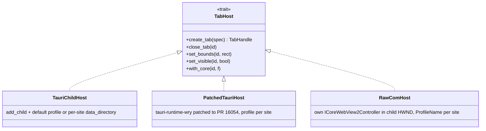

# WebView2 integration layer

The guiding rule (master prompt §3): *"Do not assume Tauri exposes every WebView2 feature directly."* Every capability Ferrum needs is assigned below to the **highest-level layer that actually provides it**: Tauri API, then wry, then raw COM via `with_webview`. That assignment comes from [the Tauri/WebView2 research note §9](../raw/research/tauri-webview2-capabilities.md). Raw COM is used only where it is the only route.

## 1. Version pins (from research, VERIFIED registry data 2026-10-08)

| Package | Version | Note |
|---|---|---|
| `tauri` | 2.12.1 (`rust_version` 1.90), feature `unstable` for `add_child` | Tauri note §1–2 |
| `tauri-build` | 2.7.1 | |
| `wry` | 0.57.0 (transitive via tauri-runtime-wry) | |
| `webview2-com` | **0.39** (must match Tauri's) | Type unification UNVERIFIED[phase-p1-foundation] |
| `windows` | **0.62** (must match Tauri's) | same |

Rust toolchain ≥ 1.90 (Tauri note §1). Tauri 3.0.0-alpha.4 exists, but Ferrum stays on 2.x (Tauri note §1).

## 2. Capability → layer assignment

| Capability (master prompt ref) | Layer used | API | Owner module |
|---|---|---|---|
| Child WebViews in one window (adr-0007) | Tauri (`unstable`) | `Window::add_child`, from **async** contexts only | `webview-manager::host` |
| Bounds, show/hide, focus, auto-resize | Tauri | `set_bounds`, `show`, `hide`, `set_focus`, `set_auto_resize` | `webview-manager::host` |
| Navigate, reload, URL | Tauri | `navigate`, `reload`, `url` | `webview-manager::tab` |
| Back / forward | **Raw COM** `GoBack`/`GoForward` (Tauri has none; `eval("history.back()")` is the fallback) | `ICoreWebView2` | `webview-manager::webview2::nav`. Choice UNVERIFIED[phase-p2-minimal-container] |
| Main-frame navigation intercept (redirects included) | Tauri `on_navigation` **plus** raw COM `NavigationStarting` for fail-closed parsing | | `webview-manager::webview2::nav` + security engine |
| Iframe navigation intercept | **Raw COM** | `add_FrameNavigationStarting` | `webview-manager::webview2::nav` |
| New-window / popup | Tauri | `on_new_window` | `webview-manager::tab` |
| Downloads | Tauri | `on_download` | `webview-manager::tab` |
| Page load start/finish | Tauri `on_page_load`. HTTP status via raw COM `NavigationCompleted` args2 is UNVERIFIED[phase-p2-minimal-container] | | `webview-manager::tab` |
| Permission requests | Tauri `on_permission_request`; `SavesInProfile(FALSE)` via **raw COM** | `PermissionRequested` | `webview-manager::webview2::perm` |
| External URI schemes | **Raw COM** | `LaunchingExternalUriScheme` | `webview-manager::webview2::nav` |
| Per-site profile name | **Not in Tauri 2.12.1.** wry has `with_profile_name`; Tauri PR #16054 is open (risk-r01) | see §3 | `webview-manager::host` (backend choice) |
| Per-WebView user data folder | Tauri `data_directory` | | `webview-manager::host` |
| InPrivate per WebView | Tauri `incognito` | | `webview-manager::host` |
| TrySuspend / Resume (risk-r03) | **Raw COM only** | `ICoreWebView2_3` | `webview-manager::webview2::lifecycle` |
| MemoryUsageTargetLevel | **Raw COM** from Tauri (wry has it but Tauri does not expose it) | `ICoreWebView2_19` | `webview-manager::webview2::lifecycle` |
| Crash detection | **Raw COM** | `ProcessFailed`, `Environment5::BrowserProcessExited` | `webview-manager::webview2::events` |
| Process ids / kinds | **Raw COM** | `BrowserProcessId`, `Environment8::GetProcessInfos`, `Environment13::GetProcessExtendedInfos` | `webview-manager::webview2::procinfo` |
| Network metadata log (adr-0008) | **Raw COM**: `ICoreWebView2_2::WebResourceResponseReceived` (adr-0008 implementation route), or the alternative in-process DevTools Protocol (`CallDevToolsProtocolMethod("Network.enable")` + `GetDevToolsProtocolEventReceiver`) | | `webview-manager::webview2::netlog` (choice: see [data flows §4](ov-arch-data-flows.md)) |
| Guard probes (unsaved forms, media) for lifecycle | **Raw COM** `ExecuteScript` (host-initiated, returns JSON) or CDP `Runtime.evaluate` | | `webview-manager::webview2::probe` |
| DevTools in dev builds | Tauri `devtools` (release builds need the cargo feature) | | `apps/desktop` |
| Remote debugging for Playwright (benchmarks) | Env var `WEBVIEW2_ADDITIONAL_BROWSER_ARGUMENTS`, set by the harness, **no code path** | | harness |
| Clear browsing data | Tauri `clear_all_browsing_data` is **profile-wide** (VERIFIED). Per-kind clearing needs `ICoreWebView2Profile2` raw COM | | `webview-manager::webview2::profile` |
| Background throttling control | **Unsupported on Windows** in Tauri (VERIFIED). Not used | | — |

## 3. Tab hosting backends (risk-r01 isolation fork)

WebView2 profiles can only be chosen **at controller creation** (VERIFIED). Tauri 2.12.1 does not pass a profile name through, so a Tauri-created tab WebView cannot be placed in a named profile after the fact. `webview-manager` therefore hides tab creation behind a `TabHost` trait so the backend can be swapped without touching the shell, security or resource code:

| Backend | Q7 profiles in a shared browser process | Cost | Status |
|---|---|---|---|
| `TauriChildHost` (default profile) | No: all tabs share one profile with the shell | Lowest | Works on stock Tauri (VERIFIED APIs). Fallback |
| `TauriChildHost` + per-site `data_directory` | No: separate browser process per site | Memory per Microsoft docs | Works today (VERIFIED). Contradicts Q7 |
| `PatchedTauriHost` | Yes | Maintaining a `[patch.crates-io]` fork | Depends on PR #16054 (open) |
| `RawComHost` | Yes | Ferrum owns all tab COM + `unsafe`; loses Tauri hooks for tabs, so `on_navigation` etc. are reimplemented in COM | Feasibility UNVERIFIED[phase-p1-foundation] (spike) |

**PROPOSAL:** P2 starts on `TauriChildHost` (default profile). Spike S2 in phase-p1-foundation (task p1.6) tries `RawComHost` and checks the state of PR #16054. The owner then chooses the backend for P3/P4 (open question Q-107) in a new ADR with the next free number, before phase-p3-tabs-sessions starts. The trait keeps the swap local to `webview-manager`.

## 4. Unsafe-code policy (master prompt §15: *"Do not introduce unsafe Rust without documenting the need and invariants"*)

This section implements adr-0019 (proposed, open question Q-110): all `unsafe` WebView2 COM lives in **one** module, `ferrum-webview-manager::webview2`. adr-0019 also says `#![deny(unsafe_code)]` applies in every other Ferrum crate. This page adds **one** narrow extension that adr-0019 does not cover: Win32 process and Job Object calls (not WebView2 COM) in `telemetry::win` and `bench::win`. The `windows` crate marks those calls `unsafe` as well. **PROPOSAL, for owner confirmation:** either (a) approve these two extra modules, or (b) move them into one Windows-platform module, which would need an amendment to adr-0019.

**Where `unsafe` may appear** (crate attribute policy):

| Crate | Attribute | Allowed unsafe modules |
|---|---|---|
| `ferrum-core`, `ferrum-security`, `ferrum-resource-manager`, `ferrum-network-logger` | `#![forbid(unsafe_code)]` | none |
| `ferrum-webview-manager` | `#![deny(unsafe_code)]` + `#[allow(unsafe_code)]` only on `mod webview2` | `webview2::*` (WebView2 COM) |
| `ferrum-telemetry` | `#![deny(unsafe_code)]` + allow on `mod win` | `win::*` (process counters, memory status) |
| `ferrum-desktop` (app) | `#![forbid(unsafe_code)]` | none (all COM goes through webview-manager) |
| `ferrum-bench` (harness) | `#![deny(unsafe_code)]` + allow on `mod win` | `win::*` (Job Objects, suspended launch, ETW) |
| `ferrum-baseline` | `#![forbid(unsafe_code)]` | none (must stay "plain Tauri") |

Every `unsafe` block carries a `// SAFETY:` comment naming the invariant(s) below. Enforcement through `clippy::undocumented_unsafe_blocks` is UNVERIFIED[phase-p1-foundation]. Each unsafe module exposes only **safe** functions, and the component page lists them under `## Unsafe invariants`.

**Invariants for WebView2 COM (`webview-manager::webview2`)**, from the facts in Tauri note §5–6:

| Id | Invariant | Basis |
|---|---|---|
| COM-1 | COM calls on a WebView happen **only on the UI/main thread**, inside a `with_webview` closure or a COM event handler | `with_webview` runs on the main thread (VERIFIED) |
| COM-2 | Never block the UI thread waiting for an async COM completion. Completion handlers post results to a tokio channel. This avoids re-entrancy and deadlock | wry `dispatch_handler` comment (VERIFIED); add_child deadlock doc (VERIFIED) |
| COM-3 | Newer interfaces are obtained with `cast::<ICoreWebView2_N>()`, and a cast failure degrades the feature (logged) instead of panicking | Runtime-version dependent interfaces (VERIFIED min versions) |
| COM-4 | Every `add_*` event registration stores its token and is removed (`remove_*`) on tab close or discard. Controllers are `Close()`d on discard to avoid reference cycles that keep WebViews alive | WebView2 Close docs (VERIFIED) |
| COM-5 | No raw pointer or borrowed COM string outlives its callback. COM-allocated strings are copied into `String` and freed exactly once. Helper availability is UNVERIFIED[phase-p1-foundation] | COM ownership rules |
| COM-6 | `TrySuspend` is called only when `IsVisible == false`. `TrySuspend/Resume` and `MemoryUsageTargetLevel` are **never mixed** on the same WebView (one `reclaim_mode` per configuration) | Microsoft reference (VERIFIED) |
| COM-7 | All WebViews on one UDF use **identical environment options** (browser args, extensions, proxy, language) | WebView2 docs (VERIFIED) |
| COM-8 | Ferrum's `webview2-com`/`windows` versions equal Tauri's (0.39/0.62) | crates.io deps (VERIFIED); unification UNVERIFIED[phase-p1-foundation] |
| COM-9 | Data leaving a CDP/COM event handler is reduced to an **allow-list of fields** before it crosses into safe code (no headers, bodies or cookies). See adr-0008 | Design rule |

**Invariants for Windows process APIs (`telemetry::win`, `bench::win`):** handles are opened with least access (query-limited information where sufficient) and closed via RAII wrappers. A PID is always paired with the process creation time to guard against PID reuse. No pointer escapes the call.

## 5. Testing the integration layer

- **phase-p1-foundation spikes:** `add_child` from an async command (no deadlock); a `with_webview` cast to `ICoreWebView2_3`/`_19` compiles and runs (COM-8); `GetProcessExtendedInfos` returns a PID set; feasibility of the `RawComHost` controller.
- **Unit-testable logic** (policy, record reduction, state machine) lives in `forbid(unsafe_code)` crates. The COM modules stay thin translation layers covered by integration tests that run a real WebView2 on Windows CI. Whether WebView2 is usable on `windows-latest` GitHub runners is a phase-p1-foundation verification item.
