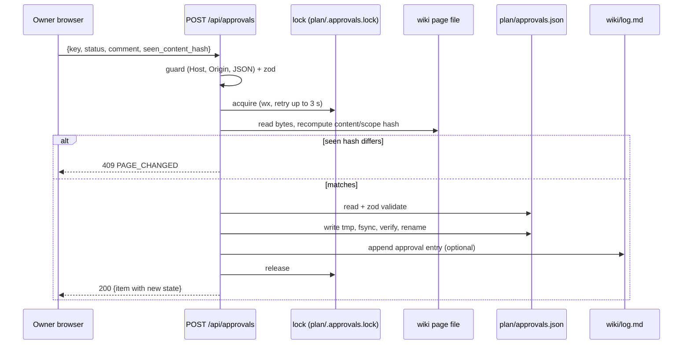

# Interactive plan app: approvals API

This route is the **only** write path in the app. It implements owner decision Q14, "Approve in UI, persisted to repo (`plan/approvals.json`, git-tracked, via local Next.js API route)" ([raw/01-scoping-decisions.md](../raw/01-scoping-decisions.md)), with the file format, hashes and states of [SCHEMA.md](../SCHEMA.md) §10. Claude never calls the POST endpoint and never writes `approvals.json` (SCHEMA §10.1). The only caller is the owner's browser click.

- File: `app/api/approvals/route.ts`, with `export const runtime = 'nodejs'` and `export const dynamic = 'force-dynamic'`.
- Logic: `lib/approvals/store.ts` (read, merge, write), `lib/approvals/lock.ts`, `lib/approvals/hash.ts`, `lib/approvals/state.ts`. The route handler is a thin adapter, so unit tests exercise the store directly.

## 1. `GET /api/approvals`

Returns the merged view: every approvable key, its stored record and its current computed state. Query parameters (all optional):

- `key=<key>`: return one item
- `state=PENDING,STALE,...`: filter by effective state
- `phase=<phase-id>`: filter by phase

```json
{
  "schema_version": 1,
  "generated_at": "2026-10-09T14:03:12+05:30",
  "file": { "path": "plan/approvals.json", "exists": true, "valid": true, "error": null },
  "readonly": false,
  "items": [
    {
      "key": "phase-p1-foundation",
      "id": "phase-p1-foundation",
      "exit": false,
      "type": "phase",
      "title": "…",
      "path": "wiki/phases/phase-p1-foundation.md",
      "page_status": "planned",
      "current": { "content_hash": "sha256:…", "scope_hash": "sha256:…" },
      "record": null,
      "state": "PENDING",
      "counts_as_approved": false,
      "moved": false
    }
  ],
  "orphans": [ { "key": "…", "record": { } } ],
  "counts": { "PENDING": 0, "APPROVED": 0, "APPROVED_VOLATILE_DRIFT": 0, "STALE": 0,
              "CHANGES_REQUESTED": 0, "REJECTED": 0, "INVALID": 0 }
}
```

- `record` is the stored entry verbatim from `approvals.json`, or `null`.
- `state` is computed exactly as in [ip-data-contract](ip-data-contract.md) §8.2.
- The GET is side-effect free and also passes the local-only guard (§3), because it reveals file paths.
- Claude sessions get the same data **without a running server**: the vitest gate report in [ip-testing](ip-testing.md) §2 (`npm run gate -- <phase-id>`) calls the same library functions.

## 2. `POST /api/approvals`

Request body. The `Content-Type` must be `application/json`:

```ts
const PostBody = z.object({
  key: z.string().regex(/^[a-z0-9][a-z0-9.-]*(#exit)?$/),   // page id, or <phase-id>#exit
  status: z.enum(['approved', 'changes-requested', 'rejected']), // SCHEMA 10.1 enum
  comment: z.string().max(4000),                             // required non-empty unless status = approved
  seen_content_hash: z.string().regex(/^sha256:[0-9a-f]{64}$/), // hash rendered on the page the owner reviewed
}).strict();
```

On the wire `status` is `changes-requested` (with a hyphen) so it matches the SCHEMA enum. The brief for this page also mentioned `pending` and `changes_requested`. Neither is accepted: SCHEMA §10.1 has no `pending` decision (a missing key means PENDING) and keeps `history` append-only. Adding a "withdraw" action would need a SCHEMA change first. That is an open question for the owner ([ip-spec](ip-spec.md) §9 item 3).

### 2.1 Server procedure (all inside the write lock, §4)

1. **Guard** (§3). On failure: `403 FORBIDDEN_ORIGIN`.
2. If `PLAN_READONLY=1`: `403 READ_ONLY`.
3. **Validate the body** with zod: `400 BAD_REQUEST` with the zod issues. For `changes-requested` or `rejected` with an empty or whitespace comment: `400 COMMENT_REQUIRED`.
4. **Resolve the key**: `id = key` with `#exit` stripped. Load **only that file** fresh from disk (no cache) by id lookup over the wiki.
   - Unknown id: `404 UNKNOWN_KEY`.
   - `approvable` is not `true`: `422 NOT_APPROVABLE`.
   - A `#exit` key on a non-phase page: `422 NOT_A_PHASE`.
   - A `#exit` key while the phase status ∉ {`gate-review`, `done`}: `409 EXIT_NOT_READY`. The exit review happens only after Claude has set `gate-review` (SCHEMA §9.7 exit gate step 5).
5. **Recompute the hashes** from the file bytes on disk ([ip-data-contract](ip-data-contract.md) §6). The client never supplies a hash that gets stored.
   - Unhashable: `422 UNHASHABLE`.
   - `seen_content_hash !== current content_hash`: **`409 PAGE_CHANGED`** with the current hashes. The owner approved what they saw, so if the file changed in between, the approval is refused.
6. **Read `approvals.json`.**
   - Missing: start from `{schema_version: 1, approvals: {}}`.
   - Invalid: **`500 APPROVALS_FILE_INVALID`**. Never overwrite it.
7. **Build the new record:**
   - `status`, `comment` (trimmed), `timestamp` (local time with offset), `path` (current repo-relative path), `content_hash`, `scope_hash`, `approved_by: "owner"`.
   - `history` = old `history` + (old top-level record reduced to `{status, comment, timestamp, content_hash, scope_hash}`) if an old record exists. History entries are never modified or removed.
8. **Snapshot** (only when `status` is `approved`): write the normalised bytes that were hashed (LF line endings, [ip-data-contract](ip-data-contract.md) §6) to `plan/snapshots/<page-id>/<content-hash-hex>.md`, where `<page-id>` is the key with `#exit` replaced by `__exit`. Written atomically (temp file + rename, §4.2) **before** the approvals file; never overwritten (if the file exists with the same hash, it is left as is). Set the record's optional `snapshot` field to that repo-relative path. Snapshots are tracked in git (not ignored), so a later STALE approval can be reviewed as a diff even when the repository has no commits.
9. **Atomic write** (§4.2).
10. **Optional log append** (§6). If it fails, the approval still stands. The response carries `log_appended: false` and a warning.
11. **Respond** `200` with `{ item }`, in the GET item shape, showing the new state (normally `APPROVED`, `CHANGES_REQUESTED` or `REJECTED`).

### 2.2 Error envelope

Every non-2xx response is `{ "error": { "code": "…", "message": "…", "details": {…} } }`. Codes: `FORBIDDEN_ORIGIN, READ_ONLY, BAD_REQUEST, UNSUPPORTED_MEDIA_TYPE, COMMENT_REQUIRED, UNKNOWN_KEY, NOT_APPROVABLE, NOT_A_PHASE, EXIT_NOT_READY, UNHASHABLE, PAGE_CHANGED, APPROVALS_FILE_INVALID, LOCK_TIMEOUT, WRITE_FAILED`. Other methods (PUT, PATCH, DELETE) are not exported. The expected answer is 405, and an E2E test asserts that it is not 2xx.

## 3. Local-only guard (no authentication otherwise)

The app has no login. Its safety rests on: (a) binding to loopback, and (b) refusing requests that did not come from the app's own page on loopback. This blocks other machines, other local web pages (CSRF) and DNS-rebinding.

1. **Bind:** every npm script starts the server with `-H 127.0.0.1 -p ${PLAN_PORT:-3417}`. The research note only says to pass `-H` explicitly, because the default bind address is unverified ([raw/research/nextjs-stack.md](../raw/research/nextjs-stack.md) §3.4). That the flag binds loopback only is `UNVERIFIED[phase-p0-planning]`, and an IP-9 check confirms it from another interface's address.
2. **Host check** (GET and POST): the `Host` header must be exactly one of `127.0.0.1:<port>`, `localhost:<port>` or `[::1]:<port>`. Otherwise the response is 403. This defeats DNS rebinding, because a rebinding page sends its own hostname as Host.
3. **Origin check** (POST): `Origin` must be present and equal to `http://` + the `Host` value. If `Sec-Fetch-Site` is present, it must be `same-origin`. A missing Origin on POST gets 403.
4. **Content type** (POST): `application/json` only. Anything else gets `415 UNSUPPORTED_MEDIA_TYPE`. Cross-site HTML forms cannot send this type without a CORS preflight, and the route answers no preflight: there is no OPTIONS handler and no CORS headers.
5. **No CORS headers** are emitted at all.
6. **Body size limit:** 16 KiB, checked against `Content-Length` and while reading the body.

The guard is a pure function `checkLocal(req, port): GuardResult`, unit-tested with a header matrix ([ip-testing](ip-testing.md) §1).

## 4. Concurrency and atomicity

Two writers are realistic: two browser tabs, or a dev server and a production server started at once. Next 16 refuses two `next dev`/`next build` instances on one project dir ([raw/research/nextjs-stack.md](../raw/research/nextjs-stack.md) §3.2), but `next start` together with a `next dev` is not ruled out. A lost update is unacceptable, because it would silently drop an owner decision.

### 4.1 Locking

- **In-process:** a promise-chain mutex serialises POSTs within one server.
- **Cross-process:** a lock file `plan/.approvals.lock`.
  - It is created with `fs.open(path, 'wx')` (exclusive create) and contains `{pid, started_at}`.
  - Acquisition retries every 50 ms for up to 3 s, then returns `503 LOCK_TIMEOUT`.
  - A lock older than 30 s is considered stale. It is removed and the event is logged to the server console.
  - The lock is released in `finally`.
  - `.approvals.lock` and `approvals.json.tmp-*` are added to `.gitignore`.
- **Read-modify-write:** the file is read **after** the lock is acquired. That makes the step-6 read and the step-8 write a single critical section.

### 4.2 Atomic write

1. Serialise as described in [ip-data-contract](ip-data-contract.md) §8.1.
2. Write `plan/approvals.json.tmp-<pid>-<random>` in the **same directory** with `fs.open` → `writeFile` → `filehandle.sync()` → `close`.
3. Re-parse the temp file with the zod schema as a self-check. If that fails, delete it and return `500 WRITE_FAILED`.
4. `fs.rename(tmp, approvals.json)`. On Windows, transient `EPERM`/`EBUSY`/`EACCES` are retried up to 5 times with 20, 40, 80, 160 and 320 ms backoff `UNVERIFIED[phase-p0-planning]`. A final failure deletes the temp file and returns `500 WRITE_FAILED`, leaving the original intact.
5. A reader therefore sees either the old file or the new one, never a partial one.

That `node:fs/promises` writes to `../plan/` from the route handler work under both servers is `UNVERIFIED[phase-p0-planning]`. Spike IP-1 checks it ([ip-build-plan](ip-build-plan.md)).

## 5. Sequence



## 6. `approval` log entry (when `PLAN_APPEND_LOG=1`)

SCHEMA §10.1 says "Each approval-change event … also gets an `approval` log entry: written by the plan app if it supports that". The app appends to `wiki/log.md` with `fs.appendFile`, after the approvals rename succeeds and while still holding the lock:

```text

## [2026-10-09] approval | phase-p1-foundation approved
- pages: [phase-p1-foundation]
- result: approved by owner via plan app; content_hash sha256:<64 hex>; comment: "<first 200 chars, newlines collapsed>"
```

Rules:

- The heading matches the SCHEMA §12 regex.
- The append starts with a newline only if the file does not already end with a blank line, so the file keeps ending with exactly one `\n`. The appended block itself ends with `\n`.
- The log is append-only. The app never rewrites `log.md`.
- `log.md` is not approvable, so appending stales nothing.
- If `log.md` is missing, the app does not create it. It returns the warning `LOG_MISSING`.

Whether the owner wants this behaviour is an open question ([ip-spec](ip-spec.md) §9 item 2). With `PLAN_APPEND_LOG=0`, Claude writes the entry at the next RESUME, as SCHEMA §10.1 allows.

## 7. What the API deliberately does not do

- It does not change any wiki page `status`, for example an ADR to `accepted` or a phase to `done`. Claude does that under SCHEMA §9.7 and §10.4, after reading the approval.
- It does not commit to git (`adr-0011`: the owner or an authorised Claude commits; Claude never pushes).
- It does not accept approvals for raw files, non-approvable pages or unknown keys.
- It does not delete keys, history or snapshots.
