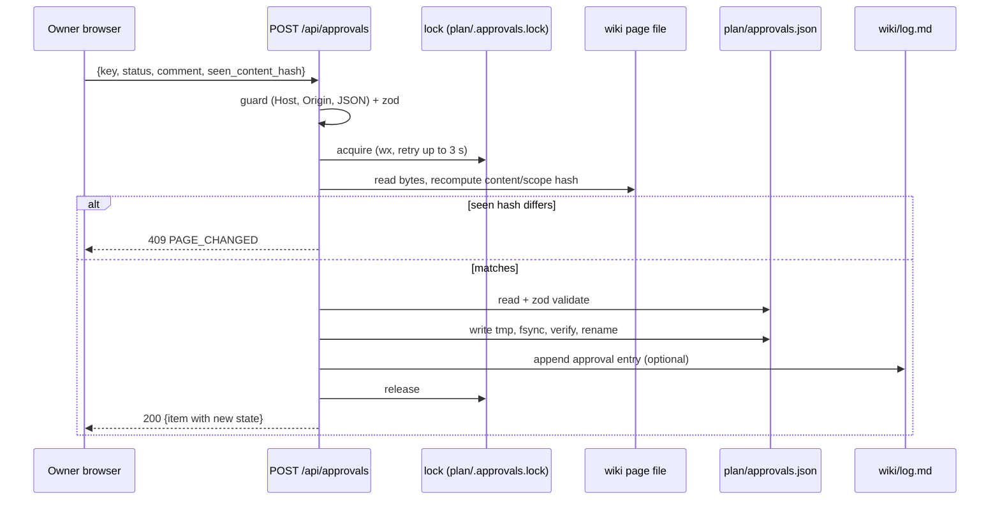

# Interactive plan app v1: approvals API

> **Retired (portal v2, task p0.17, 2026-10-09).** This API no longer exists. The owner decided that approvals are
> given in Claude Code and recorded by Claude with `tools/approvals_record.py`, and that the portal is read-only
> ([adr-0023](../decisions/adr-0023-approvals-in-claude-code-portal-read-only.md)); every portal route now refuses any
> method other than GET and HEAD. This page is kept as the record of how v1 worked; its code is in git history (before
> commit "feat(portal): read-only portal shell ..."). It needs no approval (`approvable: false`). Current pages:
> [ip-spec](ip-spec.md), [ip-data-contract](ip-data-contract.md).

This route is the **only** write path in the app. It implements owner decision Q14, "Approve in UI, persisted to repo (`plan/approvals.json`, git-tracked, via local Next.js API route)" ([raw/01-scoping-decisions.md](../raw/01-scoping-decisions.md)), with the file format, hashes and states of [SCHEMA.md](../SCHEMA.md) §10. Claude never calls the POST endpoint and never writes `approvals.json` (SCHEMA §10.1). The only caller is the owner's browser click.

- File: `app/api/approvals/route.ts`, with `export const runtime = 'nodejs'` and `export const dynamic = 'force-dynamic'`.
- Logic: `lib/approvals/store.ts` (validate, merge, snapshot, write), `lib/approvals/lock.ts`, `lib/approvals/hash.ts`, `lib/approvals/state.ts`. Since IP-4 also: `file.ts` (read and serialise `approvals.json`, no writes), `view.ts` (the GET merged view and the item shape), `guard.ts` (§3), `logAppend.ts` (§6), `errors.ts` (§2.2 codes and statuses), `time.ts` (local timestamps) and `api.ts` (Request to Response adapter). The route handler only binds `api.ts` to the config from the environment, so unit tests exercise the store and the adapter directly.

## 1. `GET /api/approvals`

Returns the merged view: every approvable key, its stored record and its current computed state. Query parameters (all optional):

- `key=<key>`: return one item
- `state=PENDING,STALE,...`: filter by effective state
- `phase=<phase-id>`: filter by phase (the phase page itself and its `#exit` key, plus every page whose `phase` field is that id)

`counts` counts the returned (filtered) items. `items` holds one entry per approvable page (and one `#exit` entry per phase page); a page whose frontmatter says `approvable: true` but fails validation is listed with state `INVALID`. If `approvals.json` is invalid, `file.valid` is false and every item is `INVALID`.

```json
{
  "schema_version": 1,
  "generated_at": "2026-10-09T14:03:12+05:30",
  "file": { "path": "plan/approvals.json", "exists": true, "valid": true, "error": null },
  "readonly": false,
  "items": [
    {
      "key": "phase-p1-foundation",
      "id": "phase-p1-foundation",
      "exit": false,
      "type": "phase",
      "title": "…",
      "path": "wiki/phases/phase-p1-foundation.md",
      "page_status": "planned",
      "current": { "content_hash": "sha256:…", "scope_hash": "sha256:…" },
      "record": null,
      "state": "PENDING",
      "counts_as_approved": false,
      "moved": false
    }
  ],
  "orphans": [ { "key": "…", "record": { } } ],
  "counts": { "PENDING": 0, "APPROVED": 0, "APPROVED_VOLATILE_DRIFT": 0, "STALE": 0,
              "CHANGES_REQUESTED": 0, "REJECTED": 0, "INVALID": 0 }
}
```

- `record` is the stored entry verbatim from `approvals.json`, or `null`.
- `state` is computed exactly as in [ip-data-contract](ip-data-contract.md) §8.2.
- The GET is side-effect free and also passes the local-only guard (§3), because it reveals file paths.
- Claude sessions get the same data **without a running server**: the vitest gate report in [ip-testing](ip-testing.md) §2 (`npm run gate -- <phase-id>`) calls the same library functions.

## 2. `POST /api/approvals`

Request body. The `Content-Type` must be `application/json`:

```ts
const PostBody = z.object({
  key: z.string().regex(/^[a-z0-9][a-z0-9.-]*(#exit)?$/),   // page id, or <phase-id>#exit
  status: z.enum(['approved', 'changes-requested', 'rejected']), // SCHEMA 10.1 enum
  comment: z.string().max(4000),                             // required non-empty unless status = approved
  seen_content_hash: z.string().regex(/^sha256:[0-9a-f]{64}$/), // hash rendered on the page the owner reviewed
  seen_bootstrap_hash: z.string().regex(/^sha256:[0-9a-f]{64}$/).optional(), // key `schema` only: CLAUDE.md hash shown
}).strict();
```

`seen_bootstrap_hash` is **required for key `schema`** and rejected (400 `BAD_REQUEST`) for every other key. It is the `content_hash` of root `CLAUDE.md` that the schema page rendered ([ip-data-contract](ip-data-contract.md) §6.2). Decided in IP-4 (2026-10-09, delegation policy) to reconcile §6.2 of the data contract with this body schema.

On the wire `status` is `changes-requested` (with a hyphen) so it matches the SCHEMA enum. The brief for this page also mentioned `pending` and `changes_requested`. Neither is accepted: SCHEMA §10.1 has no `pending` decision (a missing key means PENDING) and keeps `history` append-only. Adding a "withdraw" action would need a SCHEMA change first. That is an open question for the owner ([ip-spec](ip-spec.md) §9 item 3).

### 2.1 Server procedure (steps 4-10 inside the write lock, §4)

Steps 1-3 look only at the request, so they run before the lock: a refused request never creates `plan/` or the lock file. From step 4 on, everything runs inside the lock (decided in IP-4).

1. **Guard** (§3). On failure: `403 FORBIDDEN_ORIGIN`.
2. If `PLAN_READONLY=1`: `403 READ_ONLY`.
3. **Validate the body** with zod: `400 BAD_REQUEST` with the zod issues. For `changes-requested` or `rejected` with an empty or whitespace comment: `400 COMMENT_REQUIRED`.
4. **Resolve the key**: `id = key` with `#exit` stripped. Load **only that file** fresh from disk (no cache) by id lookup over the wiki.
   - Unknown id: `404 UNKNOWN_KEY`.
   - `approvable` is not `true`: `422 NOT_APPROVABLE`.
   - A `#exit` key on a non-phase page: `422 NOT_A_PHASE`.
   - A `#exit` key while the phase status ∉ {`gate-review`, `done`}: `409 EXIT_NOT_READY`. The exit review happens only after Claude has set `gate-review` (SCHEMA §9.7 exit gate step 5).
5. **Recompute the hashes** from the file bytes on disk ([ip-data-contract](ip-data-contract.md) §6). The client never supplies a hash that gets stored.
   - Unhashable: `422 UNHASHABLE`.
   - `seen_content_hash !== current content_hash`: **`409 PAGE_CHANGED`** with the current hashes. The owner approved what they saw, so if the file changed in between, the approval is refused.
   - Key `schema` only: root `CLAUDE.md` missing: `422 UNHASHABLE` (no `bootstrap_hash` can be recorded; fail closed). `seen_bootstrap_hash` differs from the current `CLAUDE.md` hash: `409 PAGE_CHANGED`, with `bootstrap_hash` in the current hashes.
   - The page's frontmatter is parsed with the same fence rule the hash uses, so a page that fails to hash already fails step 4 (`NOT_APPROVABLE`). `UNHASHABLE` for a page is kept as a defensive check; the route tests reach it with an injected hash function.
6. **Read `approvals.json`.**
   - Missing: start from `{schema_version: 1, approvals: {}}`.
   - Invalid: **`500 APPROVALS_FILE_INVALID`**. Never overwrite it.
7. **Build the new record:**
   - `status`, `comment` (trimmed), `timestamp` (local time with offset), `path` (current repo-relative path), `content_hash`, `scope_hash`, `approved_by: "owner"`, plus `snapshot` (step 8) and, for key `schema`, `bootstrap_hash`.
   - `history` = old `history` + (old top-level record reduced to `{status, comment, timestamp, content_hash, scope_hash}`) if an old record exists. History entries are never modified or removed.
8. **Snapshot** (only when `status` is `approved`): write the normalised bytes that were hashed (LF line endings, [ip-data-contract](ip-data-contract.md) §6) to `plan/snapshots/<page-id>/<content-hash-hex>.md`, where `<page-id>` is the key with `#exit` replaced by `__exit`. Written atomically (temp file + rename, §4.2) **before** the approvals file; never overwritten (if the file exists with the same hash, it is left as is). Set the record's optional `snapshot` field to that repo-relative path. Snapshots are tracked in git (not ignored), so a later STALE approval can be reviewed as a diff even when the repository has no commits.
9. **Atomic write** (§4.2).
10. **Optional log append** (§6). If it fails, the approval still stands. The response carries `log_appended: false` and a warning.
11. **Respond** `200` with `{ item }`, in the GET item shape, showing the new state (normally `APPROVED`, `CHANGES_REQUESTED` or `REJECTED`). With `PLAN_APPEND_LOG` on, the body also has `log_appended` (boolean) and, if the append failed, `warnings: [{code, message}]` (`LOG_MISSING` or `LOG_APPEND_FAILED`).

### 2.2 Error envelope

Every non-2xx response is `{ "error": { "code": "…", "message": "…", "details": {…} } }`. Codes: `FORBIDDEN_ORIGIN, READ_ONLY, BAD_REQUEST, UNSUPPORTED_MEDIA_TYPE, COMMENT_REQUIRED, UNKNOWN_KEY, NOT_APPROVABLE, NOT_A_PHASE, EXIT_NOT_READY, UNHASHABLE, PAGE_CHANGED, APPROVALS_FILE_INVALID, LOCK_TIMEOUT, WRITE_FAILED`. Other methods (PUT, PATCH, DELETE) are not exported. The expected answer is 405, and an E2E test asserts that it is not 2xx.

HTTP status per code (`lib/approvals/errors.ts`; `tests/unit/schema-sync.test.ts` parses this table and `route.test.ts` checks every code against literal numbers, IP-9 review):

| Code | HTTP status |
|---|---|
| `FORBIDDEN_ORIGIN` | 403 |
| `READ_ONLY` | 403 |
| `BAD_REQUEST` | 400 |
| `UNSUPPORTED_MEDIA_TYPE` | 415 |
| `COMMENT_REQUIRED` | 400 |
| `UNKNOWN_KEY` | 404 |
| `NOT_APPROVABLE` | 422 |
| `NOT_A_PHASE` | 422 |
| `EXIT_NOT_READY` | 409 |
| `UNHASHABLE` | 422 |
| `PAGE_CHANGED` | 409 |
| `APPROVALS_FILE_INVALID` | 500 |
| `LOCK_TIMEOUT` | 503 |
| `WRITE_FAILED` | 500 |

## 3. Local-only guard (no authentication otherwise)

The app has no login. Its safety rests on: (a) binding to loopback, and (b) refusing requests that did not come from the app's own page on loopback. This blocks other machines, other local web pages (CSRF) and DNS-rebinding.

1. **Bind:** every npm script starts the server with `-H 127.0.0.1 -p ${PLAN_PORT:-3417}`. `dev`, `dev:local`, `start` and `start:local` all go through `scripts/serve.mjs`, which reads `PLAN_PORT` with the same rule as `lib/config.ts` (digits only, default 3417) and refuses caller-supplied `-H`/`-p`, so the bound port is always the port the Host check expects (IP-9 review fix, 2026-10-09). The research note only says to pass `-H` explicitly, because the default bind address is unverified ([raw/research/nextjs-stack.md](../raw/research/nextjs-stack.md) §3.4). The flag binds loopback only under both `next start` and `next dev`: IP-1 spike S3 found the only listener on 127.0.0.1 and connections to the LAN IPv4 and the WSL vEthernet address refused ([IP-1-spikes.txt](../raw/evidence/phase-p0-planning/interactive-plan/IP-1-spikes.txt)). IP-9 repeated this from every non-loopback address of the machine (LAN and WSL IPv4, global and link-local IPv6) for the E2E servers on 3418 and 3419: all refused with `ECONNREFUSED`, while a throwaway listener on all interfaces was reachable on each of those addresses (`security.spec.ts`, [IP-9-verify.txt](../raw/evidence/phase-p0-planning/interactive-plan/IP-9-verify.txt)).
2. **Host check** (every route, every method): the `Host` header must be exactly one of `127.0.0.1:<port>`, `localhost:<port>` or `[::1]:<port>`. Otherwise the response is 403. This defeats DNS rebinding, because a rebinding page sends its own hostname as Host. The check runs in `proxy.ts` (Next 16 proxy, no matcher) for pages, `/_next` assets and the API alike, so a rebinding page cannot read the wiki either; the API handlers repeat it inside `checkLocal`. Before the IP-9 review only `/api/approvals` was checked and every page answered any Host (reviewer finding, fixed 2026-10-09; `security.spec.ts`).
3. **Origin check** (POST): `Origin` must be present and equal to `http://` + the `Host` value. If `Sec-Fetch-Site` is present, it must be `same-origin`. A missing Origin on POST gets 403.
4. **Content type** (POST): `application/json` only. Anything else gets `415 UNSUPPORTED_MEDIA_TYPE`. Cross-site HTML forms cannot send this type without a CORS preflight, and the route answers no preflight: there is no OPTIONS handler and no CORS headers.
5. **No CORS headers** are emitted at all.
6. **Body size limit:** 16 KiB, checked against `Content-Length` and while reading the body. Over the limit: `400 BAD_REQUEST`.
7. **No framing, same-origin subresources** (every route, `lib/security/policy.ts` through `headers()` in `next.config.ts`): `X-Frame-Options: DENY` and a `Content-Security-Policy` with `frame-ancestors 'none'`, `default-src 'self'`, `img-src 'self' data:`, `connect-src 'self'`, `object-src 'none'`, `base-uri 'self'`, `form-action 'self'` (scripts `'self' 'unsafe-inline'`, plus `'unsafe-eval'` under `next dev` only). Without it another origin could frame the app and turn one click into a same-origin approve POST that passes checks 2-4 (clickjacking), and a Mermaid label `` could make the browser contact another host. Both were demonstrated by the IP-9 review and are now covered by `security.spec.ts`. The Mermaid component also removes ``/`<image>` elements with a non-`data:` source from the rendered SVG before inserting it.

The guard is a pure function `checkLocal(req, port): GuardResult` (its Host part is `checkHost`, used by `proxy.ts` through `lib/security/hostGate.ts`), unit-tested with a header matrix ([ip-testing](ip-testing.md) §1).

## 4. Concurrency and atomicity

Two writers are realistic: two browser tabs, or a dev server and a production server started at once. Next 16 refuses two `next dev`/`next build` instances on one project dir ([raw/research/nextjs-stack.md](../raw/research/nextjs-stack.md) §3.2), but `next start` together with a `next dev` is not ruled out. A lost update is unacceptable, because it would silently drop an owner decision.

### 4.1 Locking

- **In-process:** a promise-chain mutex serialises POSTs within one server.
- **Cross-process:** a lock file `plan/.approvals.lock`.
  - It is created with `fs.open(path, 'wx')` (exclusive create) and contains `{pid, started_at, nonce}` (`started_at` in epoch ms; the random `nonce` lets the holder release only its own lock).
  - Acquisition retries every 50 ms for up to 3 s, then returns `503 LOCK_TIMEOUT`.
  - On Windows the exclusive create can fail with `EPERM` (also `EACCES` or `EBUSY`) while the previous holder's lock file is still pending deletion: it was unlinked while another process had it open to read it. That is a busy lock, not a failure. It is retried like `EEXIST`, bounded by the same 3 s, and gives `LOCK_TIMEOUT` (with `last_error` in the details) if it persists. Any other open error is not retried. Decided 2026-10-09, after a raw `EPERM` escaped a writer in the IP-8 gate run of the IP-4 cross-process test ([IP-8-tests.txt](../raw/evidence/phase-p0-planning/interactive-plan/IP-8-tests.txt)).
  - A lock older than 30 s is considered stale. It is removed and the event is logged to the server console. Removal renames the lock aside first and checks it is still the file judged stale; if another process replaced it meanwhile, it is linked back (link never overwrites), so a fresh lock is never broken.
  - The lock is released in `finally`.
  - `.approvals.lock`, `.approvals.lock.stale-*`, `approvals.json.tmp-*` and snapshot temp files (`snapshots/**/*.tmp-*`) are in `.gitignore`.
- **Read-modify-write:** the file is read **after** the lock is acquired. That makes the step-6 read and the step-8 write a single critical section.

### 4.2 Atomic write

1. Serialise as described in [ip-data-contract](ip-data-contract.md) §8.1.
2. Write `plan/approvals.json.tmp-<pid>-<random>` in the **same directory** with `fs.open` → `writeFile` → `filehandle.sync()` → `close`.
3. Re-parse the temp file with the zod schema as a self-check. If that fails, delete it and return `500 WRITE_FAILED`.
4. `fs.rename(tmp, approvals.json)`. Transient `EPERM`/`EBUSY`/`EACCES` are retried up to 5 times (6 attempts in total) with 20, 40, 80, 160 and 320 ms backoff. Any other error, or a sixth failure, deletes the temp file and returns `500 WRITE_FAILED`, leaving the original intact. The retry is needed on Windows, which refuses a rename over a file another process has open: in the IP-4 cross-process test, renames over `approvals.json` failed with `EPERM` while a reader process had the file open, and the retry recovered them ([IP-4-tests.txt](../raw/evidence/phase-p0-planning/interactive-plan/IP-4-tests.txt)). Under extreme read pressure (another process re-reading the file about every millisecond while the machine is loaded) the retries can run out: the IP-4 stress test then sees an explicit `WRITE_FAILED` (or `LOCK_TIMEOUT` for a writer queued behind it), never a lost or torn write. The owner simply clicks again. To keep the app's own reads out of the way, GET reads `approvals.json` under the same in-process mutex as POST (no lock file, so the GET stays side-effect free).
5. A reader therefore sees either the old file or the new one, never a partial one. The IP-4 cross-process test runs a reader process in a loop during 40 writes from 4 processes and found no torn read ([IP-4-tests.txt](../raw/evidence/phase-p0-planning/interactive-plan/IP-4-tests.txt)).

`node:fs/promises` writes to `../plan/` from a nodejs-runtime route handler work under both servers: IP-1 spike S1 created, wrote, read back and deleted `../plan/.spike-*` per request ([IP-1-spikes.txt](../raw/evidence/phase-p0-planning/interactive-plan/IP-1-spikes.txt); [ip-build-plan](ip-build-plan.md)).

## 5. Sequence



## 6. `approval` log entry (when `PLAN_APPEND_LOG=1`)

SCHEMA §10.1 says "Each approval-change event … also gets an `approval` log entry: written by the plan app if it supports that". The app appends to `wiki/log.md` with `fs.appendFile`, after the approvals rename succeeds and while still holding the lock:

```text

## [2026-10-09] approval | phase-p1-foundation approved
- pages: [phase-p1-foundation]
- result: approved by owner via plan app; content_hash sha256:<64 hex>; comment: "<first 200 chars, newlines collapsed>"
```

Rules:

- The heading matches the SCHEMA §12 regex. The title is `<key> <status>` (for example `phase-p1-foundation#exit approved`); `pages` holds the page id (the key without `#exit`). In the comment, `"` and `\` are escaped with a backslash.
- The append starts with a newline only if the file does not already end with a blank line, so the file keeps ending with exactly one `\n`. The appended block itself ends with `\n`.
- The log is append-only. The app never rewrites `log.md`.
- `log.md` is not approvable, so appending stales nothing.
- If `log.md` is missing, the app does not create it. It returns the warning `LOG_MISSING`.

The owner wants this behaviour (Q-006 answered yes, [raw/owner/2026-10-08-s01-wave0.md](../raw/owner/2026-10-08-s01-wave0.md)), so `PLAN_APPEND_LOG` defaults to on (`lib/config.ts`). With `PLAN_APPEND_LOG=0`, Claude writes the entry at the next RESUME, as SCHEMA §10.1 allows.

## 7. What the API deliberately does not do

- It does not change any wiki page `status`, for example an ADR to `accepted` or a phase to `done`. Claude does that under SCHEMA §9.7 and §10.4, after reading the approval.
- It does not commit to git (`adr-0011`: the owner or an authorised Claude commits; Claude never pushes).
- It does not accept approvals for raw files, non-approvable pages or unknown keys.
- It does not delete keys, history or snapshots.
