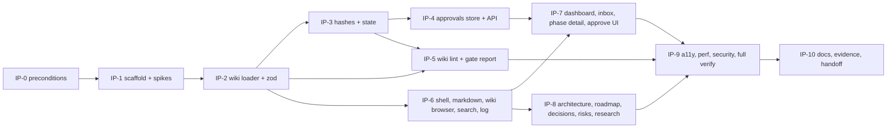

# Interactive plan app: build plan

This plan is sized for **one build workflow** (one or two sessions). Every step ends with a **test gate**. The step is done only when the gate command was run in the current repo state and its output was saved (SCHEMA §9.7 spirit). The plan is **resumable**: after each step, update `STATUS.md` and append a `code` log entry naming the step (SCHEMA §9.5 continuous checkpointing). A session that dies mid-build then loses at most one step.

The `IP-n` labels are local to this page. They are not SCHEMA task ids. The mapping to `p0.N` task ids, and the evidence file names per step, are in the table "Plan-app task to build-step mapping" on [phase-p0-planning](../phases/phase-p0-planning.md). Commits and `STATUS.md` always use the `p0.N` id.



## Resume rule

On resume, read `STATUS.md` and the last 5 log entries. Then list `wiki/raw/evidence/phase-p0-planning/interactive-plan/`. The current step is the first IP step whose listed evidence files (any extension, exactly as named in the P0 mapping table, e.g. `IP-5-lint.json` and `IP-5-gate.txt`, or `IP-10-final-lint.json`) are not all present. Re-run that step's gate before continuing, because the previous session may have died after coding and before verifying.

## IP-0: Preconditions (no code)

**Do:**

0. Confirm that p0.7 and p0.8 are done: the SCHEMA amendment batch of 2026-10-08 is applied, the quick lint ([ops-wiki-maintenance §5](../operations/ops-wiki-maintenance.md#5-lint)) reports 0 errors, and `wiki/raw/MANIFEST.sha256` exists. Otherwise IP-9 and IP-10 cannot pass, because they require a clean real wiki.
1. Confirm that the owner has approved (Approval Wave 0, [ops-approval-workflow §8](../operations/ops-approval-workflow.md#8-approval-waves); in chat, transcribed to `raw/owner/`, since the app that records approvals does not exist yet) `ip-spec`, `ip-data-contract`, `ip-routes-and-views`, `ip-approvals-api`, `ip-wiki-lint`, `ip-testing`, this page and `adr-0016`. This bootstrap exception is needed because approvals can only be clicked once the app exists. **After IP-10, the owner re-approves the same pages in the app**, so `approvals.json` holds them.
2. Confirm that the owner has answered Q-006, Q-007, Q-103 and Q-210 in [ov-open-questions](../overview/ov-open-questions.md) (the questions of [ip-spec](ip-spec.md) §9), or accepted the stated defaults.
3. Record the toolchain: `node -v`, `npm -v`, `git --version`. Claude runs toolchain installs on the owner's authorisation ([adr-0021](../decisions/adr-0021-claude-runs-toolchain-installs.md)); Node was installed with `winget install -e --id OpenJS.NodeJS.LTS`, which gave 24.20.0 ([raw/owner/2026-10-08-s01-wave0.md](../raw/owner/2026-10-08-s01-wave0.md), [IP-0-toolchain.txt](../raw/evidence/phase-p0-planning/interactive-plan/IP-0-toolchain.txt); Node 26 becomes LTS on 2026-10-28, [raw/research/nextjs-stack.md](../raw/research/nextjs-stack.md) §2). If a later reinstall gives another major (for example 26.x), stop and ask the owner (Q-102 says stay on 24): `.nvmrc`/`engines` would have to change.

**Gate:** the Node major is 24 and the version is ≥ 24.15 (the jsdom floor). Any other major is a stop condition. Evidence: `IP-0-toolchain.txt`.

## IP-1: Scaffold + de-risking spikes

**Do:**

1. From the repo root (the path contains a space, so quote it):
   ```text
   npx create-next-app@16.4.0 interactive_plan --ts --tailwind --eslint --app --turbopack --import-alias "@/*" --use-npm --disable-git --no-cache-components --no-agent-feedback --no-react-compiler
   ```
   The flag set comes from the research note. It ran unchanged in IP-1, in the repo path containing a space, with no flag rejected ([IP-1-scaffold.txt](../raw/evidence/phase-p0-planning/interactive-plan/IP-1-scaffold.txt)). If a flag is ever rejected, drop only that flag, log it, and set the equivalent config by hand.
2. Pin exact versions ([ip-spec](ip-spec.md) §7). Then run `npm install` and commit `package-lock.json`. It resolved without peer errors in IP-1 (eslint 9.39.5; [IP-1-scaffold.txt](../raw/evidence/phase-p0-planning/interactive-plan/IP-1-scaffold.txt)). If it fails, record the error, and do **not** use `--force`/`--legacy-peer-deps` without asking the owner.
3. Add `.nvmrc`, `"engines"`, and `next.config.ts` with `turbopack.root` set to the app directory.
4. Add the npm scripts from [ip-testing](ip-testing.md) §0 (`typecheck` is `next typegen && tsc --noEmit`, owner answer 2026-10-09, [wave 0c](../raw/owner/2026-10-09-s01-wave0c.md) item 7), plus:
   - `dev:local` = `next dev -H 127.0.0.1 -p 3417`
   - `start:local` = `next build && next start -H 127.0.0.1 -p 3417`

   (IP-9 review, 2026-10-09: `dev`, `dev:local`, `start` and `start:local` now run `scripts/serve.mjs`, which binds 127.0.0.1 on `PLAN_PORT`, default 3417; [ip-approvals-api](ip-approvals-api.md) §3 item 1.)
5. Install test dependencies approved under Q-210: `npm install -D --save-exact @vitest/coverage-v8@<version matching the pinned vitest>` (exact version taken from the registry at this moment and recorded in the evidence) and `npx playwright install chromium` (downloads a browser into the user profile; record the output).
6. Add `.gitignore` entries `.next/`, `node_modules/`, `.lint/`, `test-results/`, `playwright-report/`, and the repo-level `plan/.approvals.lock` and `plan/approvals.json.tmp-*`. These are the only edits outside `interactive_plan/`, and they are logged.
7. **Spike S1, fs outside the root:** a temporary route reads `../wiki/SCHEMA.md` and writes and deletes `../plan/.spike-<rand>`, under both `next dev` and `next start`.
8. **Spike S2, mermaid:** a client component renders one flowchart with mermaid 12.1.0.
9. **Spike S3, bind:** started with `-H 127.0.0.1`, the server answers on 127.0.0.1 and **not** on the machine's LAN IPv4 address.
10. Delete the spike code once its results are recorded.

**Gate:** `npm run typecheck && npm run lint && npm run build` pass. S1–S3 results are recorded, and each one settles a tag in the `ip-*` pages. If S1 fails, stop: the architecture needs a change, so ask the owner. If S2 fails, switch to mermaid 11.17.2 and log it. If S3 fails, stop and ask. Evidence: `IP-1-scaffold.txt`, `IP-1-spikes.txt`.

## IP-2: Wiki loader + zod schemas

**Do:**

- `lib/config.ts`.
- `lib/wiki/frontmatter.ts`, `schemas.ts` (all types), `load.ts` (with the cache), `links.ts`, `status.ts`, `log.ts`, and `openQuestions` parsing ([ip-data-contract](ip-data-contract.md) §3–§5).
- Fixtures: `tests/fixtures/mini-wiki/` (a clean page of every type, ids in the fixture range) and `tests/fixtures/broken-wiki/`.
- `vitest.lint.config.mts` with the real-wiki loader test `tests/lint/real-wiki-loader.test.ts` (run by `npm run lint:wiki`, not `npm test`; [wave 0c](../raw/owner/2026-10-09-s01-wave0c.md) item 3). IP-5 adds the wiki lint to the same suite.

**Gate:** the unit tests in [ip-testing](ip-testing.md) §1.1, §1.2 (including **schema-sync** against the real SCHEMA.md) and the links/log parts of §1.6 pass (`npm run test`), the real-wiki loader test passes (`npm run lint:wiki`: zero `FM-*` errors on the real wiki, p0.11 verify), and `npm run typecheck && npm run lint`. Evidence: `IP-2-tests.txt`.

## IP-3: Hashes + effective state + gates

**Do:** `lib/approvals/hash.ts`, `state.ts` and `lib/wiki/gates.ts` ([ip-data-contract](ip-data-contract.md) §6–§8), plus `lib/approvals/model.ts` (the §8.1 zod schemas, shared with the IP-4 store) and the pure `lib/approvals/diff.ts` ([ip-routes-and-views](ip-routes-and-views.md) §3.11). The loader fills `contentHash`/`scopeHash` and `bootstrapHash`.

**Gate:** [ip-testing](ip-testing.md) §1.3 passes, **including the Python cross-check** (Python 3.12.10 is on the machine per [raw/01-scoping-decisions.md](../raw/01-scoping-decisions.md); the test must not be skipped here, so the gate runs `IP3_REQUIRE_PYTHON=1 npm run test`), plus `npm run typecheck`, `npm run lint` and `npm run lint:wiki`. Done 2026-10-09 ([IP-3-tests.txt](../raw/evidence/phase-p0-planning/interactive-plan/IP-3-tests.txt)). A failing vector is a stop condition: never adjust expected values to match the code. Evidence: `IP-3-tests.txt`.

## IP-4: Approvals store + API route

**Do:** `lib/approvals/store.ts`, `lock.ts`, the guard, and `app/api/approvals/route.ts` ([ip-approvals-api](ip-approvals-api.md)), plus the optional log append.

**Gate:** [ip-testing](ip-testing.md) §1.4 and §1.5 pass, including the cross-process test, run 3 times in a row to catch flakiness, plus `npm run typecheck`, `npm run lint` and `npm run lint:wiki`. Done 2026-10-09 ([IP-4-tests.txt](../raw/evidence/phase-p0-planning/interactive-plan/IP-4-tests.txt)). Evidence: `IP-4-tests.txt`.

## IP-5: Wiki lint + gate report

**Do:** `lib/lint/` with every rule in [ip-wiki-lint](ip-wiki-lint.md) §2 and §2.1, the git-backed rules (§3), `tests/lint/wiki-lint.test.ts` (under the `vitest.lint.config.mts` of IP-2), and the `lint:wiki:json` and `gate` scripts. Confirm the vitest-as-runner approach of [ip-wiki-lint](ip-wiki-lint.md) §1 (confirmed in IP-5 with `reporters: ["default"]` and `silent: false`, [IP-5-gate.txt](../raw/evidence/phase-p0-planning/interactive-plan/IP-5-gate.txt)).

**Gate:**

- The golden rule tests pass and `mini-wiki` is clean.
- `npm run lint:wiki` runs against the **real** wiki and produces a report.
- Real-wiki errors in `wiki/interactive-plan/` are fixed in this step. Errors elsewhere are listed in the log for the integrator or owner, and are **not** fixed by the app builder. If such errors remain, this is a **stop condition** before IP-9: report them to the integrator and do not proceed until they are fixed (IP-9 and IP-10 need 0 real-wiki errors).
- `npm run gate` prints the P0 checklist.

Done 2026-10-09: 0 real-wiki errors, so no stop condition (`IP-5-lint.json` in the same folder as [IP-5-gate.txt](../raw/evidence/phase-p0-planning/interactive-plan/IP-5-gate.txt)). Evidence: `IP-5-lint.json`, `IP-5-gate.txt`.

## IP-6: App shell, markdown, wiki browser, search, log

**Do:** the layout, theme tokens and toggle, `Markdown` and `Mermaid` components, `/wiki`, `/wiki/[...path]`, `/go/[id]`, `/search` and `/log` ([ip-routes-and-views](ip-routes-and-views.md) §2, §3.7, §3.9, §3.10, §4).

**Gate:** the `Markdown` and `Mermaid` component tests (§1.7) pass; the `ApproveBar` tests run in IP-7 with the component (decided 2026-10-09). Then run Playwright `wiki.spec.ts`, `log.spec.ts`, `theme.spec.ts` and the matching rows of `views.spec.ts`. Evidence: `IP-6-tests.txt`. Until IP-7, `/` is an interim home page (STATUS next action, recent log, links).

## IP-7: Dashboard, approvals inbox, phase detail, approve UI

**Do:** `/`, `/approvals`, `/phases/[id]`, `ApproveBar`, and `/lint` ([ip-routes-and-views](ip-routes-and-views.md) §3.1, §3.4, §3.11, §3.12).

**Gate:** the `ApproveBar` component tests ([ip-testing](ip-testing.md) §1.7), `dashboard.spec.ts`, **`approval-flow.spec.ts`**, `approval-race.spec.ts` and `exit-approval.spec.ts` pass, plus the guard test that the real `plan/approvals.json` was not touched. The gate runs the full unit suite and the full Playwright suite (so the IP-6 specs re-run against the new routes), plus `npm run typecheck`, `npm run lint` and `npm run lint:wiki`. Done 2026-10-09 ([IP-7-tests.txt](../raw/evidence/phase-p0-planning/interactive-plan/IP-7-tests.txt)). Evidence: `IP-7-tests.txt`.

## IP-8: Architecture, roadmap, decisions, risks, research

**Do:** `/architecture`, `/roadmap`, `/decisions`, `/decisions/[id]`, `/risks` and `/research`, with the graph, timeline and heatmap components and their text alternatives ([ip-routes-and-views](ip-routes-and-views.md) §3.2, §3.3, §3.5, §3.6, §3.8).

**Gate:** the graph unit tests (§1.6) pass, along with `architecture.spec.ts`, `roadmap.spec.ts`, `risks.spec.ts` and `research.spec.ts`. Evidence: `IP-8-tests.txt`.

The IP-8 run (decided 2026-10-09) also covered:

- the full unit suite and the full Playwright suite, so the earlier specs re-ran against the new routes, plus the new `decisions.spec.ts`
- typecheck and eslint
- `lint:wiki`, which now includes the real-wiki graph test `real-wiki-graphs.test.ts`: the real 9 phases, because the E2E fixture has only 3
- the quick lint and the tool tests

Registering `decision → /decisions/[id]` in `TYPED_ROUTES` changed the `/go/adr-0901` expectations of `views.spec.ts`, `wiki.spec.ts`, `approval-flow.spec.ts` and `search.test.ts` by design.

## IP-9: Accessibility, performance, security, full verify

**Do:**

- `a11y.spec.ts` and `security.spec.ts`.
- Time each route's server render against the **real** wiki: 5 runs per route, report the median. Compare against the targets in [ip-spec](ip-spec.md) §5 and record the numbers as **app evidence only**, never as Ferrum results.
- Check `PLAN_READONLY` mode.

**Gate:** `npm run verify` is green in one run, and the coverage thresholds (§1.6) are met. A `lint:wiki` failure on a file outside `wiki/interactive-plan/` is a stop condition (report to the integrator, do not proceed), never a silent pass. Evidence: `IP-9-verify.txt`, `IP-9-perf.txt`, `playwright-report.zip`.

The IP-9 run (decided 2026-10-09, under the wave 0c delegation policy):

- The coverage thresholds of [ip-testing](ip-testing.md) §1.6 are `coverage.thresholds` globs in `vitest.config.mts`. `npm run verify` stays as defined; the gate runs `npm run test:coverage` right after it, and both outputs go into `IP-9-verify.txt`.
- `PLAN_READONLY` is checked twice. `security.spec.ts` uses a second Playwright `webServer` (port 3419, same build and fixture). `npm run perf` uses the real wiki (POST → 403 `READ_ONLY`, banner, disabled buttons, real files unchanged).
- The timing script is `scripts/perf-routes.mjs` (`npm run perf`). It reports the median of 5 warm runs per route as specified. It also reports the server's first request and one request per route after the layout's 10 s lint memo has expired, because that memo makes warm runs cheaper. Every number is app evidence only.
- No axe scan: `@axe-core/playwright` needs the owner's consent (Q-008, open). `a11y.spec.ts` checks landmarks, headings, accessible names and keyboard operation instead.

## IP-10: Documentation, evidence, handoff

**Do:**

1. Write `interactive_plan/README.md`: how to start the app, how to run lint and gate, and the environment variables. Link back to these pages.
2. Update the `ip-*` pages:
   - turn each `UNVERIFIED[...]` tag that names phase-p0-planning and is settled by evidence into a citation of the evidence file, or keep it with a logged reason
   - set `status: active` (this is volatile, so approvals stay valid under the scope hash)
3. Ask the owner (through the integrator or STATUS) to update `comp-interactive-plan` to `implemented` with `last_verified_commit`. That page is outside this area.
4. Ask the owner to: (a) run the manual checks in [ip-testing](ip-testing.md) §4, and (b) approve the `ip-*` pages, `schema` and the other P0 pages **in the app**. Claude never writes `approvals.json`.
5. Commit only if the owner has authorised local commits (`adr-0011`). Never push. Otherwise list the uncommitted paths in the handoff.
6. Do a HANDOFF (SCHEMA §9.5): run lint, write the handoff page, update STATUS, add the log entry.

**Gate:** `npm run lint:wiki` reports 0 errors. Evidence: `IP-10-final-lint.json`. The handoff page exists.

## Stop conditions (ask the owner, do not improvise)

- Spike S1 or S3 fails.
- A hash vector or the Python cross-check fails.
- Peer-dependency errors need `--force`.
- Node is not 24.x (Q-102).
- `lint:wiki` reports errors in files outside `wiki/interactive-plan/` (report to the integrator).
- Any change would require writing outside `interactive_plan/`, `plan/` (through the app only), `.gitignore`, `wiki/interactive-plan/`, `wiki/raw/evidence/…` or the log/STATUS bookkeeping.
- Any SCHEMA.md ambiguity that changes the hash, the state or the lint semantics.
