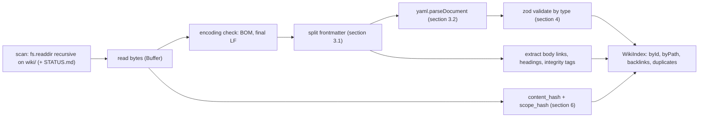

# Interactive plan app: data contract

This page defines **exactly** what the plan app reads and writes, how it validates the data, and how it computes hashes and approval states. The authoritative rules are in [SCHEMA.md](../SCHEMA.md). This page is their executable reading. If the two disagree, SCHEMA.md wins and the app is fixed (precedence, SCHEMA §3.4). SCHEMA §10.2 names this page (`ip-data-contract`) as the home of the shared **hash test vectors** (§7 below).

## 1. Files touched

| File / glob | Access | Notes |
|---|---|---|
| `wiki/**/*.md` except `wiki/raw/**` | read | Wiki pages. Full frontmatter validation (§3) |
| `wiki/raw/research/*.md` | read | `research-note` reduced frontmatter (SCHEMA §6.13). Validated, never written |
| `wiki/raw/**` (all other files) | stat + read for rendering | No frontmatter required. Exists only to resolve `sources` and body links, and to render raw files read-only in the wiki browser |
| `STATUS.md` (repo root) | read | Frontmatter `status-live` (SCHEMA §6.16) + body "Next action" |
| `plan/approvals.json` | read + **atomic write** | Only through `lib/approvals/store.ts` ([ip-approvals-api](ip-approvals-api.md)) |
| `plan/snapshots/<page-id>/<content-hash-hex>.md` | **create** (atomic, never overwritten) | The normalised bytes of an approved page, written by `store.ts` before the approvals file ([ip-approvals-api](ip-approvals-api.md) §2.1 step 8); git-tracked |
| `plan/.approvals.lock` (+ `*.tmp-*` temp files) | create + delete | Cross-process write lock and atomic-write temp files ([ip-approvals-api](ip-approvals-api.md) §4); git-ignored |
| `CLAUDE.md` (repo root) | read | `bootstrap_hash` of key `schema` (§6.2) |
| `wiki/log.md` | read; optional **append** | Append only an `approval` entry, only after a successful approvals write, only if `PLAN_APPEND_LOG` is on (default on; `0` turns it off; Q-006) |

The app writes nothing else. In particular it never writes to `wiki/raw/`, any other wiki page, `STATUS.md` or git.

## 2. Load pipeline (per request, server only)



- **Function:** `loadWiki(cfg): Promise<WikiIndex>` in `lib/wiki/load.ts`. It is pure apart from `fs`, and tests can inject a fixture directory.
- **Cache:** an in-memory `Map<absPath, {mtimeMs, size, parsed}>`. Every call `stat`s every file and re-parses only changed ones. Nothing is cached to disk. With a few hundred files the `stat` pass is cheap. That is a target, checked in IP-9 of [ip-build-plan](ip-build-plan.md).
- **Paths:** paths in the model are **wiki-relative with forward slashes** (`phases/phase-p2-minimal-container.md`). `repoPath` is `wiki/` + that. This matches `approvals.json` `path` (repo-relative, forward slashes, SCHEMA §10.1).
- **No file failure stops loading.** A parse error becomes a `LintFinding` attached to a `WikiPage` whose `fm` is `null`.

## 3. Frontmatter parsing

### 3.1 Splitter (in-house, `lib/wiki/frontmatter.ts`)

1. `bytes`: the raw file Buffer. If it starts with `EF BB BF`, record `FILE-ENCODING` (BOM) and strip the BOM **for parsing only**. Hashing always uses the raw bytes (§6).
2. `text = N(bytes).toString('utf8')`, where `N` is the line-ending normalisation from SCHEMA §10.2.
3. If `text` does not start with `---\n`, there is no frontmatter: `FM-MISSING` (except raw non-research files, which are exempt).
4. `close = text.indexOf('\n---\n', 3)`. If it is `-1`, record `FM-MISSING` (no closing fence). The page then has no valid hashes either (§6.3).
5. `yamlText = text.slice(4, close + 1)`, `body = text.slice(close + 5)`.
6. Also check: the file ends with exactly one `\n` (`FILE-ENCODING` otherwise).

### 3.2 YAML subset enforcement

- Parse with `yaml.parseDocument(yamlText, { version: '1.2', schema: 'core', uniqueKeys: true })`. Any `doc.errors` → `FM-MISSING` with the YAML error message.
- Walk the document AST. Any **anchor, alias, explicit tag**, or more than one document is an error (SCHEMA §5 YAML subset).
- The volatile keys `status`, `updated` and `last_verified_commit` must be top-level single-line plain or quoted scalars. A block scalar (`|`, `>`) or a multi-line value is an error, because the scope hash depends on it (SCHEMA §5, §10.2).
- Dates: the core schema returns `2026-10-08` as a string (yaml 2.9.1; pinned by the IP-2 unit test "dates stay strings", [IP-2-tests.txt](../raw/evidence/phase-p0-planning/interactive-plan/IP-2-tests.txt)). If the parser ever returns a `Date`, the loader converts it back to `YYYY-MM-DD` (UTC) before zod sees it, and a unit test pins the behaviour.

## 4. Typed model (zod 4, `lib/wiki/schemas.ts`)

All schemas mirror SCHEMA §5–§6 one to one. Enums are defined once as `const` arrays and reused by the UI (badges, filters) and by lint.

```ts
// Sketch; field names and enums are normative, TS syntax is illustrative.
const Id        = z.string().regex(/^[a-z0-9][a-z0-9.-]*$/);
const Date10    = z.string().regex(/^\d{4}-\d{2}-\d{2}$/);
// SCHEMA §5.1 (owner answer 2026-10-09, wave 0c item 1): an https:// URL, or a wiki-relative path
// (no leading '/', no '..' segment, no '\', no whitespace, no scheme; optional #anchor). Existence of a
// path entry is checked by REF-DANGLING (lint), not by zod.
const Source    = z.string().refine(s => /^https:\/\/\S+$/.test(s) || isWikiRelativePath(s));
// Raw research notes (§6.13; wave 0c item 2): sources is only z.array(z.string()).
const Unverified = z.object({ claim: z.string(), verify_in: z.string().regex(/^phase-p[0-8]-[a-z0-9-]+$/) });

const Base = z.object({
  id: Id, type: z.enum(PAGE_TYPES), title: z.string().min(1),
  status: z.string(),            // narrowed per type below
  updated: Date10, sources: z.array(Source), related: z.array(Id), approvable: z.boolean(),
  phase: Id.optional(), tags: z.array(z.string().regex(/^[a-z0-9-]+$/)).optional(),
  unverified: z.array(Unverified).optional(), superseded_by: Id.optional(),
  aliases: z.array(z.string()).optional(),
  last_verified_commit: z.string().regex(/^[0-9a-f]{7,40}$/).optional(),
}).passthrough();                // unknown keys -> FM-UNKNOWN-KEY warning, not failure

const Edge = z.object({ to: Id, label: z.string(), kind: z.enum(EDGE_KINDS), crosses_trust_boundary: z.boolean() });
const Component = Base.extend({ type: z.literal('component'), status: z.enum(COMPONENT_STATUS),
  path: z.string().nullable(), crate: z.string().nullable(), trust_level: z.enum(['trusted','untrusted','external']),
  phase_introduced: Id, responsibilities: z.array(z.string()), connects: z.array(Edge),
  interfaces: z.array(z.string()).optional(), shipped: z.boolean().optional(),
  unsafe_code: z.boolean().optional(), external_version: z.string().optional() });

const Task = z.object({ id: z.string().regex(/^p[0-8]\.[0-9]+$/), title: z.string(), verify: z.string() });
const Phase = Base.extend({ type: z.literal('phase'), status: z.enum(PHASE_STATUS),
  milestone: z.enum(['M1','M2','M3','M4','M5','M6','M7']).nullable(), order: z.number().int().min(0).max(8),
  depends_on: z.array(Id), est_sessions: z.number().int().min(1),
  entry_criteria: z.array(z.string()), deliverables: z.array(z.string()), tasks: z.array(Task),
  test_gate: z.object({ automated: z.array(z.string()), manual: z.array(z.string()), evidence: z.array(z.string()) }),
  exit_criteria: z.array(z.string()), risks: z.array(Id), decisions: z.array(Id), experiments: z.array(Id),
  components: z.array(Id).optional() });

// Decision, Risk, ResearchQuestion, Hypothesis, Experiment, Metric, Workload, Quality,
// Operations, Handoff, Glossary, Index, Log, Schema, StatusLive, ResearchNote: same pattern,
// fields exactly as SCHEMA sections 6.4-6.16.
export const PageSchema = z.discriminatedUnion('type', [/* all of the above */]);
```

Constants (copied from SCHEMA; the sync test in [ip-testing](ip-testing.md) §2 fails if SCHEMA.md changes and these do not):

| Constant | Values (SCHEMA §) |
|---|---|
| `PAGE_TYPES` | overview, component, phase, decision, risk, research-question, hypothesis, experiment, metric, workload, quality, operations, handoff, glossary, index, log, schema (§5.1), plus `research-note` (raw only) and `status` (STATUS.md only) |
| `EDGE_KINDS` | rust-api, tauri-ipc, tauri-event, webview2-com, cdp, process-spawn, file-io, network, os-api, data-export (§6.2) |
| Status enums | per type, §6.1–§6.16 |
| Id patterns | §8 table, one regex per type |
| Directory ↔ type | §4.1 (for `FM-TYPE-DIR`) |

**`sources` (SCHEMA §5.1, §6.13):** on every page except raw research notes, each entry must be an `https://` URL or a wiki-relative path (any wiki file, e.g. `SCHEMA.md`, not only `raw/…`). A malformed entry is `FM-MISSING` (zod); a well-formed path to a missing file is `REF-DANGLING` ([ip-wiki-lint](ip-wiki-lint.md) §2). Raw research notes are immutable and may hold free-text entries, so their `sources` is only a list of strings. Owner answer 2026-10-09 ([raw/owner/2026-10-09-s01-wave0c.md](../raw/owner/2026-10-09-s01-wave0c.md), items 1 and 2).

**Per-type cross-field rules** that zod cannot express locally (reciprocity, trust-edge consistency, superseded chains, task-id uniqueness, DAG order) live in lint rules ([ip-wiki-lint](ip-wiki-lint.md)). The UI shows their findings on the affected page.

### 4.1 `WikiPage` and `WikiIndex`

```ts
interface WikiPage {
  id: string | null;          // null if frontmatter missing
  path: string;               // wiki-relative, forward slashes
  repoPath: string;           // 'wiki/' + path   (or 'STATUS.md')
  kind: 'wiki' | 'raw-research' | 'raw' | 'status';
  fm: Page | null;            // zod-parsed (typed) frontmatter, null on failure
  rawFm: unknown;             // parsed YAML before zod, for display
  body: string;               // markdown after the closing fence
  contentHash: string | null; // 'sha256:<hex>' (section 6)
  scopeHash: string | null;
  headings: { depth: number; text: string; slug: string }[];
  links: { href: string; resolvedPath: string | null; anchor: string | null }[];
  unverifiedTags: { phase: string; line: number }[];  // outside fenced code; a tag in inline code counts (IP-5)
  findings: LintFinding[];    // from parsing + validation + cross-page rules
  mtimeMs: number; size: number;
}
interface WikiIndex {
  pages: WikiPage[]; byId: Map<string, WikiPage>; byPath: Map<string, WikiPage>;
  duplicates: Map<string, string[]>;      // id -> paths (ID-DUP)
  backlinks: Map<string, Set<string>>;    // id -> ids referencing it (frontmatter refs + body links)
  status: StatusLive | null;              // parsed STATUS.md
  log: LogEntry[]; openQuestions: OpenQuestion[];
  bootstrapHash: string | null;           // content_hash of <repo root>/CLAUDE.md (section 6.2), null if missing
}
```

### 4.2 Reference fields (graph edges)

These frontmatter fields are id references. They feed backlinks, graphs and `REF-DANGLING`: `related, depends_on, risks, decisions, experiments, components, connects[].to, rq, hypotheses, metrics, workloads, supersedes, superseded_by, phase, owner_phase, phase_introduced, last_handoff (STATUS), current_phase (STATUS), blocked_on (STATUS, ids or Q-NNN)`. `spike` and `current_task` refer to task ids (`pN.M`), which resolve against the union of all phase `tasks`.

### 4.3 Derived structures (`lib/wiki/graph.ts`, all pure)

| Function | Output | Used by |
|---|---|---|
| `componentGraph(idx)` | Nodes = component pages (trust_level, status, shipped). Edges = `connects` (label, kind, crosses_trust_boundary). Unknown `to` → dangling node | `/architecture` |
| `phaseDag(idx)` | Nodes = phases by `order`. Edges = `depends_on`. Plus `schedule`: `start = max(end(dep))`, `end = start + est_sessions` (in **sessions, not dates**), and the critical path | `/roadmap`, dashboard |
| `traceGraph(idx)` | Layered graph rq → hyp → exp → {metric, workload}, plus exp → phase. `gaps[]` (see [ip-routes-and-views](ip-routes-and-views.md) §3.8) | `/research` |
| `riskMatrix(idx)` | 5×5 cells (likelihood × impact) → risk ids; score = L×I | `/risks` |
| `approvables(idx)` | Every page with `approvable: true`, plus `<phase-id>#exit` for each phase whose status ∈ {gate-review, done} or that has a stored `#exit` record | `/approvals`, dashboard |
| `entryGate(idx, approvals, phaseId)` | The SCHEMA §9.7 entry-gate checklist (§8 below) | `/phases/[id]`, dashboard |

## 5. Other inputs

### 5.1 `STATUS.md`

Parsed with the same splitter. Frontmatter (SCHEMA §6.16): `id: status-live`, `type: status`, `status: active|blocked|awaiting-owner`, `session`, `current_phase`, `current_task`, `next_action`, `blocked_on`, `last_handoff`, plus common fields. The dashboard shows `next_action` verbatim, `blocked_on` as links, and the body section whose heading contains "Next action", if present. A missing STATUS.md shows a warning card. It is not a crash.

### 5.2 `wiki/log.md`

- Entries are split on the heading regex from SCHEMA §12: `^## \[(\d{4}-\d{2}-\d{2})\] (ingest|query|lint|decide|handoff|resume|gate|code|approval|schema|correct|plan) \| (.+)$`.
- The body bullets `session, pages, sources, result, stales, next, commit` are parsed leniently into `LogEntry { date, op, title, session?, pages[], stales[], raw }`.
- A heading that starts with `## [` but does not match the regex is a lint error (`LOG-FORMAT`, an app-level check listed in [ip-wiki-lint](ip-wiki-lint.md)).

### 5.3 Open questions

The `ov-open-questions` page is split into sections on the heading regex `^## (Q-\d{3}) (.+)$`. Inside each section, fields are bullet lines matched by `^- (asked|blocking|status|answer):\s*(.*)$` (SCHEMA §6.1; the register writes them as bullets, e.g. `- blocking: [phase-p2-minimal-container]`).

- `blocking` is parsed as an inline YAML list of ids (`[]` allowed).
- `status` must be `open`, `answered` or `withdrawn`. Only `open` blocks.
- **Fail closed:** a section with no `status` line, an unknown status, a duplicate Q id, or an unparsable `blocking` value is lint error `Q-FORMAT`, and the gate evaluator treats that question as **open and blocking every phase**.
- Every `blocking` id must resolve (`REF-DANGLING`). An id that is in no phase's dependency set (for example a risk id) is warning `Q-BLOCK-UNGATED`, because it gates nothing.
- Unit tests use a copy of the real register as a fixture, plus broken variants for each failure above.

### 5.4 `index.md`

Each line under a `##` category is matched against the SCHEMA §11 regex. The lines are only used by lint (`INDEX-MISSING`) and by search ranking (summary text).

## 6. Hashes (`lib/approvals/hash.ts`)

### 6.1 Algorithm (must equal SCHEMA §10.2 byte for byte)

```ts
import { createHash } from 'node:crypto';

/** N(bytes): CRLF -> LF, then lone CR -> LF. Nothing else. */
export function normalizeEol(buf: Uint8Array): Buffer {
  const out = Buffer.allocUnsafe(buf.length); let j = 0;
  for (let i = 0; i < buf.length; i++) {
    const b = buf[i];
    if (b === 0x0d) { out[j++] = 0x0a; if (buf[i + 1] === 0x0a) i++; }
    else out[j++] = b;
  }
  return out.subarray(0, j);
}

const VOLATILE = /^(status|updated|last_verified_commit)[ \t]*:.*\n/gm;

export function hashes(raw: Uint8Array): { content: string; scope: string } {
  const n = normalizeEol(raw);
  const content = 'sha256:' + createHash('sha256').update(n).digest('hex');
  let s: Buffer = n;
  if (n.subarray(0, 4).toString('latin1') === '---\n') {
    const idx = n.indexOf('\n---\n', 3, 'latin1');
    if (idx < 0) throw new HashError('NO_CLOSING_FENCE');  // Python raises ValueError here too
    const end = idx + 1;                                    // start of the closing fence line
    const fm = n.subarray(0, end).toString('latin1').replace(VOLATILE, '');
    s = Buffer.concat([Buffer.from(fm, 'latin1'), n.subarray(end)]);
  }
  return { content, scope: 'sha256:' + createHash('sha256').update(s).digest('hex') };
}
```

Why this matches the Python reference:

- Hashing works on **bytes**, never on decoded UTF-8 strings.
- The frontmatter is mapped byte to char through `latin1`, which round-trips every byte value: a unit test checks all 256 values, vector v09 pins non-ASCII UTF-8, and the Python cross-check agrees on 401 generated inputs, one of them holding every byte value inside the frontmatter ([IP-3-tests.txt](../raw/evidence/phase-p0-planning/interactive-plan/IP-3-tests.txt)).
- In JS, without the `s` flag, `.` excludes `\n`, `\r`, `
` and `
`. The last two cannot occur in latin1 text, and `\r` has already been normalised away. So `.` behaves like Python's bytes-mode `.` (anything except `\n`), and multiline `^` behaves the same way.
- The BOM is **not** stripped before hashing. Neither is it by the Python reference, and a BOM is a lint error anyway.

### 6.2 What is hashed

The file **at `approvals.path`'s current location** (looked up by id, see §8) as raw bytes on disk. For `<phase-id>#exit`, the file is the phase page.

For key `schema` only, the record also stores **`bootstrap_hash`** = `content_hash` of root `CLAUDE.md` (SCHEMA §10.2). If the current `CLAUDE.md` hash differs, the effective state of `schema` is `STALE`, regardless of the scope hash. The schema page view renders `CLAUDE.md` below `SCHEMA.md`, and the POST for `schema` sends `seen_bootstrap_hash` as well.

Details decided in IP-3 (2026-10-09, delegation policy; the `decide` log entry of that date): the loader computes the current hash once per load (`WikiIndex.bootstrapHash`). A stored `bootstrap_hash` with `CLAUDE.md` missing counts as a difference (**fail closed**, `STALE`). A `schema` record without `bootstrap_hash` (the app always writes one, so only a hand-made record lacks it) is judged on the page hashes alone. `rejected` and `changes-requested` take precedence over the check. `tools/approvals_check.py` does the same.

### 6.3 Unhashable pages

A page that starts with `---\n` but has no closing fence throws `NO_CLOSING_FENCE`. The page is shown with state `INVALID` and cannot be approved (POST → 422).

## 7. Hash test vectors (shared with the Python reference)

The values below were computed by running the SCHEMA §10.2 Python reference (Python 3.12.10, per [raw/01-scoping-decisions.md](../raw/01-scoping-decisions.md)) on each `input` encoded as UTF-8: v01–v10 on 2026-10-08, v11–v15 (more line-ending and volatile-key edge cases) on 2026-10-09 in IP-3, with the code block extracted from SCHEMA.md; the same run re-confirmed v01–v10 ([IP-3-tests.txt](../raw/evidence/phase-p0-planning/interactive-plan/IP-3-tests.txt)). `input` is a JSON string, so `\n`, `\r` and `\uXXXX` are escapes. The unit test `hash.vectors.test.ts` **reads this fenced block from this page at test time**, so there is a single source of truth. If `python` is on PATH, it also re-runs the reference implementation extracted from SCHEMA.md on each vector and asserts that both agree.

```json
[
  {"name": "v01-basic", "input": "---\nid: ip-x\nstatus: draft\nupdated: 2026-10-08\n---\n# T\n",
   "content_hash": "sha256:ac7c2f3291f3d6de3efaceac04e736347d57880f424b72e81f42e4c2a3944bbd",
   "scope_hash": "sha256:86291af5a046d82b2432cb4b8c68324bd272b1e9be775493dd804976819d0781"},
  {"name": "v02-crlf", "input": "---\r\nid: ip-x\r\nstatus: draft\r\nupdated: 2026-10-08\r\n---\r\n# T\r\n",
   "content_hash": "sha256:ac7c2f3291f3d6de3efaceac04e736347d57880f424b72e81f42e4c2a3944bbd",
   "scope_hash": "sha256:86291af5a046d82b2432cb4b8c68324bd272b1e9be775493dd804976819d0781"},
  {"name": "v03-volatile-change", "input": "---\nid: ip-x\nstatus: active\nupdated: 2026-10-09\n---\n# T\n",
   "content_hash": "sha256:ea4f4da541dc8c56ea8c15fc6ff8cdc45967e0766fab8be62c6924dd7ebff53f",
   "scope_hash": "sha256:86291af5a046d82b2432cb4b8c68324bd272b1e9be775493dd804976819d0781"},
  {"name": "v04-body-change", "input": "---\nid: ip-x\nstatus: draft\nupdated: 2026-10-08\n---\n# T2\n",
   "content_hash": "sha256:f837c1c643eef5450c757cdb66b6828782f444ebd031d685c398f7703b045aa4",
   "scope_hash": "sha256:3acba3d9bcb1b15399a730155ccc202164d38a9c06a3317aa144d2b9fff1490a"},
  {"name": "v05-no-frontmatter", "input": "# Just text\nstatus: draft\n",
   "content_hash": "sha256:25496efdeb39db6c25ffee59fb546d552e783719fe2c222d2c6d894242188bef",
   "scope_hash": "sha256:25496efdeb39db6c25ffee59fb546d552e783719fe2c222d2c6d894242188bef"},
  {"name": "v06-status-in-body", "input": "---\nid: ip-x\nstatus: draft\n---\nstatus: body line kept\n",
   "content_hash": "sha256:99df997e25692d95c4c33cc0cf4fd940286fbeff1a5534245d27c61b8057204e",
   "scope_hash": "sha256:c49f9e67d25eb6bb12d3882d8adbb7ca0982c09bf8d657fa7e41b617991d8794"},
  {"name": "v07-lookalike-keys", "input": "---\nid: ip-x\nstatuses: kept\nsub:\n  status: nested kept\nstatus : spaced removed\nlast_verified_commit: abc1234\n---\nB\n",
   "content_hash": "sha256:a3601bf95a39e1341931318dd63fc8271ac25882e4d016c96be3056b8a838ba8",
   "scope_hash": "sha256:b6c62f4d9fd5e22d8b21787040c20a2ea5cc3ca6b5db26229083de5dea0857e3"},
  {"name": "v08-lone-cr", "input": "---\rid: ip-x\rstatus: draft\r---\ra\rb\n",
   "content_hash": "sha256:c110064f30dda4a342bed3e778eb060042cd6b4e9d8de455126dc56c63c707af",
   "scope_hash": "sha256:cc710c91fc7e91269ed9a627f156e7f32fc3125556d5b5ca821ce59c276aa534"},
  {"name": "v09-utf8", "input": "---\nid: ip-x\ntitle: \"Füße — ✓\"\nupdated: 2026-10-08\n---\nété\n",
   "content_hash": "sha256:eebe8fb18ca541d179674cbbaddad76a2cacc495238d149bfaa31dd648ee50d0",
   "scope_hash": "sha256:24c19830a7767fc292908559d3a6642f5180782eb8cb970aacce3c0adb993824"},
  {"name": "v10-empty-frontmatter", "input": "---\n---\nbody\n",
   "content_hash": "sha256:b798967e97edb1a5ba916ddff44964faa067b0ed348af17ea3aa6e617730aa64",
   "scope_hash": "sha256:b798967e97edb1a5ba916ddff44964faa067b0ed348af17ea3aa6e617730aa64"},
  {"name": "v11-mixed-eol", "input": "---\r\nid: ip-x\rstatus: draft\r\nupdated: 2026-10-08\n---\r# T\r\n",
   "content_hash": "sha256:ac7c2f3291f3d6de3efaceac04e736347d57880f424b72e81f42e4c2a3944bbd",
   "scope_hash": "sha256:86291af5a046d82b2432cb4b8c68324bd272b1e9be775493dd804976819d0781"},
  {"name": "v12-cr-before-crlf", "input": "a\r\r\nb\n\rc\r",
   "content_hash": "sha256:24afb4914b5064bbab48d9900a0ef5d2c2a9108786c16f17dbe613db04fe53d7",
   "scope_hash": "sha256:24afb4914b5064bbab48d9900a0ef5d2c2a9108786c16f17dbe613db04fe53d7"},
  {"name": "v13-crlf-volatile-change", "input": "---\r\nid: ip-x\r\nstatus: active\r\nupdated: 2026-10-09\r\n---\r\n# T\r\n",
   "content_hash": "sha256:ea4f4da541dc8c56ea8c15fc6ff8cdc45967e0766fab8be62c6924dd7ebff53f",
   "scope_hash": "sha256:86291af5a046d82b2432cb4b8c68324bd272b1e9be775493dd804976819d0781"},
  {"name": "v14-volatile-edge-cases", "input": "---\nid: ip-x\nstatus\t: tab removed\nStatus: capital kept\nupdated:\n last_verified_commit: indented kept\nlast_verified_commit: abc1234\n---\nB\n",
   "content_hash": "sha256:c13ae11ffc870defc8614a3a3d374df4a2543ac0c6c2e7a2b73ddf94e6461af6",
   "scope_hash": "sha256:74740e4a2dce83d3c1937ef5184993096dfec22f6baa462957c6cd304269bf2a"},
  {"name": "v15-second-fence-in-body", "input": "---\nid: ip-x\nstatus: draft\n---\nbody\n---\nstatus: after second fence kept\n---\n",
   "content_hash": "sha256:d7da8adef18a31b63f2683d3a3b3aa60d013f05efb1bbb0be50dda38f047e1a7",
   "scope_hash": "sha256:7f90926db8ecd82bffa2eaada4b342e577d8b0db49c2b9182c5a2cf630ca30de"}
]
```

What each vector demonstrates:

| Vector | Property |
|---|---|
| v01 = v02 | CRLF and LF give identical hashes |
| v03 vs v01 | A change only in `status`/`updated` changes `content_hash` but **not** `scope_hash` → `APPROVED_VOLATILE_DRIFT` |
| v04 vs v01 | A body change changes both → `STALE` |
| v05 | No frontmatter: scope = content, and a `status:` line in the body is kept |
| v06 | Only frontmatter lines are removed. The body `status:` line stays |
| v07 | `statuses:` and the nested `  status:` stay; `status :` (space before the colon) and `last_verified_commit:` are removed |
| v08 | Lone `\r` is normalised to `\n` before fence detection |
| v09 | Non-ASCII UTF-8 bytes are hashed unchanged |
| v10 | Empty frontmatter block |
| v11 = v01 | Mixed CRLF, lone CR and LF in one file normalise to the LF file (CR before the closing fence and in the body included) |
| v12 | `\r\r\n` becomes `\n\n` (CRLF is replaced first, then the remaining CR); a trailing lone CR becomes `\n`; no frontmatter, so scope = content |
| v13 | CRLF file whose only change against v01 is `status`/`updated`: content = v03, scope = v01 |
| v14 | `status<TAB>:` and an empty `updated:` are removed; `Status:` (case differs) and an indented `last_verified_commit:` are kept |
| v15 | Only the **first** closing fence ends the frontmatter: a `status:` line between a second pair of `---` lines in the body is kept |
| (no vector) | `"---\nid: x\nno close\n"` → Python raises `ValueError`; TS must throw `HashError('NO_CLOSING_FENCE')` |

## 8. Approvals: file model and effective state

### 8.1 `plan/approvals.json` (zod, `lib/approvals/model.ts`, used by `store.ts`)

The schemas live in `lib/approvals/model.ts` (IP-3), so the pure state and gate modules share them with the store (IP-4) without importing its fs code.

```ts
const Hash     = z.string().regex(/^sha256:[0-9a-f]{64}$/);
const Decision = z.enum(['approved', 'changes-requested', 'rejected']);       // SCHEMA 10.1
const Iso      = z.string().regex(/^\d{4}-\d{2}-\d{2}T\d{2}:\d{2}:\d{2}(\.\d+)?([+-]\d{2}:\d{2}|Z)$/);
const Hist     = z.object({ status: Decision, comment: z.string(), timestamp: Iso,
                            content_hash: Hash, scope_hash: Hash }).passthrough();
const Rec      = z.object({ status: Decision, comment: z.string(), timestamp: Iso,
                            path: z.string().regex(/^[^\\]+$/), content_hash: Hash, scope_hash: Hash,
                            approved_by: z.literal('owner'), history: z.array(Hist),
                            snapshot: z.string().regex(/^plan\/snapshots\/[^\\]+\.md$/).optional(),   // ip-approvals-api §2.1 step 8
                            bootstrap_hash: Hash.optional() }).passthrough();                  // key 'schema' only, SCHEMA §10.2
const Key      = z.string().regex(/^[a-z0-9][a-z0-9.-]*(#exit)?$/);
export const ApprovalsFile = z.object({ schema_version: z.literal(1),
                                        approvals: z.record(Key, Rec) });
```

- **Missing file:** it is read as `{ "schema_version": 1, "approvals": {} }`. It is created on the first write, along with the `plan/` directory if needed.
- **Invalid file** (bad JSON or a zod failure): the app shows a blocking banner, every state is shown as `INVALID`, and POST returns `500 APPROVALS_FILE_INVALID`. The app **never overwrites a file it cannot parse**.
- **Serialisation:** `JSON.stringify(data, null, 2) + '\n'`, LF line endings. Keys of `approvals` are sorted alphabetically to keep git diffs small, and keys inside a record are written in SCHEMA order.
- **Timestamps:** local wall-clock time with the machine's UTC offset, for example `2026-10-09T14:03:12+05:30` (SCHEMA §10.1 example).

### 8.2 Effective state (`lib/approvals/state.ts`; exactly SCHEMA §10.3)

```ts
type Effective = 'PENDING'|'APPROVED'|'APPROVED_VOLATILE_DRIFT'|'STALE'|'CHANGES_REQUESTED'|'REJECTED'|'INVALID';

function effectiveState(key: string, rec: Rec | undefined, idx: WikiIndex): Effective {
  const id = key.replace(/#exit$/, '');
  const page = idx.byId.get(id);
  if (!page || !page.fm || page.fm.approvable !== true) return 'INVALID';
  if (key.endsWith('#exit') && page.fm.type !== 'phase') return 'INVALID';
  if (page.contentHash === null) return 'INVALID';               // unhashable (section 6.3)
  if (!rec) return 'PENDING';
  if (rec.status === 'rejected') return 'REJECTED';
  if (rec.status === 'changes-requested') return 'CHANGES_REQUESTED';
  if (key === 'schema' && rec.bootstrap_hash !== undefined
      && rec.bootstrap_hash !== idx.bootstrapHash) return 'STALE';    // section 6.2
  if (rec.content_hash === page.contentHash) return 'APPROVED';
  if (rec.scope_hash === page.scopeHash) return 'APPROVED_VOLATILE_DRIFT';
  return 'STALE';
}
export const countsAsApproved = (e: Effective) => e === 'APPROVED' || e === 'APPROVED_VOLATILE_DRIFT';
```

- The page is looked up **by id**. If `rec.path` differs from the current path (the file was renamed with a new slug), the state is computed normally and a `moved` flag is shown.
- A stored key with no page resolves to `INVALID` and is listed in the inbox under "orphaned approvals". The app never deletes it.

### 8.3 Entry-gate evaluation (`lib/wiki/gates.ts`; SCHEMA §9.7)

`entryGate(phaseId)` returns a checklist. Each item has `{ check, ok, ids[] }`:

1. **Dependencies done:** every `depends_on` phase has `status: done` **and** `countsAsApproved(<dep>#exit)`.
2. **Dependency set approved.** The set is:
   - the phase page
   - each id in `decisions`
   - components with `phase_introduced == P` or listed in `components`
   - each id in `experiments`
   - `schema`

   Each must satisfy `countsAsApproved`. Failures are listed with their state.
3. **No blocking open questions:** no `Q-NNN` with `status: open` whose `blocking` list intersects the dependency set. A malformed section (`Q-FORMAT`, §5.3) blocks every phase.
4. **No unregistered contradictions** (SCHEMA §9.7 step 4): no `> **CONTRADICTION:**` blockquote on a page of the dependency set that names no `Q-NNN` present in the register. A blockquote naming a registered question is left to step 3. The blockquote is the marker line plus the following lines starting with `>`.
5. **Overall** = all items ok.

Also decided in IP-3 (2026-10-09, delegation policy; aligned with `tools/approvals_check.py --gate`): items carry `details[]` (`{id, detail}`, e.g. the effective state) beside `ids[]`; an id that is not a valid phase page gives a single failing `phase-exists` item; and `phase-p0-planning` reports `bootstrapException: true` with overall ok (SCHEMA §9.7 P0 bootstrap exception), while its items are still computed for display. Step 4 was missing from this list before IP-3; SCHEMA wins (§3.4).

**The app only reports.** It never changes a phase `status`. Claude does that per SCHEMA §9.7 and logs it.
