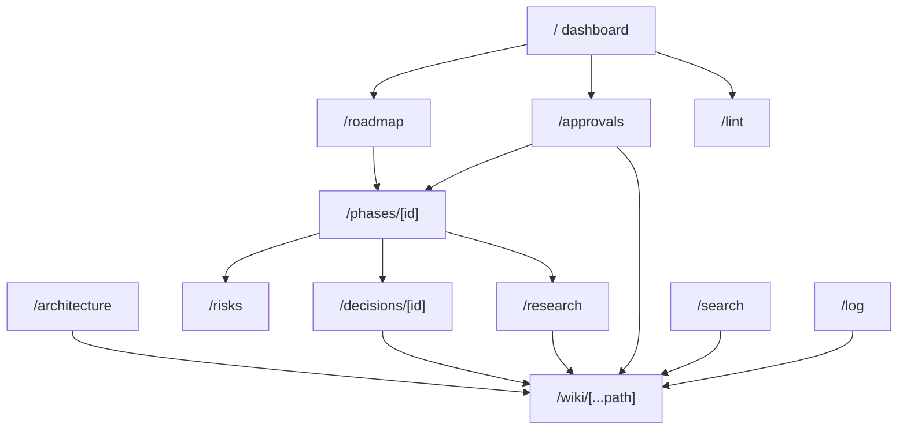

# Interactive plan app: routes, views and UI rules

Every view is a **server component** that calls the pure `lib/` functions from [ip-data-contract](ip-data-contract.md), plus small **client components** where interaction is needed: graphs, mermaid, the approve bar, the theme toggle and the search box. Route `params`/`searchParams` are async in Next 16 ([raw/research/nextjs-stack.md](../raw/research/nextjs-stack.md) §3.2). Every route is dynamic: there is no static generation and no Cache Components.

## 1. Route map

| Route | View | Main data |
|---|---|---|
| `/` | Dashboard | phases, STATUS.md, approvals, log, lint summary |
| `/architecture` | Architecture graph | `componentGraph` |
| `/roadmap` | Phase DAG + session timeline | `phaseDag` |
| `/phases/[id]` | Phase detail + gate checklist + approve UI | phase page, `entryGate`, approvals |
| `/decisions` | ADR register | decision pages |
| `/decisions/[id]` | ADR detail + approve UI | decision page |
| `/risks` | Heatmap + register | `riskMatrix` |
| `/research` | Traceability rq→hyp→exp→metric/workload, with gaps | `traceGraph` |
| `/wiki` | Wiki browser: tree + index | all pages |
| `/wiki/[...path]` | Render any wiki or raw file (path relative to `wiki/`) | one page + backlinks |
| `/go/[id]` | Redirect id → `/wiki/<path>` (or to the typed view if one exists, e.g. a phase → `/phases/[id]`) | `byId` |
| `/search?q=` | Full-text search results | search index |
| `/log` | Log timeline | `log.md` entries |
| `/approvals` | Approvals inbox | `approvables` + approvals.json |
| `/lint` | Wiki lint report (same engine as `npm run lint:wiki`) | lint run |
| `/api/approvals` | JSON API ([ip-approvals-api](ip-approvals-api.md)) | — |

A missing id or path returns a 404 page that lists close matches (by edit distance on ids).

`/go/[id]` details (decided 2026-10-09, IP-6): besides page ids it accepts an open-question id `Q-NNN` (the question's heading anchor on `ov-open-questions`) and a task id `pN.M` (the phase page that defines the task). `status-live` goes to the dashboard `/`. It redirects to a typed view only once that route exists: the build step that adds `/phases/[id]` (IP-7) or `/decisions/[id]` (IP-8) registers it in `lib/wiki/routes.ts`; until then every page opens in `/wiki/<path>`. Since IP-7 a phase id and a task id go to `/phases/<id>`; since IP-8 an ADR id goes to `/decisions/<id>`. `/wiki/[...path]` serves only paths in the loaded file set, so nothing outside `wiki/` can be read.

## 2. Global layout

- **Top bar:** the project name "Ferrum plan", nav links (Dashboard, Roadmap, Architecture, Decisions, Risks, Research, Wiki, Log, Approvals, Lint), a search box (`/` focuses it), the theme toggle, and a **pending-approvals counter** (PENDING + STALE + CHANGES_REQUESTED over the eligible keys of §3.11, linking to `/approvals`). A nav entry whose route a later build step adds is shown disabled, with the step in its tooltip, never as a link to a 404 (IP-6). The theme toggle has three states: System (follows `prefers-color-scheme`), Light and Dark.
- **Global banners:**
  - red if `approvals.json` is invalid
  - amber if lint reports errors (count, links to `/lint` and names the `npm run lint:wiki` command). The layout runs the same lint engine **without git** (ip-wiki-lint §3: the git-backed rules run only in the lint CLI; STALE-UPDATED shows its info line and RAW-IMMUTABLE uses the MANIFEST.sha256 fallback), memoised for 10 s on the file signature (decided 2026-10-09 in the IP-9 review; `/lint` names `npm run lint:wiki` for the git rules)
  - grey "read-only mode" when `PLAN_READONLY=1`
- **Page shell** for every page-backed view:
  - title, id (copy button), type badge, status badge, `updated`, effective-approval badge
  - links to sources (raw files) and related ids
  - an "Open in editor" hint showing the repo path (plain text; the app never spawns an editor)
- **Status colours** (each always paired with a text label, never colour alone):
  - neutral: planned / draft / proposed / open
  - blue: ready / in-progress / review / mitigating
  - amber: gate-review / blocked / changes-requested / STALE
  - green: done / accepted / approved / resolved / verified
  - red: rejected / realized / INVALID
  - purple: APPROVED_VOLATILE_DRIFT (labelled "approved – bookkeeping changed", SCHEMA §10.3)

## 3. Views

### 3.1 Dashboard `/`

Cards, top to bottom:

1. **Next action:** `STATUS.md` `next_action` (verbatim, monospace), `current_phase`, `current_task`, `session` and STATUS `status` (`active|blocked|awaiting-owner`). `blocked_on` renders as id links / `Q-NNN` anchors into `ov-open-questions`, shown prominently in amber. Below them, the STATUS body section whose heading contains "Next action" ([ip-data-contract](ip-data-contract.md) §5.1), rendered as Markdown with its links re-based to the repo root (added in the IP-9 review; it was computed but never shown).
2. **Phase progress:** a horizontal strip of the 9 phases (P0–P8) in `order` (the denominator is 9, or the number of phase pages if that is larger). Each phase shows its status badge, milestone label (M1–M7) and `est_sessions`. Progress = phases `done` / 9. A second bar shows **sessions budget**: the sum of `est_sessions` for done phases over the total. It is labelled as a planning estimate. Task-level progress is not shown as a percentage, because task status is not stored on phase pages (SCHEMA §6.3). Instead the strip shows "last activity", the newest `code` log entry that mentions a `pN.M`.
3. **Current phase gate:** the `entryGate` checklist for `STATUS.current_phase` (see [ip-data-contract](ip-data-contract.md) §8.3), with a link to the phase.
4. **Approval status counts:** counts per effective state over all approvables, as stacked labelled numbers. Each count links to `/approvals?state=…`.
5. **Blockers:** the union of STATUS `blocked_on`, phases with `status: blocked`, open `Q-NNN` sections, and STALE approvals in the current or next phase's dependency set.
6. **Recent log:** the last 5 entries. This mirrors `grep "^## \[" wiki/log.md | tail -5` from RESUME (SCHEMA §9.6).
7. **Lint summary:** error and warning counts with a link to `/lint`.

Decided 2026-10-09 (IP-7): the counts of card 4 and the top-bar counter use the same eligible keys as the inbox (§3.11), so a planned phase's `#exit` key, which nobody can act on yet, is not counted as pending. "Next phase" in card 5 is the phase after `STATUS.current_phase` in `order`. The view model is the pure `lib/views/dashboard.ts`.

### 3.2 Architecture `/architecture`

- An interactive graph (`@xyflow/react`, dagre left-to-right layout) of all `component` pages. Edges come from `connects` only. The mermaid diagrams on architecture pages are illustrations (SCHEMA §14).
- **Nodes:** title, id and status. Grouped into swim-lanes/backgrounds by `trust_level` (trusted / untrusted / external). Not-shipped components (`shipped: false`) get a dotted border. `unsafe_code: true` gets a "unsafe" tag.
- **Edges:** labelled with `label` and `kind`. **Trust-boundary crossings** (`crosses_trust_boundary: true`) are drawn dashed and thick, with a "TB" marker, matching the SCHEMA §14 mermaid convention. Edges with `TRUST-EDGE` lint errors are drawn red.
- **Interaction:**
  - Click or Enter on a node opens a side panel with responsibilities, interfaces, phase_introduced and the approval state, plus a link to the full page (`/wiki/...`).
  - Filters: by `kind`, "only trust-boundary edges", "hide not-shipped".
  - Keyboard: Tab moves through nodes in reading order (left to right, then top to bottom) and Enter or Space activates a node. Each node holds one real control (a button here, a link in §3.3 and §3.8) in that DOM order, and xyflow's own node focus is switched off. Verified with @xyflow/react 12.12.0 in `architecture.spec.ts` and `roadmap.spec.ts` ([IP-8-tests.txt](../raw/evidence/phase-p0-planning/interactive-plan/IP-8-tests.txt)).
  - Below the graph there is a **text alternative**: an always-present table of edges (from, to, label, kind, TB).
- Dangling `to` ids render as red dashed placeholder nodes.

Decided 2026-10-09 (IP-8):

- **Layout:** computed on the server with dagre (left to right) in the pure `lib/views/graphLayout.ts`. A node keeps its dagre column; the nodes of each trust level are stacked in their own lane in dagre's vertical order. Dangling targets get a "Missing" lane.
- **Client loading:** the client graph (`components/graph/FlowGraph.tsx`) is loaded with `next/dynamic` and `ssr: false`, so xyflow loads only on the graph routes. The text alternatives are server-rendered.
- **Pointer events:** xyflow gives non-selectable, non-draggable nodes `pointer-events: none`, so the node's own control re-enables them.
- **Filters:** the filters are URL parameters (`kind`, `tb=1`, `hide=1`), so the graph and the edge table always show the same edges.
- **TRUST-EDGE:** red edges use the same rule as lint TRUST-EDGE, computed in `componentGraph`.
- **Side panel:** it also lists the component's outgoing edges. Focus moves to its heading, and Close returns focus to the node.
- **Components table:** a table of trust level, status, shipped and approval state follows the edge table.

Decided 2026-10-09 (IP-9 review, the default view was unreadable: fit at scale 0.455 with 42 overlapping, clipped edge labels):

- **Zoom:** the initial view never zooms out below 0.7 (`lib/views/viewport.ts`); a larger graph starts at its top-left corner and is panned. The zoom controls still allow zooming out by hand.
- **Edge labels:** only the edges of the component under the pointer, in focus or open in the side panel show their full label; the others show a short marker (`TB`, `TRUST-EDGE`, `missing`) or nothing. The edge table keeps every label.

### 3.3 Roadmap `/roadmap`

- **Phase DAG:** xyflow, nodes = phases ordered by `order`, edges = `depends_on`, coloured by status, with the critical path highlighted.
- **Timeline:** a custom SVG Gantt with **no calendar dates**. The x axis is cumulative sessions: `start = max(end of dependencies)`, width = `est_sessions`, and milestones M1–M7 are marked at phase ends. A note states: "Session estimates are planning guesses, not measurements".
- **Per-phase row:** status, milestone, `#exit` approval state, number of tasks, risks (as score chips) and experiments.
- Clicking a node or bar opens `/phases/[id]`.

Decided 2026-10-09 (IP-8):

- **Critical path:** the longest chain by sessions. It is traced back from the phase with the largest end through the dependency whose end equals the start. Ties go to the lower `order`.
- **Cycles:** phases on a dependency cycle, and every phase behind one, are not scheduled. They show a red banner and "not scheduled" in the timeline. Missing dependencies are listed in an amber banner.
- **Exit approval column:** uses the eligibility rule of §3.4, so a planned phase shows "not open".
- **Timeline labels:** do not repeat a leading `P<order>` that the title already has.
- **Per-phase table:** it is the text alternative of the DAG and the timeline.
- **Zoom and routing (IP-9 review):** the DAG is shown at zoom ≥ 0.8 and panned sideways, in a pane only as tall as its rows need (it was fit at 0.40 in a mostly empty pane). An edge whose straight line would run behind another phase (P6 → P8 behind P7) leaves and enters at the bottom of the nodes (`edgesBehindNodes`).

### 3.4 Phase detail `/phases/[id]`

Sections, all read from frontmatter:

- header (milestone, order, status, est_sessions, depends_on)
- **Entry gate checklist** (from `entryGate`)
- entry criteria
- deliverables
- **Tasks** table (`id`, `title`, `verify`)
- **Test gate**: automated (as copyable commands), manual and evidence. Each evidence path is checked for existence under `wiki/raw/evidence/<phase-id>/` and shown ✓ or ✗. An entry that starts with `raw/` is read as a wiki-relative path (the real phase pages write `raw/evidence/<phase-id>/…`), any other entry as a file name in that folder; an entry outside the phase's folder is marked as such (decided 2026-10-09, IP-7).
- exit criteria
- risks (with L×I score)
- decisions (with approval states)
- experiments
- components
- the rendered markdown body

Two **approve bars**: one for the page itself (key = phase id), and one for the milestone exit (key `<phase-id>#exit`). The exit bar is shown only when status ∈ {gate-review, done} or a record already exists; otherwise a closed panel says when it opens. A phase page that fails validation renders its findings and a link to `/wiki/<path>` instead of the sections. An unknown id or a non-phase id gives 404.

**Approve bar** (client component; also used on every approvable page view):

- Shows the effective state, the stored comment and timestamp, and the history (expandable). When the state is STALE or APPROVED_VOLATILE_DRIFT, a **Diff since approval** toggle shows the snapshot diff (§3.11).
- Shows the **current short hashes** (content and scope; the first 12 hex digits).
- Buttons: **Approve**, **Request changes**, **Reject**, with a comment textarea. The comment is required for Request changes and Reject.
- Sends `seen_content_hash` = the hash rendered on the page ([ip-approvals-api](ip-approvals-api.md) §2). On `409 PAGE_CHANGED` it shows "This page changed since you loaded it – reload to review the new version".
- After success, the page refreshes (`router.refresh()`) and announces the new state in an `aria-live="polite"` region.
- Disabled, with an explanation, when the state is INVALID or in read-only mode (also when the page cannot be hashed, or for key `schema` when root `CLAUDE.md` is missing). For key `schema` it also shows the short `CLAUDE.md` hash and sends it as `seen_bootstrap_hash` ([ip-approvals-api](ip-approvals-api.md) §2).
- Since IP-7 the bar appears on `/phases/[id]`, in the inbox review mode and on `/wiki/<path>` for every approvable page (raw files never have one). Component: `components/ApproveBar.tsx`; server props (record, snapshot diff) from `lib/server/approveBar.ts`.

### 3.5 Decisions `/decisions` and `/decisions/[id]`

- **List:** a table of id, title, status, `decided_by`, date, effective approval state and supersedes/superseded_by. Filters by status and approval state. `decided_by: owner` rows show "owner-decided (confirm or overturn)". `claude-proposed` rows awaiting approval are sorted first.
- **Detail:** the rendered ADR body (required sections Context, Options considered, Decision, Consequences, Verification / evidence; a missing section is flagged), the supersession chain, the pages that list this ADR (backlinks from `decisions`/`related`) and the approve bar.

Decided 2026-10-09 (IP-8):

- **Awaiting approval:** a row is "awaiting approval" when it is `claude-proposed` and its state is PENDING, STALE or CHANGES_REQUESTED.
- **Filters:** they are URL parameters (`status`, `state`).
- **Section check:** it uses the order rule of lint ADR-SECTIONS (`lib/views/registers.ts`).
- **Supersession chain:** it follows the first `supersedes` entry backwards and `superseded_by` forwards. It stops on a cycle, and a missing id is shown red.
- **Backlinks:** the detail view shows only the `decisions` and `related` backlinks; the full list stays on `/wiki/<path>`.
- **Invalid pages:** a page that fails validation shows its findings and a link to the wiki view, as `/phases/[id]` does.

### 3.6 Risks `/risks`

- **Heatmap:** a 5×5 grid with x = likelihood 1→5 and y = impact 1→5. Each cell lists its risk ids as chips. The cell background follows score bands, which are a convention of this app, not of SCHEMA: 1–4 low, 5–9 moderate, 10–14 high, 15–25 critical. Each band has a pattern as well as a colour. The grid is a real `<table>` with row and column headers so screen readers can read it.
- **Register:** a sortable table of id, title, L, I, score, status, owner_phase, spike (linked to its phase task), mitigation, trigger, fallback and approval state.
- A toggle shows "open + mitigating only".

Decided 2026-10-09 (IP-8):

- **Sorting:** sort and toggle are URL parameters (`sort`, `dir`, `active=1`), so the register works without JavaScript. Each sortable header is a link with `aria-sort`. The default is score, descending; ties fall back to score, then id.
- **Links:** a heatmap chip links to its register row. A `spike` links to `/phases/<id>#task-<task id>`.
- **Band labels:** each cell also has its band as screen-reader text and its score as visible text. The cells are positioned so that text never widens the page.

### 3.7 Wiki browser `/wiki`, `/wiki/[...path]`

- **Left pane:** the directory tree of `wiki/` (raw/ collapsed by default, labelled "immutable"). It can be filtered by type and status.
- **Rendering** uses `react-markdown` + `remark-gfm` + `rehype-slug`:
  - **No raw HTML** (no `rehype-raw`). Raw HTML in the source is shown as literal text, never parsed or executed: a `<script>` block, an `` and an `<iframe>` render as text and run nothing ([IP-6-tests.txt](../raw/evidence/phase-p0-planning/interactive-plan/IP-6-tests.txt), `markdown.test.tsx` and `wiki.spec.ts`). The app turns raw nodes into text itself instead of relying on react-markdown's default.
  - Heading levels in the body are shifted down by one, so the page title stays the only `h1`; the rehype-slug anchors depend on the text only and do not change.
  - Images are not loaded (no external requests, no file route); the alt text is shown in a placeholder.
  - Relative links are rewritten to `/wiki/<resolved path>`. Anchors are kept.
  - External `https` links get `rel="noreferrer noopener"` and an external-link icon.
  - Links to missing files are styled red with the title "missing (REF-DANGLING)".
  - Links to repo files outside `wiki/` (for example `../CLAUDE.md`) render as text with the repo path as tooltip; `STATUS.md` links to the dashboard. Schemes other than `https`, `http` and `mailto` are not rendered as links.
- **Mermaid:** a fenced `mermaid` block renders through a client `<Mermaid>` component:
  - mermaid is dynamically imported in `useEffect` (works with mermaid 12.1.0 in a React 19.3 client component under Next 16.4: IP-1 spike S2, [IP-1-spikes.txt](../raw/evidence/phase-p0-planning/interactive-plan/IP-1-spikes.txt))
  - config `securityLevel: 'strict'`, `layout: 'dagre'`, `look: 'classic'`, `theme` = `default` or `dark` following the app theme
  - each diagram keeps a "show source" toggle
  - a render error shows the source and the error message; it never breaks the page
  - node ids that equal a page id with `-`→`_` (SCHEMA §14) get a tooltip linking to that page, wired after render, never with `click` directives
  - IP-9 review: the rendered SVG is passed through `stripExternalResources` before insertion (mermaid's strict mode keeps `` in HTML labels, which made the browser contact another host), and the CSP `img-src 'self' data:` blocks such requests too ([ip-approvals-api](ip-approvals-api.md) §3 item 7)
  - IP-9 review: a diagram keeps at least 0.8 of its native size (`MIN_SCALE`) and scrolls horizontally inside its figure instead of shrinking to 5-9 px text
- **Frontmatter panel:** a readable key/value table with id references as links, and a "raw YAML" toggle.
- **Integrity markers:** inline integrity tags (SCHEMA §7.1) are highlighted as amber chips linking to the target phase. `> **CONTRADICTION:**` blockquotes get a red border.
- **Backlinks:** a list of pages whose frontmatter refs or body links point to this page, grouped by reference field (`related`, `depends_on`, `connects`, body link, …).
- **Lint findings** for this page are shown at the top when there are any.
- Raw files render read-only with an "immutable raw source" banner and no approve bar.

### 3.8 Research traceability `/research`

- A **layered graph** (xyflow + dagre, left to right) with columns RQ → Hypothesis → Experiment → Metric / Workload, and experiments also linked to their phase.
  - Node colour = status.
  - Metric nodes show `support` (supported / unsupported / unverified) as a text badge.
  - Hypotheses show the "preregistered" state prominently.
- **Gaps** are highlighted with red outlines and also listed in a table under the graph:
  - rq with an empty `hypotheses` list
  - hypothesis with no experiments or no metrics
  - experiment with no workloads, metrics or configurations, or with `trials.target < 30` (master prompt §10 target, see [raw/00-master-prompt.md](../raw/00-master-prompt.md))
  - experiment not listed in any phase's `experiments`
  - metric referenced by no hypothesis or experiment
  - metric with `support: unverified` used by an experiment whose phase is current or next
  - reciprocity mismatches (`REF-RECIPROCAL`)
- **Filter:** pick one rq to show its subgraph only.
- **Text alternative:** a nested list rq → hyp → exp → metrics/workloads.
- **Nodes (IP-9 review):** one title line (full title as the tooltip) and one badge row, so the id line is never covered (40 of 72 real nodes clipped before); the initial zoom is at least 0.6.
- A sankey diagram is **not** used. A graph shows many-to-many links and gaps more clearly, and it avoids an extra dependency.

Decided 2026-10-09 (IP-8):

- **Phase nodes:** an experiment's phase is a node in the last column, next to the metrics and workloads.
- **Column wrap:** that column wraps into side-by-side sub-columns no taller than the other columns (at least 12 rows), so the real wiki's 72 nodes stay readable at fit zoom.
- **Relations:** a hypothesis's experiments are its own list plus the experiments that list it. An rq's hypotheses are its list plus the hypotheses whose `rq` names it. Mismatches are reported as reciprocity gaps by the same helper as lint REF-RECIPROCAL.
- **"Preregistered":** shown for status `preregistered` or a later state (`testing`, `supported`, `not-supported`, `inconclusive`); "not preregistered" otherwise.
- **Current and next phase:** taken from `STATUS.current_phase` and the next phase in `order`.
- **Filter:** `?rq=` keeps the rq and everything reachable from it.
- **Text alternative:** it also lists hypotheses and experiments that no rq reaches.

### 3.9 Search `/search?q=`

- A server-side in-memory index (rebuilt when files change, see the [ip-data-contract](ip-data-contract.md) §2 cache) over id, title, aliases, tags, headings and body text.
- Ranking: exact id > title > alias/tag > heading > body. Matches are case-insensitive.
- Results show type and status badges and a highlighted snippet, and can be filtered by type.
- The top-bar box offers suggestions (ids and titles) as you type. Pressing Enter goes to `/search`. An exact id match jumps directly to `/go/[id]`.

### 3.10 Log timeline `/log`

- Entries from `wiki/log.md`, newest first by default, with a toggle for chronological order. They are grouped by date.
- Each entry shows a coloured op chip (`ingest, query, lint, decide, handoff, resume, gate, code, approval, schema, correct, plan`), the title, its session, and pages / stales as links.
- Filters by op, session and page id.
- The "Last 5" view matches the RESUME recipe.
- Malformed headings are listed at the top as `LOG-FORMAT` findings.

### 3.11 Approvals inbox `/approvals`

- One row per approvable key (pages with `approvable: true` plus eligible `#exit` keys). Columns: key, type, title, phase, effective state, last decision + timestamp, and comment excerpt.
- **Default filter:** "needs attention" = PENDING, STALE, CHANGES_REQUESTED. Tabs: All / Pending / Stale / Changes requested / Approved / Rejected / Invalid. "Stale" lists STALE only; APPROVED_VOLATILE_DRIFT counts as approved and is listed under "Approved" (decided 2026-10-09, IP-7). The dashboard's `?state=` links open the matching tab.
- **Eligible `#exit` keys:** a phase's exit key is listed only when the phase status is `gate-review` or `done`, or a record for it already exists (the same rule as the exit bar of §3.4).
- **Grouping:** by phase (pages with a `phase` field, or in a phase's dependency set). Ungrouped items go under "Cross-cutting". A phase page and its exit key go under that phase; a page in several dependency sets goes under the first phase in `order` (decided 2026-10-09, IP-7).
- Each row opens the page view with its approve bar. A **review mode** steps through the filtered list one page at a time (`j`/`k` keys) and shows the approve bar beside the rendered page. Its URL is `/approvals?tab=<tab>&review=1&i=<n>`; `j`/`k` are ignored while typing in a field or with a modifier key.
- STALE and APPROVED_VOLATILE_DRIFT rows show "approved <timestamp>, content changed since" and a **Diff since approval** view: a line diff between the record's `snapshot` ([ip-approvals-api](ip-approvals-api.md) §2.1 step 8) and the current file, computed by the pure function `lib/approvals/diff.ts`. If a record has no snapshot (approved before snapshots existed), the row says so and, if git history exists, shows the command `git log -p --follow -- <path>` (the app does not run it).
- **Wave filter:** a "Current wave" tab shows only the keys in the dependency set of the next phase's entry gate (`entryGate(nextPhase)`; the next phase is the one after `STATUS.current_phase` in `order`, or the current phase if it is the last), matching the approval waves in [ops-approval-workflow §8](../operations/ops-approval-workflow.md#8-approval-waves). It is the default view when the inbox would otherwise list more than about 30 pending keys.
- An "Orphaned approvals" section lists keys that do not resolve (INVALID).
- **No bulk approve.** Every approval is one explicit click on one page, so each one has the owner's attention (SCHEMA §10.1 "explicit owner click").

### 3.12 Lint `/lint`

Runs the same lint engine as `npm run lint:wiki` ([ip-wiki-lint](ip-wiki-lint.md)). Findings are grouped by severity and then by code, with file links. It also shows the exact command for future sessions: `cd interactive_plan && npm run lint:wiki`. The file links open `/wiki/<path>`; the line number is shown as text, because the wiki view has no per-line anchors. The grouping is the pure `groupFindings` of `lib/views/phase.ts`.

## 4. UI quality rules

- **Theme:**
  - The light/dark themes are built from CSS custom properties on `:root`.
  - Dark values apply under `prefers-color-scheme: dark` unless overridden. A toggle sets `data-theme="light|dark"` on `<html>`, and the choice is stored in `localStorage` with try/catch.
  - A tiny inline script sets the attribute before paint to avoid a flash.
  - Graphs and mermaid re-theme when the theme changes.
- **Accessibility target:** WCAG 2.2 AA.
  - semantic landmarks
  - visible focus rings
  - all actions keyboard-reachable
  - colour never the only signal
  - text contrast ≥ 4.5:1
  - `aria-live` for approval results
  - every graph has a text or table alternative
  - `prefers-reduced-motion` disables graph animations
- **Performance:** server-render everything that is not interactive. Load xyflow and mermaid only on routes that use them, via dynamic import. No web fonts: the system font stack only. No external requests. The targets are in [ip-spec](ip-spec.md) §5.
- **Narrow widths:** at widths below 900 px the side panels stack, tables scroll inside their own container, and there is no horizontal page scroll.
- **Errors:** every view tolerates invalid pages (it shows them with a findings banner) and never crashes on one bad file. Next's `error.tsx` boundary shows the error and the file path.
