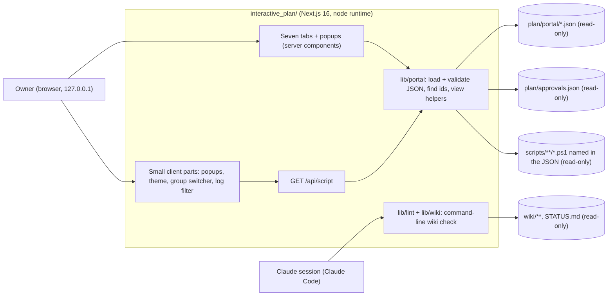

# Plan portal (`interactive_plan/`): product specification

> **This page describes portal v2** (task p0.17, 2026-10-09). The owner found v1, a wiki browser with
> an approvals inbox, too technical ([owner feedback](../raw/owner/2026-10-09-s01-plan-app-feedback.md)) and chose a
> read-only, plain-language portal ([owner decisions](../raw/owner/2026-10-09-s01-portal-v2-decisions.md),
> [adr-0023](../decisions/adr-0023-approvals-in-claude-code-portal-read-only.md),
> [adr-0024](../decisions/adr-0024-portal-reads-plain-language-json.md)). The v1 specification is in git history
> (this page before commit "feat(portal): read-only portal shell ..."); v1's build plan stays readable as
> [ip-build-plan](ip-build-plan.md) and its approvals API as [ip-approvals-api](ip-approvals-api.md), both retired.

The `interactive_plan/` folder holds a small Next.js application: a **read-only portal** where the owner follows the
project in plain words. It is planning tooling for this repository. It is **not part of Ferrum**, is never shipped
and is never deployed.

| Page | Content |
|---|---|
| this page (`ip-spec`) | Purpose, users, scope, non-goals, principles, architecture, technology |
| [ip-routes-and-views](ip-routes-and-views.md) | The seven tabs, the popups, the script route and the UI rules |
| [ip-data-contract](ip-data-contract.md) | What the portal reads (portal JSON, approvals file) and what the command-line wiki check reads |
| [ip-wiki-lint](ip-wiki-lint.md) | `npm run lint:wiki` and `npm run gate`: command-line checks of SCHEMA §9.3, kept from v1 |
| [ip-testing](ip-testing.md) | Type check, ESLint, unit, browser and accessibility tests; `npm run verify` |
| [ops-portal-pipeline](../operations/ops-portal-pipeline.md) | How Claude writes the portal JSON from the wiki (skill, shapes, checker, end-of-turn hook) |

## 1. Purpose

1. **Let the owner understand the project quickly.** The owner's comprehension sets the pace of the project
   ([owner feedback](../raw/owner/2026-10-09-s01-plan-app-feedback.md)). The portal shows where the project stands,
   what happens next, every phase with its tasks and check scripts, the architecture, decisions, risks, research
   design, open questions and a plain-language log.
2. **Make every id explain itself.** Any id-shaped word (phase, task, decision, risk, question, commit, ...) is a
   button that opens a short explainer in a popup, without leaving the page.
3. **Show, never change.** The owner steers and approves in Claude Code; Claude records approvals with
   `tools/approvals_record.py` ([adr-0023](../decisions/adr-0023-approvals-in-claude-code-portal-read-only.md)). The
   portal only shows approval state.
4. **Let the owner read a check script before running it.** Each phase popup shows the PowerShell 7 check script of
   every task and of the phase gate ([adr-0025](../decisions/adr-0025-check-scripts-powershell-7.md)).

## 2. Users

| User | Needs | Where |
|---|---|---|
| **Owner** (one person, local machine) | Where are we, what is next, what does each phase do, what does an id mean, what did Claude decide | The seven tabs and their popups |
| **Claude sessions** | Check the wiki after edits; check whether a phase may start | `npm run lint:wiki`, `npm run gate` (command line, [ip-wiki-lint](ip-wiki-lint.md)) |

There is exactly one human user. Accounts, roles and remote access are out of scope.

## 3. Scope (in)

- Seven top tabs from the owner-approved mockups (Layout A): Overview, Roadmap, Architecture, Decisions (with risks),
  Research, Questions, Log ([ip-routes-and-views](ip-routes-and-views.md)).
- Popups: phase (tasks, test gate, gate script), reference (any id), detail (decision, risk, research item), script
  (the text of a check script).
- Read-only approval labels from `plan/approvals.json`.
- `GET /api/script`: the text of a check script that the portal JSON names, nothing else.
- Light, dark and system themes; keyboard and screen-reader accessible; usable at phone width.
- The command-line wiki check and entry-gate report from v1 ([ip-wiki-lint](ip-wiki-lint.md)).

## 4. Non-goals

- **No writes of any kind.** No approvals, no edits, no log entries. Every route refuses methods other than GET and HEAD.
- **No wiki pages in the portal.** The wiki is Claude's working memory; the portal shows only its plain-language
  translation ([adr-0024](../decisions/adr-0024-portal-reads-plain-language-json.md)).
- **No deployment, hosting, analytics, external fonts or CDN calls.** At runtime the portal makes no outbound requests.
- **No authentication.** It listens on 127.0.0.1 only and refuses non-loopback `Host` headers.
- **No database and no Ferrum code.** The JSON files in `plan/portal/` are the data.
- **No git operations.** Claude commits; nobody pushes without the owner.

## 5. Design principles

1. **Plain words first.** Text is short, low on jargon and written for a smart non-specialist; tasks use a thought
   chain (cause → action → why it matters). The rules are in the repo skill `wiki-to-portal`
   ([ops-portal-pipeline](../operations/ops-portal-pipeline.md)).
2. **The JSON is the only input for pages.** Pages render `plan/portal/*.json` and `plan/approvals.json`; nothing on
   screen is invented by the portal. When the text is wrong, Claude fixes the wiki and its JSON in the same edit.
3. **Bad data is visible, not fatal.** A JSON file that is missing or does not match its shape shows a note at the top
   of the page; the rest still renders.
4. **Pure logic, thin pages.** Loading, validation, id detection and view helpers live in `lib/portal/` and are unit
   tested; pages and components only arrange them.
5. **Approval state is never guessed.** A label says "Approved" only when `plan/approvals.json` holds an approval whose
   fingerprint matches the one the portal text was written from; a different fingerprint says "Approved, page edited
   since", and an unreadable approvals file says so instead of guessing.

v1 had a page-render time target; v2 sets none, because the owner reads a handful of small JSON files and the target
no longer guards anything (decided by Claude under the wave 0c delegation policy; logged 2026-10-09).

## 6. Architecture



- **Start (owner):** `pwsh -NoProfile -File scripts/start-portal.ps1` finds Node, installs packages the first time,
  checks the port, builds, starts on http://127.0.0.1:3417/ and opens the browser
  ([interactive_plan/README.md](../../interactive_plan/README.md)).
- **Runtime:** `next start` or `next dev` through `scripts/serve.mjs`, always `-H 127.0.0.1` on `PLAN_PORT` (default
  3417). `proxy.ts` refuses a non-loopback `Host` (403) and any method other than GET and HEAD (405). Every response
  sends `X-Frame-Options: DENY` and a same-origin Content-Security-Policy.
- **File locations** come from `PLAN_REPO_ROOT`, `PLAN_DATA_DIR` (holds `portal/` and `approvals.json`),
  `PLAN_WIKI_DIR` and `PLAN_STATUS_FILE` (wiki check only) and `PLAN_PORT` ([ip-data-contract](ip-data-contract.md)).
- **Module rule:** files outside the app are read with `node:fs` at request time, never imported.

## 7. Technology (pinned exactly)

Source: [raw/research/nextjs-stack.md](../raw/research/nextjs-stack.md) §1 and §5; versions as installed in
`interactive_plan/package.json` (no `^`), `package-lock.json` committed.

| Concern | Package @ version |
|---|---|
| Runtime | Node 24 LTS (`engines.node: ">=24.15 <27"`) |
| Framework | next 16.4.0, react 19.3.0, react-dom 19.3.0 (App Router, Turbopack, no Cache Components) |
| Language | typescript 5.9.3 |
| Styling | tailwindcss 4.3.3 + @tailwindcss/turbopack 4.3.3, plus plain CSS tokens for light and dark |
| Fonts | @fontsource/ibm-plex-sans and @fontsource/ibm-plex-mono 5.3.0, self-hosted through `next/font/local` |
| Validation | zod 4.6.5; the zod schemas are generated from `plan/portal/schema/*.schema.json` (`npm run schemas:portal`) |
| Wiki check | yaml 2.9.1, github-slugger 2.0.0 (command line only) |
| Lint | eslint 9.39.5 + eslint-config-next 16.4.0 |
| Unit tests | vitest 5.0.3, jsdom 30.1.2, @testing-library/react 16.3.3 |
| Browser tests | @playwright/test 1.64.0 (Chromium), axe-core 4.14.0 |

The v1 graph and markdown libraries (xyflow, dagre, mermaid, react-markdown and its plugins) were uninstalled in p0.17.

**npm audit (accepted risk, owner answer 2026-10-09, [wave 0c](../raw/owner/2026-10-09-s01-wave0c.md) item 8):** the
remaining findings are 5 high in development tooling (eslint-config-next pulling in braces and micromatch). **Recheck
`npm audit` at the P0 exit** and record the result in the exit evidence.

## 8. Directory layout

```text
interactive_plan/
├── package.json  package-lock.json  next.config.ts  proxy.ts  tsconfig.json
├── eslint.config.mjs  vitest.config.mts  vitest.lint.config.mts  vitest.gate.config.mts  playwright.config.ts
├── app/          layout.tsx (top tabs, phase popups), page.tsx (Overview), roadmap/ architecture/ decisions/
│                 research/ questions/ log/, api/script/route.ts, not-found.tsx, globals.css, fonts.ts
├── components/   portal/ (Modal, PhasePopup, DetailPopup, Ref, RefProvider, RichText, ScriptProvider,
│                 GroupSwitcher, TopNav, browse/, ...), ThemeToggle
├── lib/          portal/ (load, schemas.gen, refs, scripts, view, tabs, dialogs), config.ts, security/,
│                 wiki/ + lint/ + approvals/ (command-line wiki check and approval-file reader)
├── scripts/      serve.mjs, gen-portal-schemas.mjs, with-env.mjs
└── tests/        unit/, lint/, e2e/, fixtures/
```

## 9. Owner decisions behind this page

| Decision | Where recorded |
|---|---|
| Approvals are given in Claude Code; Claude records them; the portal is read-only | [adr-0023](../decisions/adr-0023-approvals-in-claude-code-portal-read-only.md) |
| The portal renders only plain-language JSON that Claude writes from the wiki | [adr-0024](../decisions/adr-0024-portal-reads-plain-language-json.md) |
| Check scripts are PowerShell 7, one per task and one per phase gate | [adr-0025](../decisions/adr-0025-check-scripts-powershell-7.md) |
| Architecture in four groups, led by a layered picture of the Rust app | [adr-0026](../decisions/adr-0026-architecture-four-groups.md) |
| Real machine values are masked everywhere | [adr-0027](../decisions/adr-0027-mask-sensitive-values.md) |
| Layout A and the Phase, Roadmap, Architecture and Log mockups are the visual spec | [owner decisions](../raw/owner/2026-10-09-s01-portal-v2-decisions.md) |

The v1 owner decisions listed here before (mermaid version, log appends by the app, "reset to pending", build timing,
accessibility test library) no longer apply: v2 has no mermaid, writes nothing, and uses axe-core 4.14.0, which was
already in the lockfile (logged 2026-10-09).

Final check of v2 (2026-10-09): `npm run verify` green in one run, screenshots of every tab at 1440 and 390 pixels
compared with the mockups ([portal-verify.txt](../raw/evidence/phase-p0-planning/portal-v2/portal-verify.txt)).
