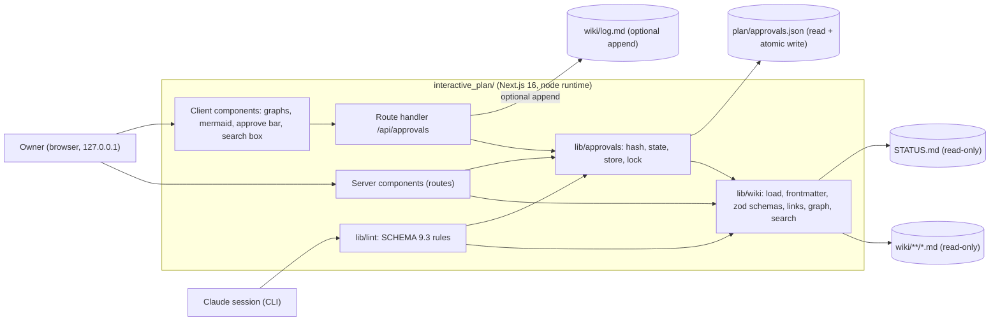

# Interactive plan app: product specification

The `interactive_plan/` folder holds a small Next.js application. It **visualises the Ferrum wiki** (architecture, phases and milestones, decisions, risks, research traceability, log) and lets the owner **approve or request changes** on every approvable page. It is planning tooling for this repository. It is **not part of Ferrum**, is never shipped and is never deployed.

The pages that make up the full specification:

| Page | Content |
|---|---|
| this page (`ip-spec`) | Purpose, users, scope, non-goals, principles, architecture |
| [ip-data-contract](ip-data-contract.md) | What the app reads and writes, zod models, hash algorithm + test vectors, effective approval state |
| [ip-routes-and-views](ip-routes-and-views.md) | Every route, what it shows, interaction and accessibility rules |
| [ip-approvals-api](ip-approvals-api.md) | `GET/POST /api/approvals`, local-only guards, atomic writes, concurrency |
| [ip-wiki-lint](ip-wiki-lint.md) | `npm run lint:wiki`: machine implementation of SCHEMA §9.3 |
| [ip-testing](ip-testing.md) | Unit, lint, E2E, typecheck, eslint, build gates |
| [ip-build-plan](ip-build-plan.md) | Step-by-step implementation plan for one build workflow, with test gates |

Binding owner inputs: Q13 (Node LTS for the plan app; installed by Claude on the owner's authorisation, [adr-0021](../decisions/adr-0021-claude-runs-toolchain-installs.md), Node 24 kept per Q-102) and Q14 (approve in the UI, persisted to `plan/approvals.json` via a local Next.js API route) in [raw/01-scoping-decisions.md](../raw/01-scoping-decisions.md). Owner directives 2, 4 and 9 in the same file ("set up a Next.js application … visualize this whole thing", "First the interactive plan comes together. I then approve everything else."). The governing decision is `adr-0016`. The data rules come from [SCHEMA.md](../SCHEMA.md) §5, §6 and §10.

## 1. Purpose

1. **Make the plan reviewable.** The owner can see the whole plan (phases M1–M7, architecture, decisions, risks, research design) at a glance and drill into any page.
2. **Make approval mechanical.** Each `approvable: true` page gets an Approve / Request changes / Reject control. The decision is written to `plan/approvals.json` together with the page's `content_hash` and `scope_hash` (SCHEMA §10). Editing the page afterwards visibly marks the approval **STALE**.
3. **Give future Claude sessions a fast, trustworthy status view and a linter.** `npm run lint:wiki` validates every wiki page against SCHEMA.md. The approvals inbox and the gate view answer "may I start phase P?" (SCHEMA §9.7) without reading 100+ files by hand.
4. **Never drift from the wiki.** The app **reads `wiki/` at request time**. It copies, caches to disk and generates no wiki content. This follows the recommendation in [raw/research/llm-wiki-pattern.md](../raw/research/llm-wiki-pattern.md) §"Plan app" and SCHEMA §1.4.

## 2. Users

| User | Needs | Main views |
|---|---|---|
| **Owner** (single human, local machine) | Understand the plan, review pages, approve / request changes with a comment, see what is blocked and what is next | Dashboard, Roadmap, Phase detail, Approvals inbox, Architecture, Risks, Research |
| **Future Claude sessions** (zero memory) | Validate the wiki after edits; check gate readiness; read effective approval states without writing `approvals.json` | `npm run lint:wiki`, `GET /api/approvals` (or the same library through a vitest test), Approvals inbox, Dashboard |

There is exactly one human user. Multi-user operation, authentication and roles are out of scope.

## 3. Scope (in)

- Read-only rendering of every wiki page (frontmatter + GFM markdown + mermaid), with backlinks and full-text search.
- Typed views built from frontmatter: architecture graph, phase DAG + session-sized timeline, decision register, risk heatmap, research traceability graph, log timeline, dashboard.
- Approvals: the only write path, to `plan/approvals.json` (plus an optional `approval` entry appended to `wiki/log.md`, see [ip-approvals-api](ip-approvals-api.md) §6).
- A wiki linter implementing SCHEMA §9.3 as a library, a CLI-style vitest suite and a `/lint` page.
- Light and dark themes, keyboard accessible, local-only.

## 4. Non-goals

- **No editing of wiki pages in the app.** Claude writes the wiki and the owner comments through approvals. A page edit through the UI would bypass the log discipline (SCHEMA §9).
- **No writes to `wiki/raw/`**, ever (SCHEMA §3.1).
- **No deployment, hosting, telemetry, analytics, external fonts or CDN calls.** At runtime the app makes no outbound network requests.
- **No authentication.** Local-only guards replace it ([ip-approvals-api](ip-approvals-api.md) §3).
- **No database.** The files in the repo are the database.
- **No Ferrum code**, no Tauri, and no benchmark results (none exist).
- **No git operations** (no commit, no push). The owner or Claude commits `plan/approvals.json` under `adr-0011`. Claude never pushes.
- No `use cache` / Cache Components and no static export. Every view must show the current file state.
- No mobile-first design. Desktop is primary. Narrow widths must remain usable (single-column, no horizontal page scroll).

## 5. Design principles

1. **Wiki is the source of truth.** Every number, status and edge on screen comes from a frontmatter field or a body. When the wiki is wrong, the fix is in the wiki, never in the app.
2. **Invalid data is visible.** A page that fails validation still renders, with a red "schema errors" banner listing the lint findings. It is never silently dropped. Graph edges to unknown ids render as dashed red "dangling" nodes.
3. **Pure logic, thin pages.** Parsing, validation, hashing, graph building, gate evaluation and linting live in framework-free TypeScript modules under `lib/`. Vitest can test those modules. Server components only call them. Vitest cannot test async Server Components ([raw/research/nextjs-stack.md](../raw/research/nextjs-stack.md) §3.6).
4. **Integrity mirrors SCHEMA.** The app never invents a status. Effective approval states are exactly SCHEMA §10.3. It never shows a measured number unless that number is a wiki field value.
5. **Fast enough to forget.** Targets (goals, not measurements): any route renders server-side in under 500 ms with a wiki of 300 pages on the owner's machine, and the first-load JS of non-graph routes stays small. `UNVERIFIED[phase-p0-planning]` They are checked once in build step IP-9 ([ip-build-plan](ip-build-plan.md)) and recorded as evidence. They are never presented as Ferrum results.

## 6. Architecture



- **Runtime:** `next start` (production build) or `next dev`, always started with `-H 127.0.0.1` on a fixed port (default `3417`, override with `PLAN_PORT`). All route handlers declare `export const runtime = 'nodejs'`.
- **File locations** come from environment variables. The defaults are relative to the app directory:

| Variable | Default | Purpose |
|---|---|---|
| `PLAN_REPO_ROOT` | `path.resolve(process.cwd(), '..')` | Repo root |
| `PLAN_WIKI_DIR` | `<root>/wiki` | Wiki directory (read-only) |
| `PLAN_STATUS_FILE` | `<root>/STATUS.md` | Live status (read-only) |
| `PLAN_DATA_DIR` | `<root>/plan` | Directory holding `approvals.json` (E2E tests point this at a temp copy) |
| `PLAN_READONLY` | unset | `1` disables POST (returns 403). Useful when Claude starts the app only to look |
| `PLAN_APPEND_LOG` | `1` | `0` disables appending `approval` entries to `wiki/log.md` |
| `PLAN_PORT` | `3417` | Port used by npm scripts |

- **Module rule:** wiki files are **never `import`ed**. Turbopack does not resolve files outside the project root ([raw/research/nextjs-stack.md](../raw/research/nextjs-stack.md) §3.5). They are read with `node:fs/promises` at request time. This works under Turbopack in both `next dev` and `next start`: spike S1 of IP-1 read `../wiki/SCHEMA.md` and wrote, read back and deleted `../plan/.spike-*` from a route handler at request time ([IP-1-spikes.txt](../raw/evidence/phase-p0-planning/interactive-plan/IP-1-spikes.txt)).
- `next.config.ts` sets `turbopack.root` explicitly to the `interactive_plan/` directory. This guards against later lockfiles in the repo root ([raw/research/nextjs-stack.md](../raw/research/nextjs-stack.md) §3.5).

## 7. Technology (pinned exactly; versions from the 2026-10-08 registry snapshot)

Source: [raw/research/nextjs-stack.md](../raw/research/nextjs-stack.md) §1 and §5. All versions are pinned **exactly** in `package.json` (no `^`), and `package-lock.json` is committed.

| Concern | Package @ version |
|---|---|
| Runtime | Node 24 LTS (`engines.node: ">=24.15 <27"`, `.nvmrc` with the exact installed version recorded at build time) |
| Framework | next 16.4.0, react 19.3.0, react-dom 19.3.0 (App Router, Turbopack, **no** Cache Components, **no** React Compiler, no agent feedback) |
| Language | typescript 5.9.3 (**not** 7.x: outside typescript-eslint's peer range, research note §1.1) |
| Styling | tailwindcss 4.3.3 + @tailwindcss/turbopack 4.3.3 (what create-next-app 16.4 emits, research note §3.1) |
| Lint | eslint 9.39.x (exact patch recorded at install) + eslint-config-next 16.4.0, flat config |
| Graphs | @xyflow/react 12.12.0 + @dagrejs/dagre 3.1.1 |
| Markdown | react-markdown 10.1.0 + remark-gfm 4.0.1 + rehype-slug 6.0.0; github-slugger 2.0.0 as an exact direct dependency (the slug algorithm rehype-slug uses, needed by the loader for heading anchors; owner answer 2026-10-09, [wave 0c](../raw/owner/2026-10-09-s01-wave0c.md) item 4) |
| Diagrams | mermaid 12.1.0 with `layout: 'dagre'`, `look: 'classic'`, `securityLevel: 'strict'` (fallback 11.17.2, owner decision, see §9) |
| Frontmatter | yaml 2.9.1 + an in-house frontmatter splitter (not gray-matter, unmaintained since 2021) |
| Validation | zod 4.6.5 |
| Unit tests | vitest 5.0.3, @vitejs/plugin-react 6.1.2, vite-tsconfig-paths 6.1.1, jsdom 30.1.2, @testing-library/react 16.3.3, @testing-library/dom 10.4.2 |
| E2E | @playwright/test 1.64.0 (Chromium) |

Scaffold command (research note §3.1; the combined flag set ran unchanged in IP-1 in the repo path containing a space, [IP-1-scaffold.txt](../raw/evidence/phase-p0-planning/interactive-plan/IP-1-scaffold.txt)):

```text
npx create-next-app@16.4.0 interactive_plan --ts --tailwind --eslint --app --turbopack --import-alias "@/*" --use-npm --disable-git --no-cache-components --no-agent-feedback --no-react-compiler
```

The generator's `typescript ^5` and `eslint ^9` ranges are then replaced with the exact pins above. No package is installed with `@latest`.

**npm audit (accepted risk, owner answer 2026-10-09, [wave 0c](../raw/owner/2026-10-09-s01-wave0c.md) item 8):** at IP-1 `npm audit` reported 7 findings, 2 low in production dependencies (katex through mermaid 12.1.0) and 5 high in dev tooling ([IP-1-scaffold.txt](../raw/evidence/phase-p0-planning/interactive-plan/IP-1-scaffold.txt)). The only offered fix is `npm audit fix --force`, which would downgrade mermaid to 10.8.0. For a local-only planning tool bound to 127.0.0.1 these are accepted: no `npm audit fix --force`. **Recheck `npm audit` at the P0 exit** (before `phase-p0-planning#exit` is approved) and record the result in the exit evidence.

## 8. Directory layout (target)

```text
interactive_plan/
├── package.json  package-lock.json  .nvmrc  next.config.ts  tsconfig.json
├── eslint.config.mjs  vitest.config.mts  vitest.lint.config.mts  playwright.config.ts
├── app/                     # routes (see ip-routes-and-views)
│   ├── layout.tsx  page.tsx  globals.css
│   ├── architecture/ roadmap/ phases/[id]/ decisions/ decisions/[id]/
│   ├── risks/ research/ wiki/[[...path]]/ go/[id]/ search/ log/ approvals/ lint/
│   └── api/approvals/route.ts
├── components/              # Markdown, Mermaid (client), FlowGraph (client), ApproveBar (client),
│                            # StatusBadge, ApprovalBadge, Heatmap, Timeline, ThemeToggle, PageShell
├── lib/
│   ├── config.ts            # env → absolute paths
│   ├── wiki/                # frontmatter.ts schemas.ts load.ts links.ts graph.ts search.ts log.ts status.ts gates.ts
│   ├── approvals/           # hash.ts state.ts store.ts lock.ts
│   └── lint/                # rules/*.ts run.ts format.ts
└── tests/
    ├── unit/                # vitest (node + jsdom)
    ├── lint/                # `npm run lint:wiki`: wiki-lint.test.ts + real-wiki-loader.test.ts (real wiki, read-only)
    ├── e2e/*.spec.ts        # Playwright
    └── fixtures/            # mini-wiki/, broken-wiki/, status/, e2e-overlay/ (E2E-only cases, IP-6)
```

## 9. Owner decisions this spec needs (also returned to the integrator for `ov-open-questions`)

1. **Mermaid 12.1.0 vs 11.17.2.** The default is 12.1.0 with the classic look. 11.17.2 is the mature fallback (research note §4).
2. **May the app append `approval` entries to `wiki/log.md`?** The default is yes (`PLAN_APPEND_LOG=1`). SCHEMA §10.1 allows the plan app to do it. The alternative is that Claude writes them at the next RESUME.
3. **"Reset to pending".** SCHEMA §10.1 allows only `approved | changes-requested | rejected`, and `history` is append-only. The brief for this page also listed `pending` as a POST status. This spec does **not** implement `pending` unless the owner wants it, because it would need a SCHEMA change (for example a `withdrawn` status kept in history).
4. **When the app is built.** Settled: inside P0, per owner directives 2 and 4 (Q-101, answered). [raw/research/nextjs-stack.md](../raw/research/nextjs-stack.md) §6 calls P1 the "plan-app build phase"; that label predates the answer. The IP-* to `p0.N` mapping is the table on [phase-p0-planning](../phases/phase-p0-planning.md).
5. **Optional accessibility test dependency** (`@axe-core/playwright`). Its version was not captured in the research note. It would be added only with owner consent and pinned from the registry at build time.
