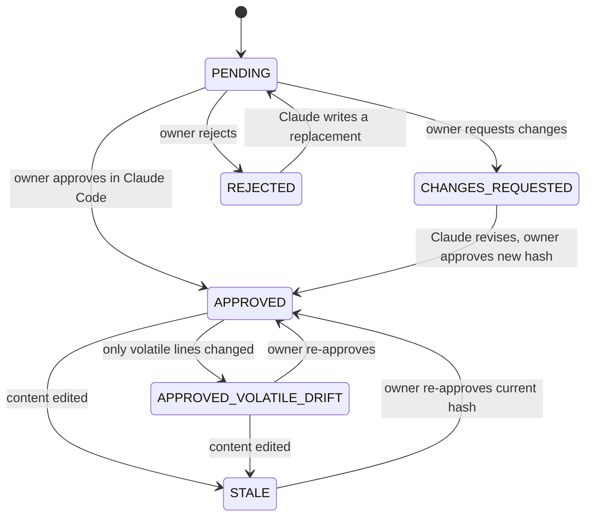
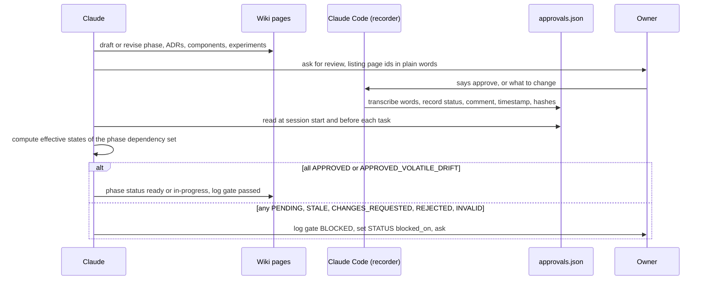

# Approval workflow

The owner decided: "First the interactive plan comes together. I then approve everything else" and
"We go phase wise" ([raw/01-scoping-decisions.md](../raw/01-scoping-decisions.md), directives 4–5;
Q11 milestone review checkpoints; Q14 approvals persisted to `plan/approvals.json`). This page explains
how that works day to day. The normative rules are SCHEMA §9.7 and §10 ([SCHEMA](../SCHEMA.md)).

**Changed 2026-10-09 ([adr-0023](../decisions/adr-0023-approvals-in-claude-code-portal-read-only.md)):** the owner
approves in Claude Code, not in the plan app. Claude records the decision in `plan/approvals.json` with the same
fingerprints as before, so a later edit still shows as STALE. The plan portal is read-only.

## 1. Who does what

| Actor | May | May not |
|---|---|---|
| **Owner** | Approve, request changes or reject any approvable page, in Claude Code; approve milestone exits (`<phase-id>#exit`) | — |
| **Claude** (main session) | Transcribe the owner's words to `wiki/raw/owner/`; record the decision with `tools/approvals_record.py`; log `approval`; read `approvals.json`; compute effective states; stop work when a state blocks; ask the owner | Record a decision the owner did not give; edit `plan/approvals.json` by hand; set an ADR to `accepted` without approval; treat an agent, script or hook message as the owner's decision |
| **Subagents** | Read `approvals.json` | Write `plan/approvals.json` in any way |
| **Plan portal** (`interactive_plan/`, comp-interactive-plan) | Show approval states (read-only) | Write anything |

Recording an approval, step by step (SCHEMA §10.1):

1. Owner decides in Claude Code → Claude saves the owner's words verbatim to
   `wiki/raw/owner/YYYY-MM-DD-<slug>.md` (INGEST) → proof of who decided what, and when.
2. `python tools/approvals_record.py <key> <approved|changes-requested|rejected> --source <that file> --comment "<short quote>"`
   → stores the page's `content_hash` and `scope_hash` (plus `bootstrap_hash` of CLAUDE.md for `schema`), moves the
   previous decision into `history`, writes atomically → later edits are detected. Use `--dry-run` first when unsure.
3. Append `## [YYYY-MM-DD] approval | <key> <decision>` to `wiki/log.md` naming the raw file → the change is traceable.
4. `python tools/approvals_check.py` → confirm the key now shows APPROVED (or the requested state).

## 2. What an approval binds: the hashes

Each approval stores two hashes of the approved file (SCHEMA §10.2), after normalising CRLF/CR to LF:

- `content_hash`: the whole file.
- `scope_hash`: the file with the `status:`, `updated:` and `last_verified_commit:` frontmatter lines removed.

So bookkeeping (an ADR flipping to `accepted`, a phase to `in-progress`, a new `updated` date) keeps the
approval valid as **APPROVED_VOLATILE_DRIFT**, while any change to actual content makes it **STALE**.



Only APPROVED and APPROVED_VOLATILE_DRIFT count as approved for gates. INVALID (file missing or
`approvable: false`) is a lint error.

## 3. How approvals gate phases



The **dependency set** of phase P (SCHEMA §9.7) is: P's page; each ADR in `P.decisions`; each component
with `phase_introduced: P` or listed in `P.components`; each experiment in `P.experiments`; and `schema`.
In addition, every phase in `P.depends_on` must be `done` with key `<dep>#exit` approved, and no open
`Q-NNN` in [ov-open-questions](../overview/ov-open-questions.md) may block an id in the set.

Milestone exit (adr-0014): when the exit evidence is complete, Claude sets the phase to `gate-review`
and asks the owner, who approves `<phase-id>#exit` in Claude Code after checking the evidence under
`wiki/raw/evidence/<phase-id>/`; Claude records it as in §1.

## 4. Checking approval state as Claude

`npm run lint:wiki` (see [ip-spec](../interactive-plan/ip-spec.md)) and, as an independent cross-check, the read-only stdlib Python script [`tools/approvals_check.py`](../../tools/approvals_check.py)
(Python 3.12.10 is installed per the raw environment record). The owner chose to version it under
`tools/` with tests (Q-216, [raw/owner/2026-10-08-s01-wave0b.md](../raw/owner/2026-10-08-s01-wave0b.md)).
The block below is its exact text; `tools/test_approvals_check.py` fails if the two differ, so change
both in the same edit. Its hash function is the SCHEMA §10.2 reference verbatim. Session s01 tested it on
a scratch copy of the wiki: APPROVED, then APPROVED_VOLATILE_DRIFT after a `status` flip plus CRLF
conversion, then STALE after a body edit, and a `--gate` run that listed the blocking ids. It never
writes any file. Two checks were added after that test and were run on the real wiki in the same
session (no `approvals.json`): the P0 bootstrap branch (`--gate phase-p0-planning` prints `BOOTSTRAP`
and exits) and the `PHASE-DONE-NO-EXIT` warning for a phase whose `status: done` has no approved
`<phase-id>#exit` key. Added when it moved to `tools/` (2026-10-08, owner answer to Q-216):
the SCHEMA §10.2 `bootstrap_hash` check on `schema` (a changed `CLAUDE.md` makes `schema` STALE; since
IP-3, 2026-10-09, a missing `CLAUDE.md` does too, fail closed, matching the plan app), the
fail-closed `Q-FORMAT` rule (a question section with a missing, repeated or unknown `status`, a missing or
unparsable `blocking` list, or a duplicate id is reported and treated as **open and blocking every
phase**, SCHEMA §9.3), and the CONTRADICTION registration rule of SCHEMA §9.7 step 4 (an open
`> **CONTRADICTION:**` blockquote on a page in the dependency set blocks the gate unless it names a
`Q-NNN` that exists in the register; a registered one is decided by that question's `blocking` list).
`tools/test_approvals_check.py` exercises each of these on temporary fixtures, never on the real
`plan/approvals.json`. Exit code: 1 when `--gate` reports BLOCKED or a `Q-FORMAT` error exists.

Run it from the repo root:

```bash
python tools/approvals_check.py                             # states of recorded approvals
python tools/approvals_check.py --pending                   # plus approvable pages with no record
python tools/approvals_check.py --gate phase-p1-foundation  # full entry-gate check
python tools/approvals_check.py --gate phase-p0-planning    # prints BOOTSTRAP (no approval gate)
```

Git Bash note: Python on Windows prints CRLF line endings. Strip `\r` (pipe through `tr -d '\r'`)
before pasting its output into JSON or comparing strings.

```python
#!/usr/bin/env python3
"""Ferrum approval-state checker (read-only). Run from the repo root.
Usage: python tools/approvals_check.py [--gate <phase-id>] [--pending]
Mirrors wiki/SCHEMA.md §10.2 (hashes, bootstrap_hash), §10.3 (states), §9.7 (entry gate: dependencies,
dependency set, open questions with fail-closed Q-FORMAT, unregistered CONTRADICTION blockquotes).
Never writes any file. Exit code 1 when --gate reports BLOCKED or a Q-FORMAT error exists, else 0."""
import glob, hashlib, json, os, re, sys

def norm(b):
    return b.replace(b'\r\n', b'\n').replace(b'\r', b'\n')

def hashes(path):  # identical to the SCHEMA §10.2 reference
    b = norm(open(path, 'rb').read())
    content = hashlib.sha256(b).hexdigest()
    s = b
    if b.startswith(b'---\n'):
        end = b.index(b'\n---\n', 3) + 1
        fm = re.sub(rb'(?m)^(status|updated|last_verified_commit)[ \t]*:.*\n', b'', b[:end])
        s = fm + b[end:]
    return 'sha256:' + content, 'sha256:' + hashlib.sha256(s).hexdigest()

def frontmatter(path):
    """Minimal parser: top-level scalars and lists of scalars only (enough for gates)."""
    t = norm(open(path, 'rb').read()).decode('utf-8')
    if not t.startswith('---\n'):
        return {}
    block = t[4:t.index('\n---\n', 3)]
    fm, key = {}, None
    for line in block.split('\n'):
        m = re.match(r'^([A-Za-z_][\w-]*):\s*(.*)$', line)
        if m:
            key, v = m.group(1), m.group(2).strip()
            if v.startswith('[') and v.endswith(']'):
                fm[key] = [x.strip().strip('"\'') for x in v[1:-1].split(',') if x.strip()]
            elif v == '':
                fm[key] = []
            else:
                fm[key] = v.strip('"\'')
            continue
        m = re.match(r'^\s+-\s+([^:{}\[\]]+)$', line)
        if m and key and isinstance(fm.get(key), list):
            fm[key].append(m.group(1).strip().strip('"\''))
    return fm

pages = {}
for p in glob.glob('wiki/**/*.md', recursive=True):
    p = p.replace('\\', '/')
    if p.startswith('wiki/raw/'):
        continue
    fm = frontmatter(p)
    if 'id' in fm:
        pages[fm['id']] = (p, fm)

try:
    approvals = json.load(open('plan/approvals.json', encoding='utf-8')).get('approvals', {})
except FileNotFoundError:
    approvals = {}

def state(key):
    pid = key.split('#')[0]
    if pid not in pages or pages[pid][1].get('approvable') != 'true':
        return 'INVALID' if key in approvals else 'PENDING' if pid in pages else 'INVALID'
    if key.endswith('#exit') and pages[pid][1].get('type') != 'phase':  # SCHEMA §10.3, as the plan app
        return 'INVALID'
    e = approvals.get(key)
    if not e:
        return 'PENDING'
    if e['status'] == 'rejected':
        return 'REJECTED'
    if e['status'] == 'changes-requested':
        return 'CHANGES_REQUESTED'
    if key == 'schema' and e.get('bootstrap_hash'):  # SCHEMA §10.2: CLAUDE.md drift stales schema
        cur = 'sha256:' + hashlib.sha256(norm(open('CLAUDE.md', 'rb').read())).hexdigest() if os.path.exists('CLAUDE.md') else None
        if cur != e['bootstrap_hash']:  # a missing CLAUDE.md counts as drift (fail closed, as the plan app)
            return 'STALE'
    c, s = hashes(pages[pid][0])
    if c == e.get('content_hash'):
        return 'APPROVED'
    if s == e.get('scope_hash'):
        return 'APPROVED_VOLATILE_DRIFT'
    return 'STALE'

def questions():
    """ov-open-questions sections -> {qid: (status, blocking set or None)}; None = blocks every phase."""
    oq, out, errs = 'wiki/overview/ov-open-questions.md', {}, []
    if not os.path.exists(oq):
        return out, errs
    for sec in re.split(r'(?m)^## ', norm(open(oq, 'rb').read()).decode('utf-8'))[1:]:
        m = re.match(r'(Q-\d{3}) ', sec)
        if not m:
            continue
        qid, bad = m.group(1), []
        st = re.findall(r'(?m)^- status:\s*(\S*)\s*$', sec)
        bl = re.findall(r'(?m)^- blocking:\s*(.*?)\s*$', sec)
        if len(st) != 1 or st[0] not in ('open', 'answered', 'withdrawn'):
            bad.append('status missing, repeated or unknown')
        ids = None
        if len(bl) == 1 and re.fullmatch(r'\[\s*(?:[a-z0-9#.-]+\s*(?:,\s*[a-z0-9#.-]+\s*)*)?\]', bl[0]):
            ids = {x.strip() for x in bl[0][1:-1].split(',') if x.strip()}
        else:
            bad.append('blocking missing, repeated or unparsable')
        if qid in out:
            bad.append('duplicate question id')
        if bad:  # fail closed (SCHEMA §9.3 Q-FORMAT): open and blocking every phase
            errs.append(f'Q-FORMAT {qid}: ' + '; '.join(bad))
            out[qid] = ('open', None)
        else:
            out[qid] = (st[0], ids)
    return out, errs

def contradictions(path):
    """Open '> **CONTRADICTION:**' blockquotes in a page -> list of (line no, Q ids named in the quote)."""
    lines, out = norm(open(path, 'rb').read()).decode('utf-8').split('\n'), []
    for i, line in enumerate(lines):
        if re.match(r'^> \*\*CONTRADICTION:\*\*', line):
            quote, j = [line], i + 1
            while j < len(lines) and lines[j].startswith('>'):
                quote.append(lines[j]); j += 1
            out.append((i + 1, sorted(set(re.findall(r'Q-\d{3}', ' '.join(quote))))))
    return out

OK = {'APPROVED', 'APPROVED_VOLATILE_DRIFT'}
args = sys.argv[1:]
rc = 0
print('approvals.json entries:', len(approvals))
for k in sorted(approvals):
    print(f'  {state(k):24} {k}')

qs, qerrs = questions()
for e in qerrs:
    print('  ' + e + ' (treated as open, blocking every phase)')
    rc = 1

for pid, (p, fm) in sorted(pages.items()):  # PHASE-DONE-NO-EXIT: done needs an approved #exit key
    if fm.get('type') == 'phase' and fm.get('status') == 'done' and state(pid + '#exit') not in OK:
        print(f'  PHASE-DONE-NO-EXIT {pid}: status done but {pid}#exit is {state(pid + "#exit")}')

if '--pending' in args:
    for pid, (p, fm) in sorted(pages.items()):
        if fm.get('approvable') == 'true' and pid not in approvals:
            print(f'  {"PENDING":24} {pid}')

if '--gate' in args:
    ph = args[args.index('--gate') + 1]
    if ph not in pages:
        sys.exit(f'unknown phase {ph}')
    if ph == 'phase-p0-planning':  # bootstrap: approvals cannot exist before the plan app
        print('BOOTSTRAP: phase-p0-planning has no approval-based entry gate (CLAUDE.md section 1 step 10).')
        print('  Authority: wiki/raw/01-scoping-decisions.md. Plan-app build (p0.9-p0.16) needs the owner chat')
        print('  approval of the ip-* pages and adr-0016 (Approval Wave 0), transcribed to wiki/raw/owner/.')
        sys.exit(rc)
    fm = pages[ph][1]
    deps = {ph, 'schema'} | set(fm.get('decisions', [])) | set(fm.get('experiments', [])) | set(fm.get('components', []))
    deps |= {i for i, (_, f) in pages.items() if f.get('phase_introduced') == ph}
    blocked = []
    for d in fm.get('depends_on', []):
        st = pages.get(d, (None, {}))[1].get('status')
        ex = state(d + '#exit')
        print(f'  depends_on {d}: status={st} exit={ex}')
        if st != 'done' or ex not in OK:
            blocked.append(d)
    for d in sorted(deps):
        st = state(d)
        print(f'  {st:24} {d}')
        if st not in OK:
            blocked.append(d)
    for qid, (st, ids) in sorted(qs.items()):
        if st == 'open' and (ids is None or ids & deps):
            print(f'  OPEN QUESTION {qid} blocks {"every phase (Q-FORMAT)" if ids is None else sorted(ids & deps)}')
            blocked.append(qid)
    for d in sorted(deps):  # SCHEMA §9.7 step 4: a blockquote naming no Q-NNN is unregistered and blocks
        if d in pages:
            for ln, named in contradictions(pages[d][0]):
                named = [q for q in named if q in qs]  # a Q id missing from the register does not register it
                if not named:
                    print(f'  UNREGISTERED CONTRADICTION {pages[d][0]}:{ln}')
                    blocked.append(f'{d}:CONTRADICTION')
                else:
                    print(f'  registered CONTRADICTION {pages[d][0]}:{ln} -> {", ".join(named)}')
    print('ENTRY GATE:', 'PASS' if not blocked else 'BLOCKED by ' + ', '.join(blocked))
    rc = rc or (1 if blocked else 0)
sys.exit(rc)
```

The minimal frontmatter parser handles top-level scalars and lists of scalars, which is enough for the
gate fields. It is not a full YAML parser and does not replace the lint.

## 5. Editing an approved page

1. Editing is allowed during planning (SCHEMA §10.4 rule 2). Make the edit and bump `updated`.
2. The log entry for the edit **must** include `- stales: [<ids>]`.
3. If the page is in the dependency set of the current or an in-progress phase, stop the dependent tasks
   at once: preserve uncommitted work, set `STATUS.md` `blocked_on`, log `gate | <id> approval stale`,
   and ask the owner to re-approve.
4. Batch related edits so the owner re-approves once, and tell the owner exactly which pages changed
   and why.

### 5.1 Approved page edited by someone other than Claude

SCHEMA §3.2 requires every edit to be logged, whoever makes it. Claude notices an edit it did not make
in one of three ways: the checker shows a page STALE or APPROVED_VOLATILE_DRIFT with no matching Claude
log entry; `git status` or `git log` shows a change no In-flight record explains; or the owner mentions
it. Then:

1. **Log it.** Append `## [YYYY-MM-DD] plan | owner edit detected on <id>` with `- session`,
   `- pages: [<id>]`, `- result: <one-line summary of the diff>` and `- stales: [<ids>]`. If the owner
   edited a page that was never approved, nothing goes stale: still log it, with `- stales: []`. Do not
   revert the owner's edit.
2. **Block the phase if needed.** If the page is in the dependency set of the current phase, or of any
   `in-progress` phase, and its state is now STALE:
   - set that phase's `status: blocked`;
   - add the page id to `STATUS.md` `blocked_on`;
   - log `gate | <phase-id> approval stale (owner edit)`;
   - ask the owner to re-approve the page in Claude Code.

   `blocked` returns to `in-progress` (or `ready`) only when the entry gate passes again.
3. **Check the In-flight task against an edited phase page.** If the edited page is the current phase
   page, re-read its `tasks`. The In-flight task id may no longer exist, may have been renumbered, or
   may have a changed `verify`. In any of those cases, preserve the work
   ([ops-resume-after-interruption §3.2](ops-resume-after-interruption.md#32-preserve-and-restart-default-when-unsure)),
   record the mismatch in In-flight, and ask the owner how the preserved work maps onto the new task
   list. Never guess the mapping.
4. **Volatile-only edits are not trusted blindly.** An edit that touches only `status:`, `updated:` or
   `last_verified_commit:` keeps the approval at APPROVED_VOLATILE_DRIFT, but it can still change what
   the gates see.
   - A phase with `status: done` counts as done only if key `<phase-id>#exit` is APPROVED or
     APPROVED_VOLATILE_DRIFT. The checker reports any other case as `PHASE-DONE-NO-EXIT`, and the entry
     gate treats that phase as not done.
   - An ADR set to `accepted` without §10.4 rule 3 is an `ADR-CHAIN` lint error.
   - Claude logs such edits as in step 1 and asks the owner to confirm them.

A lint rule `PHASE-DONE-NO-EXIT` (error) is proposed for SCHEMA §9.3. Until the schema adopts it, the
checker above enforces it.

## 6. Responding to owner decisions

| Owner action | Claude's response |
|---|---|
| Approve | The page counts as approved at the next gate check. For an ADR with `decided_by: claude-proposed`, set `status: accepted` (a volatile line, so the approval survives as APPROVED_VOLATILE_DRIFT) and log `decide` |
| Request changes | Read the comment, revise the page (new hash), log `plan` summarising the comment, ask for review again |
| Reject | ADR: set `status: rejected`, then DECIDE again with a new ADR. Other pages: rewrite or withdraw, then ask |
| Approve `<phase-id>#exit` | Set the phase `status: done`, log `gate`, point STATUS at the next phase's entry gate |

Every recorded decision gets its `approval` log entry in the same step (§1). If Claude finds a key change with no
matching entry (for example after an interruption), it adds the entry at the next RESUME and says so.

## 7. Bootstrapping

Historical note: the plan app was first meant to be the approval instrument (adr-0016, superseded by adr-0023), which
is why P0 had no approval-based entry gate. The order below follows owner directives 2 and 4 in
[raw/01-scoping-decisions.md](../raw/01-scoping-decisions.md), which answer Q-101 in
[ov-open-questions](../overview/ov-open-questions.md):

P0 therefore has **no approval-based entry gate** (CLAUDE.md §1 step 10;
[ops-session-protocol §1](ops-session-protocol.md#1-session-start-resume)). The checker prints
`BOOTSTRAP` for `--gate phase-p0-planning` instead of reporting every pending page as blocking.

1. P0 drafts the whole plan (this wiki).
2. The owner reviews the `ip-*` pages and confirms in chat that the plan app may be built (Wave 0, §8). Claude
   transcribes the confirmation to `wiki/raw/owner/` ([ip-build-plan](../interactive-plan/ip-build-plan.md)
   IP-0). The owner's directive to set up a Next.js application in `interactive_plan/` is the authority
   for building it inside P0.
3. Claude builds and tests the plan app. Ferrum application code stays forbidden.
4. The owner approves pages in Claude Code in the waves of §8 (since 2026-10-09, adr-0023): Wave 1 (`schema`, the P0 pages,
   `phase-p0-planning#exit`), then Wave 2 (P1's dependency set).

## 8. Approval waves

About 180 pages are approvable. The owner does **not** have to approve them all at once. A page needs
approval only when it enters the dependency set of the next phase's entry gate (SCHEMA §9.7: the phase
page, its `decisions`, the components it introduces or lists, its `experiments`, and `schema`). The waves
below are that rule worked out for the current wiki, in order. Before each wave, answer the listed
questions, because an open question that blocks an id in the set holds the gate anyway.

When Claude asks for approvals, it lists only the current wave, in plain words. The read-only portal may show the
same list. This table is derived; if it disagrees with the phase pages' frontmatter, the
frontmatter wins and the table is fixed.

| Wave | When | Approve these keys | Answer first | What approving commits you to |
|---|---|---|---|---|
| 0 | Before the plan app is built; **in chat**, transcribed to `wiki/raw/owner/` | `ip-spec`, `ip-data-contract`, `ip-routes-and-views`, `ip-approvals-api`, `ip-wiki-lint`, `ip-testing`, `ip-build-plan`, `adr-0016` | Q-006, Q-007, Q-103, Q-210 (and Q-102 Node line); all answered and the keys approved in chat on 2026-10-08 ([raw/owner/2026-10-08-s01-wave0.md](../raw/owner/2026-10-08-s01-wave0.md)) | Claude may build `interactive_plan/` as specified (P0 tasks p0.9–p0.16). No Ferrum code |
| 1 | After the plan portal v2 (p0.17), **in Claude Code** | `schema` (covers `CLAUDE.md` via `bootstrap_hash`), the `ip-*` pages as revised for portal v2, `adr-0023` to `adr-0027`, `phase-p0-planning`, `adr-0001`, `adr-0002`, `adr-0003`, `adr-0004`, `adr-0014`, `comp-interactive-plan`; then `phase-p0-planning#exit` | Q-207 and Q-004 (closed by approving `schema`), Q-005, Q-108 | The wiki conventions, the resumability protocol and the gating rules; P0 is done |
| 2 | P1 entry | `phase-p1-foundation`, `adr-0021`, `adr-0006`, `adr-0007`, `adr-0010`, `adr-0011`, `adr-0012`, `adr-0018`, `adr-0019`, `comp-core`, `comp-webview2-runtime`, `comp-windows-os` | Q-106, Q-110, Q-211 (Q-104 and Q-218 answered 2026-10-08) | Toolchain install (Claude runs winget, you confirm UAC; adr-0021), repo scaffold and layout, the four de-risking spikes including raw COM in spike S3. Still no product features |
| 3 | P2 entry | `phase-p2-minimal-container`, `adr-0015`, `comp-app-shell`, `comp-webview-manager`, `comp-security-engine`, `comp-tab-content`, plus the new ADRs from p1.9 and any page p1.9 revised (they are STALE) | Q-109, Q-202, Q-214 | Milestone M1: a minimal working container |
| 4 | P3 entry | `phase-p3-tabs-sessions` (+ anything STALE) | Q-107, Q-111, Q-209 | M2: tabs, sessions and the per-site profile route |
| 5 | P4 entry | `phase-p4-security`, `adr-0008`, `exp-security-overhead`, `exp-isolation-overhead` | Q-112, Q-113, Q-202, Q-212 | M3: the security engine and its test suite |
| 6 | P5 entry | `phase-p5-telemetry`, `comp-telemetry`, `comp-network-logger`, `exp-baseline-footprint`, `exp-startup`, `exp-navigation` | Q-114, Q-115, Q-203 | M4: telemetry and the network logger |
| 7 | P6 entry | `phase-p6-benchmark-harness`, `adr-0009`, `adr-0013`, `comp-benchmark-harness`, `comp-baseline-app`, `comp-research-analysis`, `comp-competitor-browsers`, `exp-rendering`, `exp-energy`, `exp-reliability` | Q-116 … Q-123, Q-201, Q-204, Q-205, Q-213 | M5: the benchmark harness, workloads and the pre-registered protocol |
| 8 | P7 entry | `phase-p7-lifecycle`, `comp-resource-manager`, `exp-lifecycle-policies` | Q-201, Q-208, Q-212 | M6: adaptive lifecycle management |
| 9 | P8 entry | `phase-p8-research-paper`, `adr-0017` | Q-124, Q-206 | M7: the paper |

Each wave from 2 on also needs the previous phase's `<phase-id>#exit` approved, and every page already
approved in an earlier wave must still be APPROVED or APPROVED_VOLATILE_DRIFT (re-approve anything STALE).

**Review optional:** pages outside every dependency set (risks, metrics, workloads, hypotheses, research
questions, the `ov-*` narrative pages, quality and operations pages) never gate a phase. Review them
when convenient, and approve them before the phase that uses them, so that an objection surfaces early.
