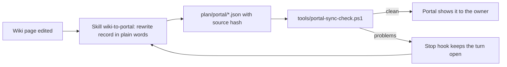

# Portal pipeline: wiki → plain-language JSON

## 1. In one paragraph

The owner reads the project through the read-only plan portal; the portal shows only JSON files in
`plan/portal/` ([ADR-0024](../decisions/adr-0024-portal-reads-plain-language-json.md)). Claude keeps the
wiki as its detailed memory and, **in the same edit**, rewrites the matching JSON record in plain
language. Each record remembers the fingerprint (SCHEMA §10.2 `content_hash`) of the page it came from,
so a later page edit without a JSON update is detected as **STALE**. Three layers enforce this, as the
owner chose ("Skill + safety-net hook",
[raw/owner/2026-10-09-s01-portal-v2-decisions.md](../raw/owner/2026-10-09-s01-portal-v2-decisions.md)):
a repo skill that says how to translate, a check script, and a Claude Code Stop hook that runs the check.

## 2. Files

| Path | What it is |
|---|---|
| `plan/portal/overview.json` | Briefing page: where we are, the next action in the owner's four-part format, questions for the owner (from `STATUS.md`) |
| `plan/portal/roadmap.json` | Stages, one row per phase, and the things that are the same in every phase (written once) |
| `plan/portal/phases/<phase-id>.json` | One phase for the phase popup: goal, status, progress, step order, tasks, test gate |
| `plan/portal/decisions.json`, `risks.json`, `research.json` | One plain record per ADR, risk, research question, hypothesis, experiment, metric, workload |
| `plan/portal/architecture.json` | Layers of the Rust app, the four groups ([ADR-0026](../decisions/adr-0026-architecture-four-groups.md)), every component |
| `plan/portal/questions.json` | The questions log (one item per `Q-NNN` in [ov-open-questions](../overview/ov-open-questions.md)) |
| `plan/portal/log.json` | The plain-language log; each entry lists the wiki log headings it covers |
| `plan/portal/refs.json` | An explainer (kind, title, 1-3 sentences, status, related ids) for every id the portal can show, so any id opens a popup |
| `plan/portal/schema/*.schema.json` | JSON Schema (draft 2020-12) per file; shared definitions in `common.schema.json` |
| `plan/portal/pipeline.json` | Machine-readable rules: file → schema, page → file, section coverage, id patterns, keys that are not text |
| `plan/portal/.hook-enabled` | Switch for the Stop hook (absent = hook does nothing). Committed when switched on |
| `.claude/skills/wiki-to-portal/SKILL.md` | The translation procedure and the plain-language style guide |
| `.claude/settings.json` | Project settings: the Stop hook |
| `tools/portal-sync-check.ps1` | The checker (also the hook, with `-Hook`; prints a page hash with `-Hash`) |
| `tools/test-portal-sync-check.ps1`, `tools/fixtures/portal-sync/clean/` | Tests and a small correct example repo |

## 3. Record rules

- Every translated record has an `id`, a plain `title`, a short plain `summary` (1-3 sentences) and
  `source: {wiki_path, content_hash}`. `wiki_path` is repo-relative (`wiki/...` or `STATUS.md`); the hash
  is the SCHEMA §10.2 `content_hash` of that page when the record was written. Log entries use `done`
  as their summary; the log file as a whole carries the source.
- Which pages are translated, and into which file: the table in the skill and `pipeline.json`
  (`translate`). Narrative pages (`ov-*` except the open-questions page, `qual-*`, `ops-*`, `ip-*`,
  glossary, handoffs, SCHEMA, index) get no record: the owner asked not to see the wiki pages themselves.
  They get a `refs.json` explainer only if portal text mentions them.
- Text limits and required arrows (`→` in every thought chain) are in the schemas, so "short and crisp"
  is checked, not just asked for.
- **Copies carry no source; they are checked for consistency** (decided 2026-10-09 after the v2
  review). Some portal text repeats another record: every `refs.json` explainer (title, status,
  summary) repeats its phase, task, decision, risk, question, research item, part or layer; the
  Overview's open-question count and list repeat `questions.json`; roadmap rows repeat the phase files;
  a phase's `progress.done` counts its tasks whose `status` is `Done`; layer and group lists repeat each
  part's own `layer` and `group`. A copy has no `source` of its own (the refs schema forbids it), so
  editing one page never fans out into dozens of STALE lines; instead the checker compares each copy
  with its record and reports `MISMATCH`. Records whose wording comes from a page other than the one
  they sit next to carry that page as their own source: architecture layers
  (`wiki/architecture/ov-arch-system-overview.md`) and groups (adr-0026). The roadmap stages and "same
  in every phase" are portal-only summaries of the phase list and of CLAUDE.md §2; the checker makes
  sure every phase is in exactly one stage.
- Ids in prose are written as links with words, `[one window, many web views](ref:adr-0007)`; the
  portal turns them into popups. Anything that looks like an id (patterns in `pipeline.json`) must
  resolve in `refs.json`, including phase short names `P0`-`P8` (aliases) and commit shas.
- **Check scripts** ([ADR-0025](../decisions/adr-0025-check-scripts-powershell-7.md); layout decided here):
  task scripts are `scripts/verify/<task-id>-<slug>.ps1` (e.g. `scripts/verify/p1.1-toolchain.ps1`),
  gate scripts `scripts/gates/<pN>-gate.ps1` (e.g. `scripts/gates/p1-gate.ps1`), following the
  owner-approved phase-popup mockup. A JSON `script` field names an existing file or is `null` until the
  script is written (the checker reports MISSING-SCRIPT otherwise).

## 4. The checker

`pwsh tools/portal-sync-check.ps1` (PowerShell 7, no installs). Exit 0 = clean, 1 = problems.

| Code | Meaning (as printed) |
|---|---|
| `MISSING-FILE` | A portal file listed in `pipeline.json` does not exist |
| `BAD-JSON` | A portal file is not valid JSON |
| `BAD-SHAPE` | A portal file does not match its schema (message names the field) |
| `STALE` | The page a record was translated from changed afterwards |
| `ORPHAN` | The page a record was translated from no longer exists |
| `MISSING` | A page that must be translated has no record in its file |
| `UNCOVERED` | A `## Q-NNN` question or a `## [date] op \| title` log heading has no entry |
| `UNKNOWN-REF` | An id written in portal text has no explainer in `refs.json` |
| `DUP-ID` | `refs.json` explains the same id or alias twice |
| `MISSING-SCRIPT` | A check-script path in the JSON does not exist |
| `MISMATCH` | A copy disagrees with its record (an explainer's title, status or summary; the Overview's question count or list; a phase's progress; a roadmap row; a layer or group list) |

`-Hash <path>` prints a page's content hash (identical to the SCHEMA §10.2 Python reference; a test
compares them). Validation uses `Test-Json`, which cannot follow a `$ref` into another file
([research note §5](../raw/research/claude-code-hooks-skills.md)), so the checker merges the shared
definitions from `common.schema.json` into each file schema before validating; the portal must do the
same. A full run on the real repo took 0.68 s in the first test run of 2026-10-09
([evidence](../raw/evidence/phase-p0-planning/p0.17-pipeline-checks.txt)), when the portal JSON was
still nearly empty. With all portal text written it took 4 to 8 s, and its 5 s speed test failed (found
by the v2 review). The checker now walks each file once without per-node function calls and runs each
id pattern once per file over all its text joined together: a full run takes about 2.3 s including
PowerShell start-up (measured 2026-10-09; the test output is in the review-fixes evidence under
`raw/evidence/phase-p0-planning/portal-v2/`). The
speed test's limit is 10 s, a third of the Stop hook's 30 s timeout, so a busy machine does not make it
flaky while a real slowdown is still caught.

## 5. The Stop hook

Configured in `.claude/settings.json` (exec form, as the docs recommend for path placeholders,
[research note §3](../raw/research/claude-code-hooks-skills.md)):
`pwsh -NoProfile -NonInteractive -File ${CLAUDE_PROJECT_DIR}/tools/portal-sync-check.ps1 -Hook -Root ${CLAUDE_PROJECT_DIR}`,
timeout 30 s. In hook mode the checker:

1. reads the hook input from stdin;
2. exits 0 at once if `plan/portal/.hook-enabled` does not exist (installed but switched off);
3. exits 0 if `stop_hook_active` is `true` (Claude is already continuing because of a stop hook; this
   prevents an endless loop, [research note §1](../raw/research/claude-code-hooks-skills.md));
4. otherwise runs the full check; if anything is wrong it writes a plain message and the first 15
   problems to stderr and exits 2, which keeps the turn open and shows the message to Claude
   ([research note §2](../raw/research/claude-code-hooks-skills.md));
5. if the checker itself crashes it exits 1 (a non-blocking hook error), so a broken checker never
   traps a session.

**Switching it on** (the last step of task p0.17, after all JSON is written and the check is clean):
create the empty file `plan/portal/.hook-enabled` and commit it. To switch off: delete the file (it is a
Claude-created file).

## 6. Workflow rules

- Same edit: a wiki change and its JSON change are in the same commit. The bookkeeping commit after a
  task (SCHEMA §9.5) therefore also carries `plan/portal/log.json` and `plan/portal/overview.json` when
  `wiki/log.md` and `STATUS.md` change.
- Raw files (`wiki/raw/`) are never translated directly; they reach the portal through the pages that
  cite them.
- Precedence is unchanged (SCHEMA §3.4): the wiki wins; a disagreement is a defect of the JSON.
- Changing the shape: edit the schema, `pipeline.json`, the skill's field guide, this page and the
  fixture together, run `pwsh tools/test-portal-sync-check.ps1`, and log a `decide` entry.

## 7. Check scripts (written in task p0.17, 2026-10-09)

One PowerShell 7 script per task and one gate script per phase ([ADR-0025](../decisions/adr-0025-check-scripts-powershell-7.md)),
linked from the `script` fields of `plan/portal/phases/*.json`.

| Path | What it is |
|---|---|
| `scripts/lib/Ferrum.Check.psm1` | Shared module: step results, summary, "what to tell Claude", exit codes, evidence saving through `tools/mask.ps1 --stdin` |
| `scripts/verify/<task-id>-<slug>.ps1` | One per task (141). P0 and P1: real checks. P2-P8: drafts that list the planned checks as TODO steps |
| `scripts/gates/p<N>-gate.ps1` | One per phase (9). A gate runs the task scripts of its phase, then the test-gate rows; manual rows are listed as YOURS |
| `scripts/run-all-checks.ps1` | `-Phase P<N>` runs one gate; `-List` shows which gates are real and which are drafts |
| `scripts/test-check-scripts.ps1` | Every `.ps1`/`.psm1` in `scripts/` and `tools/` parses; house rules; every JSON `script` field exists with the agreed name and no script is orphaned; `-RunDrafts` also runs every draft |

Rules:

- **Result words and exit codes** (the same in every script): PASS, FAIL, WAIT (waits for the owner or for
  earlier work), TODO (planned check, later phase), YOURS (a manual step for the owner; never fails a script).
  Exit 0 = everything checked passed (YOURS may remain), 1 = at least one FAIL, 2 = no FAIL but a WAIT or TODO.
- Every script starts with `#Requires -Version 7.0`, a plain-language header (what it checks, why, what it
  changes, how long, how to run, result, what to tell Claude), `Set-StrictMode -Version Latest` and
  `$ErrorActionPreference = 'Stop'`. An unexpected error inside a step is reported as that step's FAIL,
  never as a crash.
- Scripts change nothing by default. `-SaveEvidence` writes the printout, masked, as a **new** file under
  `wiki/raw/evidence/<phase-id>/` (a time stamp is added rather than overwrite a raw file); Claude adds
  its MANIFEST line when committing it.
- Tasks that wait for an owner approval end NOT READY (exit 2) until the approval is recorded
  (for example p0.17, p0.18). A gate lists the owner's part as YOURS, so the P0 gate passes when every
  automatic check passes; the phase still ends only with the owner's `#exit` approval.
- When a phase starts, Claude turns its draft TODO steps into real `Invoke-Step` checks before its first
  task is marked done; the planned command from the phase page's `verify` field is quoted in each draft's header.
- After any change to a script or to a `script` field: `pwsh -NoProfile -File scripts/test-check-scripts.ps1`
  and `pwsh tools/portal-sync-check.ps1` must both pass.
