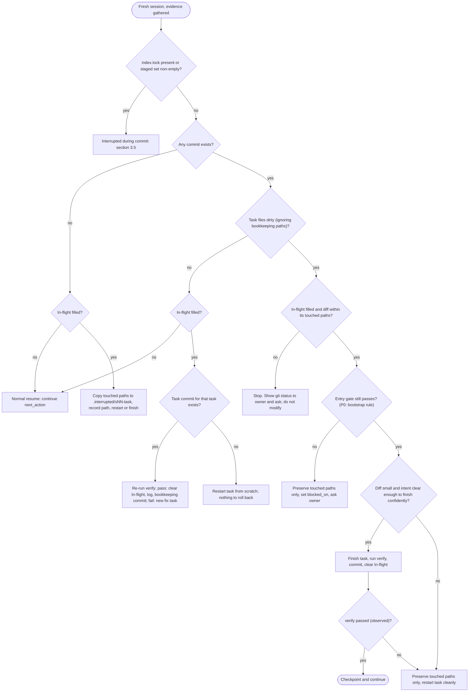

# Resume after interruption

Sessions can end without warning: tokens run out, the process crashes, or the terminal is closed. This
page tells a fresh session with no memory how to work out what was happening, and whether to finish the
work, redo it or roll it back. It refines SCHEMA §9.6 step 6 ([SCHEMA](../SCHEMA.md)). It relies on the
write-ahead In-flight record in [STATUS.md](../../STATUS.md), defined in
[ops-session-protocol §3](ops-session-protocol.md#3-write-ahead-the-statusmd-in-flight-section), and on
the two-commit checkpoint (a task commit, then a bookkeeping commit) in
[ops-session-protocol §4](ops-session-protocol.md#4-checkpoints).

**Rule of trust:** git history + `wiki/log.md` > STATUS.md > handoff note > your own assumptions.
Record any disagreement in a `resume` log entry.

**Bookkeeping paths:** `STATUS.md`, `wiki/log.md` and `wiki/index.md`. Every write-ahead and every
checkpoint changes them. In the classification below, "task files dirty" means changes **outside**
these paths. Changes to bookkeeping paths alone are explained by STATUS and the log. Read them, but they
are not an interruption signal. The In-flight `touched paths` always implicitly include the bookkeeping
paths.

## 1. Gather evidence (read-only, always safe)

Run every command in this block on every resume. `git stash list` is mandatory, not optional.

```bash
cd "/c/Users/Varun Ojha/Documents/Projects/ferrum-rust-webclient"
git rev-parse --verify -q HEAD || echo "NO COMMITS YET"   # P0 before the first commit
ls .git/index.lock 2>/dev/null && echo "INDEX LOCK PRESENT"
git status --short                 # uncommitted and untracked changes
git diff --cached --name-only      # staged but not committed (interrupted during commit?)
git diff --stat                    # size of tracked changes
git log --oneline -5               # last checkpoints (task commit + docs(status) bookkeeping commit)
git stash list | grep interrupted  # preserved interruptions: always report them to the owner
grep "^## \[" wiki/log.md | tail -5
sed -n '/^## In-flight/,/^## /p' STATUS.md
```

Classify the situation. Check the rows from the top; the first match wins.

| Signal | Meaning and action |
|---|---|
| `.git/index.lock` exists, or the staged set is non-empty | Interrupted during a commit. Follow §3.5 |
| No commits yet (no HEAD) | Every file is untracked, so git cannot show what changed. Classify by In-flight and the log only. Preserving means copying aside (§3.2, no-HEAD branch) |
| Task files clean, In-flight `none` | Normal. Continue with `next_action`. Bookkeeping-only changes are expected right after a write-ahead or before a bookkeeping commit |
| Task files clean, In-flight filled, a task commit with the In-flight task id exists (`git log --oneline -5`) | Died between the task commit and the bookkeeping commit. Re-run verify, clear In-flight, log, make the bookkeeping commit |
| Task files clean, In-flight filled, In-flight has `state: preserved in stash …` or `preserved in .interrupted/…` | Already preserved by an earlier resume. Restart the task, keep the stash or copy, and tell the owner |
| Task files clean, In-flight filled, no commit for that task | Died right after the write-ahead, before any edits. Restart the task |
| Task files dirty, In-flight filled | Interrupted mid-task. Use the decision tree in §2 |
| Task files dirty, In-flight `none` | Changes that no write-ahead explains (owner edits, or a missed write-ahead). **Ask the owner** before touching them. If the changes are to approved wiki pages, also run [ops-approval-workflow §5.1](ops-approval-workflow.md#51-approved-page-edited-by-someone-other-than-claude) |
| A stash named `interrupted …` exists | An earlier session preserved work. Mention it to the owner. Never drop it |
| A commit exists that the log does not mention | Died between commit and log. Add the missing log entry (op `correct`, noting the gap) |
| Campaign in flight: a `wiki/raw/bench/<run-id>/` (or `benchmarks/results/<run-id>/`) exists without a `SEALED` file | An interrupted benchmark campaign ([adr-0003](../decisions/adr-0003-multi-session-resumability.md) rule 5; [SCHEMA §3.1](../SCHEMA.md#31-raw-sources-wikiraw-immutable) open vs sealed runs). First check for still-running harness or browser processes and never kill one an earlier session started without owner consent. **Never edit existing files** in the run. Resume only through the orchestrator's resume command, as a new `segment-NN/` with the **same pinned versions**: if any browser or WebView2 version changed, abort the resume and log it. Record the gap in the run manifest. If the gap exceeds the limit set in the pre-registered protocol, ask the owner before resuming. Never restart the campaign from scratch in the same run folder, and never cherry-pick segments |

## 2. Decision tree



"Entry gate still passes" means: for phases P1–P8, the SCHEMA §9.7 entry gate. For
`phase-p0-planning`, the bootstrap rule (CLAUDE.md §1 step 10;
[ops-session-protocol §1](ops-session-protocol.md#1-session-start-resume)). P0 work may continue if the
owner directives still apply. Plan-app tasks (p0.9–p0.16) also need the owner's chat confirmation of
Q-101 and of the `ip-*` pages to be on file in `wiki/raw/owner/`. A P0 task is therefore not forced into
"preserve and blocked" just because nothing is approved in `plan/approvals.json`.

## 3. Actions

### 3.1 Finish and verify

Use this when the diff touches only the In-flight `touched paths`, is small enough to read in full, and
has a clear intent. Before continuing, read the whole diff: `git diff`, plus `git status` for new files.
Then run the task's `verify` check, commit per [ops-git-conventions](ops-git-conventions.md), clear
In-flight, log `resume` and `code`, and make the bookkeeping commit.

### 3.2 Preserve and restart (default when unsure)

Preserving does not destroy anything and can be undone. Stash **only the task's touched paths**. Never
stash the bookkeeping paths: they hold the write-ahead record and the log, and the next session needs
them in the working tree.

```bash
# <touched paths> = the In-flight list, WITHOUT STATUS.md, wiki/log.md, wiki/index.md
git stash push -u -m "interrupted p2.3 s05" -- "crates/webview-manager/src/nav.rs" "wiki/architecture/components/comp-webview-manager.md"
git status --short   # task files clean now; STATUS.md / wiki/log.md may still show as modified (expected)
```

Then, in this order:

1. Update In-flight. Keep the task and its paths, and add `- state: preserved in stash 'interrupted p2.3 s05'`.
2. Append a `resume` log entry that names the stash.
3. Redo the task from the last checkpoint commit.

Mention the stash in the handoff as well. A stash may be dropped only after the owner agrees.

**No commits yet (P0, no HEAD):** `git stash` fails without a HEAD. Copy (do not move) the touched paths
to a folder inside the repo, so the copy is not lost when the OS cleans its temp folder:

```bash
mkdir -p ".interrupted/s05-p0.10"
cp -r --parents "interactive_plan/app/page.tsx" ".interrupted/s05-p0.10/"   # one cp per touched path
```

Record `- state: preserved in .interrupted/s05-p0.10/` in In-flight and in the `resume` log entry. The
folder is never committed: stage explicit paths only, per [ops-git-conventions §2](ops-git-conventions.md#2-checkpoint-commits).
The P1 `.gitignore` adds `.interrupted/`. Deleting the folder needs the owner's consent (§3.3).

### 3.3 Roll back

Rolling back means discarding work, and **Claude never does it on its own**. That covers
`git reset --hard`, `git checkout -- <file>`, `git restore` of the working tree, `git clean`, deleting
files, deleting `.interrupted/` folders and removing lock files. Propose the rollback to the owner with
the exact command, and wait for an explicit yes. The one exception is files Claude created *in this same
session* that are not yet committed.

### 3.4 When approvals changed meanwhile

The task was interrupted, and meanwhile the approval checker
([ops-approval-workflow §4](ops-approval-workflow.md#4-checking-approval-state-as-claude)) shows that a
page in the current phase's dependency set became STALE, CHANGES_REQUESTED or REJECTED. In that case:

1. Preserve the work (§3.2).
2. Set `STATUS.md` `blocked_on` to those ids.
3. Log `gate | <phase-id> approval stale`.
4. Ask the owner.

Do not finish the task. This does not apply to P0, which has no approval-based gate (§2).

### 3.5 Interrupted during a commit

1. **Stale `.git/index.lock`.** Every git command that writes will fail while it exists. First check
   that no git process is running: `tasklist //FI "IMAGENAME eq git.exe"` (Git Bash; prints "No tasks"
   when none). If none is running, **ask the owner** before removing the lock, and give the exact
   command: `rm "/c/Users/Varun Ojha/Documents/Projects/ferrum-rust-webclient/.git/index.lock"`. Never
   remove it on your own: it is a file deletion.
2. **Half-staged index** (`git diff --cached --name-only` is not empty). Compare the staged set with the
   In-flight touched paths.
   - The set belongs to the In-flight task, and the full task diff is present: re-run the task's
     `verify`. If it passes, complete the commit normally. If it fails, unstage and treat the failure as
     a fix.
   - The set does not match: unstage with `git restore --staged -- <paths>`. This only unstages. The
     changes stay in the working tree, so nothing is lost. Then classify again from §1.
3. **Failed pre-commit hook** (from P1 onward). Treat it as a failed `verify`: fix the cause and commit
   again. **Never** use `--no-verify`.
4. **Partial task commit.** The last commit carries the task id, but some In-flight paths are still
   dirty. Do not amend an earlier session's commit. Finish the remaining paths, re-run verify, and commit
   them as a second commit with the same `[pN.M]` suffix. The body says it completes the interrupted
   commit.
5. **No HEAD yet (P0).** Cases 2 and 4 apply the same way. If in doubt, use the copy-aside branch of §3.2.

## 4. After recovery

1. Update STATUS.md: the session id, In-flight (including any `state: preserved …` line),
   `next_action` and `updated`.
2. Append a `resume` log entry that states what was found and what was done, for example:

```markdown
## [2026-10-12] resume | s06 resumed after interruption in p2.3
- session: s06
- result: dirty task files matched In-flight p2.3; diff small; finished and verified (cargo test -p webview-manager passed)
- next: p2.4
- commit: abc1234
```

3. If STATUS, the log and git disagreed, the entry says how they disagreed and which source was trusted.
4. Make the bookkeeping commit (`docs(status): …`), if commits are authorised.
