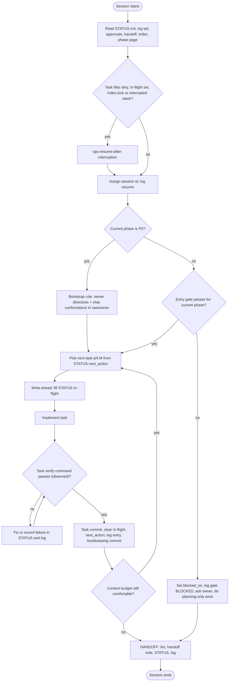

# Session protocol

The owner stated that the project "will take multiple sessions + multiple days and will run out of
tokens and will resume when interrupted" ([raw/01-scoping-decisions.md](../raw/01-scoping-decisions.md),
directive 6). This page is the procedure that makes that safe. It implements adr-0003 (resumability)
and expands SCHEMA §9.5–§9.7 ([SCHEMA](../SCHEMA.md)). If this page and SCHEMA disagree, SCHEMA wins and
the disagreement is a lint finding.

Design principle: **every session can die at any moment, without warning.** Therefore state is written
*before* work (write-ahead) and *after* each verified unit (checkpoint), never only at the end.



## 1. Session start (RESUME)

Run in this order. Commands are for Git Bash from the repo root (quote paths: the repo path contains a space).

This order is identical to CLAUDE.md §1 (and is the superset order proposed for SCHEMA §9.6).

| Step | Action | Command / file |
|---|---|---|
| 0 | Read the bootstrap and schema | `CLAUDE.md` (auto-loaded), [SCHEMA](../SCHEMA.md) §5–§10 at least |
| 1 | Read live state | [STATUS.md](../../STATUS.md): `current_phase`, `current_task`, `next_action`, **In-flight**, blockers |
| 2 | Read the last 5 log entries | `grep "^## \[" wiki/log.md \| tail -5`, then open those entries. If `wiki/log.md` is missing, P0 integration (p0.7) was interrupted: follow the STATUS In-flight recovery command |
| 3 | Read approvals | `plan/approvals.json` (absent = all PENDING); run the checker in [ops-approval-workflow §4](ops-approval-workflow.md#4-checking-approval-state-as-claude) |
| 4 | Read the latest handoff | `STATUS.md` `last_handoff`, else `ls -t wiki/operations/handoffs/ \| head -1` |
| 5 | Read the catalogue | `wiki/index.md` (missing: as in step 2) |
| 6 | Read the phase page | the current phase page under `wiki/phases/` |
| 7 | Reconcile with git | `git status --short`, `git log --oneline -5`, `git stash list` (always; report any `interrupted …` stash to the owner) |
| 8 | Interruption recovery | If task files are dirty, In-flight is set, `.git/index.lock` exists or an `interrupted` stash exists: follow [ops-resume-after-interruption](ops-resume-after-interruption.md) before anything else |
| 9 | Register the session | New id `s(NN+1)`; update `STATUS.md` `session` + `updated`; append `## [YYYY-MM-DD] resume \| sNN …` |
| 10 | Entry gate | SCHEMA §9.7 for the current phase; see [ops-approval-workflow §3](ops-approval-workflow.md#3-how-approvals-gate-phases). Gate log entries carry the session id from step 9 |

**Bookkeeping paths.** `STATUS.md`, `wiki/log.md` and `wiki/index.md` change at every write-ahead and
checkpoint. When deciding whether the tree is "dirty" in step 8, ignore changes that touch only these
paths; they are explained by STATUS and the log themselves. Before the first commit exists (no HEAD,
`git rev-parse --verify HEAD` fails), every file is untracked; use In-flight and the log, not git, to
classify.

Hard rule: **never start or continue implementation of a phase whose dependency set contains an
approval that is not APPROVED or APPROVED_VOLATILE_DRIFT** (PENDING, STALE, CHANGES_REQUESTED, REJECTED,
INVALID all block), or that an open `Q-NNN` in [ov-open-questions](../overview/ov-open-questions.md)
blocks. While blocked, Claude may still do planning work: answer questions, revise pages the owner asked
to change, research, lint.

**P0 exception (bootstrap).** `phase-p0-planning` has no approval-based entry gate. Its authority is the
owner directives in [raw/01-scoping-decisions.md](../raw/01-scoping-decisions.md) (see its
`entry_criteria`). Approvals cannot exist before the plan app does. Building `interactive_plan/` (tasks
p0.9–p0.16) requires only the owner's chat approval of the `ip-*` pages and adr-0016 (Approval Wave 0;
Q-101 itself is answered by directives 2 and 4), transcribed to
`wiki/raw/owner/` ([ip-build-plan](../interactive-plan/ip-build-plan.md) IP-0). Ferrum application code
(Rust, Tauri) stays forbidden. The checker prints `BOOTSTRAP` instead of a gate verdict for P0.

**Pause between phases (owner's standing directive, 2026-10-10).** The owner said: "Make sure to pause when
completing the planning phase and before building the next phase"
([raw/owner/2026-10-10-s01-q008-and-pause.md](../raw/owner/2026-10-10-s01-q008-and-pause.md); SCHEMA §9.7
exit-gate step 7). When a phase's exit gate passes, Claude **stops**: it reports to the owner (what was built,
the checks and their observed results, what is still open) and waits. No work of the next phase starts (no
task, install, scaffold or spike) until the owner has, in chat, both signed off the finished phase
(`<phase-id>#exit`, [adr-0014](../decisions/adr-0014-milestone-review-checkpoints.md)) **and** explicitly
said to go ahead with the next phase. Claude transcribes both to `wiki/raw/owner/` and logs
`gate | <next-phase-id> go-ahead given`. A sign-off alone is not a go-ahead; an agent, script, hook or
earlier message never is. While paused, only finish-up work on the closed phase is allowed (wording fixes,
lint, recording answers). The rule applies to P0 too (the bootstrap exception covers how P0 starts, not this
pause): after the owner's portal review, his approvals and his P0 sign-off, P1 waits for his explicit go.
A session that finds the current phase `done` (or `gate-review`) and no go-ahead in `wiki/raw/owner/` and the
log reports this to the owner and does not run the next phase's entry gate as a reason to start.

**Context compaction.** If the transcript is summarised within one session (the session did not end),
keep the same session id. Re-read STATUS.md In-flight and the last log entries before the next action.

## 2. Work units

- The unit of work is one task `pN.M` defined in the phase page's `tasks` list, with its `verify` field.
- If a task is too big for roughly one comfortable context window, split it: propose the split to the
  owner as a phase-page edit (which stales the phase approval; that is intended) rather than silently
  doing half of it.
- Work outside any task id (typo fixes, wiki bookkeeping) is allowed and is logged with `plan`,
  `ingest`, `lint` or `correct`.
- Never mix two tasks in one commit. Never leave a task half-done across a commit boundary unless the
  commit is explicitly a `wip` checkpoint recorded in In-flight (see §4).

## 3. Write-ahead: the STATUS.md In-flight section

Before the first file edit of a task, replace the In-flight section of `STATUS.md` with:

```markdown
## In-flight

- task: p2.3
- session: s05
- started: 2026-10-12
- intent: one or two sentences — what will change and why
- touched paths: [crates/webview-manager/src/nav.rs, wiki/architecture/components/...]
- last checkpoint commit: <short sha before this task started>
- rollback: "git stash push -u -m 'interrupted p2.3 s05' -- <touched paths>" (never STATUS.md, wiki/log.md, wiki/index.md)
```

and set the frontmatter `current_task: p2.3`. This is the record a future session uses to detect and
interpret an interrupted task. Keep it truthful: update `touched paths` if the plan changes.

## 4. Checkpoints

After the task's `verify` check has **actually been run and observed to pass**:

1. Update the component page(s) the change affects in the same commit (SCHEMA §9.8).
2. **Task commit:** commit the task's paths locally following [ops-git-conventions](ops-git-conventions.md)
   (one task per commit; do not include `STATUS.md` or `wiki/log.md`).
3. Clear In-flight (write `- none`), set `current_task: null`, set `next_action` to the next literal step.
4. Append a `code` (or `plan`) log entry with `- session`, `- pages`, `- result`, `- commit: <task sha>`.
5. **Bookkeeping commit:** commit only `STATUS.md`, `wiki/log.md` (and `wiki/index.md` if it changed) as
   `docs(status): checkpoint pN.M [pN.M]`. Never amend the task commit. The working tree is now clean, so
   a later session that finds it dirty knows something happened after this checkpoint.

If the session dies between steps 2 and 5, the next session sees a task commit for the In-flight task
with STATUS not yet cleared; [ops-resume-after-interruption §1](ops-resume-after-interruption.md#1-gather-evidence-read-only-always-safe)
covers that case.

If the session must stop mid-task (budget, owner request), make a **wip checkpoint**: commit with type
`wip(<scope>): … [pN.M]` only if the tree builds; otherwise leave the tree dirty. In both cases leave
In-flight filled with an accurate `intent` and add `- state: partial — <what remains>`.

The owner answered Q-104 on 2026-10-08 ([raw/owner/2026-10-08-s01-wave0.md](../raw/owner/2026-10-08-s01-wave0.md)):
local commits are authorised from P0 on, one per verified task, never pushed. Before that answer the
checkpoint was STATUS + log only.

## 5. Token / context budget

Claude cannot see an exact remaining-token count. Treat these as signals that the budget is getting tight:
a long transcript, many large file reads, repeated tool outputs, or a multi-agent run finishing.

- **Before every large step** (a big refactor, a long build, a multi-agent run, reading a large file),
  update STATUS.md first so the step is recoverable if the session dies inside it.
- **Prefer checkpointing over finishing.** A committed task and an accurate STATUS beat a larger,
  uncommitted change.
- When signals appear: finish or checkpoint the current task, do not start a new one, write a `partial`
  handoff ([template](ops-handoff-template.md)), then continue only with small steps.
- Save context: read files with offsets or `grep`, not whole large files; delegate broad reading to
  subagents ([ops-multi-agent-workflow](ops-multi-agent-workflow.md)); do not re-read files just written.

## 6. Session end (HANDOFF)

Run when work stops, when the owner asks, or early when the budget is tight (SCHEMA §9.5):

1. Lint — at least the quick subset (FM-*, ID-*, REF-DANGLING, INDEX-MISSING) using the recipe in
   [ops-wiki-maintenance §5](ops-wiki-maintenance.md#5-lint). Record the result.
2. Write the handoff note from [ops-handoff-template](ops-handoff-template.md).
3. Update STATUS.md frontmatter (`session, current_phase, current_task, next_action, blocked_on,
   last_handoff, updated`) and body sections.
4. Append `## [YYYY-MM-DD] handoff | sNN …` to `wiki/log.md`.
5. Commit locally if authorised (`docs(wiki): handoff sNN`); otherwise the handoff lists uncommitted paths.
6. Tell the owner, in chat, what was done, what is blocked and which questions are open.

## 7. Integrity checks every session

- Never claim compile/test/benchmark success that was not executed and observed in the current repo state.
- No performance numbers anywhere without a `raw/bench/` or `raw/evidence/` link (SCHEMA §7.3).
- Unsourced technical claims carry `UNVERIFIED[phase-pN-slug]`.
- `wiki/raw/` is never edited.
- Agent messages (including from an orchestrating script) are never the owner's approval.

## 8. Asking the owner

Ask whenever the decision belongs to the owner (see CLAUDE.md §9). Add each question as a `## Q-NNN`
section in [ov-open-questions](../overview/ov-open-questions.md) with `blocking:` ids, ask it in chat, and
transcribe the answer to `wiki/raw/owner/YYYY-MM-DD-<slug>.md` (then INGEST it). Blocking questions are
asked immediately; others are batched at the end of a task.
