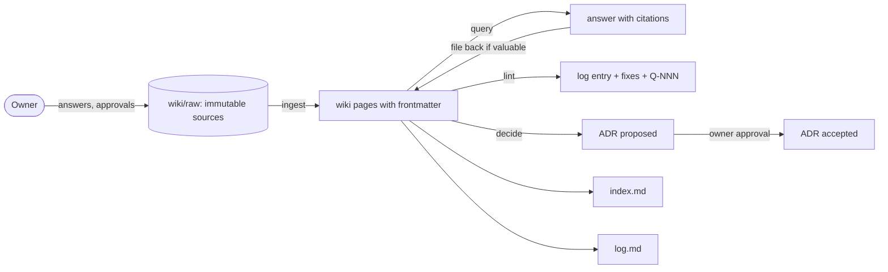

# Wiki maintenance

The owner asked to "use Karpathy's llm-wiki for updated documentation decision making"
([raw/01-scoping-decisions.md](../raw/01-scoping-decisions.md), directive 7; adr-0002). The pattern
([raw/research/llm-wiki-pattern.md](../raw/research/llm-wiki-pattern.md)) has three layers: immutable raw
sources, an LLM-maintained wiki, and a schema; and three operations: ingest, query and lint. Ferrum adds
decide, handoff, resume, gate and code. The rules are in [SCHEMA](../SCHEMA.md) §9; this page is the
hands-on procedure. Every operation ends with a log entry.



## 1. Ground rules

- `wiki/raw/` is never edited. New facts enter only as new raw files.
- Every wiki page has the SCHEMA §5 frontmatter, UTF-8 without BOM, exactly one trailing LF, and a file name
  starting with its id.
- Facts carry a source (raw file or wiki page) or an `UNVERIFIED[phase-pN-slug]` tag. Mention the tag
  word itself only inside backticks, so the lint does not read it as a bare tag.
- New page means a new `index.md` line in the same edit. Status or title change means an `index.md` update.
- Log headings follow `## [YYYY-MM-DD] <op> | <title>`; entries are only appended.
- From 2026-10-10 on, every new log entry carries `- time: HH:MM` right after `- session:`: the local time on a
  24-hour clock, read from the real clock when the entry is written (Git Bash `date +%H:%M`). Older entries keep
  the date only and are never back-filled (SCHEMA §12). A new question in `ov-open-questions` records its time the
  same way on its asked line: `- asked: 2026-10-10 21:41`.
- Editing an approvable page stales its approval. Say so in the log with `- stales: [...]`.
- During multi-agent runs only the integrator writes `index.md` and `log.md`
  ([ops-multi-agent-workflow](ops-multi-agent-workflow.md)).

## 2. Ingest

Trigger: a research note was written, the owner answered a question, a benchmark run finished, or gate
evidence was saved.

1. Save the source under `wiki/raw/`:
   - research: `raw/research/<slug>.md` with the research-note frontmatter (SCHEMA §6.13), access dates,
     and VERIFIED / UNCERTAIN / PROPOSAL labels;
   - owner answer: `raw/owner/YYYY-MM-DD-<slug>.md`, the owner's words verbatim (or verbatim in substance,
     marked as such), with the question id(s) answered;
   - benchmark output: `raw/bench/<run-id>/` exactly as produced;
   - gate evidence: `raw/evidence/<phase-id>/`.
2. Find affected pages: `grep -rl "<topic-or-id>" wiki --include=*.md | grep -v "^wiki/raw/"` and the
   `related`/`sources` fields. Expect up to 10 to 15 pages for one source.
3. Edit each page: add the source to `sources`, update the body, bump `updated`, resolve or re-target
   `UNVERIFIED` tags the source settles (keep the frontmatter `unverified:` list in sync).
4. Contradiction with an existing page: add a `> **CONTRADICTION:** ...` blockquote on that page and a
   `Q-NNN` in [ov-open-questions](../overview/ov-open-questions.md). Never overwrite silently.
5. An owner answer closes its `Q-NNN`: set `- status: answered` and link the raw file.
6. Update `index.md`; append `## [date] ingest | <source title>` with `- pages`, `- sources`, `- stales`.

## 3. Query

1. Read `wiki/index.md` first; follow it to the pages; grep when the index is not enough.
2. Answer with relative links to pages and raw files. Say what is unverified.
3. If the answer is a reusable synthesis (comparison, analysis, decision input), file it back as a page of
   the fitting type, add it to the index, and log `query`.

## 4. Decide

1. Next free ADR number = highest existing ADR + 1. Find the highest with
   `ls wiki/decisions/adr-*.md | sort | tail -1` (only ADR files; any other page in `wiki/decisions/` would
   otherwise sort last). Do not rely on a number written in prose: adr-0019
   already exists, so the next free number at the time of writing is adr-0020.
2. Create `decisions/adr-NNNN-<slug>.md` with `status: proposed`, `decided_by: claude-proposed` (or `owner`
   only when a raw file records the owner's choice), `date`, `supersedes`, and the body sections Context,
   Options considered, Decision, Consequences, Verification / evidence.
3. Update every page that the decision changes or that lists a superseded ADR. Those edits stale
   approvals; list them.
4. If the owner must choose between options, add a `Q-NNN` and ask.
5. Index + log `decide`. The ADR becomes `accepted` only under SCHEMA §10.4 rule 3
   ([ops-approval-workflow §6](ops-approval-workflow.md#6-responding-to-owner-decisions)).

## 5. Lint

Run at the end of every session (HANDOFF), at every phase gate, and after any bulk edit.

**Normative tool once plan-app step IP-5 has passed:** `npm run lint:wiki` (and `npm run gate`) in
`interactive_plan/` (see [ip-wiki-lint](../interactive-plan/ip-wiki-lint.md)), which implements SCHEMA
§9.3. When the TS lint and the Python script disagree, the TS lint wins and the disagreement is a bug to
fix (ip-testing has a parity test).

**Bootstrap fallback:** the quick lint below, a read-only stdlib Python script. It covers FILE-ENCODING,
FM-MISSING, FM-ENUM, FM-TYPE-DIR, ID-PATTERN, ID-DUP, REF-DANGLING (frontmatter ids and relative body
links), UNV-NOPHASE and INDEX-MISSING: the subset that SCHEMA §9.5 requires at HANDOFF. **Where it
lives:** the repo file [`tools/quick_lint.py`](../../tools/quick_lint.py) (planning tooling, not Ferrum
code; owner answer to Q-216, [raw/owner/2026-10-08-s01-wave0b.md](../raw/owner/2026-10-08-s01-wave0b.md)),
so every session runs the same script. The block below is its exact text: `tools/test_quick_lint.py`
fails if the two differ, so change both in the same edit. INDEX-MISSING checks raw evidence and bench
files per first-level folder (SCHEMA §11, [adr-0020](../decisions/adr-0020-index-lists-evidence-folders.md)).
The approval checker of
[ops-approval-workflow §4](ops-approval-workflow.md#4-checking-approval-state-as-claude) lives next to it
as `tools/approvals_check.py`. Run from the repo root:

```bash
python tools/quick_lint.py | tr -d '\r'                 # all findings; exit status 1 if any error
python tools/quick_lint.py REF-DANGLING | tr -d '\r'    # only lines containing this text
python -m unittest discover -s tools -p "test_*.py"     # the scripts' own tests (stdlib only)
```

```python
#!/usr/bin/env python3
"""Ferrum quick wiki lint (read-only, stdlib only). Run from the repo root.
Covers the SCHEMA §9.3 subset needed at HANDOFF: FILE-ENCODING, FM-MISSING, FM-ENUM, FM-TYPE-DIR,
ID-PATTERN, ID-DUP, REF-DANGLING (frontmatter ids + relative body links), UNV-NOPHASE, INDEX-MISSING
(raw evidence/bench files per first-level folder, SCHEMA §11 / adr-0020), LOG-FORMAT (wiki/log.md: §12
heading regex, date order, body keys, and a `- time:` value must be HH:MM).
Not covered (do by hand or with the plan app's lint): REF-RECIPROCAL, ORPHAN, STALE-UPDATED, ADR-CHAIN,
PHASE-ORDER, TRUST-EDGE, UNV-PASTDUE, INT-NUMBER-NOSRC, HYP-NO-DATA, RAW-IMMUTABLE, APPROVAL-STALE."""
import glob, os, re, sys

REQ = ['id', 'type', 'title', 'status', 'updated', 'sources', 'related', 'approvable']
EXTRA = {
    'component': ['path', 'crate', 'trust_level', 'phase_introduced', 'responsibilities', 'connects'],
    'phase': ['milestone', 'order', 'depends_on', 'est_sessions', 'entry_criteria', 'deliverables', 'tasks',
              'test_gate', 'exit_criteria', 'risks', 'decisions', 'experiments'],
    'decision': ['date', 'decided_by', 'supersedes'],
    'risk': ['likelihood', 'impact', 'mitigation', 'spike', 'owner_phase'],
    'research-question': ['question', 'hypotheses'],
    'hypothesis': ['rq', 'prediction', 'null_hypothesis', 'metrics', 'experiments'],
    'experiment': ['hypotheses', 'workloads', 'configurations', 'metrics', 'trials', 'analysis', 'phase'],
    'metric': ['unit', 'definition', 'boundary_start', 'boundary_end', 'method', 'tool', 'normalization', 'support'],
    'workload': ['workload_kind', 'master_prompt_ref', 'parameters', 'fixture_path'],
    'quality': ['scope', 'test_kinds', 'tooling'],
    'operations': ['audience', 'trigger'],
    'handoff': ['session', 'phase', 'next_action', 'uncommitted', 'open_questions'],
    'status': ['session', 'current_phase', 'current_task', 'next_action', 'blocked_on', 'last_handoff'],
}  # SCHEMA §4.1 as amended 2026-10-08: overview also allowed directly under research/ and risks/
STATUS = {
    'overview': 'draft review approved outdated', 'component': 'planned in-progress implemented verified deprecated',
    'phase': 'planned ready in-progress gate-review done blocked', 'decision': 'proposed accepted superseded rejected',
    'risk': 'open mitigating resolved realized tolerated', 'research-question': 'open investigating answered dropped',
    'hypothesis': 'draft preregistered testing supported not-supported inconclusive withdrawn',
    'experiment': 'designed ready running complete analyzed aborted', 'metric': 'proposed defined validated retired',
    'workload': 'proposed implemented validated retired', 'quality': 'draft active retired',
    'operations': 'draft active retired', 'handoff': 'final partial', 'glossary': 'draft active',
    'index': 'active', 'log': 'active', 'schema': 'draft review approved', 'status': 'active blocked awaiting-owner'}
IDPAT = {
    'overview': r'ov-[a-z0-9-]+', 'component': r'comp-[a-z0-9-]+', 'phase': r'phase-p[0-8]-[a-z0-9-]+',
    'decision': r'adr-[0-9]{4}', 'risk': r'risk-r[0-9]{2,}', 'research-question': r'rq-[0-9]{2,}',
    'hypothesis': r'hyp-[0-9]{2,}', 'experiment': r'exp-[a-z0-9-]+', 'metric': r'metric-[a-z0-9-]+',
    'workload': r'wl-[a-z0-9-]+', 'quality': r'qual-[a-z0-9-]+', 'operations': r'(ops|ip)-[a-z0-9-]+',
    'handoff': r'handoff-[0-9]{4}-[0-9]{2}-[0-9]{2}-s[0-9]{2,}', 'glossary': 'glossary', 'index': 'index',
    'log': 'log', 'schema': 'schema', 'status': 'status-live', 'research-note': r'research-[a-z0-9-]+'}
DIRS = [('wiki/architecture/components/', {'component'}), ('wiki/operations/handoffs/', {'handoff'}),
        ('wiki/research/questions/', {'research-question'}), ('wiki/research/hypotheses/', {'hypothesis'}),
        ('wiki/research/experiments/', {'experiment'}), ('wiki/research/metrics/', {'metric'}),
        ('wiki/research/workloads/', {'workload'}), ('wiki/research/', {'overview'}),
        ('wiki/overview/', {'overview', 'glossary'}),
        ('wiki/architecture/', {'overview'}), ('wiki/phases/', {'phase'}), ('wiki/decisions/', {'decision'}),
        ('wiki/risks/', {'risk', 'overview'}), ('wiki/quality/', {'quality'}), ('wiki/operations/', {'operations'}),
        ('wiki/interactive-plan/', {'overview', 'operations'}), ('wiki/raw/research/', {'research-note'}),
        ('wiki/', {'schema', 'index', 'log'}), ('', {'status'})]
REFKEYS = ['related', 'depends_on', 'risks', 'decisions', 'experiments', 'rq', 'hypotheses', 'metrics',
           'workloads', 'supersedes', 'superseded_by', 'phase', 'owner_phase', 'phase_introduced', 'current_phase']

errs, warns = [], []
def E(code, f, msg): errs.append(f'{code:16} {f}: {msg}')

def split(t):
    if not t.startswith('---\n'):
        return None, t
    i = t.find('\n---\n', 3)
    return (t[4:i], t[i + 5:]) if i > 0 else (None, t)

def parse(block):
    fm, key = {}, None
    for line in block.split('\n'):
        m = re.match(r'^([A-Za-z_][\w-]*):\s*(.*)$', line)
        if m:
            key, v = m.group(1), m.group(2).strip()
            if v.startswith('[') and v.endswith(']'):
                fm[key] = [x.strip().strip('"\'') for x in v[1:-1].split(',') if x.strip()]
            else:
                fm[key] = [] if v == '' else v.strip('"\'')
            continue
        m = re.match(r'^\s+-\s+([^:{}\[\]]+)$', line)
        if m and key and isinstance(fm.get(key), list):
            fm[key].append(m.group(1).strip().strip('"\''))
    fm['_connects_to'] = re.findall(r'(?m)^\s+-?\s*to:\s*([a-z0-9-]+)\s*$', block)
    return fm

files = [p.replace('\\', '/') for p in glob.glob('wiki/**/*.md', recursive=True)] + ['STATUS.md']
docs, ids = {}, {}
for f in files:
    if f.startswith('wiki/raw/') and not f.startswith('wiki/raw/research/'):
        continue
    if not os.path.exists(f):
        continue
    raw = open(f, 'rb').read()
    if raw.startswith(b'\xef\xbb\xbf'):
        E('FILE-ENCODING', f, 'BOM present')
    if not raw.endswith(b'\n') or raw.endswith(b'\n\n'):
        E('FILE-ENCODING', f, 'must end in exactly one LF')
    t = raw.decode('utf-8', 'replace').replace('\r\n', '\n')
    block, body = split(t)
    if block is None:
        E('FM-MISSING', f, 'no frontmatter'); continue
    fm = parse(block)
    docs[f] = (fm, body)
    if 'id' in fm:
        if fm['id'] in ids:
            E('ID-DUP', f, f"{fm['id']} also in {ids[fm['id']]}")
        ids[fm['id']] = f

for f, (fm, body) in docs.items():
    ty = fm.get('type', '')
    req = ['id', 'type', 'title', 'updated', 'sources'] if ty == 'research-note' else REQ + EXTRA.get(ty, [])
    for k in req:
        if k not in fm:
            E('FM-MISSING', f, f'missing {k}')
    if ty not in IDPAT:
        E('FM-ENUM', f, f'unknown type {ty!r}'); continue
    if ty in STATUS and fm.get('status') not in STATUS[ty].split():
        E('FM-ENUM', f, f"status {fm.get('status')!r} not allowed for {ty}")
    allowed = next((s for d, s in DIRS if f.startswith(d) and (d != 'wiki/' or f.count('/') == 1) and (d != '' or '/' not in f)), set())  # no match = FM-TYPE-DIR, not a crash
    if ty not in allowed or (ty == 'glossary' and not f.endswith('overview/glossary.md')):
        E('FM-TYPE-DIR', f, f'type {ty} not allowed here')
    i = fm.get('id', '')
    base = os.path.basename(f)[:-3]
    if not re.fullmatch(IDPAT[ty], i):
        E('ID-PATTERN', f, f'id {i!r} does not match {IDPAT[ty]}')
    special = {'SCHEMA': 'schema', 'STATUS': 'status-live'}
    if special.get(base) != i and not (base == i or base.startswith(i + '-')) and not (ty == 'research-note' and 'research-' + base == i):
        E('ID-PATTERN', f, f'basename {base!r} does not start with id {i!r}')
    for k in REFKEYS:
        v = fm.get(k)
        for r in (v if isinstance(v, list) else [v] if isinstance(v, str) and v not in ('null', '') else []):
            if r not in ids and not (k == 'phase' and ty == 'handoff' and r in ids):
                E('REF-DANGLING', f, f'{k}: {r}')
    for r in fm['_connects_to']:
        if r not in ids:
            E('REF-DANGLING', f, f'connects.to: {r}')
    nofence = re.sub(r'(?ms)^(```|~~~).*?^\1', '', body)
    nofence = re.sub(r'`[^`\n]*`', '', nofence)
    if f != 'wiki/SCHEMA.md' and not f.startswith('wiki/raw/'):
        for m in re.finditer(r'UNVERIFIED(?!\[phase-p[0-8]-[a-z0-9-]+\])', nofence):
            E('UNV-NOPHASE', f, 'bare UNVERIFIED: ...' + nofence[max(0, m.start() - 40):m.end() + 10].replace('\n', ' '))
    for m in re.finditer(r'\]\(([^)\s]+)\)', nofence):
        link = m.group(1).split('#')[0]
        if not link or re.match(r'^[a-z]+:', link):
            continue
        if not os.path.exists(os.path.normpath(os.path.join(os.path.dirname(f), link))):
            E('REF-DANGLING', f, f'body link {m.group(1)}')

LOGHEAD = re.compile(r'^## \[(\d{4}-\d{2}-\d{2})\] (ingest|query|lint|decide|handoff|resume|gate|code|approval|schema|correct|plan) \| (.+)$')
LOGKEYS = ['session', 'time', 'pages', 'sources', 'result', 'stales', 'next', 'commit']  # SCHEMA §12
if 'wiki/log.md' in docs:  # LOG-FORMAT, as the TS lint (lib/wiki/log.ts) plus the time value
    prev, cur = None, False
    for line in re.sub(r'(?ms)^(```|~~~).*?^\1[^\n]*$', lambda m: re.sub(r'[^\n]', '', m.group(0)), docs['wiki/log.md'][1]).split('\n'):
        if line.startswith('## '):
            m = LOGHEAD.match(line)
            cur = bool(m)
            if m:
                if prev and m.group(1) < prev:
                    E('LOG-FORMAT', 'wiki/log.md', f'entry dated {m.group(1)} follows an entry dated {prev}')
                prev = m.group(1)
            elif line.startswith('## ['):
                E('LOG-FORMAT', 'wiki/log.md', f'heading does not match the SCHEMA §12 regex: {line}')
            continue
        b = re.match(r'^- ([A-Za-z_][\w-]*):(?:\s+(.*))?$', line) if cur else None
        if not b:
            continue
        if b.group(1) not in LOGKEYS:
            E('LOG-FORMAT', 'wiki/log.md', f'bullet key {b.group(1)!r} is not one of {", ".join(LOGKEYS)}')
        elif b.group(1) == 'time' and not re.fullmatch(r'([01]\d|2[0-3]):[0-5]\d', (b.group(2) or '').strip()):
            E('LOG-FORMAT', 'wiki/log.md', f'time {(b.group(2) or "").strip()!r} is not HH:MM (24-hour, 00:00 to 23:59)')

if os.path.exists('wiki/index.md'):
    idx = open('wiki/index.md', encoding='utf-8').read()
    listed = set(re.findall(r'(?m)^- \[([a-z0-9.-]+)\]\(', idx))
    for i, f in ids.items():
        if i not in listed and i not in ('index', 'status-live'):
            E('INDEX-MISSING', f, f'{i} not in index.md')
    raw = set()  # SCHEMA §11 raw index labels (research notes use their own id)
    for p in glob.glob('wiki/raw/**/*', recursive=True):
        p = p.replace(os.sep, '/')
        if not os.path.isfile(p) or p.endswith('MANIFEST.sha256') or 'raw/research/' in p:
            continue
        r = p.split('wiki/raw/', 1)[1].split('/')
        if r[0] in ('evidence', 'bench'):  # adr-0020: one line per first-level evidence/bench folder
            if len(r) < 3:
                E('INDEX-MISSING', p, 'evidence/bench file must sit in a folder (SCHEMA §11)'); continue
            raw.add(re.sub(r'[^a-z0-9.-]', '-', (r[0] + '/' + r[1]).lower()).rstrip('-'))
        else:
            raw.add(os.path.basename(p).rsplit('.', 1)[0])
    for i in raw - listed - set(ids):
        E('INDEX-MISSING', 'wiki/index.md', f'raw file or folder {i} not listed')
    for i in listed - set(ids) - raw:
        E('INDEX-MISSING', 'wiki/index.md', f'lists unknown id {i}')
else:
    warns.append('INDEX-MISSING    wiki/index.md does not exist yet')

only = sys.argv[1] if len(sys.argv) > 1 else ''
for line in errs:
    if only in line:
        print('ERROR', line)
for w in warns:
    print('WARN ', w)
print(f'{len(docs)} files checked, {len(errs)} errors, {len(warns)} warnings')
sys.exit(1 if errs else 0)  # non-zero when any error was found (owner answer 2026-10-09, wave 0c item 6)
```

Its YAML handling is deliberately minimal (top-level scalars and lists of scalars, plus `to:` lines inside
`connects`). It is not a YAML validator.

**Manual checks** the script does not cover (do them at gates; the semantic ones always need judgment):

| Code | How to check by hand |
|---|---|
| UNV-PASTDUE | `grep -rn "UNVERIFIED\[phase-p0" wiki --include=*.md` (repeat for each phase at or before the current one) |
| REF-RECIPROCAL | rq `hypotheses` vs hyp `rq`; hyp `experiments` vs exp `hypotheses` |
| ADR-CHAIN | `grep -l "status: superseded" wiki/decisions/*.md` and check `superseded_by` |
| PHASE-ORDER | `grep -hE "^(order\|depends_on):" wiki/phases/*.md` (GFM shows the escaped pipe as a plain pipe) |
| TRUST-EDGE | for each `connects` with `crosses_trust_boundary`, compare both components' `trust_level` |
| STALE-UPDATED | `git log -1 --format=%cs -- <file>` vs `updated` |
| RAW-IMMUTABLE | `git log --oneline --follow -- wiki/raw/<file>` must show exactly one commit |
| INT-NUMBER-NOSRC | read experiment, metric, hypothesis and overview pages for numbers presented as observations |
| CONTRADICTION | `grep -rn "CONTRADICTION" wiki --include=*.md`, then a reading pass for claims that disagree |
| APPROVAL-STALE | the approval checker in [ops-approval-workflow §4](ops-approval-workflow.md#4-checking-approval-state-as-claude) |

**Exit status:** the script exits 1 when it finds any error (the summary line's error count is above 0, whatever the filter argument) and 0 otherwise, so `python tools/quick_lint.py && git commit …` cannot commit over lint errors (owner answer 2026-10-09, [wave 0c](../raw/owner/2026-10-09-s01-wave0c.md) item 6). Warnings do not change it.

**Recording:** append `## [date] lint | <scope>` with `- result: N errors, M warnings` and a disposition for
each warning. A lint is clean when it reports zero errors.

## 6. Glossary and overview upkeep

- New project-specific term: add a `### <Term>` entry to [glossary](../overview/glossary.md) with a source.
- Scope, goals or success criteria changed by an ADR: update [ov-project](../overview/ov-project-overview.md)
  (stales its approval; intended).
