# Ferrum: project overview

## 1. What Ferrum is

Ferrum is two things developed in lock-step, with **equal weight** (owner answer Q1, adr-0004,
[raw/01-scoping-decisions.md](../raw/01-scoping-decisions.md)):

1. **An application:** an open-source web-application container for Windows 11 x64, built with Rust,
   Tauri 2 and Microsoft WebView2, that *aims* to be resource-efficient and security-conscious
   ([raw/00-master-prompt.md](../raw/00-master-prompt.md) §1–§3). Whether it is more efficient than
   Chrome or Edge is a research question to be tested, not an established property (see
   [ov-research-plan](../research/ov-research-plan.md)).
2. **A research project:** a rigorous, reproducible experimental framework comparing Ferrum with Google
   Chrome, Microsoft Edge and a minimal Tauri + WebView2 baseline, plus an experimental adaptive WebView
   lifecycle manager, written up as a manuscript with the working title *Adaptive Resource Management for
   Chromium-Based Desktop Web Containers: Design and Experimental Evaluation* (master prompt §1, §13).

The long-term question (master prompt §1): can intelligent WebView lifecycle management, resource
isolation and adaptive policies reduce resource use while preserving website compatibility, usability and
security? **No answer exists yet**: no code has been written and no measurement has been taken.

## 2. How the work is organised

- **Planning first, then phase-gated implementation** with owner approval of every plan item before
  dependent work starts (owner directives 1, 4, 5, 9; adr-0001).
- **Owner review after every milestone** (Q11, adr-0014).
- **Many sessions over many days**, with interruptions expected; the documentation is the memory
  (directive 6, adr-0003, [ops-session-protocol](../operations/ops-session-protocol.md)).
- **Karpathy's LLM-wiki pattern** for documentation and decision-making (directive 7, adr-0002).

```mermaid
flowchart LR
    phase_p0_planning["P0 Planning"] --> phase_p1_foundation["P1 Foundation"]
    phase_p1_foundation --> phase_p2_minimal_container["P2 Minimal container (M1)"]
    phase_p2_minimal_container --> phase_p3_tabs_sessions["P3 Tabs and sessions (M2)"]
    phase_p3_tabs_sessions --> phase_p4_security["P4 Security (M3)"]
    phase_p4_security --> phase_p5_telemetry["P5 Telemetry (M4)"]
    phase_p5_telemetry --> phase_p6_benchmark_harness["P6 Benchmark harness (M5)"]
    phase_p6_benchmark_harness --> phase_p7_lifecycle["P7 Adaptive lifecycle (M6)"]
    phase_p7_lifecycle --> phase_p8_research_paper["P8 Research paper (M7)"]
```

This diagram shows only the nominal order. The authoritative dependencies (`depends_on`) are on each
phase page; where they differ, the phase pages win.

## 3. Goals

### 3.1 Application goals (master prompt §2, §5)

1. Load arbitrary HTTPS websites in WebView2, with a minimal modern browser-like interface.
2. Multiple tabs, navigation, redirects, session persistence and restoration; the UI stays responsive when
   one site is expensive. Hosting model: trusted shell WebView plus one untrusted child WebView per tab in
   one window (Q4, adr-0007).
3. Configurable security policies: navigation policy (open browsing plus blocklist, Q12, adr-0015),
   permissions, external protocols, downloads, restricted native capability exposure, audit logging of
   denied actions.
4. Website isolation where technically feasible: per-site WebView2 profiles in a shared browser process
   (Q7, adr-0010), documenting precisely which resources remain shared.
5. Low memory, CPU and energy use, with lifecycle states ACTIVE, BACKGROUND, IDLE, DISCARD_CANDIDATE,
   DISCARDED, RESTORING and a configurable state machine.
6. Process-level telemetry and a metadata-only network call log written as JSONL to a folder for review
   (master prompt §2 item 11; Q5, adr-0008).

### 3.2 Research goals (master prompt §6–§10, §13)

1. Compare at least four lifecycle strategies: none, fixed idle-time discard, memory-pressure discard, and
   an adaptive cost-aware policy; investigate the objective J = αM + βE + γL with documented measurement
   and normalisation of each term.
2. Benchmark five configurations (Chrome, Edge, Tauri baseline, Ferrum without and with adaptive
   management) on the dimensions memory, CPU, startup, navigation, rendering, energy, reliability and
   security overhead, using controlled local workloads plus supplementary public sites.
3. Fair comparisons: equivalent workloads, viewport, network, cache, authentication state, extensions,
   throttling policies and hardware; vendor resource-saving features are not disabled merely to help
   Ferrum (see Q-001 in [ov-open-questions](ov-open-questions.md)).
4. Full traceability: research question → hypothesis → experiment → raw data → analysis → figure →
   conclusion.
5. A literature review **before** any novelty claim. Substantial prior art for adaptive, cost-aware tab
   lifecycle policies exists (for example Chrome and Edge tab freezing and sleeping, GreedyDual-Size), so
   any novelty claim will be narrow, if one can be made at all
   ([raw/research/related-work-seed.md](../raw/research/related-work-seed.md)).

## 4. Scope

**In scope:** everything in §3; the repository structure of master prompt §12 (layout proposed in
adr-0018); AI-usage documentation; the interactive plan app (`interactive_plan/`) as planning tooling that
is not shipped with Ferrum.

**Fixed constraints from the owner** ([raw/01-scoping-decisions.md](../raw/01-scoping-decisions.md)):
shell UI in vanilla TypeScript + Vite (Q3); benchmark hardware is the owner's AMD desktop (Q6); Rust
harness orchestrator invoking Node/TypeScript Playwright scripts, with statistics in Python (Q9, Q10);
git + GitHub Actions, MIT OR Apache-2.0, Claude never pushes (Q8); toolchain installed by the owner via
winget (Q2).

## 5. Non-goals

From the master prompt (binding):

- Weakening WebView2/Chromium security, sandboxing or certificate validation, or bypassing OAuth
  provider restrictions on embedded browsers — for any reason, including benchmarks (§5, §11).
- Claiming complete process or security isolation without validating it (§5 Phase 3).
- Claiming novelty, results, significance or improvements that experiments have not produced (§1, §13, §14).
- Substituting mock or estimated numbers for real measurements; where energy cannot be measured defensibly,
  the dimension is marked unsupported (§7 Energy, §17).
- Disabling Chrome or Edge resource-saving features merely to improve Ferrum's results (§8).

Proposed by Claude, **not in the master prompt**, confirmed by the owner on 2026-10-11 (Q-005: "yes for now. I may add bookmarks but after we are done", [raw/owner/2026-10-11-s01-wave1-answers-and-p0-signoff.md](../raw/owner/2026-10-11-s01-wave1-answers-and-p0-signoff.md)):

- Browser extensions or an extension API.
- Account sign-in, sync or cloud services operated by Ferrum.
- Platforms other than Windows 11 x64 (the master prompt targets only this platform).
- Replacing a full general-purpose browser (Ferrum is a web-application container).

**Deferral** of a master-prompt feature, confirmed by the owner on 2026-10-11 (Q-005):

- Split view: deferred until after P8. Master prompt §4 lists "Split-view support in a later phase" and
  §16 assigns it to no milestone ([phase-p3-tabs-sessions](../phases/phase-p3-tabs-sessions.md), Out of scope).

Possible later addition, noted by the owner (2026-10-11): **bookmarks**, only after the planned phases are done. Not in scope now.

## 6. Success criteria

### 6.1 Application

Per milestone, the phase pages define the exact automated and manual test gates. In summary (master
prompt §16):

| Milestone | Phase | Success means |
|---|---|---|
| M1 | phase-p2-minimal-container | Compilable Tauri app loads a configurable HTTPS site; back, forward, refresh, URL display, redirects, error states; smoke tests pass (observed) |
| M2 | phase-p3-tabs-sessions | Tab manager, session management, persistent settings; integration tests pass |
| M3 | phase-p4-security | Navigation policy engine, permission controls, origin-aware capability restrictions; the master prompt §11 security tests pass; threat model documented |
| M4 | phase-p5-telemetry | Process metrics, startup and navigation measurements, CSV/JSON export, validation tests pass |
| M5 | phase-p6-benchmark-harness | Repeatable automated runs against Chrome, Edge, baseline and Ferrum on controlled workloads |
| M6 | phase-p7-lifecycle | Lifecycle state machine, fixed and memory-pressure policies, adaptive prototype, safety tests, comparative benchmarks |
| M7 | phase-p8-research-paper | Literature review, analysis, figures, draft manuscript, reproducibility instructions |

Every milestone exit also needs: evidence saved under `wiki/raw/evidence/<phase-id>/`, a clean lint, and
the owner's approval of `<phase-id>#exit` (adr-0014).

### 6.2 Research

Success is defined by **method quality, not by Ferrum winning**. A study that finds Ferrum is no better
than the baselines is a valid outcome and is reported as such.

- Hypotheses are written down and owner-approved before their experiments run (preregistered in the wiki).
- Each major configuration gets at least 30 independent trials where practical (master prompt §10), with
  warmup, randomised or counterbalanced order, and recorded failures; the research notes show that 30 trials
  only detect fairly large effects, so effect sizes and confidence intervals are reported, not just p-values
  ([raw/research/measurement-methodology.md](../raw/research/measurement-methodology.md)).
- Metrics have precise boundaries; memory uses summable private commit across exactly the product's
  processes rather than double-counted working sets; process attribution never relies on executable names.
- Every number in the paper traces to raw data in `wiki/raw/bench/`, and the analysis reruns from scripts.
- Statistically detectable effects are distinguished from practically meaningful ones; no runs are
  cherry-picked; every citation is verified against a real publication.
- Energy is reported only to the extent the hardware supports it (adr-0009; risk-r04 notes that AMD
  energy counters are modelled, not measured).

## 7. Where to go next

- Terms: [glossary](glossary.md).
- Open decisions for the owner: [ov-open-questions](ov-open-questions.md).
- How sessions work: [ops-session-protocol](../operations/ops-session-protocol.md).
- Rules of the wiki: [SCHEMA](../SCHEMA.md).
