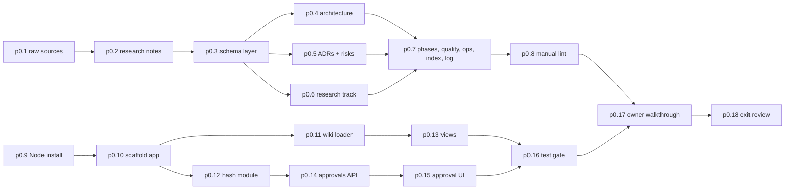

# P0 Planning: LLM wiki, interactive plan app, owner approval

P0 creates the project's memory and its approval mechanism before any Ferrum code exists. It answers owner directives 1, 2, 4, 6, 7 and 9 in [raw/01-scoping-decisions.md](../raw/01-scoping-decisions.md): plan first, visualise it in a Next.js app under `interactive_plan/`, record everything in markdown so the work survives interrupted sessions, use the LLM-wiki pattern ([raw/research/llm-wiki-pattern.md](../raw/research/llm-wiki-pattern.md)), and get owner approval before implementation.

## Scope

1. **Wiki (p0.1 to p0.8).** Raw sources, research notes, schema, every planning page, index, log, root summaries, manual lint.
2. **Plan app (p0.9 to p0.16).** A local-only Next.js app (`comp-interactive-plan`, adr-0016) that reads `wiki/` at runtime and writes approvals to `plan/approvals.json`. Stack recommendation and its open checks come from [raw/research/nextjs-stack.md](../raw/research/nextjs-stack.md) sections 5 and 6. That note labels its open checks "P1 (plan-app build phase)"; in this plan the plan app is built in P0, so those checks are verified here (see `unverified` above).
3. **Owner approval (p0.17, p0.18).** Owner reviews in the app; Claude revises; P0 exits when the P1 dependency set is approved.

## Out of scope

- Any Rust, Tauri, Cargo workspace or shell UI code. These start in [P1](phase-p1-foundation.md) (scaffold and spikes) and [P2](phase-p2-minimal-container.md).
- Installing Rust or MSVC Build Tools (P1, adr-0005). Only Node is installed now, per Q13.
- Deploying the plan app anywhere. It runs on `127.0.0.1` only.
- Any performance claim. No measurements exist.

## Step order

The wiki track (p0.1 to p0.8) and the app track (p0.9 to p0.16) can interleave. The app track needs Node first (p0.9). The owner walkthrough needs both.

## Plan-app task to build-step mapping

The plan-app track (p0.9 to p0.16) is executed by following [ip-build-plan](../interactive-plan/ip-build-plan.md), whose steps are IP-0 to IP-10. The two numbering schemes map as follows. They are one scheme, not two.

| Phase task | ip-build-plan step(s) | Evidence under `raw/evidence/phase-p0-planning/interactive-plan/` |
|---|---|---|
| p0.9 Node install | IP-0 | `IP-0-toolchain.txt` |
| p0.10 scaffold | IP-1 | `IP-1-scaffold.txt`, `IP-1-spikes.txt` |
| p0.11 wiki loader | IP-2 | `IP-2-tests.txt` |
| p0.12 hash module | IP-3 | `IP-3-tests.txt` (includes the Python cross-check) |
| p0.14 approvals API | IP-4 | `IP-4-tests.txt` |
| p0.13 wiki lint + views | IP-5, IP-6, IP-8 | `IP-5-lint.json`, `IP-5-gate.txt`, `IP-6-tests.txt`, `IP-8-tests.txt` |
| p0.15 approval UI | IP-7 | `IP-7-tests.txt` |
| p0.16 full gate | IP-9, IP-10 | `IP-9-verify.txt`, `IP-9-perf.txt`, `playwright-report.zip`, `IP-10-final-lint.json` |

Rules for a resuming session:

- **Which step is current:** use the ip-build-plan resume rule. The first IP step whose evidence file is missing is the current step; the table gives its p0.N task.
- **What to record:** `STATUS.md` `current_task` (the In-flight entry) and commit tags always use the p0.N id, for example `[p0.13]`. The IP step goes in the intent or commit message text, for example "p0.13 (IP-6: wiki browser)".
- **Evidence names:** the IP-* files above are the canonical evidence for this phase's `test_gate.evidence`. No separate `plan-app-*.txt` files are written.
- IP steps run in IP order (IP-4 before IP-5), so p0.14 is done before p0.13 even though its number is higher.

## Checkpoints and interruption recovery

- Each task is one commit boundary (once the owner authorises local commits, adr-0011). After each task: update `STATUS.md` (`current_task`, `next_action`) and append a `plan` or `code` log entry. A session cut off mid-task loses at most that task.
- App tasks p0.11, p0.12 and p0.14 are pure modules with their own unit tests. A fresh session can confirm what exists by listing the IP-* evidence files (mapping table above) and running `npm run test` in `interactive_plan/` before continuing.
- If the owner requests changes during p0.17, each revision is a separate `plan` log entry listing the pages whose approval it stales.

## Test gate rationale

The plan app is tooling, but it becomes the gatekeeper of every later phase. A wrong hash or a wrong effective state would let unapproved work proceed. That is why p0.12 tests the TypeScript hashes against the Python reference, p0.14 tests every effective state, and the E2E suite always writes to a temporary data directory so tests never touch the real `plan/approvals.json`. The loader integration test (p0.11) doubles as an automated part of the wiki lint.

Evidence files under `wiki/raw/evidence/` are raw and immutable. A failed run is saved under a dated name (`<name>.<YYYYMMDD-HHMM>.txt`); the canonical file name listed in `test_gate.evidence` is created once, from the passing run on the exit commit.

## Research track in P0

Only the seed list exists ([raw/research/related-work-seed.md](../raw/research/related-work-seed.md)). The literature review protocol starts in P1 (p1.14). No novelty is claimed anywhere.

## Owner review checkpoint (adr-0014)

At the end of P0 the owner reviews the plan in the app. The exact keys are listed wave by wave in [ops-approval-workflow §8](../operations/ops-approval-workflow.md#8-approval-waves): Wave 0 (chat, before the app is built), Wave 1 (`schema`, the P0 pages, `phase-p0-planning#exit`) and Wave 2 (the P1 dependency set: `phase-p1-foundation`, every ADR in its `decisions`, every component it introduces or lists). Pages outside every dependency set do not need approval now.

Claude never writes `plan/approvals.json`. If the owner approves in chat, Claude transcribes it to `raw/owner/` and asks the owner to click Approve in the app.
