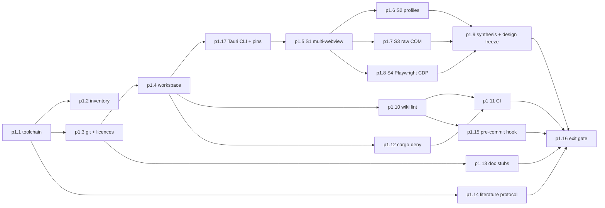

# P1 Foundation: toolchain, repo scaffold, CI, de-risking spikes

P1 turns an empty repository into a working Rust workspace and, before any M1 design is frozen, runs four throwaway spikes against the riskiest assumptions in the plan. The spikes come first because three owner decisions (Q4 child WebViews, Q7 per-site profiles, Q9/Q10 Playwright harness) rest on capabilities that research found only partly reachable through Tauri ([raw/research/tauri-webview2-capabilities.md](../raw/research/tauri-webview2-capabilities.md) sections 2, 5, 6, 7, 9, 10).

## Scope

### Toolchain (p1.1, adr-0021)

Claude runs these commands in PowerShell (exact text from [raw/01-scoping-decisions.md](../raw/01-scoping-decisions.md), "Claude defaults proposed"); the owner clicks through the UAC prompts. This follows [ADR-0021](../decisions/adr-0021-claude-runs-toolchain-installs.md), which supersedes adr-0005 (owner answer to Q-218, [raw/owner/2026-10-08-s01-wave0b.md](../raw/owner/2026-10-08-s01-wave0b.md)). Kernel drivers are not covered and need a separate owner approval.

```powershell
winget install -e --id Rustlang.Rustup
winget install -e --id Microsoft.VisualStudio.2022.BuildTools --override "--quiet --wait --add Microsoft.VisualStudio.Workload.VCTools --includeRecommended"
winget install -e --id OpenJS.NodeJS.LTS
rustup default stable-msvc
```

Observed on 2026-10-09 (session s01, not yet saved as evidence): Rust 1.99.0 on `stable-x86_64-pc-windows-msvc` (default), Visual Studio Build Tools 2022 17.14 with MSVC 14.44 and Windows SDK 10.0.26100, Node v24.20.0 (installed in P0, p0.9) and PowerShell 7.6.6 are already installed; cargo-deny is not. p1.1 therefore confirms and records these versions and runs a command above only for a missing tool. Whether the Build Tools command is sufficient for Tauri is UNVERIFIED[phase-p1-foundation]. Tauri 2.12.1 needs Rust 1.90 or newer (research note section 10, item 10). After 2026-10-28 the LTS winget id may resolve to Node 26 ([raw/research/nextjs-stack.md](../raw/research/nextjs-stack.md) section 2); pinning with `--version` is UNVERIFIED[phase-p1-foundation].

Verification commands Claude runs afterwards (output to `toolchain.txt`):

```powershell
rustup show
rustc -Vv
cargo -V
node --version
npm --version
python --version
git --version
pwsh --version
where.exe link.exe
```

`raw/01` observed that `link.exe` on PATH is Git's, not MSVC's. Whether that matters for cargo is UNVERIFIED[phase-p1-foundation]; the decisive check is a throwaway `cargo new --lib` + `cargo build`.

### Machine inventory (p1.2)

Needed for the measurement questions in [raw/research/measurement-methodology.md](../raw/research/measurement-methodology.md) section 10 (CPU generation, RAM, wall-power meter, PawnIO consent) and for risk-r04.

```powershell
Get-CimInstance Win32_Processor | Select-Object Name, NumberOfCores, NumberOfLogicalProcessors
Get-CimInstance Win32_ComputerSystem | Select-Object TotalPhysicalMemory
Get-CimInstance Win32_VideoController | Select-Object Name, DriverVersion, CurrentHorizontalResolution, CurrentVerticalResolution
Get-CimInstance Win32_OperatingSystem | Select-Object Caption, Version, BuildNumber
powercfg /getactivescheme
reg query "HKLM\SOFTWARE\WOW6432Node\Microsoft\EdgeUpdate\Clients\{F3017226-FE2A-4295-8BDF-00C3A9A7E4C5}" /v pv
```

The `reg query` line above was run on 2026-10-08 (session s01) and returned `pv REG_SZ 154.0.4258.62` ([raw/evidence/phase-p0-planning/env-webview2-pv.txt](../raw/evidence/phase-p0-planning/env-webview2-pv.txt)), matching [raw/01](../raw/01-scoping-decisions.md). p1.2 re-reads it, because the Evergreen runtime updates itself. Browser versions are taken from the executables' file versions.

### Repository scaffold (p1.3, p1.4, adr-0011, adr-0018)

- Repo root is the project root; the Cargo workspace mirrors master prompt section 12 (adr-0018, proposed until approved).
- Licence: dual MIT OR Apache-2.0 (Q8). Licence texts are copied from the official sources and the URLs recorded in the commit message.
- Library crates start with `#![forbid(unsafe_code)]`. The crate that will host raw COM (decided in p1.9) relaxes this only with a documented `## Unsafe invariants` section on its component page (master prompt section 15; SCHEMA section 6.2).
- Spike code lives in `spikes/` outside the workspace members (`exclude = ["spikes/*"]`; each spike has its own Cargo.toml and lockfile; `spikes/*/target/` is git-ignored). It is kept for reproducibility of the evidence but never shipped. Whether to keep `spikes/` long-term is part of Q-106 ([ov-arch-repo-layout](../architecture/ov-arch-repo-layout.md)).
- Cargo commands in tasks, the test gate and CI use `--locked` ([qual-ci-plan](../quality/qual-ci-plan.md)).

### De-risking spikes (p1.5 to p1.8) before the M1 design

Version pins come from the research note (tauri 2.12.1, wry 0.57.0, webview2-com 0.39.1, windows 0.62.2, Playwright 1.64.0). At spike start Claude re-checks crates.io and npm. If versions moved, the spike uses the newer patch release and records the change.

| Spike | Risk | Question | Pass criteria |
|---|---|---|---|
| S1 multi-webview | risk-r02 (and risk-r05) | Is `Window::add_child` (unstable feature) usable for a shell + N tabs on Windows? | No deadlock when created from an async command (and the sync-command deadlock reproduced or documented); tabs switch by hide/show; window resize keeps children laid out; keyboard focus reaches tab content after Alt+Tab (issue 13466); shell UI does not need to overlap tab bounds (issue 15682); children render (issues 10011, 11376); text-editing shortcuts work (issue 9257). Attribution row (risk-r05, comp-benchmark-harness): launch the spike suspended in a Job Object; compare job membership with `GetProcessInfos` and `GetProcessExtendedInfos`; record whether `msedgewebview2` processes join the job (UNVERIFIED[phase-p1-foundation]) |
| S2 profiles | risk-r01 | Can each tab get its own WebView2 profile in one shared browser process (Q7, adr-0010)? | For each route (a) to (d): creation succeeds; two profiles share one `BrowserProcessId`; cookie isolation between profiles holds on a local fixture; unsafe and maintenance cost noted |
| S3 raw COM | risk-r03 | Can Ferrum reach TrySuspend/Resume, MemoryUsageTargetLevel, ProcessFailed, WebResourceResponseReceived and GetProcessInfos through `with_webview`? | Each call returns success or a documented failure HRESULT; TrySuspend only attempted while hidden; one `webview2-com`/`windows` version in the tree; unsafe invariants drafted |
| S4 Playwright CDP | risk-r06 | Can the Node/TS Playwright harness drive a multi-webview Ferrum and Chrome/Edge through the same CDP path? | `connectOverCDP` attaches; every target listed and attributable to shell or tab; navigation and paint timing work; unsupported features listed |

S4 must run the app non-elevated: environment-variable browser flags are ignored for elevated apps (research note section 7). The debug port exposes the trusted shell WebView to local processes, so it is benchmark/debug only (goes into SECURITY.md).

### Spike synthesis and design freeze (p1.9)

The spikes feed the M1 design. Expected outputs:

- A new ADR choosing the profile route. If route (d) per-site data directories is chosen, it contradicts Q7's "shared browser process", so adr-0010 would be superseded through DECIDE with owner approval.
- A new ADR for back/forward: `eval("history.back()")` versus raw COM `GoBack`/`GoForward` (Tauri 2.12.1 has neither as an API, research note section 2).
- A new ADR or adr-0012 revision on whether the CDP path is used for Ferrum benchmarks.
- If S1 fails badly, a DECIDE on the hosting model (adr-0007) before P2, for example one top-level window per tab. The owner chooses.

[P2](phase-p2-minimal-container.md) and [P3](phase-p3-tabs-sessions.md) pages are revised after p1.9. Revising them stales their approvals; that is intended, and the owner re-approves before P2 starts.

### Quality infrastructure (p1.10 to p1.13, p1.15)

- The wiki lint already exists from P0 (`npm run lint:wiki`, IP-5, normative per SCHEMA §9.3), and so do its git-backed rules (built early in p0.13, found by the 2026-10-09 review). p1.10 therefore only re-confirms them on the P1 history; it is a check, not new work. The Python quick lint stays a bootstrap fallback (`tools/quick_lint.py`, Q-216).
- Tauri CLI (p1.17): the npm package `@tauri-apps/cli` is used rather than `cargo install tauri-cli`, so the shell's Vite toolchain and the CLI share one `package.json` with exact pins. Spikes are hand-written, not generated by `create-tauri-app@latest`, so that no unpinned template enters the evidence.
- CI runs on `windows-latest` (Q8). Claude can only run the local equivalent; the owner pushes.
- `cargo-deny` checks licences and advisories (master prompt section 15, dependency auditing).

### Research track start (p1.14)

The literature review starts now, not at the end. P1 writes the protocol and covers the gaps the seed list itself names ([raw/research/related-work-seed.md](../raw/research/related-work-seed.md)): the original ARC paper, the Page Lifecycle specification, Windows memory-pressure signalling and whether WebView2 raises page freeze/resume events. Each later phase has one small literature task. The review closes in [P7](phase-p7-lifecycle.md) (p7.12) before any novelty framing in [P8](phase-p8-research-paper.md).

## Out of scope

- Any user-facing Ferrum feature (P2 onward). Spike code is not promoted into `apps/desktop` without being rewritten under P2's tests.
- Benchmark measurements. Spikes may print process IDs and HRESULTs, never performance numbers presented as results.
- Pushing to GitHub. Claude never pushes (adr-0011).

## Step order



## Checkpoints and interruption recovery

- Each task is one commit. Each spike writes its report incrementally: the table rows are filled as each check runs, so an interrupted spike resumes at the first empty row.
- Spikes are time-boxed at one session each. If a spike overruns, Claude writes the partial report, logs it, and asks the owner whether to continue, change route or accept the risk.
- The elevated installs of p1.1 wait for the owner's UAC confirmation and may need a reboot. Claude records the pending state in `STATUS.md` (`blocked_on`) and continues with tasks that do not need Rust (p1.13, p1.14).

## Owner review checkpoint (adr-0014)

The P1 exit review is the most consequential decision point before code: the owner sees the spike evidence and confirms or changes the M1 design. Approval keys: the new ADRs from p1.9, revised `phase-p2-minimal-container`, `phase-p1-foundation#exit`.

## Phase-label crosswalk for the research notes

The research notes use master prompt phase names, not this registry. Their "P3 security tests" mean [phase-p4-security](phase-p4-security.md); "P5 CDP targets" is answered by spike S4 here; "P-harness (M5)" and "P-bench" mean [phase-p6-benchmark-harness](phase-p6-benchmark-harness.md). The full table is in the root PLAN.md.
