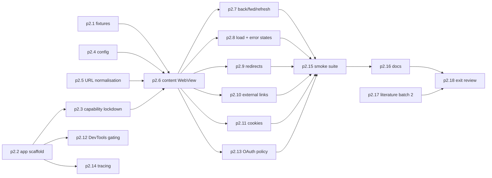

# P2 Minimal container (Milestone M1)

P2 builds the smallest useful Ferrum: one window with a trusted shell WebView and one untrusted content WebView that loads an HTTPS site. It covers master prompt section 5 "Phase 1: Minimal WebView Container" and section 16 "Milestone 1" ([raw/00-master-prompt.md](../raw/00-master-prompt.md)).

Even with a single tab, P2 uses the hosting model chosen for tabs: one window, the trusted shell as a Tauri child web view, and the content web view as a WebView2 controller Ferrum creates itself from Tauri's environment (adr-0007 as refined by the proposed adr-0029, from spikes S1 to S3 in [P1](phase-p1-foundation.md)). That way P3 adds tabs to a proven structure instead of rebuilding it. The shell never overlaps the content bounds: spike S1 showed child views are drawn on top.

## Scope

- Shell UI: address bar, back/forward/refresh, load indicator, error panel. Vanilla TS + Vite (adr-0006).
- Content WebView: navigation, redirects, external links, cookies, DevTools gating.
- Known issue from spike S1 (owner: fix later): after Alt+Tab back to the window, typing does not reach the web view until a click ([S1 report](../raw/evidence/phase-p1-foundation/spike-s1-multiwebview.md), Tauri issue 13466). P2 moves keyboard focus into the content web view when the window becomes active; that this fixes it is UNVERIFIED[phase-p4-security] (the owner's check was deferred at the P3 sign-off on 2026-10-13 and moves to the P4 hand checks) (the owner had not checked it by the P2 exit, 2026-10-12; it moves to the P3 keyboard checks).
- Security floor from day one. Every web view Tauri creates gets the IPC channel, and authorisation in Rust is the only protection ([raw/research/tauri-webview2-capabilities.md](../raw/research/tauri-webview2-capabilities.md) section 3). P2 therefore applies recipe items 1 to 3 (no `remote` capability, webview-label targeting, app ACL manifest) and proves them with the p2.3 negative test. The content web view is created by Ferrum (adr-0029) and has no IPC bridge at all; the same negative test showed it (verified in P2, [check-p2.3](../raw/evidence/phase-p2-minimal-container/check-p2.3.txt)). The full policy engine is [P4](phase-p4-security.md).
- Secure defaults from master prompt section 5: never bypass certificate validation, never weaken Chromium sandboxing, never bypass OAuth provider restrictions.

## Out of scope

- Multiple tabs, session restore, per-site profiles, downloads (P3).
- Blocklist, permission controls, iframe interception, audit log (P4).
- Telemetry and network logging (P5).
- Any performance claim.

## ADRs from p1.9

Spike synthesis (p1.9, 2026-10-11) proposed three ADRs, now in this page's `decisions`:
[adr-0029](../decisions/adr-0029-profile-route-raw-com-tab-controllers.md) (tab web views are controllers Ferrum creates,
one profile per site), [adr-0030](../decisions/adr-0030-back-forward-raw-com-history.md) (back/forward through the browser's
history calls) and [adr-0031](../decisions/adr-0031-benchmark-cdp-path-visible-tab.md) (one CDP test-robot path, visible tab
only). They are `proposed` until the owner approves them in chat; P2 cannot start before that, and if the owner chooses other
options this page is revised again. This edit is the intended re-approval point for this page in Approval Wave 3
([ops-approval-workflow §8](../operations/ops-approval-workflow.md#8-approval-waves)).

## Fixture HTTPS question (owner decision before P2)

This is [Q-202](../overview/ov-open-questions.md#q-202-local-fixture-scheme-loopback-http-exemption-or-a-locally-trusted-development-ca) in the canonical register, which gates P2 and P4 entry. Navigation tests need deterministic pages. Three options, none of which weakens certificate validation in the shipped app:

1. A locally trusted development certificate (a local CA installed into the user certificate store with owner consent) so fixtures are served over HTTPS on loopback.
2. Fixtures over `http://127.0.0.1` under a test-only configuration. Under adr-0015 HTTP is upgraded or warned, so tests would exercise the warning path, not the HTTPS path.
3. Public HTTPS sites only for HTTPS-specific smoke checks, fixtures over HTTP for everything else.

Claude's recommendation is option 1 for fixtures plus a few public HTTPS sites in the owner's manual checklist. Option 1 works without weakening certificate checks (verified in P2, [check-p2.1](../raw/evidence/phase-p2-minimal-container/check-p2.1.txt)). Its one
side effect is the local test certificate authority in the developer's Windows user Root store, which is
name-constrained to `localhost`, `127.0.0.0/8` and `::1` (installed with the owner's confirmation).

## Step order

p2.3 comes before any remote page is loaded, so a regression in IPC exposure is caught from the first content navigation.

## Checkpoints and interruption recovery

- One task, one commit, one `code` log entry naming the task id, with the matching component page updated in the same commit (SCHEMA section 9.8).
- Pure-Rust tasks (p2.4, p2.5) have unit tests and can be resumed by running `cargo test -p` on the crate.
- Smoke tests are added per feature task, not only at p2.15, so `cargo test --workspace` plus the smoke command show exactly which feature tasks are done.

## Test gate rationale

Master prompt Milestone 1 asks for "smoke tests". The owner asked for rigorous phase-wise testing, so the gate also requires unit tests for every pure function, the IPC denial test (security cannot wait until P4), a release build (DevTools gating only shows there) and a manual checklist on real sites.

## Research track

Literature batch 2 (p2.17) continues the protocol from p1.14.

## Owner review checkpoint (adr-0014)

The owner gets the release build, the manual checklist and the evidence folder. Approval key `phase-p2-minimal-container#exit`. The P3 dependency set must also be approved before P3 starts.
