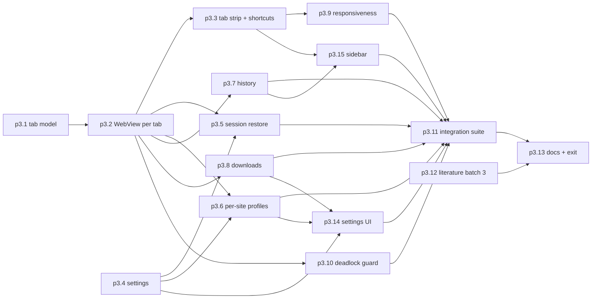

# P3 Tabs and sessions (Milestone M2)

P3 turns the single content WebView into a tab manager. It covers master prompt section 5 "Phase 2: Multi-Website Container" and section 16 "Milestone 2" ([raw/00-master-prompt.md](../raw/00-master-prompt.md)), plus the per-site profile isolation the owner chose in Q7 ([raw/01-scoping-decisions.md](../raw/01-scoping-decisions.md)) through the route fixed in spike S2 ([P1](phase-p1-foundation.md), p1.6 and p1.9).

## Scope

- Tab model as pure Rust in the core crate, so its rules are tested without a GUI.
- Child WebViews per tab with hide/show switching. Hiding matters later: TrySuspend requires `IsVisible == false` ([raw/research/tauri-webview2-capabilities.md](../raw/research/tauri-webview2-capabilities.md) section 6), which P7 relies on.
- Known constraints from research that shape the UI: tab content is always drawn above the shell, so shell menus must never overlap tab bounds (issue 15682); WebView creation from synchronous commands deadlocks on Windows (section 2).
- Owner answers of 2026-10-12 ([raw/owner/2026-10-12-s02-p3-questions.md](../raw/owner/2026-10-12-s02-p3-questions.md)): the normal Windows title bar first, tab strip just under it (Q-125); a site is its registrable domain (Q-111); a top-level navigation to another site asks first, then moves the tab to that site's profile (Q-209).
- Shortcuts with focus in a page (p3.3): WebView2's `AcceleratorKeyPressed` on each tab view reports the key before the page sees it; Ferrum's keys are marked handled and never reach the page; nothing is injected into the page, and the p2.3 IPC test still passes ([check-p3.3](../raw/evidence/phase-p3-tabs-sessions/check-p3.3.txt)). CDP key events do not reach this hook, so the smoke test presses real keys.
- Per-site profiles (p3.6): site key from the `psl` crate (VERIFIED maintained, [p3-profiles-psl](../raw/research/p3-profiles-psl.md)); profile names within WebView2's documented rules; what stays shared is listed on [ov-arch-isolation-model](../architecture/ov-arch-isolation-model.md) §3 and [comp-webview-manager](../architecture/components/comp-webview-manager.md) ([check-p3.6](../raw/evidence/phase-p3-tabs-sessions/check-p3.6.txt)).
- Busy tab (p3.9): with a tab whose script never stops, switching tabs and typing an address in the shell each finished within the test's 5-second requirement, and the busy tab could be closed ([check-p3.9](../raw/evidence/phase-p3-tabs-sessions/check-p3.9.txt); timings there are test log, not measurements). This answers the planning claim that a busy tab does not block the shell; which renderer process hosts which view was not inspected (process isolation is examined in P4).
- Alt+Tab focus: P2 built the fix; the owner checks it here (UNVERIFIED[phase-p3-tabs-sessions], carried from P2).
- Per-site profiles. All profiles in one user data folder share the browser process and must use identical environment options (section 6), and `clear_all_browsing_data` is profile-wide. P3 documents exactly what is shared; P4 tests it as a security property.

## Out of scope

- Blocklists, permission prompts, secure-download rules (P4). Downloads in P3 are "basic" per master prompt Phase 2.
- Lifecycle states and discarding (P7). Hidden tabs simply stay hidden in P3.
- Split view. Master prompt section 4 lists it as "Split-view support in a later phase" and section 16 assigns it to no milestone. This plan proposes deferring it to after P8. The deferral is a proposal, not an owner decision: approving this page approves it, and it is also listed with the proposed non-goals and deferrals in [ov-project-overview](../overview/ov-project-overview.md) and [ov-open-questions](../overview/ov-open-questions.md) (Q-005), so the owner decides it explicitly.
- Blocklist and permission-grant editing in the settings interface (P4, p4.17), because the blocklist and permission model do not exist until P4.

## Step order

Task ids are stable identifiers, not an ordering: p3.14 and p3.15 were added after review and slot in before p3.11 as the diagram shows.

## Checkpoints and interruption recovery

- Session restore (p3.5) uses the same atomic-write pattern as the plan app's approvals file: write a temp file, then rename. A crash never leaves a half-written session file.
- Each task's integration tests are added with the task. A resuming session runs `cargo test --workspace` and the integration suite to see which tasks hold.

## Test gate rationale

Tabs multiply every P2 behaviour, so the P2 smoke suite and IPC denial test run again as regressions. Session restore is tested after a forced kill, not just a clean exit, because that is the case users hit. Profile isolation is tested functionally here (cookies) and adversarially in P4.

## Research track

Literature batch 3 (p3.12) covers tab-usage and lifecycle policies, the closest prior art for P7.

## Owner review checkpoint (adr-0014)

The owner uses Ferrum for a real working session with many tabs (manual items) before approving `phase-p3-tabs-sessions#exit`.
