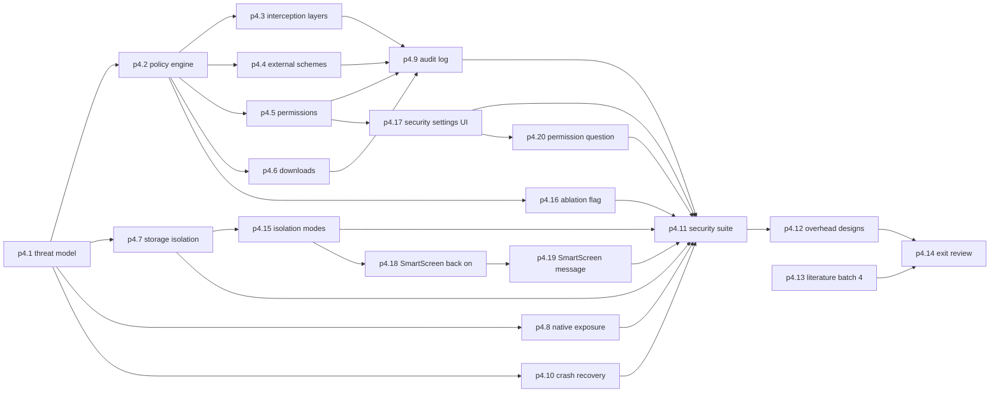

# P4 Security (Milestone M3)

P4 builds the security policy engine and proves, with tests, which security properties Ferrum actually enforces. It covers master prompt section 5 "Phase 3: Security Controls", section 11 "Security Testing" and section 16 "Milestone 3" ([raw/00-master-prompt.md](../raw/00-master-prompt.md)).

Phase-label note: the research note [raw/research/tauri-webview2-capabilities.md](../raw/research/tauri-webview2-capabilities.md) calls these "P3 security tests" because it uses the master prompt's phase numbering. In this plan they are P4.

## Scope

Research findings this phase must act on (all from the Tauri/WebView2 note, sections 3, 6 and 10):

- **The IPC channel exists in every WebView.** Protection is Rust-side authorisation. P2 already locked capabilities down; P4 extends the tests to every path, including the internal fetch-channel command that is exempt from the ACL check.
- **`on_navigation` fails open** for URLs that do not parse and never sees iframe navigations. The engine therefore also hooks raw COM `NavigationStarting` and `FrameNavigationStarting`, and its own parser denies on failure.
- **External schemes, certificate errors and some permission settings** are only reachable through raw COM. Each raw COM use needs a documented unsafe invariant (master prompt section 15).
- **Profiles share the browser process.** Isolation is about storage, not processes. Master prompt Phase 3 asks to "document precisely which resources remain shared" and forbids claiming complete isolation without validation; p4.7 does both. The same Phase 3 text asks to "investigate the feasibility of independent WebView2 user-data directories": p4.15 does this. The capabilities note records that Tauri's `data_directory` gives one WebView2 environment, user data folder and browser process per distinct directory (VERIFIED in its section 4), and that all WebViews sharing one user data folder must use identical environment options (section 6). Whether per-site folders are practical at Ferrum's tab counts is UNVERIFIED[phase-p4-security].
- **Navigation posture** is open browsing plus blocklist (Q12, adr-0015).

Security correctness tests are kept separate from performance measurement (master prompt section 7). P4 only designs the overhead experiments and checks their microbenchmark harness runs; the measurements happen in [P6](phase-p6-benchmark-harness.md).

## Out of scope

- Network call logging (P5, adr-0008). P4 defines the policy-decision field that the network log will carry.
- Remote-debugging-port hardening for benchmark builds beyond documenting it (P6 decides how benchmark builds are produced).
- Claims about overhead numbers.

## Step order

The threat model comes first so that every later task can be traced to a threat it mitigates. Task ids are stable identifiers, not an ordering: p4.15 to p4.17 were added after review and slot in before p4.11 as the diagram shows; p4.18 was added during P4 (owner answer Q-225, [raw](../raw/owner/2026-10-14-s06-p4-15-reapproval-and-q225.md)), and p4.19 after it (owner answer Q-226, [raw](../raw/owner/2026-10-15-s07-p4-18-reapproval-and-q226.md)). p4.20 was added after p4.13, before the exit gate (owner answer Q-227, [adr-0034](../decisions/adr-0034-permission-question-chrome-style.md)); it changes p4.5's silent refusal into a question, so the security suite (p4.11) is rerun by the gate.

## Checkpoints and interruption recovery

- The policy engine is a pure crate with unit tests; resume by running its tests.
- Each security test is written together with the control it checks, and the item-to-test mapping on the security quality page is updated in the same commit. A resuming session reads the mapping to see which master prompt section 11 items are still open.

## Test gate rationale

Each master prompt section 11 item gets at least one automated test, with harmless local fixtures. Tests are adversarial: they try the bypasses research identified (redirect, iframe, malformed URL, local-origin navigation, exempt command). Coverage of the policy engine's decision branches is required because a missed branch is a missed policy.

## Research track

Literature batch 4 (p4.13): site isolation and embedded-browser security, needed for the paper's security and usability trade-offs section.

## Owner review checkpoint (adr-0014)

The owner reviews the threat model and the "not enforced" list, performs the manual checks and approves `phase-p4-security#exit`.
