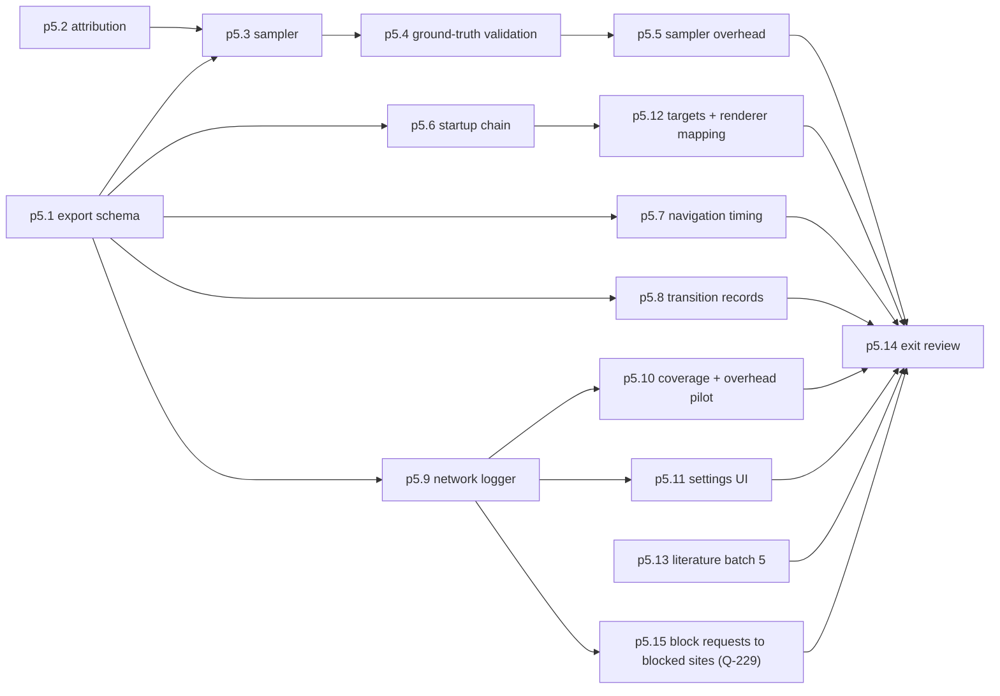

# P5 Telemetry and network logger (Milestone M4)

P5 builds the measurement layer and, more importantly, proves it measures what it claims. It covers master prompt section 4 "Telemetry Engine", section 16 "Milestone 4" and objective 11 (network call logs) ([raw/00-master-prompt.md](../raw/00-master-prompt.md)), with the owner's Q5 choice of metadata-only JSONL ([raw/01-scoping-decisions.md](../raw/01-scoping-decisions.md), adr-0008).

## Scope

Method choices come from [raw/research/measurement-methodology.md](../raw/research/measurement-methodology.md):

- **Headline memory metric is private commit (`PrivateUsage`)** summed over exactly Ferrum's processes. Working set double-counts shared pages when summed and is secondary only (section 1). Peaks come from the summed series, never from adding per-process peaks.
- **Attribution by identity, never by executable name** (section 2). Other WebView2 hosts on the machine would otherwise be counted. WebView2 renderers are shared across WebViews in one user data folder, so per-tab memory is not well defined; the telemetry records process-level data and says so.
- **Direct `windows` crate calls**, not `sysinfo`, whose `memory()` returns the double-counting working set (section 8).
- **Startup boundaries** use creation, window visible, FCP, LCP. "Time to interactive" is retired upstream (section 4), so the master prompt's "time to interactive state" is mapped to a responsiveness metric defined on the metric pages.
- **Network log** uses raw COM `WebResourceResponseReceived` or DevTools `Network.*` events, because Tauri has no response hook for https tabs ([raw/research/tauri-webview2-capabilities.md](../raw/research/tauri-webview2-capabilities.md) section 6).

Rigorous testing here means ground truth: p5.4 builds helper programs whose memory and CPU use are known by construction and checks the sampler against them, with tolerances fixed before the run. A sampler that fails validation blocks P6.

## Network-log privacy questions (owner, before P5)

Answered by the owner on 2026-10-18 (Q-114, [raw/owner/2026-10-18-s08-p5-questions.md](../raw/owner/2026-10-18-s08-p5-questions.md)):

1. Full URLs are kept in the local log, query strings included.
2. The network log is off by default and switched on in settings; benchmark runs switch it on themselves.
3. Log files older than 14 days are deleted (changeable in settings).

Q-115 (startup chain without time to interactive) and Q-203 (all raw run data in git under `raw/bench/<run-id>/`) were answered the same day.

## Out of scope

- Running browsers other than Ferrum (P6).
- Energy measurement (P6, adr-0009).
- Any comparative or "improvement" statement. p5.4 and p5.5 outputs characterise the tool, not Ferrum.

## Step order

## Checkpoints and interruption recovery

- Validation tolerances are committed before the validation run (p5.4) so that a resumed session cannot loosen them after seeing results. Any later change is logged with a reason.
- Raw validation outputs go to `raw/evidence/phase-p5-telemetry/` immediately after each run, so nothing depends on terminal scrollback.

## Open points settled at the exit review (p5.14)

The four points this page listed as unverified were answered during P5:

- `PrivateWorkingSetSize` (`PROCESS_MEMORY_COUNTERS_EX2`) is filled on this PC ([check-p5.3](../raw/evidence/phase-p5-telemetry/check-p5.3.txt)).
- First and largest contentful paint are read from the host through DevTools calls in an isolated world of the page
  ([check-p5.6](../raw/evidence/phase-p5-telemetry/check-p5.6.txt)).
- `GetProcessExtendedInfos` reports the frames each renderer draws, so a tab's renderer, and its other-site frames',
  are found by address ([devtools-targets-p5.12-note](../raw/evidence/phase-p5-telemetry/devtools-targets-p5.12-note.md)).
- `WebResourceResponseReceived` reports responses of an other-site iframe and requests a service worker answers or
  passes on, but not the worker's own script or requests, nor requests that get no response
  ([netlog-coverage-p5.10.json](../raw/evidence/phase-p5-telemetry/netlog-coverage-p5.10.json)).

The other P5-targeted points on other pages were answered or moved to a later phase, each with its reason, in the
same review (log entry of p5.14).

## Owner review checkpoint (adr-0014)

The owner reviews the validation evidence and the network-log privacy check, then approves `phase-p5-telemetry#exit`.
