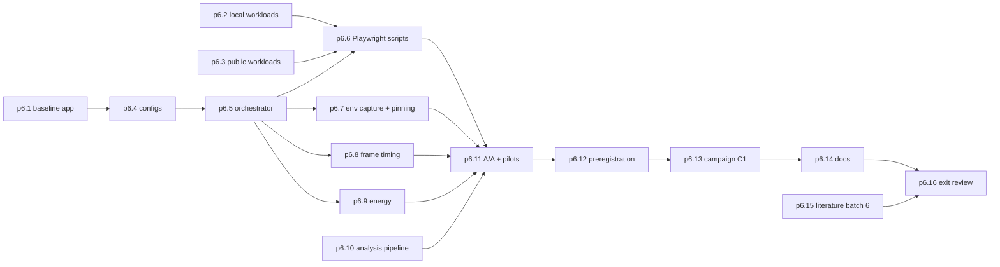

# P6 Benchmark harness (Milestone M5)

P6 builds a harness that compares Ferrum with Chrome, Edge and a minimal Tauri baseline fairly and repeatably, validates it with an A/A test, preregisters hypotheses, and collects the first campaign of raw data (C1). It covers master prompt sections 7 to 10 and section 16 "Milestone 5" ([raw/00-master-prompt.md](../raw/00-master-prompt.md)), with the owner's Q6, Q9 and Q10 choices ([raw/01-scoping-decisions.md](../raw/01-scoping-decisions.md); adr-0009, adr-0012, adr-0013).

Phase-label note: [raw/research/measurement-methodology.md](../raw/research/measurement-methodology.md) section 11 says "P-harness (M5)" and "P-bench"; both are this phase.

## Scope

Fairness rules from the measurement note (sections 2, 5, 6, 7):

- Launch every target suspended inside a Job Object with a fresh profile; attribute processes by identity.
- Record and pin browser resource features: Edge sleeping tabs (default on), Edge Startup Boost (pre-launches processes, invalidates cold start), Chrome background freezing, Chrome Memory Saver (set explicitly by policy because its default is unclear). Never disable Chrome or Edge resource-saving features just to help Ferrum (master prompt section 8).
- Fix the window state: Windows 11 changes timer resolution and EcoQoS for hidden or minimised windows.
- Drive all products through the same CDP path, because Playwright's `connectOverCDP` is lower fidelity and only Ferrum needs it ([raw/research/tauri-webview2-capabilities.md](../raw/research/tauri-webview2-capabilities.md) section 7). Ferrum must run non-elevated for the environment-variable debug flag, so the energy sampler is a separate elevated process.
- Energy: AMD counters are modelled, exclude DRAM and under-report against wall power (Zen 2 study). Claims follow the note's section 5.5 policy: "modeled CPU-package energy" only with counters, "system energy" only with a meter, per-process energy unsupported (risk-r04).
- Statistics: with 30 trials per arm only fairly large effects are detectable (note section 7.2), so the A/A test and pilots set the trial counts, and practical thresholds are written down before C1.

### Why campaign C1 is in P6

Master prompt Milestone 5 asks for "repeatable benchmark execution". Running C1 here proves that, and gives P7 a no-lifecycle reference measured with the same harness. C1 data is analysed mechanically (the pipeline runs) but not interpreted: no result statements, no hypothesis verdicts until [P8](phase-p8-research-paper.md).

### Where raw benchmark data lives

SCHEMA section 3.1 puts benchmark outputs under `wiki/raw/bench/<run-id>/`. Campaign data may be large for git. Open question for the owner: commit full raw data, or commit manifests and checksums with the data archived elsewhere (for example a release asset) and referenced from the manifest.

## Out of scope

- Lifecycle policies and cfg-ferrum-adaptive ([P7](phase-p7-lifecycle.md)).
- Interpreting results or writing the paper (P8).

## Step order

## Checkpoints and interruption recovery

- Campaigns are long and will be interrupted. The orchestrator writes each trial's result and the manifest entry before starting the next trial, and can resume a campaign from its manifest with the same seed and plan. A resumed campaign is recorded as such in the manifest; trials are never re-run selectively to replace unwanted results.
- `STATUS.md` names the run id and the next trial index during C1.

## Owner review checkpoint (adr-0014)

The owner checks the fairness diff, approves the preregistration before C1 (p6.12, a mid-phase approval) and approves `phase-p6-benchmark-harness#exit` after C1.
