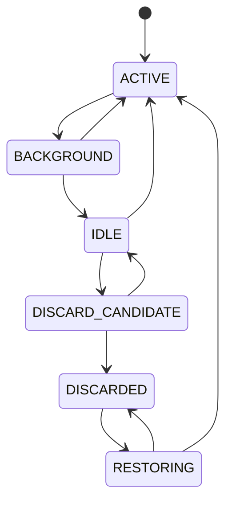
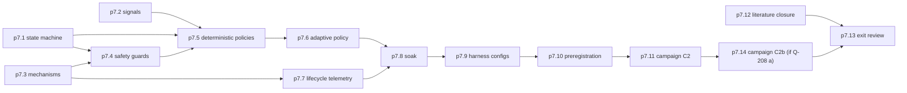

# P7 Adaptive lifecycle (Milestone M6)

P7 implements the experimental adaptive WebView lifecycle manager and collects campaign C2. It covers master prompt section 5 "Phase 4: Resource Management", section 6 "Adaptive Lifecycle Research" and section 16 "Milestone 6" ([raw/00-master-prompt.md](../raw/00-master-prompt.md)).

## Scope

This diagram is the starting proposal for p7.1; the authoritative transition table lives on the comp-resource-manager page once implemented.

Research findings that shape the design:

- **Suspend and discard are different.** Edge treats sleeping and discarding separately ([raw/research/related-work-seed.md](../raw/research/related-work-seed.md)). WebView2 TrySuspend needs the WebView hidden, is best effort, and must not be mixed with MemoryUsageTargetLevel ([raw/research/tauri-webview2-capabilities.md](../raw/research/tauri-webview2-capabilities.md) section 6). Both are raw COM only (risk-r03).
- **Per-tab cost is hard to attribute.** Renderers are shared across WebViews in one user data folder ([raw/research/measurement-methodology.md](../raw/research/measurement-methodology.md) section 2), so "site activity" and "memory per tab" signals are approximations and are documented as such (risk-r05).
- **Prior art is close.** Chrome freezes CPU-heavy hidden tabs, Edge sleeps tabs under memory pressure, Android standby buckets may use a learned model, GreedyDual-Size weighs cost, size and recency (seed list). The master prompt says not to assume novelty; p7.12 closes the literature review before P8 frames anything.
- **Strategies are compared on one binary.** Master prompt section 6 asks for policies behind feature flags so identical workloads run under each. Runtime flags keep the binary identical across arms; a compile-time feature may additionally gate the experimental adaptive code.
- **Weights are not tuned on the evaluation data.** alpha, beta and gamma are fixed on a disjoint calibration set before C2, to avoid overfitting the policy to the benchmark.

## Out of scope

- Learned or ML policies beyond the cost-aware prototype.
- Interpreting C2 or claiming improvements (P8).

## Step order

p7.12 can run any time during P7 but must finish before the exit review.

## Checkpoints and interruption recovery

- Same campaign-resume rules as P6: per-trial persistence, resumable manifest, no selective re-runs.
- Calibration weights are committed (p7.6) before C2 starts; a resumed session must not change them without a logged DECIDE and a new preregistration.

## Owner review checkpoint (adr-0014)

Three owner approvals inside this phase: calibration and weights, preregistration (p7.10) and novelty assessment (p7.12). Then `phase-p7-lifecycle#exit`.
