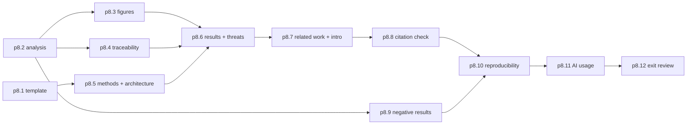

# P8 Research paper (Milestone M7)

P8 turns the raw data from C1 and C2 into analysed results and a draft manuscript with the working title "Adaptive Resource Management for Chromium-Based Desktop Web Containers: Design and Experimental Evaluation" (master prompt section 13, [raw/00-master-prompt.md](../raw/00-master-prompt.md)).

## Hard rules for this phase

From master prompt sections 13 and 14:

1. **No Results section until experiments are complete and analysed.** p8.6 is blocked until p8.2 is done for every experiment it cites.
2. **Every citation verified** against an actual publication. The seed list's "do not cite" section stays binding ([raw/research/related-work-seed.md](../raw/research/related-work-seed.md)). For example, the Intel-only RAPL study must not be cited as support for AMD counters.
3. **No novelty beyond the approved assessment** from p7.12.
4. **Statistically detectable is not the same as practically meaningful.** Results report effect sizes and CIs against the preregistered practical thresholds ([raw/research/measurement-methodology.md](../raw/research/measurement-methodology.md) section 7).
5. **Human authors remain responsible.** The owner reviews every claim; AI assistance is disclosed in AI_USAGE.md.

## Scope

- Analysis and figures (p8.2, p8.3), traceability (p8.4), manuscript sections in a safe order (p8.5 to p8.7), verification (p8.8, p8.9), reproducibility and disclosure (p8.10, p8.11).
- Template: ACM acmart is proposed (adr-0017, `claude-proposed`); the venue is undecided, so the owner may replace it.

## Out of scope

- Submitting the paper or contacting venues (owner decision, after P8).
- New experiments. If analysis shows a needed experiment, it goes back through DECIDE and a new preregistration, and P8 notes the delay.

## Step order

## Checkpoints and interruption recovery

- Each manuscript section is a separate commit. The section-status table lives in `STATUS.md` during P8.
- Generated numbers and figures are rebuilt by one command, so a resumed session never needs to remember a number.

## Owner review checkpoint (adr-0014)

The owner reads the whole manuscript as its responsible author before approving `phase-p8-research-paper#exit`.
