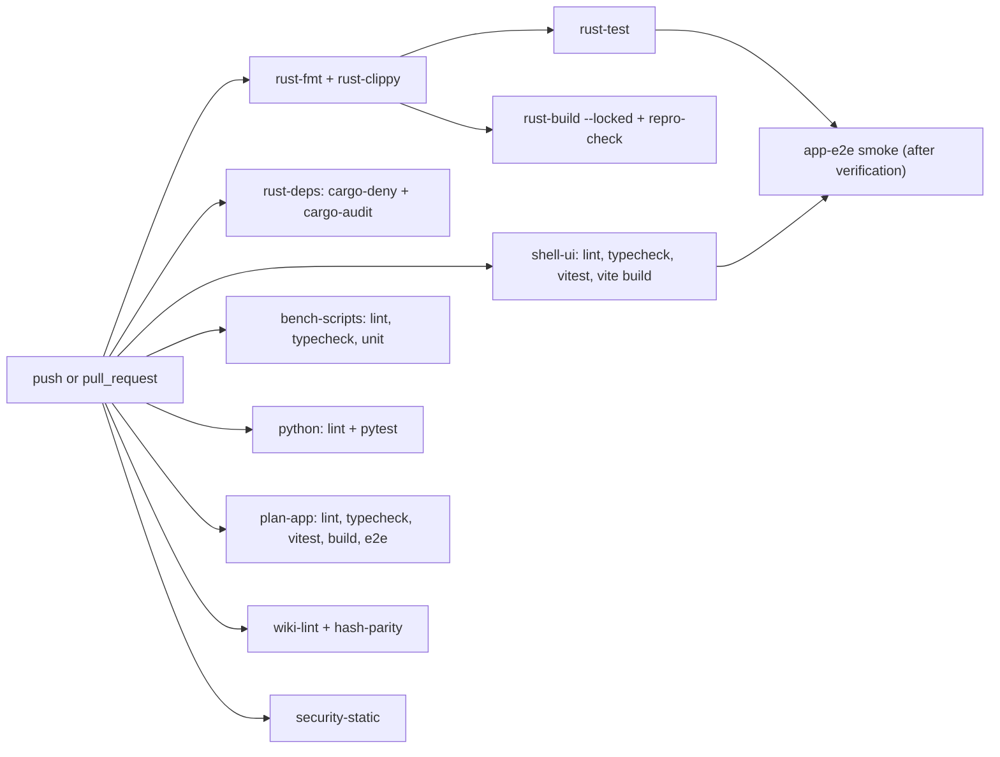

# CI plan

The owner chose **git + GitHub Actions on windows-latest**, licence MIT OR Apache-2.0; **Claude never pushes** and the owner creates the remote ([scoping decisions](../raw/01-scoping-decisions.md) Q8, adr-0011). The master prompt (§15) requires reproducible builds, dependency auditing, automated formatting, Clippy and CI workflows ([master prompt](../raw/00-master-prompt.md)).

Consequences:
- CI runs only after the owner pushes. Until a remote exists, and before every push, the **same jobs run locally** through one script, and that run's logs are the gate evidence ([qual-phase-gate-checklist](qual-phase-gate-checklist.md)).
- CI **never runs benchmarks**. Hosted runners are not the benchmark machine and are noisy; benchmark campaigns run only on the owner's desktop (adr-0009).

The workflow files are written in `phase-p1-foundation`. Jobs for code that does not exist yet are added in the phase that creates that code (section 3).

## 1. Workflow layout

One workflow file `.github/workflows/ci.yml` with independent jobs, so one failure does not hide others. A second file `.github/workflows/nightly.yml` may run slower jobs (full security E2E, dependency audit against a fresh advisory database) on a schedule once the owner enables it.

## 2. Jobs

All jobs: `runs-on: windows-latest`, `permissions: contents: read`, no secrets, third-party actions pinned by full commit SHA (UNVERIFIED[phase-p3-tabs-sessions], re-targeted in P2 because the first push is still deferred, Q-221: P1 resolved the SHAs of actions/checkout v7.0.1 and actions/setup-node v7.1.0 in `ci.yml`; a run on GitHub waits for the first push, which the owner deferred), tool versions taken from committed lockfiles and toolchain files (risk-r20).

| Job | Commands (planned) | Fails when | Introduced |
|---|---|---|---|
| `rust-fmt` | `cargo fmt --all -- --check` | any formatting diff | P1 |
| `rust-clippy` | `cargo clippy --locked --workspace --all-targets --all-features -- -D warnings` | any warning | P1 |
| `rust-test` | `cargo test --locked --workspace --all-targets` | any test fails | P1 |
| `rust-build` | `cargo build --locked --workspace --release` | any build error, or `Cargo.lock` would need to change | P1 |
| `rust-deps` | `cargo deny check` (advisories, bans, licences compatible with MIT OR Apache-2.0, sources) (`cargo audit` was not added in P1: cargo-deny's advisories check reads the same RustSec database; running on windows-latest is UNVERIFIED[phase-p3-tabs-sessions]; locally it passed in P2) | an advisory, a banned or unlicensed crate, or an unknown source (a `[patch]` git source must be explicitly allowed, see risk-r01 route b) | P1 |
| `shell-ui` | in `apps/desktop/`: `npm ci`, `npm run lint`, `npm run typecheck`, `npm test`, `npm run build` | any step fails | P2 |
| `bench-scripts` | in `benchmarks/runners/`: `npm ci`, `npm run lint`, `npm run typecheck`, `npm test` | any step fails | P6 (first scripts may appear in P5) |
| `python` | in `analysis/`: install from the committed pinned requirements/lock file only, linter, `pytest` | any step fails | P6 |
| `plan-app` | in `interactive_plan/`: `npm ci`, lint, typecheck, `vitest run`, `next build`, Playwright E2E against `next start` on loopback with a temporary data directory | any step fails | P0 code; CI job added in P1 when CI first exists |
| `wiki-lint` | in `interactive_plan/`: `npm ci`, then `npm run lint:wiki` | any lint error (warnings are listed, not fatal) | P1 (lint itself built in P0) |
| `hash-parity` | run the SCHEMA §10.2 Python reference and the TypeScript implementation on the shared test vectors and compare | any mismatch (risk-r22) | P1 |
| `security-static` | scan capability files for any `remote` section; scan browser-argument configuration for weakening flags; check release configuration does not enable devtools or a debug port | any finding (risk-r19, SEC-12) | P2 |
| `repro-check` | verify the toolchain file and every lockfile are committed and unchanged after the jobs above; optionally build the release binary twice from clean and compare SHA-256 hashes (UNVERIFIED[phase-p3-tabs-sessions]: P2 built release binaries but did not run the comparison) | a missing or modified lockfile or toolchain file; a hash mismatch only once the comparison is verified and adopted | P1 |
| `app-e2e` | build Ferrum in test mode and run the smoke E2E suite | any test fails | after the runner capability is verified (UNVERIFIED[phase-p3-tabs-sessions]; re-targeted in P1 and again in P2 because the first push is deferred); until then this suite runs only locally (it passed locally in P2, [check-p2.15](../raw/evidence/phase-p2-minimal-container/check-p2.15.txt)) |

Notes:
- **Reproducible builds (master prompt §15).** Every Cargo command runs with `--locked`, so a build fails instead of silently updating `Cargo.lock`. Every Node job installs with `npm ci` (never `npm install`), so `package-lock.json` is authoritative. The Rust toolchain is pinned by a committed `rust-toolchain.toml`, Node by `engines`, Python by a pinned requirements file (risk-r20). This gives reproducible *dependency resolution*. Bit-for-bit reproducible binaries are a stronger claim; the `repro-check` hash comparison tests it and stays UNVERIFIED[phase-p3-tabs-sessions] until it runs (not run in P2; its lockfile and toolchain check passed locally, [local CI run](../raw/evidence/phase-p1-foundation/ci-local-p1.11.txt)).
- **Wiki lint script name.** The script is `lint:wiki` (with `lint:wiki:json`), as defined in [ip-wiki-lint](../interactive-plan/ip-wiki-lint.md) §1. Phase-page test gates that say `npm run wiki:lint` must be changed to `npm run lint:wiki`.
- **Phase test gates** that run Cargo or npm commands use the same forms as this table (`--locked`, `npm ci` first).
- Tauri 2.12.1 needs Rust 1.90 or newer ([tauri-webview2-capabilities](../raw/research/tauri-webview2-capabilities.md) §1), so the toolchain file pins a stable version at or above that.
- The plan app uses TypeScript 5.9.x and ESLint 9.x, not the `@latest` majors, because of eslint-config-next's declared support ([nextjs-stack](../raw/research/nextjs-stack.md) §1.1).
- Node major is pinned by an `engines` range and recorded, because the winget LTS id may switch major after 2026-10-28 ([nextjs-stack](../raw/research/nextjs-stack.md) §2).

## 3. Rollout by phase

| Phase | CI state |
|---|---|
| `phase-p0-planning` | No remote and no workflows. Plan-app tests and lint run locally; logs are P0 evidence. |
| `phase-p1-foundation` | `ci.yml` created with rust-fmt, rust-clippy, rust-test, rust-build, rust-deps, repro-check, plan-app, wiki-lint, hash-parity. Local equivalent script created. First green run (local, or CI if the owner pushed) is P1 evidence. |
| `phase-p2-minimal-container` | shell-ui, security-static; app-e2e if verified. |
| `phase-p4-security` | Security fixture suite runs locally at every gate; in CI if app-e2e works on hosted runners, else nightly on the owner's machine. |
| `phase-p6-benchmark-harness` | bench-scripts, python. |

## 4. Local equivalent

A single script (proposed `scripts/ci-local.ps1`, created in P1) runs the same commands in the same order, writes each command's output to a log, and writes `manifest.json` in the evidence layout of [qual-phase-gate-checklist](qual-phase-gate-checklist.md). Claude runs it before declaring any gate item passed and before the owner pushes.

## 5. Policies

- **Branch protection** on the default branch (required jobs: everything in section 2 that exists) is the owner's choice when the remote is created.
- **Dependency updates** are explicit tasks; an automated update bot, if enabled, opens pull requests only, never auto-merges (risk-r20).
- **The component-page rule** (SCHEMA §9.8: a code change updates its component page in the same commit) is enforced as a warning by `scripts/hooks/pre-commit`, tested in P1 ([hook test](../raw/evidence/phase-p1-foundation/p1.15-hook-test.txt)).
- **Required evidence for a phase gate** comes from a run on the exact gate commit; an older green run does not count.
