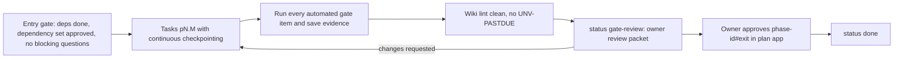

# Phase gate checklist

This page turns SCHEMA §9.7 (PHASE-GATE) into a checklist a fresh session can run step by step, and fixes **where evidence is stored**. The owner reviews and approves after every milestone ([scoping decisions](../raw/01-scoping-decisions.md) Q11, adr-0014). The master prompt (§17) says never to claim code compiled or tests passed unless that was executed and observed ([master prompt](../raw/00-master-prompt.md)).



## 1. Evidence location and format

**Path rule (SCHEMA §3.1, §4.1, §9.7):** gate evidence is stored under `wiki/raw/evidence/<phase-id>/`. Raw files are immutable, so each gate run gets its **own folder** and is never overwritten:

```text
wiki/raw/evidence/<phase-id>/<YYYY-MM-DD>-<run-slug>/
  manifest.json        # what was run, where, by whom, with what result
  <step>.log           # full stdout+stderr of each command, unedited
  <step>.junit.xml     # machine-readable results where the tool supports it
  screenshots/         # E2E failure or manual-check screenshots, if any
```

> **Path conflict to resolve.** The task brief for this page said `docs/evidence/<phase>/`. SCHEMA (the authoritative rule) says `wiki/raw/evidence/<phase-id>/`, which also makes evidence immutable and citable from wiki pages. This page follows SCHEMA. If the owner prefers `docs/evidence/`, SCHEMA §4.1 and §9.7 must change first.

`manifest.json` fields (all required):

| Field | Content |
|---|---|
| `phase` | phase id |
| `run` | folder name |
| `commit` | full git sha of the tested state, plus `dirty: true/false` |
| `started`, `finished` | ISO 8601 with offset |
| `machine` | OS build, CPU model, RAM, as observed |
| `toolchain` | exact versions of rustc, cargo, node, npm, python, and the WebView2 runtime, as observed by command output |
| `steps` | list of `{name, command, exit_code, log}` in the order run |
| `result` | `pass` only if every step exited 0 and every gate item is covered; otherwise `fail` |
| `operator` | `claude` or `owner` |

Rules:
- A step's `exit_code` and log come from the actual run. Nothing is typed in by hand.
- A failed run is kept, not deleted. The next run gets a new folder. The gate cites the passing run.
- Evidence never contains secrets, real browsing data or full network logs of real browsing. Network-log evidence uses fixture traffic only.
- Large binary outputs (for example traces) are referenced by hash if they cannot be committed. Size limits are decided in P1.

## 2. Entry gate (run before any implementation task of phase P, and at the start of every session that continues P)

- [ ] Every phase in `P.depends_on` has `status: done` and its `<phase-id>#exit` approval is APPROVED (SCHEMA §10.3).
- [ ] Every id in P's dependency set has effective state APPROVED or APPROVED_VOLATILE_DRIFT: P's page, each ADR in `P.decisions`, each component introduced by or listed in P, each experiment in `P.experiments`, and `schema`.
- [ ] No open `Q-NNN` in `ov-open-questions` blocks an id in that set.
- [ ] Risks owned by P are read and their spikes, if any, are scheduled first ([ov-risk-register](../risks/ov-risk-register.md)).
- [ ] Result logged: `gate | <phase-id> entry passed`, or `gate | <phase-id> entry BLOCKED: <ids>` with `STATUS.md` `blocked_on` set and the owner asked.

Claude reads `plan/approvals.json` for this check and never writes it (SCHEMA §10.1, risk-r22).

## 3. Exit gate

- [ ] Every task in the phase meets [qual-definition-of-done](qual-definition-of-done.md) section 1.
- [ ] Every `test_gate.automated` item was run in the final repo state, passed, and has a log in one evidence run folder whose `manifest.json` says `result: pass`.
- [ ] Every `test_gate.evidence` path exists.
- [ ] Every `test_gate.manual` item is recorded as performed by the owner (a `raw/owner/` file or the exit approval comment).
- [ ] CI is green for the same commit if a remote exists ([qual-ci-plan](qual-ci-plan.md)); otherwise the local CI-equivalent run is in the evidence folder.
- [ ] Wiki lint clean (zero errors), no `UNV-PASTDUE` targeting this phase, and no open `CONTRADICTION` blocks on this phase's pages.
- [ ] Risks owned by this phase re-scored with status and evidence; new risks added to the register.
- [ ] Review packet prepared (section 5). Status set to `gate-review` and logged `gate | <phase-id> exit ready for review`.
- [ ] Owner approves `<phase-id>#exit` in the plan app. Then status `done` and log `gate | <phase-id> exit approved`.

## 4. Minimum evidence per phase (recommended; each phase page's `test_gate` is authoritative)

| Phase | Minimum automated evidence | Typical manual items |
|---|---|---|
| `phase-p0-planning` | Plan app unit, E2E, typecheck and build logs (`ip-testing`); hash-parity log; wiki lint clean log | Approval Waves 0–1 per [ops-approval-workflow §8](../operations/ops-approval-workflow.md#8-approval-waves) (Wave 2, the P1 dependency set, before P1 entry) |
| `phase-p1-foundation` | Toolchain version capture; scaffold `cargo build --locked`/`cargo test --locked`; fmt and clippy logs; first CI-equivalent run; one report per spike S1–S4 (risk-r02, risk-r01, risk-r03, risk-r06), plus the risk-r05 Job Object attribution check from S1 | Owner confirms installs and the spike-based route decisions (ADRs) |
| `phase-p2-minimal-container` | Release build log; smoke E2E log (load, back, forward, refresh, redirect, external link, error state); SEC-03 minimal log | Owner browses a few real HTTPS sites; Google sign-in observation (risk-r10) |
| `phase-p3-tabs-sessions` | Multi-tab integration and E2E logs; session-restore test; repeated tab-creation (deadlock) test; responsiveness test with a CPU-heavy fixture | Owner uses tabs, shortcuts and restore |
| `phase-p4-security` | Full SEC-01..SEC-13 suite log with per-test results; static capability check | Owner reads the threat model and the enforced-properties list |
| `phase-p5-telemetry` | Known-answer fixture logs; export-schema tests; network-log completeness on a fixture | Owner inspects a sample network log from fixture traffic |
| `phase-p6-benchmark-harness` | Harness validation suite; A/A campaign raw data in `raw/bench/` plus analysis; workload-equivalence log; analysis known-dataset tests | Owner approves preregistration before comparative runs |
| `phase-p7-lifecycle` | State-machine unit and property tests; safety fixture tests (risk-r23); policy feature-flag tests; experiment raw data linked | Owner tries the policies on real use |
| `phase-p8-research-paper` | Analysis reproducibility re-run; citation-check log; traceability lint | Owner reviews the manuscript |

## 5. Review packet (what the owner sees at `gate-review`)

Claude writes a short packet (as a handoff or an operations page, per the operations pages) containing:

1. What was built, by task id, with links to the component pages.
2. The evidence run folder and its `manifest.json` result.
3. What was **not** done or did not work, and known limitations.
4. Security considerations introduced in the phase.
5. Risk changes (re-scores, new risks, realised risks and fallbacks used).
6. Pages whose approval went STALE during the phase and need re-approval.
7. Proposed next phase and its entry blockers.

This mirrors the end-of-milestone report the master prompt asks for (§18: files changed, decisions, commands, test results, limitations, security considerations, next milestone).
