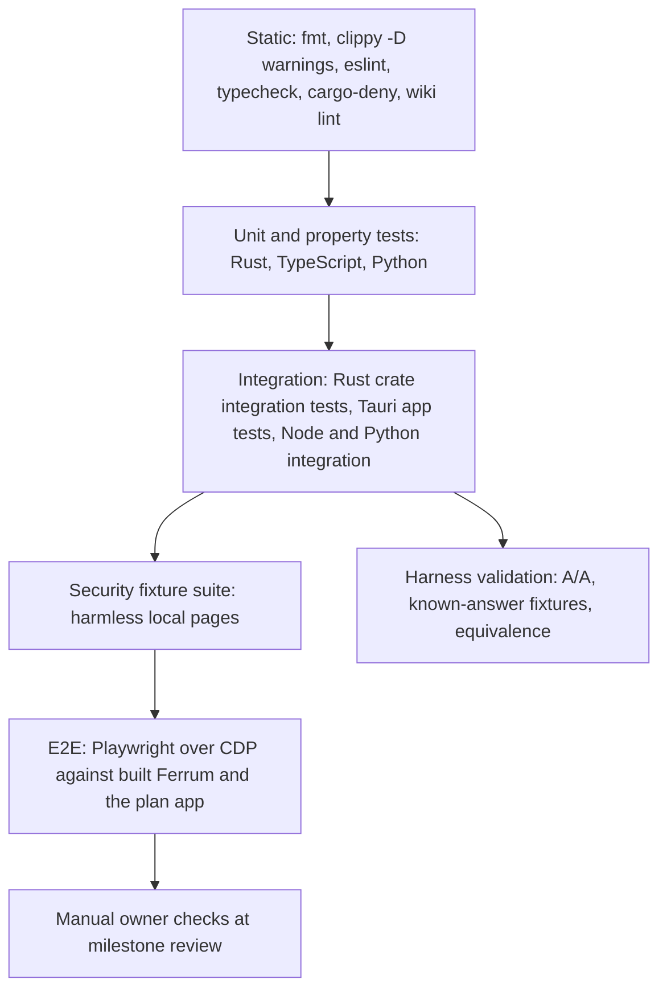

# Testing strategy

The owner asked for **phase-wise testing and rigorous testing** ([scoping decisions](../raw/01-scoping-decisions.md), directive 5). The master prompt asks for unit tests, integration tests, CI, reproducible builds, dependency auditing, formatting and Clippy (§15), automated security tests (§11), and says never to claim code compiled, tests passed or benchmarks succeeded unless that was executed and observed (§17) ([master prompt](../raw/00-master-prompt.md)).

This page defines **what kinds of tests exist, where they live, and which phase introduces them**. Related pages:

- [qual-definition-of-done](qual-definition-of-done.md): when a task, component change or phase counts as done.
- [qual-phase-gate-checklist](qual-phase-gate-checklist.md): the evidence a phase needs before its exit review.
- [qual-ci-plan](qual-ci-plan.md): which tests run in GitHub Actions.
- [qual-security-testing-plan](qual-security-testing-plan.md): the master prompt §11 security suite in detail.
- `ip-testing`: tests for the interactive plan app (owned by the interactive-plan pages).

Each phase page's `test_gate` is authoritative for that phase. This page is the policy those gates follow.

## 1. Principles

1. **Observed, not assumed.** A test counts only if it ran in the current repo state and its output is saved as evidence (SCHEMA §9.7). No test result is ever written from memory or expectation.
2. **Deterministic first.** Unit and integration tests use local fixtures, fixed seeds and no live internet. Live websites appear only in manual checks and in labelled real-world benchmark workloads.
3. **Correctness separate from performance.** Security and functional tests never double as performance measurements, and benchmark runs never count as correctness tests (master prompt §7 Security Overhead).
4. **Test the measurement before trusting it.** Every metric the harness reports is checked against a known-answer fixture before any comparative run (section 5).
5. **Tests are written with the code**, in the same task, not afterwards. A bug fix starts with a failing test that reproduces it.
6. **Logic lives in pure modules.** Parsing, policy evaluation, state machines and statistics are plain functions that unit tests can reach. Code that touches WebView2, COM or the OS is a thin layer around them.
7. **No retries for security tests.** A security test that fails once is a failure. Other flaky tests are quarantined (section 9), never silently retried.

## 2. Test pyramid by language

The base runs on every change; the top runs at phase gates. Counts per layer are not fixed in advance; each phase's gate states its minimum.

### 2.1 Rust (crates and the Tauri host)

Paths follow the Cargo workspace proposed in `adr-0018` (mirroring master prompt §12); they are finalised in P1.

| Layer | What | Where | Examples |
|---|---|---|---|
| Static | `cargo fmt --check`, `cargo clippy --locked --workspace --all-targets -- -D warnings`, unsafe lints | whole workspace | see [qual-ci-plan](qual-ci-plan.md) |
| Unit | Pure logic in each crate | `crates/<crate>/src/**` `#[cfg(test)]` | URL policy evaluation in `comp-security-engine`; lifecycle transition function in `comp-resource-manager`; JSONL record serialisation in `comp-network-logger` and `comp-telemetry` |
| Property | Invariants over generated inputs | same, using proptest | policy is fail-closed for any string that does not parse as a URL; no lifecycle transition leaves a protected tab (media, download, exclusion) in DISCARDED; serialise then parse returns the same record |
| Integration | Crate public APIs together; OS calls on this machine | `crates/<crate>/tests/`, top-level `tests/` | process sampler against the known-answer fixtures (section 5); Job Object assignment of a spawned child tree |
| App | Tauri host with real WebView2 | `apps/desktop/` tests plus E2E | webview create/destroy loop shows no handle or process leak (risk-r18); tab creation from async commands never deadlocks (risk-r02) |

Rules for `unsafe` code (risk-r18): every `unsafe` block has a `// SAFETY:` comment, every COM handler registration has a test proving it is removed on drop, and the component page carries `## Unsafe invariants` (SCHEMA §6.2). Whether the unsafe-documentation lints can be denied on the pinned toolchain is checked in P1 (risk-r18).

### 2.2 Shell UI (vanilla TypeScript + Vite, adr-0006)

| Layer | What | Tool |
|---|---|---|
| Static | `eslint`, `tsc --noEmit` | eslint, TypeScript |
| Unit | Address-bar input normalisation, tab-strip state, keyboard-shortcut mapping, IPC request builders, all as pure modules | Vitest with jsdom (UNVERIFIED[phase-p2-minimal-container]) |
| E2E | The built app driven through the shell webview | Playwright over CDP (UNVERIFIED[phase-p2-minimal-container]) |

The shell never contains policy logic; policy decisions live in Rust and are unit-tested there.

### 2.3 Node/TypeScript benchmark scripts (adr-0012)

| Layer | What |
|---|---|
| Static | eslint, typecheck |
| Unit | Workload step builders, timing extraction (Paint Timing, LCP, LoAF parsing), result-record schema validation |
| Integration | Each workload script runs once against a local fixture on every configured product and emits a schema-valid record (smoke, not measurement) |

Benchmark scripts never run as part of correctness CI on hosted runners (noise, wrong hardware); see [qual-ci-plan](qual-ci-plan.md).

### 2.4 Python analysis (adr-0013)

| Layer | What |
|---|---|
| Static | formatter and linter chosen in P1 |
| Unit | Each statistic against **known datasets** (section 6) |
| Integration | The full analysis pipeline on a frozen synthetic `raw/bench`-shaped dataset reproduces a committed expected summary exactly (fixed seeds) |
| Reproducibility | Re-running the pipeline on a real run directory reproduces the committed tables and figures (P8) |

### 2.5 Interactive plan app and wiki

The plan app (`comp-interactive-plan`, adr-0016) has its own unit, E2E, typecheck and build gates in `ip-testing`. Two of its outputs are project-wide gates:

- **Wiki lint** (`npm run lint:wiki`, defined in `ip-wiki-lint`): implements SCHEMA §9.3. It must be clean (zero errors) at every phase gate and at every handoff. Until it exists, Claude runs the checks by hand and records them in a `lint` log entry (SCHEMA §9.3).
- **Hash parity**: the TypeScript hash implementation matches the Python reference in SCHEMA §10.2 on shared test vectors (risk-r22).

## 3. Phase-wise test matrix

What each phase must add. Phase pages turn these into concrete `test_gate` entries.

| Phase | New test layers introduced | Key tests |
|---|---|---|
| `phase-p0-planning` | Plan app unit and E2E, wiki lint, hash parity | `ip-testing`; lint clean on the whole wiki |
| `phase-p1-foundation` | Static Rust jobs, empty-workspace build, CI skeleton, spike tests | `cargo build --locked` and `cargo test --locked` on the scaffold; every spike in [ov-risk-register](../risks/ov-risk-register.md) owned by P1 leaves a log |
| `phase-p2-minimal-container` (M1) | Ferrum smoke E2E, first security test | load a local fixture page; back, forward, refresh; redirect followed and URL shown; external link handled; error state shown for an unreachable host; remote page cannot invoke a command (SEC-03 minimal) |
| `phase-p3-tabs-sessions` (M2) | Multi-tab integration and E2E | create, switch and close tabs; session restore after restart; shell stays responsive while a CPU-heavy fixture runs in a tab; no deadlock in repeated tab creation |
| `phase-p4-security` (M3) | Full security suite | SEC-01 to SEC-13 in [qual-security-testing-plan](qual-security-testing-plan.md) |
| `phase-p5-telemetry` (M4) | Telemetry validation | known-answer fixtures (section 5); CSV and JSON export schema tests; network log completeness on a fixture with known requests |
| `phase-p6-benchmark-harness` (M5) | Harness validation | A/A campaign; workload equivalence; randomisation and metadata completeness tests; analysis known-dataset tests |
| `phase-p7-lifecycle` (M6) | State machine and safety | unit and property tests of every transition; safety fixtures (risk-r23); feature flags select the policy deterministically |
| `phase-p8-research-paper` (M7) | Reproducibility | analysis re-run reproduces every figure and table; every citation checked against a fetched source; traceability lint from research question to figure |

## 4. Fixtures

- **Location (proposed):** `tests/fixtures/` for shared pages, `tests/security/fixtures/` for the security suite, `benchmarks/workloads/<slug>/` for benchmark workloads.
- **Served locally** by a small fixture server bound to `127.0.0.1`. Distinct origins come from distinct ports. Whether fixtures are served over HTTP on loopback (needs a test-only policy exception) or over HTTPS with a locally trusted test certificate is an owner decision (see [qual-security-testing-plan](qual-security-testing-plan.md) section 3).
- Fixtures are **harmless**: no real exploit code, no external network contact, no real credentials.
- Fixture content is versioned in git; a fixture change is a code change and goes through review.

## 5. Benchmark-harness validation (before any comparative run)

The harness is a measuring instrument and is validated like one (risk-r05, risk-r12, risk-r14, risk-r25). Sources: [measurement-methodology](../raw/research/measurement-methodology.md) §1 to §7.

| Check | Fixture | Pass criterion (tolerances fixed in the test before running) |
|---|---|---|
| Private-commit known answer | Test binary that commits and touches a fixed amount of private memory, then idles | Tree private commit rises by that amount within tolerance |
| CPU-time known answer | Test binary that spins one thread for a fixed CPU duration | Job CPU time matches within tolerance; cycles reported separately, never converted to time |
| Exited-process accounting | Child that burns CPU then exits before the trial ends | Its CPU time is still in the job total |
| Process attribution | Spawner that creates a known tree; plus a foreign `msedgewebview2.exe` started outside the harness | Reported PID set equals the known tree; the foreign process is excluded; the trial fails if a foreign PID appears |
| Ferrum PID set | Ferrum launched in a job | Job set equals `GetProcessExtendedInfos` plus crashpad and the host process |
| Aggregation invariants | Any trial | Headline uses summed `PrivateUsage`; per-process peaks are never summed; per-tab values never summed into totals; per process, private working set never exceeds working set |
| Timing boundaries | Startup fixture | Durations are non-negative and boundaries are recorded in the defined order (T0 process start before T1 window visible) |
| Metadata completeness | Any trial | Every record carries product, four-part version, workload id, configuration id, block and order index, window state, power plan, RAM and timestamp; a missing field fails the trial |
| Randomisation | Scheduler with a fixed seed | Same seed gives the same order; each block contains every product-workload pair exactly once |
| Workload equivalence | Each workload on each product | Same final DOM hash and same request count (where the workload defines them) |
| A/A test | One product as two labelled arms through the full pipeline | No difference beyond what the preregistered error rate allows; the spread defines the noise floor used for sample sizes (risk-r25) |
| Sampler self-cost | Sampler on and off around an idle fixture | Overhead recorded and reported |

## 6. Statistical-analysis tests with known datasets

Sources: [measurement-methodology](../raw/research/measurement-methodology.md) §7. Expected values in these tests are computed by hand or from a direct reference library call, never copied from the code under test.

| Function | Known-answer test |
|---|---|
| Bootstrap CI wrapper | Matches a direct `scipy.stats.bootstrap` call with the same data, seed, method (BCa) and resample count |
| Degenerate data | Constant samples make BCa return NaN; the wrapper falls back to percentile and flags the result |
| Hedges' g | Small hand-computed example (including the small-sample correction) |
| Cliff's delta | Fully separated samples give +1 or -1 by the sign convention; identical samples give 0 |
| Holm correction | p = [0.01, 0.04, 0.03] gives adjusted [0.03, 0.06, 0.06] in input order |
| Benjamini-Hochberg | Hand-computed example of the step-up procedure |
| Synthetic effect | Two seeded normal samples with a known mean difference: the CI covers it, and an A/A pair shows no significant difference at the chosen seed |
| Determinism | Two runs of the pipeline on the same input produce identical output files |

## 7. Wiki and documentation tests

- `npm run lint:wiki` clean (zero errors; warnings each with a disposition in the `lint` log entry).
- Every inline unverified tag (SCHEMA §7) has a matching `unverified:` entry, and no tag targets a phase that is done (`UNV-PASTDUE`).
- Code changes update their component page in the same commit (SCHEMA §9.8); lint checks `last_verified_commit` once components are implemented.

## 8. Manual checks

Manual checks are done by the owner at milestone reviews (adr-0014) and recorded in `raw/owner/` or the exit approval comment (SCHEMA §9.7). Examples: browse to a few real HTTPS sites in M1; try Google sign-in and confirm the system-browser hand-off (risk-r10); judge UI responsiveness in M2.

## 9. Flaky tests

- A flaky test is one that both passes and fails on the same commit.
- It is moved to a quarantine list with a log entry and a task to fix it; the phase gate cannot pass while a quarantined test covers a gate item.
- Security tests are never quarantined; a flaky security test is a gate failure until fixed.

## 10. Unverified items on this page

- proptest availability on the pinned toolchain: compatible by its metadata (proptest 1.12.0 needs Rust 1.88; [claim checks](../raw/evidence/phase-p1-foundation/p1-claim-checks.txt) §2).
- Playwright over CDP driving both the shell and the tabs in a test build (stated in 2.2). See the inline tag there.
- Vitest with jsdom for the vanilla TypeScript shell (stated in 2.2). See the inline tag there.
- A hosted windows-latest runner launching a Tauri WebView2 window. UNVERIFIED[phase-p2-minimal-container] (re-targeted in P1: the first push was deferred).
- pytest as the Python runner on Python 3.12.10. UNVERIFIED[phase-p6-benchmark-harness] (re-targeted in P1: the Python environment tool is open, Q-121, and analysis code starts in P6).
