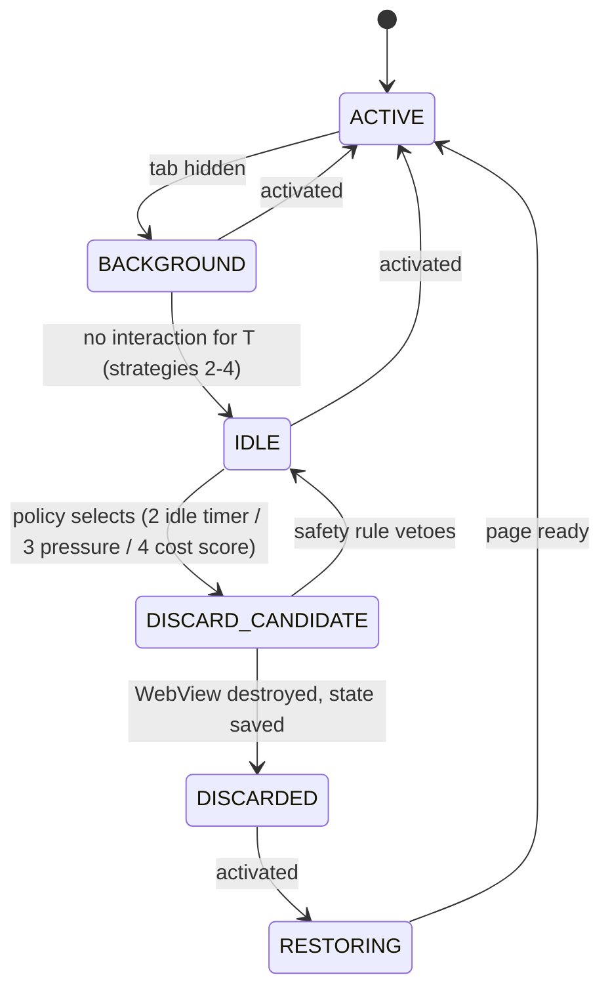

# Benchmark configurations

Configuration ids (`cfg-*`) are not pages (SCHEMA §8). They are defined here, and experiment pages list them in `configurations`.

## Competitors (master prompt §8 A–E)

| Id | Master prompt | What it is | Key settings |
|---|---|---|---|
| `cfg-chrome` | A | Google Chrome, **as-shipped defaults**. Chrome's own resource-saving features stay as shipped | Fresh `--user-data-dir` per launch, no extensions, no sign-in, policies recorded. Chrome Memory Saver is set **explicitly** by policy to its observed default, because sources disagree on the default ([measurement note](../raw/research/measurement-methodology.md) §6.1) |
| `cfg-edge` | B | Microsoft Edge, as-shipped defaults (sleeping tabs on by default) | Fresh profile, no extensions, no sign-in. Startup Boost disabled **only** because it invalidates startup boundaries (see fairness protocol) |
| `cfg-tauri-baseline` | C | Minimal Tauri 2 + WebView2 app: one window, one WebView, no Ferrum components (`comp-baseline-app`) | Same WebView2 runtime and environment options as Ferrum |
| `cfg-ferrum-nolifecycle` | D | Ferrum with every lifecycle policy off (strategy 1) | Security engine on, telemetry on at the benchmark level |
| `cfg-ferrum-adaptive` | E | Ferrum with the adaptive cost-aware policy (strategy 4) | Policy parameters from the training seeds only |

## Lifecycle strategies (master prompt §6)

| # | Strategy | Configuration | Behaviour (design detail belongs to `comp-resource-manager`, P7) |
|---|---|---|---|
| 1 | No application-level lifecycle management | `cfg-ferrum-nolifecycle` | Background tabs stay alive. The only throttling is whatever WebView2 does by itself, which is unknown: UNVERIFIED[phase-p7-lifecycle] |
| 2 | Fixed idle-time discard | `cfg-ferrum-fixed-idle` | After a fixed idle time T_idle (proposed 5 min, frozen at pre-registration), BACKGROUND → IDLE → DISCARD_CANDIDATE → DISCARDED, subject to the safety rules |
| 3 | Memory-pressure discard | `cfg-ferrum-mempressure` | Under a memory-pressure signal, discard the least recently used eligible tab until the pressure clears. Which Windows signal to use is UNVERIFIED[phase-p7-lifecycle] |
| 4 | Adaptive cost-aware | `cfg-ferrum-adaptive` | Choose per tab between keep, memory-target Low, suspend (sleep) and discard, using estimated memory size, restore cost and predicted reuse (GreedyDual-Size-like; [seed](../raw/research/related-work-seed.md) G1). Uses the objective in [ov-research-objective-function](ov-research-objective-function.md) |

Policies sit behind feature flags so that the same build runs every strategy (master prompt §6). Sleep and discard are different actions. TrySuspend and MemoryUsageTargetLevel are best-effort and must not be mixed ([Tauri/WebView2 note](../raw/research/tauri-webview2-capabilities.md) §6, VERIFIED).

The state names are the ones in master prompt §5 Phase 4. Where suspend (sleep) and memory-target-Low fit into the state machine is a P7 design decision for `comp-resource-manager`. Strategy 4 is the only one that uses them.

## Secondary, ablation and validation configurations

| Id | Purpose | Notes |
|---|---|---|
| `cfg-chrome-matched` | Matched comparison: Chrome with Memory Saver off and background freezing off by policy | **Labelled secondary** and never the headline. Master prompt §8 forbids disabling these features merely to improve Ferrum's results. Owner question R-Q1 |
| `cfg-edge-matched` | Matched comparison: Edge with sleeping tabs off | As above |
| `cfg-ferrum-fixed-idle` | Strategy 2 | See above |
| `cfg-ferrum-mempressure` | Strategy 3 | See above |
| `cfg-ferrum-nosecurity-bench` | Ablation for [exp-security-overhead](experiments/exp-security-overhead.md). Every policy decision returns "allow" | Benchmark-only build flag, never shipped, local fixtures only |
| `cfg-ferrum-shared-profile` | Isolation: every tab in the default profile | [exp-isolation-overhead](experiments/exp-isolation-overhead.md) |
| `cfg-ferrum-profile-per-site` | Isolation: one WebView2 profile per site in a shared browser process (`adr-0010`) | Depends on `risk-r01`. Tauri 2.12.1 does not expose the profile name ([Tauri/WebView2 note](../raw/research/tauri-webview2-capabilities.md) §6) |
| `cfg-ferrum-udf-per-site` | Isolation: one user data folder per site, so one browser process group per site | Works with Tauri today (`data_directory`) |
| `cfg-aa-<product>-1`, `cfg-aa-<product>-2` | A/A validation: the same product run as two arms | Measures the noise floor. Used only for validation and sample-size decisions, never as comparison evidence |

## Coverage matrix A to E

Master prompt §8 asks for comparisons between A (Chrome), B (Edge), C (Tauri baseline), D (Ferrum without adaptive lifecycle) and E (Ferrum with adaptive lifecycle). This matrix shows where each configuration is measured. **C1** = campaign C1 in `phase-p6-benchmark-harness`. **C2** = campaign C2 (task p7.11) in `phase-p7-lifecycle`. **C2b** = a proposed re-run in P7 of the C1 families, with E added and every listed configuration run again in new blocks (never pooled with C1).

| Experiment | A `cfg-chrome` | B `cfg-edge` | C `cfg-tauri-baseline` | D `cfg-ferrum-nolifecycle` | E `cfg-ferrum-adaptive` |
|---|---|---|---|---|---|
| [exp-baseline-footprint](experiments/exp-baseline-footprint.md) | C1, C2b | C1, C2b | C1, C2b | C1, C2b | C2b (proposed) |
| [exp-startup](experiments/exp-startup.md) | C1 | C1 | C1 | C1 | Not measured (proposed deviation, see below) |
| [exp-navigation](experiments/exp-navigation.md) | C1, C2b | C1, C2b | C1, C2b | C1, C2b | C2b (proposed) |
| [exp-rendering](experiments/exp-rendering.md) | C1, C2b | C1, C2b | C1, C2b | C1, C2b | C2b (proposed) |
| [exp-energy](experiments/exp-energy.md) | C1, C2b | C1, C2b | C1, C2b | C1, C2b | C2b (proposed; only if the energy metric is supported) |
| [exp-reliability](experiments/exp-reliability.md) | C1, C2b | C1, C2b | C1, C2b | C1, C2b | C2b (proposed) |
| [exp-lifecycle-policies](experiments/exp-lifecycle-policies.md) | C2 (M and L only, external reference) | C2 (M and L only, external reference) | Not applicable (one WebView, no tabs to manage) | C2 | C2 |
| [exp-security-overhead](experiments/exp-security-overhead.md) | Not applicable (Ferrum-only ablation) | Not applicable | Not applicable | C1 (with `cfg-ferrum-nosecurity-bench`) | Not applicable |
| [exp-isolation-overhead](experiments/exp-isolation-overhead.md) | Not applicable (Ferrum-only isolation variants) | Not applicable | Not applicable | C1 (as the isolation variants) | Not applicable |

**Why C2b.** Without it, E would be compared with A, B and C only on memory and restore latency (exp-lifecycle-policies). Nothing would show whether adaptive lifecycle management hurts responsiveness, reliability or energy relative to the browsers. E needs the adaptive policy, which exists only in P7, so the comparison cannot happen in C1. C2b re-runs the whole configuration set of each listed experiment in the same blocks, so that E is compared within blocks and never across campaigns.

**Proposed deviation: E is not measured in exp-startup.** Startup opens one tab (wl-static-info) and lifecycle policies act only on background tabs, so E is expected to behave like D at startup apart from the policy's initialisation cost. That expectation is UNVERIFIED[phase-p7-lifecycle]. If the owner prefers, exp-startup is added to C2b too.

**Owner decision needed (R-Q15 in [ov-research-plan](ov-research-plan.md)).** Either (a) approve C2b as above, which costs roughly one more campaign of P7 benchmark time, or (b) exclude E from those dimensions and record that as a deviation from master prompt §8 in the paper's limitations. Option (a) is recommended. **Cross-area gap:** `phase-p7-lifecycle` has no C2b task yet (C2 is p7.11). A task such as "p7.11b Campaign C2b: rerun the C1 families with cfg-ferrum-adaptive" must be added by the phases owner if the owner chooses (a).

## Settings that are the same in every configuration

Window size, display mode, viewport, the fixture server, cache policy (per workload), no extensions, no logins, and the same CDP attachment path. The full list is in [ov-research-fairness-protocol](ov-research-fairness-protocol.md).
