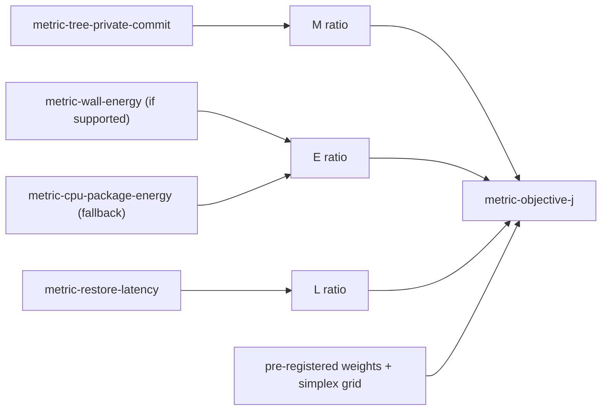

# Objective function J = αM + βE + γL

> **Novelty: none claimed.** Adding normalised objectives with a weighted sum is a common way to turn several objectives into one. A citation for this is still to be added: UNVERIFIED[phase-p8-research-paper]. Close prior art for cost-aware lifecycle decisions already appears in the verified seed list: GreedyDual-Size (G1), LRU-K (G3), ARC (G4), Edge sleeping tabs under memory pressure (B2), Chrome CPU-based freezing (A3) and Android App Standby Buckets (F2) ([ov-research-related-work-seed](ov-research-related-work-seed.md)). Any novelty claim needs the P8 literature review first (master prompt §6).

## Definition

For a trial *t* of configuration *c* on workload *w*, in block *b*:

- **M** = time-averaged [metric-tree-private-commit](metrics/metric-tree-private-commit.md) over the measurement window ÷ the same quantity for `cfg-ferrum-nolifecycle` in the same block and workload.
- **E** = energy per completed workload above idle baseline ÷ the same for `cfg-ferrum-nolifecycle` in the same block. The source is chosen in this order:
  1. [metric-wall-energy](metrics/metric-wall-energy.md), if it is `supported`.
  2. Otherwise [metric-cpu-package-energy](metrics/metric-cpu-package-energy.md), if it is `supported`, labelled "modeled CPU-package energy".
  3. Otherwise the E term is **dropped**: β = 0, the remaining weights are renormalised, and the objective is reported as **J_ML**. It is never estimated.
- **L** = mean [metric-restore-latency](metrics/metric-restore-latency.md) over all background-tab activations in the window ÷ the same for `cfg-ferrum-nolifecycle`. Every configuration has activations, so the term is always defined.
- **J = αM + βE + γL**, with α, β, γ ≥ 0 and α + β + γ = 1. Lower is better.

Because every term is a ratio to the same-block reference, **J(reference) = 1**. J < 1 means a better weighted trade-off than having no lifecycle management.

## Why normalise by a ratio to the reference

| Option | Problem | Decision |
|---|---|---|
| Min–max across the policies being compared | The scale depends on which policies are included and on outliers. Adding a policy changes every J value | Rejected |
| z-score | Depends on the sample. Not interpretable in physical units | Rejected |
| **Ratio to the same-block reference configuration** | Ratios inherit the reference's noise. This is mitigated by pairing within blocks and by bootstrapping whole blocks | **Chosen** (proposed) |

## Choosing the weights

The master prompt says the weights are "experimentally chosen". This plan reads that as: **choose them before seeing confirmatory data, then show how sensitive the conclusions are to them.** Fitting the weights to the confirmatory data so that a policy wins would be circular and is not allowed.

1. **Primary weight vector (proposed; owner question R-Q7):** α = β = γ = 1/3 if an energy metric is supported. Otherwise α = γ = 1/2 and β = 0. Equal weights are a neutral convention, not a claim about user preferences.
2. **Sensitivity analysis (pre-registered):** evaluate J on the simplex grid with step 0.1, which gives 66 weight vectors. For each vector, report the configuration with the lowest median J, and also how often each configuration wins across bootstrap replicates. Figure: a ternary plot with the regions where each policy wins.
3. **Tuning the adaptive policy's internal parameters** (thresholds, reuse predictor) uses only **development** activation-trace seeds and development trials. Confirmatory trials use fresh seeds that are frozen at pre-registration ([ov-research-statistical-analysis-plan](ov-research-statistical-analysis-plan.md)).
4. Any weight vector chosen after the data is seen is reported as **exploratory**.

## Known limitations

- M uses private commit. That is not the same as the user-perceived memory pressure on the system ([ov-research-threats-to-validity](ov-research-threats-to-validity.md)).
- A modeled package-energy E excludes DRAM and does not reflect wall energy ([seed](../raw/research/related-work-seed.md) E4).
- Taking the mean for L hides tail latency. The p95 is reported next to it as a secondary measure (hypothesis `hyp-10`).
- J is only meaningful for Ferrum configurations. Chrome and Edge are external reference points and are reported per term ([exp-lifecycle-policies](experiments/exp-lifecycle-policies.md)).
