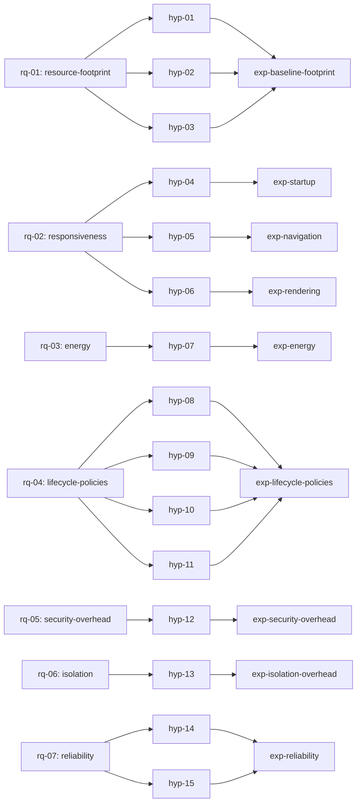

# Ferrum research plan (hub)

**Status:** `draft` (P0, planning only). **No experiments have been run and no measurements exist.** Every metric has support `unverified` and every hypothesis is `draft`.

Ferrum is both a usable app and a research project, weighted equally (`adr-0004`, [scoping decisions](../raw/01-scoping-decisions.md)). The research track follows master prompt §§6–10 and §13 ([master prompt](../raw/00-master-prompt.md)). It compares five products and configurations (A Chrome, B Edge, C minimal Tauri baseline, D Ferrum without lifecycle management, E Ferrum with adaptive lifecycle management) and four lifecycle strategies. All of them are defined in [ov-research-configurations](ov-research-configurations.md).

## Map

## Research questions, hypotheses, experiments

| RQ | Topic | Hypotheses | Experiments |
|---|---|---|---|
| [rq-01](questions/rq-01-resource-footprint.md) | Resource footprint versus browsers and baseline | [hyp-01](hypotheses/hyp-01-idle-memory-vs-browsers.md), [hyp-02](hypotheses/hyp-02-overhead-vs-tauri-baseline.md), [hyp-03](hypotheses/hyp-03-background-cpu-without-lifecycle.md) | [exp-baseline-footprint](experiments/exp-baseline-footprint.md) |
| [rq-02](questions/rq-02-responsiveness.md) | Startup, navigation and rendering responsiveness | [hyp-04](hypotheses/hyp-04-startup-window-visible.md), [hyp-05](hypotheses/hyp-05-navigation-non-inferiority.md), [hyp-06](hypotheses/hyp-06-rendering-non-inferiority.md) | [exp-navigation](experiments/exp-navigation.md), [exp-rendering](experiments/exp-rendering.md), [exp-startup](experiments/exp-startup.md) |
| [rq-03](questions/rq-03-energy.md) | Defensible energy measurement and comparison | [hyp-07](hypotheses/hyp-07-energy-per-workload.md) | [exp-energy](experiments/exp-energy.md) |
| [rq-04](questions/rq-04-lifecycle-policies.md) | Adaptive lifecycle policies versus fixed policies | [hyp-08](hypotheses/hyp-08-adaptive-reduces-memory.md), [hyp-09](hypotheses/hyp-09-adaptive-lowest-objective.md), [hyp-10](hypotheses/hyp-10-adaptive-restore-latency.md), [hyp-11](hypotheses/hyp-11-lifecycle-safety.md) | [exp-lifecycle-policies](experiments/exp-lifecycle-policies.md) |
| [rq-05](questions/rq-05-security-overhead.md) | Overhead of security controls | [hyp-12](hypotheses/hyp-12-security-overhead-small.md) | [exp-security-overhead](experiments/exp-security-overhead.md) |
| [rq-06](questions/rq-06-isolation.md) | Isolation model: shared resources and overhead | [hyp-13](hypotheses/hyp-13-profiles-cheaper-than-udfs.md) | [exp-isolation-overhead](experiments/exp-isolation-overhead.md) |
| [rq-07](questions/rq-07-reliability.md) | Reliability over long sessions and failures | [hyp-14](hypotheses/hyp-14-memory-growth-non-inferior.md), [hyp-15](hypotheses/hyp-15-restore-and-recovery.md) | [exp-reliability](experiments/exp-reliability.md) |

## Pages in this area

| Page | Purpose |
|---|---|
| [ov-research-configurations](ov-research-configurations.md) | Configurations A–E, the four lifecycle strategies, ablations, A/A |
| [ov-research-objective-function](ov-research-objective-function.md) | J = αM + βE + γL: measurement, normalisation, choice of weights, sensitivity analysis (not claimed novel) |
| [ov-research-workload-catalog](ov-research-workload-catalog.md) | The 10 controlled local workloads, the supplementary public sites, fixture hosting |
| [ov-research-fairness-protocol](ov-research-fairness-protocol.md) | Equivalence rules, resource-saving features, version pinning, per-trial environment record |
| [ov-research-statistical-analysis-plan](ov-research-statistical-analysis-plan.md) | Pre-registration, bootstrap CIs, effect sizes, practical thresholds, multiple comparisons, failed runs |
| [ov-research-threats-to-validity](ov-research-threats-to-validity.md) | Construct, internal, external and conclusion validity, with mitigations |
| [ov-research-traceability](ov-research-traceability.md) | RQ → hypothesis → experiment → metric → raw data → script → figure → conclusion |
| [ov-research-related-work-seed](ov-research-related-work-seed.md) | Summary of the VERIFIED seed entries only (not a literature review) |
| [ov-research-experiment-log](ov-research-experiment-log.md) | Append-only experiment log (master prompt §14) |
| [ov-research-paper-plan](ov-research-paper-plan.md) | Working title, outline, template (acmart proposed, `adr-0017`), rules |
| `research/metrics/` | 27 metric definitions (`metric-*`) |
| `research/workloads/` | 12 workload definitions (`wl-*`) |

## Research work by phase

| Phase | Research work in that phase |
|---|---|
| `phase-p0-planning` | This plan. Hypotheses stay `draft` and every metric support status stays `unverified` |
| `phase-p1-foundation` | Recording the environment (CPU model, RAM). Literature review protocol and the first reading batch (p1.14); further batches run in P2–P6 |
| `phase-p4-security` | [metric-policy-eval-latency](metrics/metric-policy-eval-latency.md) instrumentation built into the security engine |
| `phase-p5-telemetry` | Implement and **validate** the memory, CPU, startup and navigation metrics (A/A, allocation probe, clock alignment). Pilot data is exploratory only |
| `phase-p6-benchmark-harness` | Harness, fixtures, configurations, energy validation gate, A/A noise floor, **pre-registration freeze**, then the confirmatory runs of every family except lifecycle |
| `phase-p7-lifecycle` | Policies behind feature flags, train/test split of activation traces, freeze, then [exp-lifecycle-policies](experiments/exp-lifecycle-policies.md) (campaign C2) and, if the owner approves R-Q15 (Q-208), campaign C2b (task p7.14) (the C1 families re-run with `cfg-ferrum-adaptive`, see [ov-research-configurations](ov-research-configurations.md#coverage-matrix-a-to-e)). Closes the literature review and gets the owner's approval of the novelty assessment (p7.12) |
| `phase-p8-research-paper` | Analysis, figures and manuscript. Related Work is written from the review closed in P7 (p7.12); novelty claims are limited to the approved assessment |

## Integrity rules for this area

1. Never report a number as an observation unless it links a file under `raw/bench/` or `raw/evidence/` (SCHEMA §7.3).
2. If an energy metric fails its validation gate, mark it `unsupported`. Never estimate it (master prompt §7).
3. Hypotheses, thresholds, metric families and analysis scripts are frozen before confirmatory data is collected. Anything decided afterwards is labelled exploratory.
4. No novelty claim before the literature review is closed and the owner approves the novelty assessment (p7.12 in P7). The seed list already contains close prior art ([ov-research-related-work-seed](ov-research-related-work-seed.md)).
5. Every run is kept, including failed, aborted and invalidated runs. Nothing is cherry-picked.
6. Vendor percentages (Chrome Memory Saver, Edge sleeping tabs) are never used as baselines.

## Open questions raised by the research plan (for the owner)

The questions this page raised are registered in the canonical register
[ov-open-questions](../overview/ov-open-questions.md), which alone states what each one blocks. The local
labels R-Qn map to register ids as follows:

| Label | Register id |
|---|---|
| R-Q1 fairness framing | [Q-117](../overview/ov-open-questions.md#q-117-fairness-framing-as-shipped-defaults-matched-configuration-or-both) |
| R-Q2 Chrome build | [Q-118](../overview/ov-open-questions.md#q-118-branded-chrome-or-chrome-for-testing) |
| R-Q3 WebView2 runtime | [Q-119](../overview/ov-open-questions.md#q-119-webview2-runtime-evergreen-fixed-version-or-both) |
| R-Q4 wall-power meter | [Q-122](../overview/ov-open-questions.md#q-122-is-a-wall-power-meter-available) |
| R-Q5 PawnIO driver and elevated samplers | [Q-123](../overview/ov-open-questions.md#q-123-approve-the-pawnio-driver-and-an-elevated-energy-sampler) |
| R-Q6 CPU model and RAM | [Q-116](../overview/ov-open-questions.md#q-116-benchmark-machine-exact-cpu-model-and-ram) |
| R-Q7 thresholds and J weights | [Q-201](../overview/ov-open-questions.md#q-201-practical-significance-thresholds-and-the-j-weight-vector) |
| R-Q8 local fixture scheme | [Q-202](../overview/ov-open-questions.md#q-202-local-fixture-scheme-loopback-http-exemption-or-a-locally-trusted-development-ca) |
| R-Q9 public websites | [Q-120](../overview/ov-open-questions.md#q-120-representative-public-websites-for-supplementary-workloads) |
| R-Q10 raw data location | [Q-203](../overview/ov-open-questions.md#q-203-raw-benchmark-data-location-and-size-policy) |
| R-Q11 one campaign or per phase | [Q-204](../overview/ov-open-questions.md#q-204-one-confirmatory-campaign-or-one-per-phase) |
| R-Q12 reliability trial count | [Q-205](../overview/ov-open-questions.md#q-205-fewer-trials-for-the-reliability-soak) |
| R-Q13 related-work sections | [Q-206](../overview/ov-open-questions.md#q-206-paper-outline-merge-the-two-related-work-sections) |
| R-Q14 overview pages under research/ | [Q-207](../overview/ov-open-questions.md#q-207-schema-gap-overview-pages-under-wikiresearch-and-wikirisks) |
| R-Q15 configuration E outside the lifecycle experiment | [Q-208](../overview/ov-open-questions.md#q-208-configuration-e-outside-the-lifecycle-experiment-p7-campaign-c2b-or-documented-deviation) (P7 task p7.14) |

Two deliberate departures from the master prompt need the owner's sign-off: "time to interactive" is
replaced by FCP/LCP plus LoAF (Q-115), and the `h-*`/`m-*` id prefixes are written `hyp-*`/`metric-*` to
follow SCHEMA §8 (Q-217).
