# Statistical analysis plan

Sources: master prompt §10 ([master prompt](../raw/00-master-prompt.md)) and the [measurement note](../raw/research/measurement-methodology.md) §7 (SciPy bootstrap defaults VERIFIED; effect-size and correction references VERIFIED from Crossref metadata only). Analysis is in Python (`adr-0013`, `comp-research-analysis`).

```mermaid
flowchart LR
    prereg["Pre-registration freeze"] --> runs["Confirmatory blocks"]
    runs --> raw["raw/bench run files (immutable)"]
    raw --> validity["Validity checks (versions, process set, equivalence)"]
    validity --> summaries["Per-trial summaries"]
    summaries --> inference["Bootstrap CI + permutation test + Holm"]
    inference --> classify["Practical-significance classification"]
    classify --> report["Tables and figures (all runs reported)"]
```

## 1. Pre-registration

- **What is frozen:** the hypotheses (prediction, null, thresholds), the primary metric per hypothesis, the test families, α, the confirmatory configurations and workloads, the trial counts, the exclusion criteria, the primary J weights, the activation-trace seeds, and the analysis-script hashes.
- **When:** at the end of `phase-p6-benchmark-harness`, before any confirmatory run of the P6 families. For `exp-lifecycle-policies` it happens before confirmatory runs in `phase-p7-lifecycle`.
- **How:** the owner approves each `hyp-*` page in Claude Code and Claude records it (adr-0023). The status changes `draft` → `preregistered` (a volatile key, so the approval stays valid). A `decide` log entry records the git commit sha. Any later change makes the affected analysis **exploratory** and is labelled that way everywhere.

## 2. Design and the unit of analysis

- **Randomised complete blocks.** Each block runs every (configuration × workload) cell once, in a random order from a recorded seed. Use at least 30 blocks where practical (master prompt §10). Documented exception: `exp-reliability` uses 10 (R-Q12).
- **The unit of analysis is the trial** (one launch running one workload). Samples within a trial, such as many navigations or frames, are first **summarised per trial** (median, p95, time average). They are never treated as independent observations, which would be pseudo-replication.
- **Warm-ups** are excluded from inference but kept in the raw data and in counts.
- **Pilot and A/A runs** (P5/P6) are used only for the noise floor and the sample-size decision. They are never pooled with confirmatory data.

## 3. Descriptive statistics (every metric, every cell)

Report n (valid, invalid, failed), mean, median, SD, IQR, min/max, and p95/p99 where the sample supports them.

**Percentile rule (project convention, DERIVED):** compute the q-quantile from a sample only when it has at least 10/(1−q) observations, so that at least 10 observations lie above it. That means 200 for p95 and 1000 for p99. Otherwise report "n too small".

## 4. Inference

| Item | Choice |
|---|---|
| Primary statistic | Difference and ratio of medians of per-trial summaries (configuration vs comparator) |
| CI | 95% bootstrap, **BCa**, 9999 resamples, fixed and recorded seed. Resample whole **blocks** so the pairing is kept. Fall back to the percentile method when BCa is degenerate and say so. These are SciPy's defaults (VERIFIED, measurement note §7.3). Whether `scipy.stats.bootstrap` supports block/paired resampling as specified (`paired=True` or a custom statistic) is UNVERIFIED[phase-p6-benchmark-harness] |
| Hypothesis test | Sign-flip permutation test on within-block paired differences, two-sided unless the hypothesis is directional and pre-registered as one-sided |
| Non-inferiority | The one-sided 95% CI bound of the ratio compared with 1 + margin (hyp-02, hyp-05, hyp-06, hyp-12, hyp-14) |
| Proportions | Exact Clopper–Pearson intervals. Counts per unit time use exact Poisson intervals |
| Slopes | Theil–Sen per trial, then bootstrap over trials |
| Effect sizes | The raw difference in natural units with its CI (always), the ratio, Hedges' g and Cliff's delta |

## 5. Multiple comparisons

- **Confirmatory families:** one family per research question (`rq-01` … `rq-07`), containing every pre-registered test of that question's hypotheses (each competitor × each workload × each primary metric). Control is **Holm** at a family-wise α = 0.05. The citation for Holm's method still needs checking: UNVERIFIED[phase-p8-research-paper] (the Crossref lookup failed, measurement note §7.5).
- **Exploratory and secondary metrics:** Benjamini–Hochberg FDR at q = 0.05, always labelled exploratory.

## 6. Practical significance, defined in advance

Every hypothesis states a **practical threshold** (proposed values are on the hyp pages and frozen at pre-registration; owner question R-Q7). Each comparison is classified into exactly one of four outcomes. The rules are applied **in this order**, and the first rule that matches decides the outcome, so the outcomes are mutually exclusive:

| Order | Outcome | Condition |
|---|---|---|
| 1 | Evidence of no meaningful difference | The CI lies entirely inside ±threshold (equivalence), **whether or not** the test is significant |
| 2 | Practically meaningful | The test is significant after Holm **and** the CI lies entirely beyond the threshold (on one side) |
| 3 | Detectable but not practically meaningful | Significant after Holm, but the CI overlaps the threshold boundary (rules 1 and 2 did not match) |
| 4 | Inconclusive | Anything else (not significant and the CI is not entirely inside ±threshold) |

## 7. Power and sample size

The measurement note gives a reference figure: with n = 30 per arm, a two-sided **independent two-sample** test at α = 0.05 with 80% power detects only standardised effects of about d ≈ 0.72 (normal approximation; measurement note §7.2, DERIVED). That figure does **not** describe this plan's design. This plan uses randomised complete blocks with within-block paired differences and a sign-flip permutation test, and the power of a paired design depends on the within-block correlation, which is unknown until data exists. The power of the block design is therefore computed in P6 from the within-block variance of the A/A and pilot runs (DERIVED at that point); until then it is UNVERIFIED[phase-p6-benchmark-harness]. The A/A noise floor from P6 decides the final block count:

- If the minimum detectable difference at 30 blocks is larger than a hypothesis's practical threshold, either raise the block count up to a pre-registered cap of 60 (proposed), or pre-register the hypothesis as "underpowered for its threshold".
- No optional stopping. Sequential designs are used only if they are pre-registered.

## 8. Failed, invalid and outlier runs (no cherry-picking)

- **Every run is kept** in `raw/bench/`, including failures, timeouts, crashes and aborted blocks.
- **Pre-registered invalidation criteria only:**
  1. A product version changed during the block (the block is invalid).
  2. A process belonging to the product was outside the attributed process set S(t) under the product's pre-registered attribution mode ([ov-research-fairness-protocol](ov-research-fairness-protocol.md) rule 3).
  3. An equivalence-beacon mismatch.
  4. Idle-baseline or temperature drift beyond tolerance (the session is invalid).

  Invalid runs are reported, with counts per configuration.
- **Failures are outcomes.** Failure rates are reported per configuration. A sensitivity analysis treats failed trials as the worst rank.
- **No outlier removal.** Robust statistics (medians, Cliff's delta) are used instead.
- Re-running a cell to replace a failed trial is **not allowed**. Extra blocks are added only under the pre-registered sample-size rule.

## 9. Reproducibility of the analysis

Analysis scripts live in `analysis/scripts/` (TBD). They are deterministic: seeds are recorded, dependency versions are locked, and inputs come only from `raw/bench/<run-id>/`. Every figure and table records the script hash and the run ids it used. The planned Python dependencies are SciPy, NumPy, pandas and matplotlib, with exact versions pinned in P6. Whether they install on Python 3.12.10 is UNVERIFIED[phase-p6-benchmark-harness].

## References (metadata verified via Crossref per the measurement note; contents not re-read)

Efron 1979 (doi 10.1214/aos/1176344552); Efron 1987, BCa (doi 10.1080/01621459.1987.10478410); Hedges 1981 (doi 10.3102/10769986006002107); Cliff 1993 (doi 10.1037/0033-2909.114.3.494); Benjamini & Hochberg 1995 (doi 10.1111/j.2517-6161.1995.tb02031.x); Georges et al., OOPSLA 2007 (doi 10.1145/1297027.1297033); Mytkowicz et al., ASPLOS 2009 (doi 10.1145/1508244.1508275); Kalibera & Jones, ISMM 2013 (doi 10.1145/2464157.2464160). Any statement about their **content** has to be re-read before it is cited in the paper.
