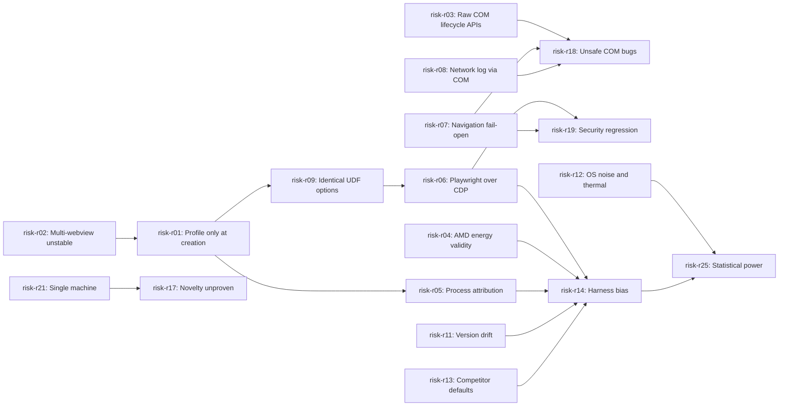

# Risk register

This page is the overview of every Ferrum risk. Each risk has its own approvable page in this folder (SCHEMA §6.5). Risks risk-r01 to risk-r06 are the owner's initial list ([scoping decisions](../raw/01-scoping-decisions.md)); risk-r07 onward were added in P0 from the research notes in [raw/research/](../raw/research/).

Likelihood and impact use the SCHEMA §6.5 scales (1 = rare or negligible, 5 = almost certain or blocks a milestone or invalidates research). They are **planning judgements**, not measurements, and are re-scored at every phase exit review.

> **Schema note.** SCHEMA §4.1 allows only `type: risk` under `risks/`. This overview page uses `type: overview` and so trips `FM-TYPE-DIR` until the owner either approves a one-line schema change (allow `overview` under `risks/`) or the page moves to `overview/`. Its id `ov-risk-register` is kept stable either way.

## Heat map (likelihood x impact)

Cells list risk ids. Score = likelihood x impact; scores of 15 or more are treated as **high** and must be reviewed at every phase gate.

| Likelihood \ Impact | 1 negligible | 2 minor | 3 moderate | 4 major | 5 severe |
|---|---|---|---|---|---|
| **5 almost certain** |  |  | [r03](risk-r03-raw-com-lifecycle-apis.md), [r08](risk-r08-network-log-needs-raw-com.md), [r15](risk-r15-session-interruption.md), [r21](risk-r21-single-machine-validity.md) | [r04](risk-r04-amd-energy-measurement.md) |  |
| **4 likely** |  |  | [r06](risk-r06-playwright-cdp-webview2.md), [r10](risk-r10-google-oauth-embedded.md), [r20](risk-r20-dependency-toolchain-churn.md), [r25](risk-r25-statistical-power.md) | [r01](risk-r01-webview2-profile-at-creation.md), [r02](risk-r02-tauri-multiwebview-unstable.md), [r07](risk-r07-navigation-filter-fail-open.md), [r11](risk-r11-evergreen-version-drift.md), [r12](risk-r12-os-noise-thermal.md), [r16](risk-r16-scope-creep.md), [r17](risk-r17-novelty-not-established.md) | [r05](risk-r05-process-tree-attribution.md), [r13](risk-r13-competitor-feature-fairness.md) |
| **3 possible** |  | [r24](risk-r24-owner-review-bottleneck.md) | [r09](risk-r09-shared-udf-identical-options.md) | [r18](risk-r18-unsafe-com-bugs.md) | [r14](risk-r14-harness-instrumentation-bias.md), [r19](risk-r19-security-regression-ipc.md), [r23](risk-r23-lifecycle-data-loss.md) |
| **2 unlikely** |  |  |  | [r22](risk-r22-approval-integrity.md) |  |
| **1 rare** |  |  |  |  |  |

## All risks by score

| Risk | Short name | L | I | Score | Status | Owner phase | Spike phase (proposed); assigned task |
|---|---|---|---|---|---|---|---|
| [risk-r04](risk-r04-amd-energy-measurement.md) | AMD energy validity | 5 | 4 | 20 | open | `phase-p6-benchmark-harness` | phase-p6-benchmark-harness; task p6.9 |
| [risk-r05](risk-r05-process-tree-attribution.md) | Process attribution | 4 | 5 | 20 | open | `phase-p5-telemetry` | phase-p5-telemetry; task p5.2 (early check in p1.5) |
| [risk-r13](risk-r13-competitor-feature-fairness.md) | Competitor defaults | 4 | 5 | 20 | open | `phase-p6-benchmark-harness` | phase-p6-benchmark-harness |
| [risk-r01](risk-r01-webview2-profile-at-creation.md) | Profile only at creation | 4 | 4 | 16 | open | `phase-p1-foundation` | phase-p1-foundation; task p1.6 |
| [risk-r02](risk-r02-tauri-multiwebview-unstable.md) | Multi-webview unstable | 4 | 4 | 16 | open | `phase-p1-foundation` | phase-p1-foundation; task p1.5 |
| [risk-r07](risk-r07-navigation-filter-fail-open.md) | Navigation fail-open | 4 | 4 | 16 | open | `phase-p4-security` | phase-p4-security |
| [risk-r11](risk-r11-evergreen-version-drift.md) | Version drift | 4 | 4 | 16 | open | `phase-p6-benchmark-harness` | phase-p6-benchmark-harness |
| [risk-r12](risk-r12-os-noise-thermal.md) | OS noise and thermal | 4 | 4 | 16 | open | `phase-p6-benchmark-harness` | phase-p6-benchmark-harness |
| [risk-r16](risk-r16-scope-creep.md) | Scope creep | 4 | 4 | 16 | open | `phase-p0-planning` | none |
| [risk-r17](risk-r17-novelty-not-established.md) | Novelty unproven | 4 | 4 | 16 | open | `phase-p8-research-paper` | none (P8 review) |
| [risk-r03](risk-r03-raw-com-lifecycle-apis.md) | Raw COM lifecycle APIs | 5 | 3 | 15 | open | `phase-p7-lifecycle` | phase-p1-foundation; task p1.7 |
| [risk-r08](risk-r08-network-log-needs-raw-com.md) | Network log via COM | 5 | 3 | 15 | open | `phase-p5-telemetry` | phase-p5-telemetry |
| [risk-r14](risk-r14-harness-instrumentation-bias.md) | Harness bias | 3 | 5 | 15 | open | `phase-p6-benchmark-harness` | phase-p6-benchmark-harness |
| [risk-r15](risk-r15-session-interruption.md) | Session interruption | 5 | 3 | 15 | mitigating | `phase-p1-foundation` | (protocol drill in P1) |
| [risk-r19](risk-r19-security-regression-ipc.md) | Security regression | 3 | 5 | 15 | open | `phase-p4-security` | phase-p2-minimal-container |
| [risk-r21](risk-r21-single-machine-validity.md) | Single machine | 5 | 3 | 15 | open | `phase-p8-research-paper` | none |
| [risk-r23](risk-r23-lifecycle-data-loss.md) | Lifecycle data loss | 3 | 5 | 15 | open | `phase-p7-lifecycle` | phase-p7-lifecycle |
| [risk-r06](risk-r06-playwright-cdp-webview2.md) | Playwright over CDP | 4 | 3 | 12 | open | `phase-p6-benchmark-harness` | phase-p1-foundation (spike S4); task p1.8 |
| [risk-r10](risk-r10-google-oauth-embedded.md) | Google OAuth blocked | 4 | 3 | 12 | open | `phase-p2-minimal-container` | phase-p2-minimal-container |
| [risk-r18](risk-r18-unsafe-com-bugs.md) | Unsafe COM bugs | 3 | 4 | 12 | open | `phase-p1-foundation` | phase-p1-foundation |
| [risk-r20](risk-r20-dependency-toolchain-churn.md) | Dependency churn | 4 | 3 | 12 | open | `phase-p1-foundation` | phase-p1-foundation |
| [risk-r25](risk-r25-statistical-power.md) | Statistical power | 4 | 3 | 12 | open | `phase-p6-benchmark-harness` | phase-p6-benchmark-harness |
| [risk-r09](risk-r09-shared-udf-identical-options.md) | Identical UDF options | 3 | 3 | 9 | open | `phase-p3-tabs-sessions` | (in r01/r02 spikes) |
| [risk-r22](risk-r22-approval-integrity.md) | Approval integrity | 2 | 4 | 8 | open | `phase-p0-planning` | phase-p0-planning |
| [risk-r24](risk-r24-owner-review-bottleneck.md) | Review bottleneck | 3 | 2 | 6 | open | `phase-p0-planning` | none |

## Risks by owner phase

- `phase-p0-planning`: [risk-r16](risk-r16-scope-creep.md), [risk-r22](risk-r22-approval-integrity.md), [risk-r24](risk-r24-owner-review-bottleneck.md)
- `phase-p1-foundation`: [risk-r01](risk-r01-webview2-profile-at-creation.md), [risk-r02](risk-r02-tauri-multiwebview-unstable.md), [risk-r15](risk-r15-session-interruption.md), [risk-r18](risk-r18-unsafe-com-bugs.md), [risk-r20](risk-r20-dependency-toolchain-churn.md)
- `phase-p2-minimal-container`: [risk-r10](risk-r10-google-oauth-embedded.md)
- `phase-p3-tabs-sessions`: [risk-r09](risk-r09-shared-udf-identical-options.md)
- `phase-p4-security`: [risk-r07](risk-r07-navigation-filter-fail-open.md), [risk-r19](risk-r19-security-regression-ipc.md)
- `phase-p5-telemetry`: [risk-r05](risk-r05-process-tree-attribution.md), [risk-r08](risk-r08-network-log-needs-raw-com.md)
- `phase-p6-benchmark-harness`: [risk-r04](risk-r04-amd-energy-measurement.md), [risk-r06](risk-r06-playwright-cdp-webview2.md), [risk-r11](risk-r11-evergreen-version-drift.md), [risk-r12](risk-r12-os-noise-thermal.md), [risk-r13](risk-r13-competitor-feature-fairness.md), [risk-r14](risk-r14-harness-instrumentation-bias.md), [risk-r25](risk-r25-statistical-power.md)
- `phase-p7-lifecycle`: [risk-r03](risk-r03-raw-com-lifecycle-apis.md), [risk-r23](risk-r23-lifecycle-data-loss.md)
- `phase-p8-research-paper`: [risk-r17](risk-r17-novelty-not-established.md), [risk-r21](risk-r21-single-machine-validity.md)

## How the technical risks connect

The diagram shows which risks feed others. It illustrates only; each page's `related` list is the source of truth.

## Decisions the owner needs to make to lower risk

These are proposed open questions for `ov-open-questions` (the owner of that page assigns the `Q-NNN` numbers).

| Topic | Lowers | Options |
|---|---|---|
| Profile route for per-site isolation | risk-r01, risk-r02 | (a) wait for Tauri PR #16054, (b) patch tauri-runtime-wry, (c) raw-COM tab controllers, (d) per-site data folders |
| PawnIO driver install and elevated sampler | risk-r04 | approve / decline |
| Wall-power meter | risk-r04, risk-r21 | available / not available (energy then limited to modeled CPU-package energy or unsupported) |
| Exact CPU model and RAM | risk-r04, risk-r05, risk-r21 | owner states them |
| Fairness framing | risk-r13 | as-shipped defaults, matched configuration, or both (recommended both) |
| Chrome build | risk-r11 | branded Chrome with updates blocked, or Chrome for Testing |
| WebView2 runtime for Ferrum | risk-r11 | Evergreen, Fixed Version, or both |
| Query-string redaction in the network log | risk-r08 | keep full URLs locally / redact |
| Local commits by Claude | risk-r15 | authorise per-task local commits (adr-0011) / owner commits |
| Fixture origins over HTTP on loopback in test builds | qual-security-testing-plan | allow test-only loopback exception / install a test CA / other |
| Second benchmark machine | risk-r21 | available / not available |

## Maintenance rules

1. A new risk gets the next free id (`risk-r26` onward), its own page, a row in this register and a line in `index.md`, in the same edit.
2. At every phase exit gate (see [qual-phase-gate-checklist](../quality/qual-phase-gate-checklist.md)), re-score each risk whose `owner_phase` is that phase or a later one, and set status (`mitigating`, `resolved`, `realized`, `tolerated`) with evidence.
3. Once a phase page assigns a spike task id, set that risk's `spike` field to it.
4. A realised risk triggers its documented fallback; any fallback that changes an accepted decision goes through DECIDE (SCHEMA §9.4).
